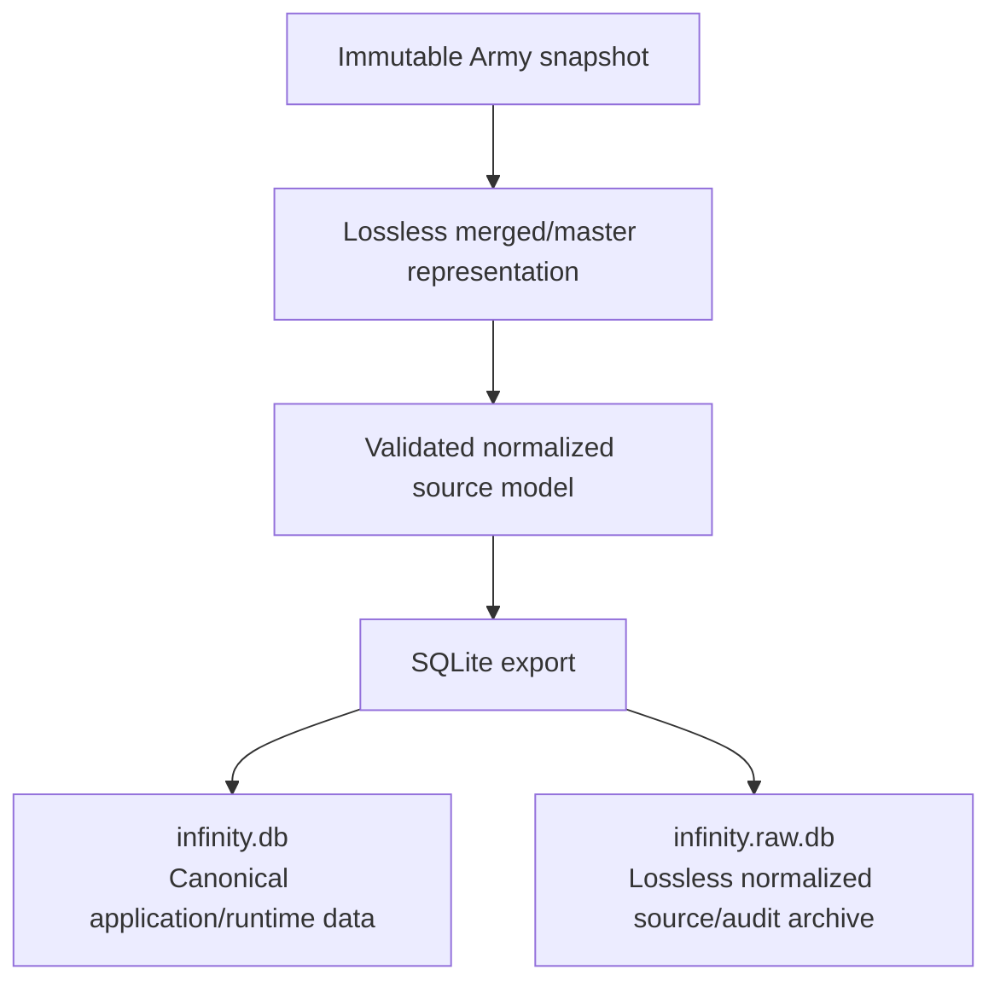
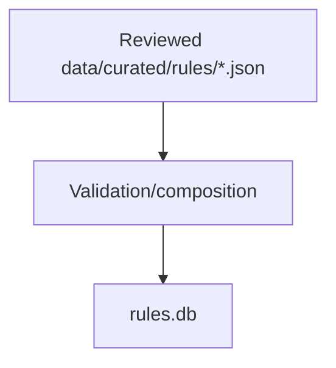

# Data model

**Project domain:** Data processing

This document owns InfinityDB's **current semantic and persistence model**. It describes what the
source means to InfinityDB, which abstractions the project introduces, how those facts are stored,
and which invariants runtime queries rely on. Historical audit counts, release benchmarks, and
migration chronology belong in Git history or `docs/CHANGELOG.md`, not in this current-state
contract.

Unless explicitly marked otherwise, statements below describe the 1.0
repository model. **Dated source-variant review notes** record the findings
and state of an earlier migration step, not the present implementation status;
the maintained publication, API and browser contracts take precedence.
Release/CI status belongs to [releasing](releasing.md) and [CI](ci.md),
not this data-model specification.

## Pipeline and persistent artifacts

Army-derived data flows through three conceptual layers:

Curated rules data follows a separate path:

The two runtime databases are intentionally separate because Army data and reviewed rules knowledge
have different sources, provenance, and update cadence.

**Optional legacy-source annexes:** The `reinforcements-extra-n4-reference`
collection is deliberately separate from `n5-core-v5.3`. Its three
current-visibility records (`rule:reinforcements-extra`, `skill:commlink`,
`skill:request-reinforcements`) explain a **still-referenced optional
N5-era mode through N4-origin procedures**, with explicit source-edition
notices. They do not assert that the N4 annex has been reissued or adopted
unchanged for N5. Commlink retains the official Army Skill family link;
Request Reinforcements is a rules-only `tactical-phase-step`, with no Army
carrier and no core Orders/AROs declaration type. `Commlink (+X)` is
now mapped in the **curated source** to two exact `reviewed-extra`
entries: Army Skill 260 extras `298/TEXT:+1` and `299/TEXT:+2`,
respectively `max-trooper-count-increase` by one or two, scoped
solely to `optional-reinforcements-extra-army-list`. The
validator rejects any other source signature or effect scope, and
fresh exports expose the typed effects. The reviewed (+1)/(+2) semantics were first promoted into the
tracked v9 `rules.db` through guarded paired publication. They remain
in the tracked v10 database. Its normalized deployed-object tables
supersede the formerly matched standalone JSON; all 17 reviewed
objects and their source evidence are retained.
Reinforcement list legality is not calculated.
Separate N5-native procedural authority verification remains open.
The optional Rule detail page also exposes a browser-only list of currently
playable Reinforcement Sections, their explicit `parent_armies` from
`/api/armies`, and direct links to each Section's Unit Explorer pool and
Army overview card. It does not infer legality, assign Section units to
Main Sections, or create new persistent Army identities.

For weapon families such as Mines, a shared curated rule describes only the common
mechanics. The individual Army weapon profile identifies ammunition, PS, Saving Rolls,
and Traits; the corresponding ammunition, State, and Trait rules determine the
weapon-specific effects. Attaching `weapon:mines` to a weapon
does not create a generic "ordinary Mine" weapon or make the variants interchangeable.
Variant-specific effects require their own source-derived weapon profile and, where
necessary, curated exceptions or relationships. A reviewed family clause is not
evidence that every named weapon variant has complete rules coverage.
An Army Weapon source ID can also cover multiple modes (Kobra Pistol: source `221`,
BS Mode and CC Mode). Curated source rules may target an exact source ID *and*
mode, but must attach to that one profile only, not to the parent Weapon/source
variant or sibling modes. Mode qualifiers describe identity, not permission to
resolve a disputed Trait automatically.

### Weapon profile row and API contract

Army `metadata_weapons` rows are source profiles, not normalized weapon behaviors.
The catalog API preserves each profile's source ID and mode as row identity, including
mode-specific rows, and exposes the source-backed ammunition ID and label, type, Burst,
Damage, Saving, Saving count, profile text, Traits, and range bands. It does not merge
sibling modes into one profile.

Burst, Damage, Saving, and Saving count remain source values rather than parsed
numbers or enums. Profile text remains source text; Traits and distance bands are
decoded into lists/maps without interpreting their rules. A source `distance = null`
currently projects as `ranges: {}`; this means no range bands were supplied to the
projection, not an adjudication of weapon reach. The browser omits the range table
when there are no bands. Blank or sentinel Saving values may display as `--`, a
presentation fallback that does not change the source value or establish a game
effect. Conditional wording and other source sentinels are not evaluated.

The existing exact-profile enrichments remain narrow and source-pinned, including
reviewed Ammunition composition and Combined Saving Roll annotations. No generic
condition or sentinel field is needed for the current profile model. Any future
structured status must follow a source-reviewed distinction; display punctuation
alone is not evidence for new semantics.

For reviewed profile-only Weapons, opt-in complete builds now materialize
Weapon Chart citations in Rules v12 (compatibility 14). The relational
`weapon_chart_profile_citations` table is keyed by exact Weapon/source-profile ID
and a non-null mode key (`''` for an unqualified mode, `mode:<name>` otherwise);
read projections restore the original nullable mode. A source-FK-backed metadata
row pins the current primary PDF identity, page range, reviewed decision SHA-256,
selected Army byte identity and complete 62-Weapon/69-profile inventory. Each
Weapon also retains its canonical slug/name and complete Army profile fingerprint.
The embedded reader validates source/page integrity, a deterministic content
digest, exact profile fingerprints and complete modes against the selected Army.
It does not read curation or the original JSON at runtime. The tracked v10
release continues to use the byte-paired
`data/generated/weapon-profile-sources.json` until P2.6. A mismatched embedded
source is rejected; older absent or independently supplied mixed-pair JSON
exposes `profile_citations_available: false`. Each Weapon profile has a
`profile_citations` list: an empty list means no reviewed profile-chart
citation was attached, not that no shared rule has a source. The browser
shows the chart citation or an explicit unavailable notice when the
publication is missing. This is a locator for the corresponding chart
entry, not a claim that Army and print values agree or an Ammunition rule.
The API snapshot revision is the SHA-256 of the colon-separated Army
database, rules database and attached Weapon-profile publication SHA-256
values. An unavailable rules database or publication contributes `none`;
an independently located rules database does not attach a neighboring
Weapon-profile publication. Release identity tools use the same validated
attachment and revision calculation, so cache validators and exact-candidate
checks change when reviewed locator bytes change.

### Deployed-object read-model and artifact-gated browser reference

Current serving reads deployed objects only from their embedded Rules
projection (v10 or later), bound to the selected Army database. Adjacent
`deployed-objects.json` files are ignored, including beside older standalone
Rules databases; they cannot enable a catalog or recover a damaged projection.
Image assembly requires a complete supported database set and rejects v8/v9
inputs before changing the destination. The standalone deployed-object JSON
publication/migration CLI is retired. Variant-usage source builds now require
source-matched deployed objects embedded in the selected Rules database;
even a present loose JSON publication cannot restore a missing model.
The core-scenario and terrain/scenery boundary audits likewise read this
embedded model from explicitly selected Army and Rules paths; their reports
pin the actual database bytes, without synthesizing a JSON publication or
guessing sibling files. The standalone JSON reader and projection adapter
remain only in source/storage/browser test fixtures pending their P2.5
reconciliation; runtime serving, current source boundary audits and supported
complete builds do not use them.

`infinity_db.deployed_object_reference.project_deployed_references` consumes
the validated N5.3 deployed-object audit and produces a **pure, read-only**
reference projection. It currently covers 15 exact Army profiles plus the
curated Armed Turret and Deployable Cover records. An Army reference key
includes **catalog, source ID and mode**; reviewed-only object keys use their
curated rule IDs. These are deterministic identities within the pinned source,
not guarantees that upstream Army IDs never change between snapshots.
The projection separately exposes raw source profile text and individual
ARM/BTS/STR/S attribute states: `known`, `unreported`, or `disputed`.
Every present value retains provenance; a disputed Silhouette retains both
conflicting source values, and missing Scenery attributes remain `null`
rather than becoming zero. Exact reviewed delivery paths point *toward* the
shared object reference; Mine Dispenser's unresolved loadout-specific Mine
subtype remains explicitly unresolved. These edges establish **delivery
origins only**. The release builder separately matches reviewed delivery origin
slugs through `application_domain_slugs` and exact
`application_catalog_sources` IDs to the published
`profile_payload_occurrences`/`loadout_payload_occurrences` with their
corresponding item rows. Each `unitUses` occurrence preserves the Army,
source Unit, group, profile or option ID, source catalog item ID/position,
logical Unit slug and reviewed delivery method. It represents a source item
listed in a source profile/loadout, **not** a deployed object already on the
table or a derived Army List legality claim. Direct source `unit_option_*`
rows are separately classified as Unit-wide options, with `armyId` and
`groupId` kept `null`. One-level reviewed delivery uses also traverse
`profile_occurrence_includes`, `loadout_occurrence_includes` and
`unit_option_include_targets` to exact included loadout payload rows.
Include occurrences retain parent profile/option ID, Include position,
target payload ID and target label. Unit-option Include targets expose
`targetArmyId` as **target provenance**, not membership of the parent
Unit option in that Army. The pinned-source regression audit in
`tests/test_deployed_object_transitive_includes.py` traverses contextual
Include chains to arbitrary depth, requiring a *unique* intermediate
`loadout_payload_occurrences` row in the same Army and source Unit at
every hop. On the pinned 2026-10-22 database and reviewed delivery origins,
it finds **no additional transitive source-item uses, ambiguous intermediate
targets or cycles**. Synthetic tests ensure new reachable uses, shared
same-context payloads and cycles are detected rather than silently accepted.
Consequently no recursive relations are projected for this snapshot; any new
matches require preserving the full Include path before publishing them.
Unresolved Mine Dispenser subtypes remain unassigned. Objects lacking exact
matches are not claimed to have zero possible users. The read-only
`tools.audit_deployed_object_detail_queue` scan covers deployable, token and
scenery mentions in maintained Weapon/Equipment definition detail fields,
not just summaries. Its only initially unreviewed detail-only finding,
Cube 2.0's Command Token recovery reroll, is source-backed and classified
as automatic Equipment rather than a deployed object; the resulting
review manifest remains distinct from new object/delivery publication.
The separate read-only `tools.audit_deployed_object_delivery_coverage`
compares the 17 published reviewed object identities against their *approved*
delivery origins. All 17 currently have reviewed origins (28 approved delivery
paths in the pinned review); this closes the bounded published-object delivery
queue, **not** the inventory of all possible deployed objects. WildParrot
distinguishes ordinary Place Deployable from Intuitive Attack with a WIP Roll.
Armed Turret has no separate Army auxiliary-profile selector: its approved
delivery path targets the exact reviewed curated object by `originRuleId`,
retaining its S1/S2 Silhouette conflict. Mine Dispenser has neither an exact
reviewed target profile nor a reviewed-only object and remains unresolved.
The audit reports exact Army source-catalog aliases as investigation leads,
**not** evidence of a delivery method, legal roster carrier or equivalence
between distinct Weapon modes. Missing delivery edges are evidence gaps,
not claims that an object cannot be deployed.

The source-schema review distinguishes direct source Unit ownership from
catalog availability and reusable metadata. Army-local `profile_*` and
`option_*` item occurrences, plus source-wide `unit_option_*` occurrences,
are eligible for reviewed reverse uses; Army-level `army_weapons` and
`army_equipment` catalogs are not carriers. Army option Weapons are reached
through `option_weapons` and `option_weapon_templates`; the template alone
does not establish Unit ownership. The three source Include contexts may
reference exact option targets, with Unit-wide Include targets retaining
unknown parent Army membership. `metadata_weapons` describes source profiles
and modes, not carrier assignments. A schema-level regression guards these
known structural context roles against silent additions; it cannot establish
whether an unreviewed rule, mode or source-text mention represents another
deployed object.

Current v10 Rules store the reviewed objects, attributes, source evidence,
delivery paths and Unit uses in normalized tables within `rules.db`.
The runtime verifies the source Army database hash before reading that
embedded model, including when the rules database is independently staged.
It does not read raw Army archives or curated/review files on requests.
The `/api/deployed-objects` catalog, exact-ID endpoint and browser page
publish the same reviewed identities, attributes and delivery links.

Every published object
must carry an explicit `unitUses` list (which may be empty when no exact uses
are established); an omitted list is invalid, not a claim of zero uses.
Without an embedded deployed-object model, the API returns 503 rather than
reconstructing assertions or attaching a loose sidecar. A mismatched embedded
Army binding fails closed on startup. Independently staged Rules databases
remain supported through that exact binding rather than directory proximity.

The deterministic JSON serializer and verifier remain source/build-side
adapters pending retirement of their historical migration consumers. Their
output is not an image input. Current container checks verify the embedded
17 reviewed objects, unresolved Mine Dispenser origin, source binding and
HTTP/browser entry points. The selected snapshot's source,
full-depth Include and reverse-use reviews and three-width object browser
acceptance are complete; their evidence is in the
[source audit](v1.0-source-coverage-audit.md#deployed-object-source-include-and-reverse-use-reconciliation-v1s-075076-2026-11-05).
Repeat those reviews after source changes. Final frozen-input source-wide and
release-matched acceptance remain separate from focused development checks.
Do not describe these delivery origins or partial reverse uses as proof of
complete Unit ownership, Army List legality or an exhaustive N5.3 model.
Weapon Ammunition navigation is a reviewed *projection*, not executable Ammunition
composition. `config/catalogs/weapon-ammunition-references.json` pins exact Army
metadata Ammunition IDs and names to canonical published base Ammunition references.
The repository preserves the source metadata ID as `ammunition_source_id` in each
Weapon profile; the catalog API attaches ordered `ammunition_parts` only when both
that ID and its name match the reviewed map. A base type links to one reference;
source-defined `AP+DA`, `AP+Exp`, `AP+Shock`, `AP+T2`, and `N+E/M` link their reviewed
components separately. Version 2 of the maintained mapping also records those
ordered components as canonical `ammunition:*` IDs; the validator requires exact
agreement with the linked display segments and literal `+` separators. The
Weapon API exposes `ammunition_composition: {kind: "combined", components: [...]}`
only for an exact Army source ID/name pair with published reference targets.
Single Ammunition profiles do not receive a synthetic composition. Alternative
(`/`), absent, or mismatched values remain source text; they are not guessed
from punctuation. Saving Roll notation (`ARM/2`, `x2`, etc.) remains a distinct,
unchanged source field and is never interpreted as Ammunition composition.
For exact reviewed source ID/name pairs, Weapon profiles additionally expose
`ammunition_effects`: ordered canonical `ammunition:*` IDs, names, current
summaries, citations and routes, copied from `rules.db` at response time.
The API resolves maintained inline references in these summaries to
`summary_tokens` with navigable public references; the browser renders
those tokens rather than exposing raw `[[...]]` source notation.
The Weapon profile displays these in a collapsible **Ammunition effects
(shared rules)** section, while its original PS, Burst, Saving Roll,
Traits and modes remain untouched. The `ammunition_effects` projection
is omitted for unreviewed/mismatched source ammunition; its existence
establishes only reusable component coverage, **not** exception/interaction
completeness. Component texts and citations are never authored in the mapping
or inferred from notation. Combined components remain distinct, not
a resolved attack result.
The Weapon source-review audit has a separate maintained decision file,
`data/curated/weapon-shared-effect-reviews.json`, for individually verified
Weapon profiles whose shared components and published Traits already suffice.
Those approvals are pinned to full Army profile SHA-256 fingerprints and the
official PDF SHA-256 and chart page range. They are not inferred from the mere
presence of an ammunition link, and a changed profile reopens review. Unreviewed and
mode-specific Weapon behavior remains in the triage; explicitly reviewed
shared-only identities do not require fabricated standalone rule records.
The separate generated profile-citation publication materializes only
the current profile-only decisions; later published family rules do not
become synthetic profile rules.
The first reviewed Ammunition effect pilot now lives on canonical `ammunition:*`
records, not on Army mapping entries. The validated, non-executable
`facts.ammunitionResolution` object can describe halving the applicable ARM/BTS
Attribute (AP), two Saving Rolls per hit (DA/E/M), and E/M State outcomes with
failure conditions and eligible target categories. The EXP, PARA, and T2
extensions add three rolls per EXP hit; a PH-6 Saving Roll with no effect
against targets lacking PH and Immobilized-A on failure for PARA; and
separate T2 Wound counts for a failed hit roll versus a failed additional
Critical roll (2 versus 1). Normal and Shock record one Saving Roll and
one Wound per failed roll; Shock's direct-to-Dead outcome applies only to
failed rolls against targets with VITA 1. Stun records the Stunned State
and automatic Guts Roll failure on a failed Saving Roll, except with Courage
or equivalent rules. These facts flow through `rules.db` to Ammunition detail
APIs with the records' existing citations. Smoke and Eclipse instead use a
separate `facts.visibilityZone` shape recording the Circular Zero Visibility
Zone, infinite height, expiration, and the distinction between Smoke's MSV
exception and Eclipse's Reflective blocking of all MSV Levels. This is
visibility reference data, never a synthetic Saving Roll or a guarantee
that a Smoke Template succeeds against all attacks.

The optional `visibilityZone.opposition` object now records the reviewed
enemy-Attack requirements (a Roll, LoF, and LoF crossing the zone),
Smoke/Eclipse's distinct Visor opposition, Normal enemy Dodge Rolls,
the requirement to win every applicable opposition or pass an unopposed
Roll, and the absence of an additional Critical effect. Its canonical
`ruleId` requires a matching `uses-effects-of` relation to
`rule:face-to-face-rolls`; the compact reference rows reuse that public
rule link. Eclipse inherits Smoke's common placement rules through its
existing relation and cited N5.3 pp. 64/66. Older five-field zone facts
remain valid without the optional object. This is descriptive reference
data, separate from Saving Roll counts or any attack-outcome evaluation.

The Weapon API separately exposes source-authored profiles and reviewed combined
component IDs. It does **not** merge these facts into an inferred roll result:
Feuerbach's AP+DA source combination remains distinct from its `ARM/2` and `2`
fields, and Plasma Carbine's `ARM and BTS` / `1 and 1` remains a Combined Saving
Roll with Normal Ammunition, never a synthetic composition.

All eleven published base Ammunition identities now carry reviewed typed
facts, but the contract is deliberately non-executable: it does not model
critical attack resolution generally, Smoke/Eclipse Face to Face adjudication,
all conditional immunity/target interactions, or combined-Ammunition
precedence. This is not yet a complete curated Ammunition effect/relation model or a
general combined-Ammunition evaluator. Conditional State outcomes are also
published as authored `causes-state` rules-graph links for E/M, PARA, Shock,
and Stun. The curated validator requires the set of targets on these links to
match `facts.ammunitionResolution.stateEffects` exactly; target/attribute
restrictions and Saving Roll failure conditions remain in the typed facts,
not on the simple relation edge. Both directions of each link are available in
reference pages. Nine roll-bearing base Ammunition records now also carry
`criticalAdditionalSavingRolls: 1`. This represents the single extra Saving
Roll from a Critical, not a multiplicative roll count per combined component.
Smoke and Eclipse retain only visibility-zone facts and no Saving Roll facts.
For the five reviewed Combined Ammunition forms (four AP-based plus
`N+E/M`), the component mapping still publishes identities only: it does not
add, multiply, or adjudicate those rolls. `N+E/M` is explicitly printed in the
N5.3 Combined Ammunition example (p. 67) and mapped from exact Army source ID 5,
not inferred from the `+` in its name. E/M CC Weapon retains two BTS/2 Saving
Rolls per hit and no additional ARM Saving Roll; its standalone Property
explains Normal's potential Wounds alongside E/M's conditional State effects.
The imported Armed Turret E/Mitter mode remains a separate source profile
listing one BTS/2 Saving Roll, and is not rewritten to match the generic E/M
Ammunition facts. Both English and Spanish N5.3 charts give the standard
E/Mitter two Saving Rolls; the conflict is confirmed and visibly noted in the
curated Armed Turret reference (REA-045), not reclassified as an authorized
special rule.
The additional roll retains applicable constituent effects; T2's
`woundsPerFailedSave.criticalAdditionalRoll` remains distinct from its regular
hit effect. Combined Saving Rolls (including Plasma's ARM/BTS case) have a
different extra-roll target rule and remain outside this fact pilot.
The other Ammunition effects, complete combined Critical interactions,
and broader semantic relationships still require source review.

The separate reviewed Combined Saving Roll projection now pins the six
Plasma Carbine, Plasma Rifle, and Plasma Sniper Rifle Hit/Blast source profiles
(including the source spelling of each name). Only exact source ID, mode,
Ammunition identity, and Saving Roll fields receive
`combined_saving_roll: {kind, rolls, critical}` in the Weapon API. The pinned
N5.3 rule specifies one additional **ARM** Saving Roll for a Critical, on top
of the ARM and BTS Saving Rolls from the hit. This is a reviewed source-profile
annotation, not a roll evaluator, an Ammunition effect, or an inferred
`ammunition_composition`. Other Weapon Saving Roll notations remain untouched.
Full cross-source Combined Saving Roll coverage and immunity interactions remain
open. A full identity/transport parity gate in
`tests/test_ammunition_publication_parity.py` separately asserts that all
16 explicitly reviewed Army Ammunition source ID/name pairs (11 base and five
combined) resolve to the same 11 canonical `ammunition:*` records, with
unchanged citations/summaries, navigable component identities, at least one
actual Weapon profile for each source identity, and unchanged imported
Saving Roll fields. All five combinations also have HTTP Weapon-detail
coverage. The independent pinned N5.3 p. 67 check establishes printed
examples for AP+DA, AP+Exp, and N+E/M; the other two combinations are
verified against exact Army metadata and public profiles instead. This is
a completeness gate for the *reviewed map*, not coverage of all source
Ammunition IDs, combined effect precedence, full Critical mechanics, or
a future Weapon comparison view. The browser-level gate in
`tests/test_verify_ammunition_publication_browser.py` additionally
covers real Weapon profiles for all 11 base and five combined
source identities, the complete canonical Ammunition detail route
set, and Plasma as a Combined Saving Roll negative control.
It compares published summaries/citations and source Saving Roll
notation rather than synthesizing runtime combat effects.

**Weapon Properties (current):** InfinityDB maintains a separate, descriptive
`weapon-property:*` vocabulary in `config/catalogs/weapon-properties.json`.
It does not redefine Ammunition, Traits, source Army `properties` (Traits), or
weapon-specific rules. Each entry has a player-readable explanation and an
explicit list of canonical rule-record origins (with their role and domain),
exact official source sections, or both. Reviewed Weapon examples link to
their canonical source-cited Weapon references; when an example record or
its route is unavailable, its maintained source section remains visible
without a fabricated link. The AP+T2 Property has a printed chart locator
rather than a standalone curated Weapon example. Reviewed memberships pin Weapon source ID, exact source name,
mode, Ammunition source ID/name, Saving Roll fields, and source Traits.
The runtime projection only attaches a Property to a profile matching that
whole signature; weapon names and punctuation are never parsed to grant
mechanics. Properties are displayed on matching Weapon profiles and indexed
as embedded Glossary/global-search concepts, without a separate top-level
catalog or a new rule evaluator. Twelve reviewed definitions currently cover
Plasma, Viral, Breaker, K1, MULTI, Monofilament, Silenced, the four
AP-based combinations and the distinct `N+E/M` source combination.
Standalone E/M remains canonical Ammunition, not a duplicate Weapon Property.
Curated rules prose can link explicitly to
`[[weapon-property:...]]`: the rules exporter validates each target against
the maintained registry, and the runtime resolves it to a Glossary entry and
summary preview without creating a second canonical rules record. Source
profiles, Ammunition composition, Combined Saving Roll, and Traits remain
independent. This maintained configuration is included in installed packages,
following the existing runtime catalog-configuration pattern.

**Browser publication parity (2026-10-31):** All five reviewed combined
forms additionally have real Chromium Weapon-detail acceptance at
1440/390/320 px. The existing profile UI displays linked ordered
Ammunition components, canonical shared-rule summaries (maintained
links rendered as text/anchors), citations and the unchanged source
Saving Roll cells. Plasma Rifle is a negative control for the
separate Combined Saving Roll notation. This validates the current
Weapon-detail *consumer*, not a Weapon comparison feature or a
damage/Immunity calculator.

A bounded Immunity cross-reference now publishes `skill:immunity`'s validated
`facts.immunityInteraction` (N5.3 Wiki Immunity `oldid=3643`). It describes
covered Ammunition as Normal, the loss of special effects and Saving Roll
modifiers, the default additional Critical Saving Roll (unless the defender has
Immunity (Critical)), and the Comms Attack/Non-Lethal/Stunned exceptions. These
facts belong to Immunity, **not** to the ordered Combined Ammunition mapping:
checking whether a defender's particular Immunity covers an entire attack or
one or more constituent effects remains unimplemented. Nine `reviewedCombinedCases`
now give **rule-derived, conditional** examples: Immunity (ARM) against source
IDs 10 (AP+DA) and 13 (AP+Exp), Immunity (AP) against AP+DA,
Silenced Pistol (AP+Shock) and AP+T2 CC Weapon, and Immunity (BTS)
against the exact non-Comms E/M CC Weapon (N+E/M) and Silenced Pistol (AP+Shock),
plus the exact Shock-only and E/M-only cases below.
The AP case records its ignored AP component and surviving DA effect, retaining
two full-ARM rolls (three on Critical), instead of collapsing to Normal.
Each example preserves before/after hit and Critical counts with source IDs,
components and explicit evidence status. They are stored on Immunity rather
than on the Ammunition navigation mapping. No roll counts, State outcomes, or
immunities are projected into individual Weapon profiles. A separate
`reviewedVulnerabilityCases` entry records the **explicit** Vulnerability (Viral)
versus Immunity (Enhanced) example (Wiki Vulnerability `oldid=3156`): the rule
matches a weapon whose *name* contains Viral, not an Ammunition component.
This example adds no weapon-name parsing at runtime. An independent, explicit
`reviewedWeaponCases` entry records the pinned Immunity (BTS) versus Flash Pulse
example (Wiki Immunity `oldid=3643`, Weapon Chart `oldid=4083`): Stun becomes
Normal, but Non-Lethal and Stunned on a failed Saving Roll remain. Flash Pulse
has its own cited Weapon reference and semantic links; none of these cases
executes a Weapon profile calculation. The **printed** N5.3 p. 96 Example 3 is now a separate authored
`skill:immunity.facts.immunityInteraction.reviewedSavingRollCases` entry:
Plasma Rifle versus Immunity (Enhanced) retains one ARM and one BTS
Saving Roll because the weapon has Normal Ammunition and a Combined
Saving Roll, **not** Combined Ammunition. This exact-source example has
its own closed validation contract, a linked player-facing Immunity
interaction, and regression against the pinned PDF, Army Plasma profile
and existing Combined Saving Roll map. It is not added to the
`reviewedCombinedCases` component examples or as an inferred
`immunity_result` on Weapon profiles. A fourth combined case is now explicitly bounded to
`weapon:e-m-cc-weapon`: the N5.3 p. 177 non-Comms CC Weapon uses
Army Ammunition source ID 5 (`N+E/M`) with BTS/2 × 2; p. 67 and
Immunity (BTS) p. 95 support a **rule-derived** one-roll Normal
BTS result (two for Critical without Immunity (Critical)). This
case is stored on `skill:immunity`, not the source Ammunition map
or Weapon profile. The checked-in `rules.db` and regenerated
deployed-object publication were promoted together, with all
17 reviewed deployed objects unchanged and a recovery backup.
A separate **standalone E/Mitter** `reviewedWeaponCases` entry
fixes the exact source weapon ID 25 and E/M ID 14, with the
original BTS/2 × 2 and conditional Immunity (BTS) one-BTS-roll
result. The surviving **Non-Lethal** Trait and absence of E/M State
effects are shown only as source-backed player guidance. The
Armed Turret source weapon 226's conflicting one-roll E/Mitter
mode remains untouched and explicitly excluded (REA-045).
The **fifth** combined case is the exact non-Comms
`weapon:silenced-pistol` AP+Shock/BTS/2 profile (Army Ammunition
source ID 30). A defender with Immunity (AP) ignores AP's halving,
retaining the one-roll Shock effect at full BTS, including its
VITA=1 failed-roll Dead condition. Silent (-6) remains a
separately conditional Trait. The Army profile and Ammunition
component mapping remain unchanged; this is not a generalized
partial-Immunity algorithm.
The seventh combined case uses that same exact Silenced Pistol profile
with **Immunity (BTS)**: both AP and Shock are treated as Normal,
leaving one full-BTS Saving Roll (two on Critical absent Immunity
(Critical)). Shock's VITA=1 direct-Dead effect is ignored, while
ordinary failed Normal Saving Rolls can still inflict Wounds. Silent
(-6) is linked separately without adjudicating its interaction with
Immunity. This rule-derived record does not generalize to other
Weapons or Comms Attacks and leaves the
Army profile and AP-only case unchanged.
Two additional partial-component cases distinguish the covered Ammunition
from the surviving component. Silenced Pistol with **Immunity (Shock)**
ignores Shock's conditional direct-Dead effect while AP still requires
one BTS/2 Saving Roll (two on Critical). E/M CC Weapon with **Immunity
(E/M)** ignores E/M's BTS reduction, roll-count modifier and State
effects while Normal remains: one full-BTS roll (two on Critical),
with a possible Wound on failure and no additional ARM roll.
Both explicitly store `ignoredComponents`, `remainingComponents`,
original/covered Saving Roll Attributes and integer hit/Critical counts.
The extra Critical roll remains unless Immunity (Critical) also applies.
No Weapon/target evaluator or Silent reaction ruling is introduced.
The **sixth** combined case is narrowly scoped to the
`weapon:ap-t2-cc-weapon` non-Comms source profile (Army
Ammunition ID 40). With Immunity (AP), the one ARM/2
Saving Roll becomes one full-ARM roll (one extra on Critical),
but T2's failure consequences stay distinct: **2 Wounds**
on a failed hit roll, **1 Wound** on a failed extra Critical
roll. The new `failedRollWounds` member is validated against
canonical `ammunition:t2` facts; it is not an arbitrary
combat computation. The independent Anti-materiel Trait and
the original Army ARM/2 profile are preserved.
A third `reviewedWeaponCases` entry captures the directly
printed N5.3 p. 96 Monofilament CC Weapon example. The
exact Normal Ammunition profile retains ARM=0 and State: Dead
Traits, but Immunity (ARM) ignores those two Traits and
uses full ARM, with one Saving Roll on a hit or two on a
Critical. This does **not** cancel the ordinary failed
Normal Ammunition Saving Roll or imply Monofilament is a
separate source Ammunition type. The printed example is
shown only on the Immunity Skill reference; Army Weapon
data and its Weapon Property remain unchanged.
A fourth `reviewedWeaponCases` entry records the printed
N5.3 p. 96 **Missile Launcher versus Immunity (ARM)**
Example 1, scoped by the Weapon Chart p. 187 to
**Blast Mode** (EXP, three ARM rolls). The covered
attack reduces to one full-ARM Normal Saving Roll
(two on a Critical unless Immunity (Critical)
applies). Hit Mode has its own AP+EXP/ARM/2 source
profile and is not included. The exact reference
links the printed Blast Mode's Circular Impact
Template and Anti-materiel Traits without deciding
their separate applicability; both original Army
profiles remain unchanged.
All four numbered N5.3 p. 96 **printed** Immunity examples now carry
explicit pinned-PDF evidence labels: Missile Launcher Blast,
Monofilament CC Weapon, Plasma Rifle and Flash Pulse.
The latter was previously labelled as a pinned-Wiki example,
despite having primary PDF citations on both Immunity and
Flash Pulse records. Its conditional BTS saving roll,
Non-Lethal and State: Stunned exception remain unchanged;
the Spanish Wiki chart discrepancy remains independently
documented. A separate Plasma Rifle `reviewedSavingRollCases`
entry derives the **Immunity (Critical)** exception from N5.3
pp. 67 and 95: the original one ARM and one BTS Saving Roll
acquires one extra ARM roll on a Critical, which this Immunity
removes. The case preserves the printed p. 96 Immunity
(Enhanced) example's distinct provenance, and neither
changes the Army's `combined_saving_roll` source annotation
nor implies Combined Ammunition. A separate exact
`reviewedCriticalCases` entry records the N5.3
AP+T2 CC Weapon (source Ammunition ID 40) versus
Immunity (Critical): the ARM/2 hit roll and its
two-Wound T2 failed-save effect remain, while only
the extra Critical roll and its possible one-Wound
effect are removed. That is not the existing
Immunity (AP) outcome, which retains two Critical
Saving Rolls at full ARM. The new category stays
separate from combined-component and Combined Saving
Roll references; Army profiles are unchanged.
The second exact `reviewedCriticalCases` record covers
AP+DA CC Weapon (Army source Ammunition ID 10): two
ARM/2 Saving Rolls on hit, three on Critical, but two
on Critical when Immunity (Critical) removes only the
extra roll. DA's two underlying rolls and AP's halved
ARM survive; Anti-materiel is separate. The case is
independent of both AP+T2's T2 Wound consequences and
Immunity (ARM)/(AP) component effects. The original
Weapon profile remains unchanged.
The remaining three exact `reviewedCriticalCases` complete one reviewed
non-Comms Weapon example for each of the five published combined forms:
AP+EXP CC Weapon (source Ammunition 13) retains three ARM/2 rolls instead
of four on Critical; Silenced Pistol (30, AP+Shock) retains one BTS/2
roll instead of two; E/M CC Weapon (5, N+E/M) retains two BTS/2 rolls
instead of three. These records reuse the closed original/applied count
shape, ordered canonical components and rule-derived evidence class.
They cancel only the extra Critical roll. AP/EXP effects, Shock's
VITA=1 failed-roll Dead condition, and N+E/M's Wounds and conditional
Isolated/Immobilized-B effects remain owned by their canonical Ammunition
facts. Silent's separate reaction mechanic is not adjudicated. Coverage
of those five forms does not authorize a general target or Weapon evaluator.
The fifth exact `reviewedWeaponCases` entry records
the source-defined E/M Grenade Launcher against
Immunity (BTS): source Ammunition 14 E/M, BTS/2
× 2, Non-Lethal and separately listed Circular
Impact Template/Speculative Attack Traits. A
non-Comms hit becomes one full-BTS Saving Roll
(two on Critical absent Immunity (Critical)),
ignoring the E/M State effects while retaining
Non-Lethal. The separate attack/template Traits
remain visible but are not resolved; source
Weapon fields and Comms mechanics are unchanged.
A separate fixed `reviewedCommsCases` collection
records the N5.3 pp. 57–58/95 **Oblivion** Comms
exception: ordinary Immunity (BTS) cannot ignore AP
or prevent the Isolated effect of that Comms Attack,
but Immunity (State: Isolated) prevents that State
without cancelling the Saving Roll. The Program's
Burst 2 is an attack-dice count, never a Saving Roll
count. The Hacking Program source, AP Ammunition,
Non-Lethal Trait and Program API remain unchanged.
This is a source-scoped negative/positive Immunity
boundary, not a general Hacking Program evaluator.
The 23 reviewed interactions are curated
references, not a runtime Weapon-resolution engine. Coordinated `rules.db` and
deployed-object publication remain synchronized; 17 reviewed
deployed objects are unchanged. Other component Immunities, Comms
Attack coverage, BTS conditions and unreviewed combinations
remain unresolved.

The separate **Silent / Attribute-Immunity timing** question is published as
ordinary `facts.clarifications`, with a `review-needed:scope-unclear` marker on
the owning `trait:silent-x` record. Immunity and Silenced Pistol cross-link the
disclosure instead of adding a computed case. Source citations distinguish
the opposing-Roll/Saving-Roll sequence and English/Spanish Trait wording;
the existing English Face to Face scope is retained. No adopted ruling,
retroactive MOD change or new typed Immunity outcome is implied.

The Perimeter Trait likewise does not imply Boost. A WildParrot uses
Perimeter deployment followed by E/M Mine behavior with a visible Token/Model;
its specific rules are separately curated, and missing Army Trait notation is
not manufactured from the printed rulebook.

Current runtime database versions:

- Army application database schema: **25**;
- Army application compatibility revision: **34**;
- rules database schema: **8**;
- rules database compatibility revision: **10**.

`data/README.md` owns source/snapshot format versions, while `data/curated/README.md` owns the
curated-rules format version. Schema and compatibility validation is fail-closed. Incompatible
generated databases are rebuilt; there is no in-place migration contract for current generated
Army/rules databases.

## Semantic provenance

A field or relationship must be understood by provenance class before it is deduplicated or
presented.

### Source-native facts

These are represented directly by Army or another cited source: source IDs, names, profile values,
loadout costs, Army-list membership, source extras, notes, Fireteam rows, and similar material.
InfinityDB may normalize their representation but must preserve their source coordinates and meaning.

### Source-derived facts

These are deterministic interpretations of explicit source relationships, such as Army grouping or
role derived from metadata parents and reinforcement links. The derivation is application logic, but
the evidence remains source-owned.

### Curated/reviewed facts

These are human-reviewed project data derived from official sources where the application needs a
stable relationship the upstream data does not directly supply. Examples include identity aliases,
legacy Army presentation records, Peripheral mappings, historical relationship endpoint evidence,
maintained rules summaries, and typed rules relationships.

### InfinityDB abstractions

These are application concepts introduced to make multiple source views coherent. They must not be
presented as if they were source-native. Important examples are:

- logical Units spanning equivalent source representations;
- the General profile abstraction;
- canonical profile/loadout payload identities;
- application-domain slugs; and
- cross-domain composed reference projections.

### Presentation-only structure

Browser grouping, card/disclosure structure, responsive layout, visual labels, and other display
conveniences are not game-data semantics unless backed by a data-model contract.

## Identity model

InfinityDB keeps **source identity**, **application identity**, **relationship context**, and
**presentation identity** separate.

### Army identities and roles

`application_armies` is the canonical runtime Army projection. Army-list source records and metadata
factions are evidence used to build that projection; they are not interchangeable identities.

Current roles include main, sectorial, non-aligned/grouping, and reinforcement. Role/grouping is
derived from imported relationships and reviewed policy rather than ID ranges. In particular:

- source identity `1` remains mercenary source provenance;
- current Non-Aligned application grouping is represented separately (source grouping identity
  `901` in the current snapshot);
- reinforcement lists retain explicit parent relationships; and
- a grouping identity may exist in source metadata/source lists without being independently playable.

Playability, catalog/discontinued status, grouping, parentage, concrete roster availability, broader
faction membership, and browser display identity are separate facts.

`main_army_id` is a compatibility-named application grouping field, not authoritative roster
membership. `display_army_id` is the reviewed presentation identity used for faction symbol/styling
where it differs from source/main grouping. Browser code consumes these projections rather than
special-casing Army IDs.

### Logical Units

A logical Unit groups source Unit representations that reviewed/source-derived evidence says are the
same application Unit. Build-time identity processing materializes that mapping; runtime queries do
not recompute it from names or ID arithmetic.

The logical Unit layer owns game-wide Unit identity and aliases while preserving every source
occurrence needed for Army/profile/loadout context. A reinforcement or optional-mercenary source
representation can therefore belong to the same logical Unit without erasing its distinct
availability path.

Configured aliases remain maintained policy and are pinned into generated metadata; they are not
rewritten into source rows.

### Spec-Ops and TEAM-OPS source-choice charts

Army `spectables` is source-native *choice inventory*, not a configured roster or a Trooper's
selected upgrades. Each source Unit's chart is stored unchanged in `logical_unit_spectables`;
`Database.get_unit()` exposes it under `source_charts`, scoped by exact
`source_unit_id` and carrying source name and Army source-version/file provenance.
Source names resolve through the materialized logical-Unit/alias projection by exact
source Unit identity; normal chart serving does not read the raw `units.name` copy.
The projection retains the two independent `table` and `specball` collections,
source order, and every attribute in compound entries. Source catalog IDs are
resolved to available names and stable public routes; unresolved extras retain their
numeric source IDs and are not silently dropped. Raw `q` values and individual
MOV components are shown as source notation because the source payload alone does
not justify interpreting all of them as modifiers or final statline values.

The Unit detail page provides an ordinary read-only reference with relevant core
Skill links. It does not apply upgrades, validate a list, equate Spec-Ops to
ITS TEAM-OPS, or interpret the in-game Initial/Enhanced Profile transition.
The separate configurable-list/session feature remains deferred.

### General profile

The **General profile** is an InfinityDB abstraction for profile information that can safely be shown
once for a logical Unit rather than repeated for every Army occurrence. It is not an upstream Army
entity.

Only semantically compatible profile data may be consolidated. Materially different statlines,
profile identities, classifications, characteristics, or other contextual facts remain distinct.
Source profile IDs/names remain available as provenance even when multiple occurrences share one
application payload identity.

### Unit and General-profile symbols

Every published logical Unit has exactly one effective graphical symbol. A General profile inherits
that Unit symbol unless InfinityDB can resolve one distinct profile symbol for its normalized profile
identity. Raw Army `logo` values remain occurrence-level provenance and are not themselves the
semantic assignment. The tracked publication retains every authoritative profile-logo resolution as
evidence, including logos that are primary for one source Unit representation, because source Units
can later collapse into one logical Unit while their distinct General profiles remain meaningful.

Army profiles explicitly identified as Peripherals publish into a dedicated
`peripherals/<main-army>/<peripheral-name>.svg` namespace when that profile name is Peripheral-only,
including Units whose primary profile is itself a Peripheral. The Peripheral name comes from Army's
Peripheral metadata when it can be matched without guessing. Main-army folders follow the same
faction-parent hierarchy used by Unit symbol publication. Peripheral is contextual Army metadata,
not a global property of a profile name. When the same physical symbol is evidenced under the same
profile name in both Peripheral and normal Unit contexts, InfinityDB treats that name as mixed-role:
its artwork stays Unit-owned under `units/`, including any additional contextual variants of that
name. Byte-identical occurrences therefore resolve to one Unit-owned symbol, while genuinely
distinct artwork remains preserved as separate Unit-profile assets. Likewise, if Army reuses parent
Unit artwork for a Peripheral occurrence, the physical asset remains Unit-owned. Distinct physical
assets for Peripheral-only names remain preserved as context-suffixed Peripheral variants rather
than being silently discarded.

The tracked symbol publication may promote a cross-Unit profile-symbol consensus when one
published symbol is a strict majority across distinct parent Unit symbols for that profile identity
and is observed as a non-Unit override against at least two different parent Unit symbols. Repeated
Army occurrences of the same Unit count once. This permits
InfinityDB to repair repeated Army assignment errors without treating a single Army-specific
variant as a global graphical identity. Ambiguous contextual evidence falls back to the Unit
symbol rather than exposing multiple effective symbols for one General profile.

### Profile and loadout payloads

Profiles and loadouts are treated as structured semantic payloads rather than deduplicated by display
name alone.

- A **profile payload** owns profile statistics and profile-scoped categorical facts.
- A **loadout payload** owns shared loadout content such as weapons, equipment, skills, Orders,
  and includes. Points and SWC belong to `loadout_payload_occurrences`, so equivalent content can
  be shared without erasing Army-specific prices.
- Context tables connect those canonical payloads back to source Unit, Army, profile-group, and
  loadout occurrences.

Exact structural equality is useful evidence but does not by itself justify semantic identity when
source context says two records mean different things. Conversely, equivalent payloads may be shared
when the contextual relationships remain explicit.

### Rule-variant usage index — implemented, release-artifact gated

**Project domains:** Data processing, Web backend, Web frontend

The cross-Army index answers **which Units can field a reviewed
Skill/Equipment variant**. It is a read-only projection of existing identity,
payload and occurrence relationships, not a second source of Skill definitions,
a loadout builder, or a record of randomized game results. The verified exact
source-row projection has an API and normal Skill/Equipment browser consumers.
Complete builds embed it in Rules v11; the tracked v10 release still uses a
byte-exact JSON publication until the coordinated cutover. The embedded model,
ignored candidate and legacy tracked publication have separate contracts
below. Exact-SHA hosted release acceptance belongs in
[releasing](releasing.md#5-land-the-release-commit-verify-hosted-ci-and-tag).

**Rule identity and variant identity.** The primary grouping key is the
published canonical rules identity (for example `skill:martial-arts`),
resolved through reviewed source-to-application catalog membership and the
corresponding rules reference. A variant key additionally records explicitly
reviewed, typed differences: Level, MOD, named parameter, and any applicable
source-scoped restrictions. The typed signature is deterministic and
source-bound; distinct modifiers such as `+1 SD` and `+1B` cannot be merged.
A shared family does not imply that all of its variants are equivalent. Retain
the source catalog ID, raw variant/extras and rule citations as provenance.

#### Dated source-variant reviews (pre-publication evidence)

The following source-specific reviews preserve exact IDs, qualifiers, evidence
and local promotion history. References to a usage index being absent describe
the **dated review step**, not version 1.0: the current exact-variant index is
published as specified above and in the later API contract.

**Reviewed Discover (+3/+6/ReRoll), promoted (2026-11-02):**
Pinned Army Skill source `131` has 43 direct occurrences, all with
one of three exact extras: `1/TEXT:+3` (24), `2/TEXT:+6` (13)
or `277/TEXT:ReRoll` (six). The N5.3 p. 68 bracket rule applies
positive MODs and ReRoll only when using the owning Skill; p. 77
defines the Discover WIP Roll. The published `reviewed-extra`
parameter therefore uses `discover-wip-roll-mod` with `modifier`
3 or 6, or `reroll-one-die`, all scoped to
`discover-wip-roll`. Closed schema validation rejects altered IDs,
types, signatures, effect kinds and scopes, including Boolean numeric
MODs and unreviewed combinations. Exact source-owner ID sets and
tracked/fresh rules exports are covered by regression tests.
The completed one-use Discover migration promoted the paired rules database
and deployed-object publication after verifying hashes and all 17 unchanged
reviewed objects, retaining ignored rollback copies. Its code is retained in
Git history. This does not
apply to other Skills or grant an independent Fireteam bonus, and
does not implement a runtime roll engine or Unit-usage index.

**Parachutist (Deployment Zone), promoted (2026-11-02):**
English N5.3 p. 105 explicitly allows this variant to enter the **enemy**
Deployment Zone; the normal Parachutist restriction still applies without
it. Pinned Skill source ID `33` contains 305 direct occurrences, of which
exactly 17 carry one extra: ID `48`, `TEXT`, raw `Dep. Zone`. Twelve occur
on source profiles and five on options, with no direct Unit-option matches.
The source-owner IDs and exact signature are pinned by
`tests/test_audit_source_variant_inputs.py`. The matching `rules.db`
family-linked `reviewed-extra` parameter is strictly
`parachutist-entry-zone-permission`, with
`applies_to: parachutist-table-edge-entry`, `zone: enemy-deployment-zone`,
and `permitted: true`. It is present only when extra 48 exactly matches;
the base family gains no unconditional permission. The guarded paired
rules/publication refresh preserved all reviewed deployed objects.
This does not infer actual legal entry positions from the Army roster,
implement the cross-Army Unit-usage index, or replace player-facing
N5.3 p. 105 procedure text.

**First verified exact-source pilot (Martial Arts L1-L5):** Army Skill source
IDs `19`, `20`, `21`, `22`, `23` share one published application Skill
but each resolves to `skill:martial-arts-l1` through
`skill:martial-arts-l5`, respectively. Each reviewed N5.3 record has
`variantSemantics.sourceVariant = {"kind": "level", "value": N}`, a
`variant-of` link to `skill:martial-arts`, and N5.3 p. 100 provenance.
The separate Army Martial Arts chart confirms L3 `+1 SD`, L4 `+1B`
and L5 both. Current direct source relationships in the pinned Army
snapshot do not attach additional extras to these five Skills; the
repository checks this against the source-only `infinity.raw.db`
tables as well as `infinity.db` catalog/usage projections and
`rules.db` variants. This is a **source/semantic regression contract**,
not a generated occurrence index or a guarantee for other source
Skill families.

**Additional verified exact-source families:** Strategos source Skill IDs
`69`/`70` are discrete Levels 1/2 (N5.3 p. 113); BS Attack
`278`/`279` replace BS with 12/11 (p. 39), and CC Attack `274`
replaces CC with 21 (p. 51). The reviewed source variant maps and
current direct Army occurrences agree; these source Skills have no
separate occurrence extras in the pinned snapshot. Source family identity
is not an additional Level or an Attribute replacement.

The reviewed TinBot Equipment family has six exact-source named
variants (N5.3 p. 127 and preserved Wiki provenance):
`169` Firewall, `188` Neurocinetics, `193` Albedo,
`244` Discover, `247` ECM Guided and `248` Repeater. The
current Army application catalog contains **only 169, 244, 247 and 248**
of those six named variants; `188` and `193` retain reviewed definitions but
have **no direct source occurrence in this pinned snapshot**. Do not
promote their rules definitions into current Unit-use counts. Unlike
Level/Attribute replacement source Skills, TinBot variants can carry
distinct occurrence-level extras such as listed MODs. N5.3 p. 127 calls its example `TinBot: Guided (-6)`,
while the reviewed source-specific variant is named `ECM Guided`;
keep that label distinction visible rather than deriving a new
source identity or conflating the two names automatically. Preserve each
actual source extra's ID/type/value and direct owner context. No MOD
may be inferred just from the `named` variant label, and TinBot's
Fireteam-sharing behavior does not create direct Skill/Equipment
occurrences for every eligible Fireteam member. The reconciliations are
enforced by `tests/test_other_source_variant_provenance.py`; they
do not implement or populate the eventual usage index.

**Reviewed TinBot Firewall Comms modifiers (2026-10-31):**
Exact source Equipment `169` retains its named `Firewall` identity
and adds a separate `reviewed-extra` map for source extras
`6` (`TEXT: -3`, 92 direct occurrences) and `7`
(`TEXT: -6`, 55). English N5.3 p. 127 specifies the
**enemy making a Comms Attack against the TinBot owner** as the
modifier recipient, not every enemy roll or generic opponent
Skill. The `enemy-comms-attack-mod` effect's
`comms-attack-targeting-tinbot-owner` scope preserves this
context without evaluating attack eligibility, stacking, Null/
Isolated restrictions or Fireteam sharing. The latter remain
in the owning TinBot rules. `RulesDatabase.equipment_reviewed_extra_semantics()`
exposes this typed map independently of Skill modifiers.
The source-pinned guard verifies 147 direct occurrences, exact
extra IDs/types/values and unchanged named source variant;
the guarded v9 refresh changes only this record's appended
parameter and the paired rules/publication fingerprints,
retaining ignored recovery copies. Other named TinBot variants
and cross-Army Unit usage remain unresolved independently.

**Reviewed TinBot Discover and ECM Guided extras (2026-10-31):**
TinBot Discover source Equipment `244` carries two occurrences of
extra `277` (`TEXT: ReRoll`). Per N5.3 p. 68, the effect is a
**one-die reroll when using the TinBot's Discover benefit**. This
does not certify the `+3 WIP` printed Discover example on p. 127
as an effect of these occurrences. TinBot ECM Guided source `247`
has four occurrences: two with extra `7` (`TEXT: -6`) and two
with extra `259` (`TEXT: -9`). N5.3 p. 127 supplies an example
of a `-6` Guided Attack penalty. The maintained ECM definition
specifies that the negative MOD has the listed value and applies
against the owner for the named attack type. The two values are
mapped as `enemy-guided-attack-mod` scoped to
`guided-attack-targeting-tinbot-owner`, without a wider attack
penalty or inferred Fireteam occurrences. Both `sourceVariant`
named identities remain unchanged. The guarded v9 refresh verifies
the exact source signatures, preserves unrelated records, updates
the matched rules database/publication, and retains ignored
recovery copies. The Equipment unresolved count is now **11**,
with no Unit-usage index yet produced.

**Reviewed Neurocinetics (+1B) source variant (2026-11-01):**
Skill source `109` has 27 direct occurrences in the pinned Army
snapshot. Four exact option-level occurrences carry source extra
`8` (`TEXT:+1B`): YĀN HUǑ in Yu Jing and Invincible Army, and
SUNDUQBUT in Haqqislam and Hassassin Bahram. English N5.3 p. 104
restricts Burst MODs on Neurocinetics to the **Reactive Turn**:
all BS Weapons have B 1 in the Active Turn; the Reactive Turn
uses their normal full Burst against one target with applicable
Burst modifiers. The single `reviewed-extra` effect is
`skill-burst-mod`, with `modifier: 1` and the exact scope
`neurocinetics-reactive-turn-bs-weapon-single-target`; it is
not a generic BS Attack or Active Turn modifier. The closed
curated validator rejects altered extra IDs, raw signatures,
modifier values, kinds and scopes.

The completed one-use Neurocinetics migration pinned the
source/Army/PDF inputs, staged a deterministic v9 rules export,
verified 17 unchanged deployed objects, and promoted the matching
rules/publication fingerprints with an ignored rollback backup.
The source audit now reports **20 unresolved Skill source IDs**;
the four reviewed option occurrences are not a Unit-usage index,
automatic attack resolver, or permission to infer other variants.
The deferred project suite passed on 2026-11-01; the queue entry was retired.

**Reviewed Minelayer (2) deployment quantity (2026-11-01):**
Skill source `56` has 546 direct occurrences in the pinned Army
snapshot. Exactly 15 have occurrence extra `267` (`TEXT:2`):
14 option-level rows and one profile-level row. English
N5.3 p. 102 explicitly defines a bracketed Minelayer value
greater than one as the number of deployable Weapons or Equipment
items that may be placed in the user's Zone of Control when deployed.
The exact `reviewed-extra` effect is
`{"kind":"minelayer-deployment-item-count","appliesTo":"minelayer-items-placed-during-deployment","count":2}`.
It does not grant additional Disposable uses, bypass the usual
deployment/exclusion requirements, or imply that each Minelayer
without an extra has a stored numeric occurrence value.
The closed curated validator accepts only the matching source
extra; a focused source test pins all 15 owners, including the
profile-level Saladin occurrence. A guarded matched rules/export
and deployed-object publication refresh verified the unchanged
17 deployed objects and retained ignored rollback copies.
The source-variant audit now reports **19 unresolved Skill IDs**;
the cross-Army variant usage index remains unimplemented.
Broader tests and mutation coverage passed on 2026-11-01.

**Reviewed Chain of Command (Non Specialist) (2026-11-01):**
The pinned Army source has 151 direct Chain of Command (source `26`)
occurrences. Exactly 11 option-level occurrences carry source extra
`375/TEXT:Non Specialist`: Joan of Arc and Joan of Arc v2 in
PanOceania/Military Orders, and William Wallace in Ariadna,
Caledonian Highlander Army and Kosmoflot. N5.3 p. 87 explicitly
excludes Specialist status from *this Skill* in scenarios where
ordinary Chain of Command would grant it. The `reviewed-extra`
effect is `specialist-qualification-exclusion` with
`appliesTo: specialist-troop-qualification-from-chain-of-command`
and `excluded: true`. It does **not** override a different
qualifying Skill. The pre-existing Specialist Troops filter
continues to use the Army variant label; this migration only
publishes matching structured semantics for future consumers.
The completed one-use Chain of Command migration matched the curated
source, Army and PDF fingerprints,
promoted the synchronized rules/publication artifacts, retained
rollback copies, and verified that 17 published deployed objects
remain unchanged. The source audit has **18 unresolved Skill IDs**,
with cumulative and additional negative tests passed on
2026-11-01. No cross-Army usage index is generated.

**Reviewed Forward Observer (+1SD) (2026-11-01):**
Skill source `59` has 609 direct occurrences in the pinned
Army snapshot; exactly two profile-level occurrences contain
`308/TEXT:+1SD`, both on TARKSHYA Operator in ALEPH and
Operations Subsection. N5.3 p. 75 defines a Special Die as an
extra die that is selected and discarded, separate from Burst
and additional Disposable uses, and permits it in both Active
and Reactive Turns. N5.3 p. 92 defines Forward Observer as a
WIP-based BS Attack. The single `reviewed-extra` effect is
`special-die`, `appliesTo: forward-observer-wip-attack-roll`
and `count: 1`. It is not an increase to the source chart's
B or a general BS Attack modifier. The previously Wiki-only
curated record now additionally cites both N5.3 pages.
The completed one-use Forward Observer migration guarded the
single-record change and verified exact Army/PDF inputs,
promoted matched rules/publication outputs, retained rollback
copies, and preserved all 17 deployed objects. The audit
reports **17 unresolved Skill IDs**. Additional mutation
and projection tests passed on 2026-11-01; no Unit-usage index
or automatic Attack resolution is implied.

**Partially reviewed Hacking Device program grants (2026-10-31):**
The pinned Army source has Hacking Device `100` with 653 direct
occurrences and Hacking Device Plus `101` with 126. English
N5.3 pp. 54, 58 and 123 distinguish an Upgrade that grants a
program from a device's standard program set and that program's
own effects. The guarded `reviewed-extra` source mapping recognizes
only five *unmodified* program grants:
Hacking Device `12` (`UPGRADE: Trinity`, 17 occurrences),
`20` (`UPGRADE: White Noise`, 12),
`25` (`UPGRADE: Cybermask`, 1),
`287` (`UPGRADE: Zero Pain`, 120);
and Hacking Device Plus `17`
(`UPGRADE: Fairy Dust`, 46). The raw
nonbreaking spaces are retained in the exact signatures.
Each typed `hacking-program-grant` carries the canonical
`hacking-program:*` identity, not a copied Hacking Program
effect, roll modifier or replacement attribute. The database
reader retains `program` without inventing an `applies_to`
scope. The guarded release migration pins these source values,
synchronizes the rules/publication pair and retains ignored
rollback artifacts. The Cybermask + Trinity combined source-100
signature (one occurrence) is **not** approved by the
individually reviewed extras. At this initial grant-only
milestone, the B/PS/SR/Special Dice/Firewall forms and the
source-101 Trinity (PS=5) + Zero Pain combination were
still unreviewed. Both source IDs therefore retained their unresolved audit status,
and the Equipment unresolved count stays **11**. Neither
Hacking Program evaluation nor cross-Army Unit use is generated.

**Reviewed Hacking Program B/PS/Special Die upgrades (2026-10-31):**
The exact pinned source signatures add **81 single-extra reviewed
occurrences** to the preceding program grants: 66 with `+1B`
(including Army's alternate `+1 B` spelling), eight with
`Carbonite (PS=6)`, and seven with `+1SD`. These belong
to Hacking Device `100` (75 direct rows) and Hacking Device Plus
`101` (six). N5.3 pp. 54/57/58 and the maintained combat
semantics distinguish adding a die to Burst, replacing a
program's PS value, and selecting an additional Special Die
without increasing Burst. The exact reviewed effects
`program-burst-mod` (`modifier: 1`),
`program-ps-replacement` (`value: 6`) and
`program-special-die` (`count: 1`) each carry the
owning canonical `hacking-program:*` ID. They do not alter
the base program's facts or define runtime Burst in ARO.
The guarded v9 migration permits only append-only changes
to the existing reviewed Hacking Device extras, checks exact
source values/counts and excludes mixtures. The synchronized
rules database/deployed-object publication was promoted with an
ignored rollback pair. At that milestone the `SR-1`/`SR-2`
forms had not yet been reviewed; the subsequent named-program
SR review below supersedes that open item. Unqualified
`SR-1`, PS replacements inside combinations and Firewall
upgrades remain unresolved. Both Equipment source IDs therefore remain unresolved;
the baseline of **34 Skill / 11 Equipment source IDs** is
unchanged. No Unit-use index or Hacking Program evaluation
was introduced.

**Reviewed named-program Saving Roll upgrades (2026-10-31):**
Five exact Hacking Device signatures add **55 reviewed
single-extra occurrences**, preserving their owning Hacking
Program identity. Source Equipment `100`: Carbonite
`SR-2` (extra 331, one occurrence), Trinity `SR-1`
(extra 339, two) and Trinity `SR-2` (extra 352, four).
Source Equipment `101`: Total Control `SR-2`
(extra 314, 46) and Trinity `SR-1` (extra 339, two).
N5.3 p. 37 and the N5 modifier examples confirm that
a negative Saving Roll modifier reduces the target's
Saving Roll Success Value; it does not reduce the number
of Saving Rolls. The `program-saving-roll-mod` effect
carries `program: "hacking-program:*"`,
`appliesTo: "target-saving-roll-against-program"`,
and an exact `modifier` of -1 or -2. These source
extras do not replace the program's base PS or produce
a runtime combat calculation. The guarded v9 migration
requires the previously reviewed program grants and
B/PS/Special Die modifiers to remain unchanged, and
synchronizes the matched rules/publication pair with
rollback copies in ignored `local/`. The unqualified
source `101` extra `344` (`UPGRADE: SR-1`,
two occurrences) remains unresolved because no program
target is identified. At this milestone Firewall and
multi-extra signatures were also open, as was the
source-ID baseline of **34 Skills / 11 Equipment**;
both classes were reviewed in subsequent sections.

**Reviewed Hacking Device Firewall extras (2026-10-31):**
Source Equipment `100` has three exact standalone
Firewall signatures: extra `326` (`Firewall -6`, two
occurrences), `334` (`UPGRADE: Firewall (-3)`, 13)
and `376` (`UPGRADE: Firewall (-6)`, one).
English N5.3 pp. 55-56 defines a Firewall as coupled
protection against a Comms Attack: the enemy applies
the listed negative WIP MOD, while the protected
Trooper receives a fixed **+3 Saving Roll MOD**
regardless of Firewall strength. Only one Firewall
can apply to a Trooper at a time. The typed
`firewall-comms-defense` effect preserves
`rule: "equipment:firewall"`,
`appliesTo: "comms-attack-targeting-device-owner"`,
`attackerWipMod: -3/-6` and
`defenderSavingRollMod: 3`. It does not overwrite
the canonical Firewall rule, decide which available
Firewall to use, infer Fireteam benefits, or bypass
the existing restrictions on a disabled Hacking Device.
This source-only mapping is separate from TinBot
Firewall and from named-program `SR-1/SR-2` upgrades.
The guarded v9 migration pins the three Army source
IDs/types/values/counts, appends only these effects
to existing reviewed Device metadata, and synchronizes
the matched rules/publication artifacts with ignored
recovery copies. The 16 additional source occurrences
are reviewed; the unqualified `UPGRADE: SR-1`
(Device Plus `101`) remains unreviewed; at this
Firewall milestone the compound signatures were
also open. The source-ID baseline then stood at
**34 Skill / 11 Equipment** before the exact
combination review below.

**Reviewed exact Hacking Device combinations (2026-11-01):**
The maintained `variantSemantics.occurrenceCombinations` records
complete, ordered two-extra source signatures, each with its own
ordered `extras` (source extra ID, TEXT type, exact raw spelling)
and `effects` (canonical Hacking Program grant or PS replacement).
This is **not** a generic parser or a composition of independently
reviewed extras. The pinned Army snapshot verifies three signatures:
Hacking Device `100` Cybermask + Trinity grants (extras `25+12`,
one direct occurrence); Hacking Device `100` Total Control
`PS=3` + Trinity `PS=5` (extras `373+343`, two);
and Hacking Device Plus `101` Trinity `PS=5` +
Zero Pain (extras `343+287`, two). The two programs in
each combination have independent typed effects; no merged
Hacking Program, runtime roll arithmetic, or inferred
Unit use is created. N5.3 pp. 54/57/58/123 supplies
the program-access and PS semantics. The dedicated
`RulesDatabase.equipment_reviewed_combination_semantics()`
reader exposes only those exact reviewed pairs. The source audit
accepts an ordered multi-extra signature **only** if it equals
one published pair, never because its elements are individually
reviewed; reordering, omitting or adding an extra fails closed.
The guarded one-time v9 refresh appends only these two records'
`occurrenceCombinations` fields, preserves all earlier variant
metadata, verifies pinned raw occurrence counts and signatures,
updates the matched `rules.db` / deployed-object publication
and retains ignored rollback copies under `local/`.
Source `100` is fully reconciled; `101` remains unresolved
because extra `344` (`UPGRADE: SR-1`) occurs twice
without naming an owning program. No effect or target has
been invented for those two occurrences. The current
unresolved baseline is **34 Skill / 10 Equipment source IDs**.

**Unqualified Hacking Device Plus SR-1 source-owner investigation
(2026-11-01):** Source Equipment `101`, exact extra `344`
(`TEXT: UPGRADE: SR-1`), occurs twice in the pinned
`601-combined-army.json` Army: THE CHARONTIDS, source Unit
`498`, group `1`, loadout options `4` and `9`
(raw occurrence IDs `51441` and `51461`). These are
**option-owned**, not shared profile or unit-option
relationships. Both options retain the unqualified
`UPGRADE: SR-1` source string; the stored occurrence
`raw` field is null, so it provides no supplementary
program scope. N5.3 p. 54 describes Upgrade Programs
but does not define an implicit target for an unnamed
SR modifier. A plausible working hypothesis is that the
unqualified `SR-1` applies across **all Hacking
Programs used through the Device Plus**, rather than
one named Upgrade Program. However, the Army extra
does not explicitly state this global scope, and
N5.3's general rules do not establish it for this
particular source variant. A narrower intended effect
remains possible; **neither interpretation is
source-confirmed**.
The two occurrences therefore remain unreviewed
without an `appliesTo`, a fabricated program ID,
or a modified published rules artifact.

The read-only, exact-owner diagnostic
`python -m tools.audit_source_variant_inputs --catalog equipment
--source-id 101 --owner-extra-id 344` reports this
`occurrenceOwners` evidence alongside the ordinary
source-signature audit. It reads the ignored pinned raw
Army database, joins to the source Unit/Army and
profile/loadout ownership, and never aggregates or
publishes a cross-Army usage index. Other ambiguity
reviews can reuse the CLI with explicit source and
extra IDs. The current unresolved baseline stays
**34 Skill / 10 Equipment source IDs**.

**Official clarification still needed:** The unqualified
Charontid `SR-1` does not identify the affected
program(s). The provisional device-wide interpretation
and the bounded negative FAQ/Wiki/source review are
recorded as [SRC-001](official-source-clarifications.md#src-001--charontid-hacking-device-plus-unqualified-sr-1).
Keep the two raw occurrences unresolved and do not add a
generic Saving Roll effect without official confirmation.

**Remaining source-parameter inventory (pinned Army source and current
generated rules database):** `tools/audit_source_variant_inputs.py` produces a
deterministic, read-only JSON inventory from `infinity.db`,
`infinity.raw.db` and `rules.db`
(`python -m tools.audit_source_variant_inputs`). It inspects exact
source IDs, direct profile/loadout/Unit-option relationship rows,
ordered extra IDs/types/values, raw occurrence values and reviewed
source-variant mappings. For targeted reviews, pass `--catalog skills`
or `--catalog equipment` and repeat `--source-id N`; absent IDs fail
rather than silently returning an empty result. The filtered response
keeps `fullCatalogSummary` for the entire catalog and lists selected
IDs separately, so global counts are never mistaken for subset counts.
It does **not** calculate Unit usage.

**Reviewed Bangbomb Dodge modifier (2026-11-01):**
The pinned source Equipment `246` has exactly 125
direct occurrences, each with a single extra `310`
(`TEXT: +4`), all now reviewed. English N5.3 p. 120
restricts that +4 to Dodge Rolls against attacks by
enemy Troopers in the user's LoF or ZoC, explicitly
**excluding Template Weapon attacks**. The
`equipment:bangbomb` family record retains its
original rules, with one exact `reviewed-extra`
effect of kind `dodge-roll-mod`, `modifier: 4`
and `appliesTo:
"dodge-vs-enemy-in-lof-or-zoc-excluding-template-weapons"`.
This is a source-variant description, not a runtime
Dodge/ARO resolution engine. The guarded v9 promotion
requires exactly this raw signature and old family
variant, rejects generic migration bypass, and updates
only the paired `rules.db`/deployed-object fingerprints
with ignored rollback copies. Pinned-raw tests compare
tracked and fresh rules exports. It reduces the
unresolved Equipment baseline from **10 to 9**;
the 34 unresolved Skill source IDs and the absent
cross-Army usage index are unaffected.

**Source-specific ECM Guided and Hacker review (2026-11-01):**
The N5.3 p. 122 `[[equipment:ecm]]` family rule
requires the owner to be targeted by the attack type
in the profile, and applies the listed negative MOD
to the enemy attacker. The official N5.3 general
modifier example clarifies that ECM against Hacking
affects **Hacking Program Rolls**, not every Comms
Attack. Source `239` (`ECM: Guided`, 181 direct
occurrences) now has `equipment:ecm-guided` and
source `241` (`ECM: Hacker`, 161 direct
occurrences, application Equipment ID `239`)
has `equipment:ecm-hacker`, each an independent
`inheritance: source` variant of the canonical
`equipment:ecm` family. The named source variants
use exact numeric source links to avoid collapsing
different attack scopes into the same application ID.

Guided signatures are `TEXT:-3` (extra `6`, 2),
`TEXT:-6` (extra `7`, 176), and `TEXT:-8`
(extra `51`, 1; extra `251`, 2).
The `-8` identities remain distinct: extra `51`
belongs to the Next Wave Juggernauts source profile,
while extra `251` belongs to the ZETA UNIT in
O-12 and Starmada. Hacker signatures are `TEXT:-3`
(extra `6`, 158) and `TEXT:-6` (extra `7`, 3).
Typed effects use `enemy-ecm-attack-mod`, with
`appliesTo: "guided-attack-targeting-ecm-owner"`
or `"hacking-program-targeting-ecm-owner"` and
exact negative `modifier`. These effects do not
derive TinBot sharing, immunity, or runtime attack
resolution. Existing generic ECM and TinBot semantics
remain unchanged.

The guarded one-time v9 refresh adds only the two
new reviewed definitions and their exact source links,
citations and `variant-of` relations. It checks every
pre-existing database row, schema, input fingerprint
and matched deployed-object publication and retains
the previous pair under ignored `local/`. Pinned
raw-source tests compare the tracked rules database
to a fresh export, including both source `-8`
identities. **342 direct occurrences** become reviewed;
unresolved Equipment IDs fall from **9 to 7**
while Skill IDs remain **34**.

**Reviewed MediKit ranged Burst variant (2026-11-01):**
Equipment source `106` has 573 direct Army
occurrences, of which exactly 38 carry a single
`TEXT:+1B` extra `8`. N5.3 p. 124 describes
MediKit as a BS Weapon when used remotely (base
Burst 1), but its Silhouette-contact use requires
no Attack Roll. The canonical `equipment:medikit`
family record now has an exact `reviewed-extra`
effect `equipment-burst-mod` with `modifier: 1`
and `appliesTo: "ranged-medikit-bs-attack"`.
This raises the Burst of the ranged MediKit BS
Attack only; it does not alter contact use,
the target's separate PH recovery Rolls, or
the one-Wound maximum recovered from multiple
successful hits/uses in a single Order.
The source gate requires the exact ID, raw value,
type and occurrence count. The guarded v9
metadata refresh rejects generic append-only
promotion, schema/other-row changes and any
unexpected variant semantics; it preserves the
previous matched rules/publication pair under
ignored `local/`. The pinned raw Army audit
matches the tracked and freshly exported rules
database. All 38 variants are now reviewed,
reducing unresolved Equipment IDs from **7 to
6**, with 34 unresolved Skill IDs unchanged.
No runtime roll resolution or cross-Army Unit-use
index is introduced.

**Reviewed GizmoKit ranged Burst variant (2026-11-01):**
N5.3 English p. 123 defines remote `[[equipment:gizmokit]]` as
a Burst-1 Non-Lethal BS Weapon requiring LoF. Its separate
Silhouette-contact use is a Short Skill without an Attack Roll;
each successful hit/use asks the target to perform a PH recovery
Roll, not a Saving Roll. The pinned Army Equipment source `237`
has 544 direct occurrences, including exactly 16
`TEXT:+1B` extras with source extra ID `8`. These 16
occurrences now have a typed `equipment-burst-mod`
effect with `modifier: 1` and
`appliesTo: "ranged-gizmokit-bs-attack"`. The
extra affects the remote attack's Burst only, not contact
use, target PH Rolls, the one-Wound-per-Order limit,
or the Remote Presence exception.

The guarded source-237 v9 refresh requires that exact raw
signature and previous family-only metadata, rejects
other record/schema changes, synchronizes the rules database
and deployed-object publication, and preserves a matched
backup under ignored `local/`. Tests compare tracked and
fresh exports against the pinned raw Army source. The
remaining unresolved source-level baseline is **34 Skill
IDs and 3 Equipment IDs**; the cross-Army Unit-use index
is still unimplemented.

**Regeneration exact PH replacements (2026-11-01):**
The pinned N5.3 Skill/Equipment modifier rule (p. 75)
explains `PH=N` as replacing the PH value for
that Skill's Roll, not the owner's PH Attribute
everywhere. Regeneration (p. 109) makes exactly
one Normal PH Roll when activated during the
States Phase, with different consequences for
success and failure.

Pinned Army Skill source `62` has 82 direct
occurrences, 16 with reviewed `TEXT` extras:
`52/PH=13` (3), `244/PH=14` (3),
`250/PH=12` (2), `353/PH=15` (8).
The other 66 occurrences retain family-only
semantics. Canonical `skill:regeneration`
records a `regeneration-ph-replacement` effect
with `attribute: PH`, exact integer `value`,
and `appliesTo: regeneration-states-phase-ph-roll`.
No change to normal PH, healing consequences,
States Phase activation or Null State rules.

Curated validation rejects altered IDs, raw
values, order, type or roll scope. The guarded
matched-v9 refresh checks pinned source counts,
requires prior family-only metadata, and preserves
unrelated records/schema and the paired
deployed-object publication. Pinned source tests
compare tracked and fresh rules exports.
Unresolved baseline: **21 Skill / 1 Equipment**.

**Booty and MetaChemistry chart ReRolls (2026-11-01):**
The N5.3 general modifier rule states that `ReRoll`
in brackets lets a Trooper reroll one die when
using the specified Skill. Booty (p. 86) and
MetaChemistry (p. 101) each roll on a deployment
chart after the Trooper is placed in Model form.
The source extra does not reroll attacks or other
rolls enabled by a chart reward.

Pinned Army Skill source 25 (`Booty`) has
482 direct occurrences, of which 108 have the
single `277/TEXT:ReRoll` extra. Source 55
(`MetaChemistry`) has 117, of which 60 have
the same raw extra. These identical source
IDs are interpreted **in each Skill's context**,
never as a globally applicable ReRoll.
The curated definitions retain family inheritance
and expose one typed `reroll-one-die` effect
applied to `booty-deployment-chart-roll` or
`metachemistry-deployment-chart-roll`.
Every other occurrence remains family-only.

Exact extra ID/type/text, effect scopes, the
two source frequencies, previous family-only
semantics and unrelated database rows/schema are
checked by curated validation, source audit,
and a guarded paired v9 refresh. A previous
matched pair is retained in ignored `local/`.
Tracked/fresh rules export tests pin the result.
No automatic roll resolution, reward selection
or chart-roll UI is introduced. Remaining:
**22 Skill / 1 Equipment** source IDs.

**Hacker Skill source-1000 direct Hacking Programs (2026-11-01):**
Pinned Army Skill source `1000` has **1094** direct occurrences;
only **21** have extras, using four exact signatures:
`265/TEXT:Zero Pain` (4),
`314/TEXT:UPGRADE: Total Control (SR-2)` (3),
`334/TEXT:UPGRADE: Firewall (-3)` (2), and the
ordered pair `386/TEXT:Carbonite` followed by
`387/TEXT:Spotlight` (12). The unannotated
occurrences retain the ordinary Hacker family.
N5.3 p. 54 and reviewed Hacker Wiki revision
`3646` explicitly permit direct program use
without a Hacking Device and separate Upgrade
Programs assigned to the Hacker.

The canonical `skill:hacker` receives three
reviewed standalone `occurrenceParameters`
and one exact `occurrenceCombinations` pair.
Zero Pain is a direct program grant;
the named Total Control upgrade grants that
program with a `-2` target Saving Roll MOD;
Firewall (-3) imposes a `-3` enemy Comms
Attack WIP MOD and grants `+3` to the
Hacker's Comms Attack Saving Rolls, following
the general Firewall rule. The pair grants
direct use of Carbonite and Spotlight **together**
on the exact source signature. Every effect is
scoped to `hacker-skill-holder`, not a
Hacking Device; this does not add capabilities
to any Equipment family.

Source signatures retain their ordered Army IDs
and literal text; no partial, reordered or
unobserved pair is published as reviewed.
The validator and matched-v9 metadata-only
migration require exact effects and source
counts, and preserve unrelated records,
schema and the paired publication. A recovery
copy remains in ignored `local/`. The
source auditor and rules database expose
typed metadata; neither infers live Unit
ownership, program access in a game state,
or new Hacking rules. Unresolved baseline:
**24 Skill / 1 Equipment**.

**Vulnerability (Viral) source semantics (2026-11-01):**
Pinned Army Skill source `220` contains exactly two
profile-level `39/TEXT:Viral` extras, both for
CHAKSA LONGARMS (Tohaa and White Company).
N5.3 p. 118 and the pinned Vulnerability Wiki
revision `3156` state that the listed vulnerability
prevents use of the user's Immunity against the
specified Attack, weapon or Ammunition. The
**printed Viral example** specifically applies
to weapons with `Viral` in their **name**,
not weapons selected by a Viral Ammunition
component. Current Viral-named weapons may
themselves use Normal Ammunition.

The exact reviewed Skill `occurrenceParameters`
uses `immunity-use-restriction` with
`immunity: skill:immunity`,
`appliesTo: attack-with-weapon-name-containing-viral`
and `weaponNameContains: Viral`. This remains
source metadata; there is no substring-based
weapon-name matcher, target roll resolver,
Ammunition conversion, or new generalized
Vulnerability interaction engine. The existing
`skill:immunity.facts.immunityInteraction.reviewedVulnerabilityCases`
Enhanced/Viral case remains unchanged. Curated
validation and the guarded matched-v9 migration
require the exact source extra, rule scope,
pre-existing family-only variant and unchanged
unrelated records/schema. Pinned source tests
compare the tracked and fresh rules exports.
Unresolved baseline: **25 Skill / 1 Equipment**.

**Decoy replica-marker counts (2026-11-01):**
The N5.3 Decoy State rules explicitly define
`Decoy (1)` and `Decoy (2)` as permitting up to
one or two **additional replica Markers**,
respectively, at deployment. The real user is
not part of this numeric count. The pinned Army
Skill source `215` has 162 direct occurrences:
`44/TEXT:1` on 132, `267/TEXT:2` on 24, and
six without an extra. The six plain occurrences
retain family-only semantics, without an
invented default count.

The canonical `skill:decoy` definition retains
its Decoy State relation and ordinary effects.
Its exact `occurrenceParameters` entries are
typed as `decoy-replica-marker-count`, scoped to
`decoy-state-deployment`, with `count: 1` or
`count: 2`. Counts do not confer any other
movement, Marker-state cancellation, Fireteam
or Coordinated Order exception. `state:decoy`
continues to own those restrictions.

The curated validator rejects altered IDs,
raw source text, primitive count types,
values and order. A guarded matched-v9
metadata refresh checks both source signature
frequencies, preserves the family-only prior
record and all unrelated rows/schema, and
retains a recovery copy under ignored `local/`.
The pinned Army audit checks the tracked rules
export and a fresh curated export. Remaining:
**26 Skill / 1 Equipment** unresolved source IDs.

**FT Master listed-Unit source dependencies (2026-11-01):**
Current official N5.3 Wiki revision 4114 specifies that when
an FT Master profile names one or more Units in brackets,
a Fireteam containing one of those Units is automatically
canceled if the FT Master leaves the Fireteam. This is a
conditional exception to the normal Fireteam integrity
rule, not general Fireteam eligibility or an action resolver.

The pinned Army Skill source `261` has **61** direct
occurrences. Exactly **59** have one of eight standalone
`TEXT` extras, with source IDs `325` (Kuang Shi; 2),
`329` (Shaolin; 47), `336` (Diablos; 1),
`338` (Morlocks, Zellenkriegers, Connolly; 2),
`347` (Hungries; 2), `364` (Helots; 2),
`365` (Jackals; 2) and `377` (Stingers; 1).
Two occurrences have no modifier and retain family-only
semantics. The comma-separated triple is one upstream
extra representing three listed Unit names, not three
independent Army extras or inferred Unit identities.

The canonical `skill:ft-master` family retains its
existing requirements and Fireteam effects, adding an
exact `reviewed-extra` source contract. Each extra
is typed as `fireteam-cancellation-dependency`, scoped
to `ft-master-leaves-fireteam-with-listed-unit-member`,
with its exact `unitNames` list. No matching to Army
Unit IDs/slugs is claimed until the separately planned
Unit-use index reconciles names in army context.
Curated validation rejects unexpected IDs, raw text,
scope or listed names. The guarded v9 promotion pins
all eight source counts, preserves prior family-only
metadata and unrelated rows/schema, and retains
the previous matched pair in ignored `local/`.
Tracked and fresh rules exports are tested against
the pinned raw source. Remaining source audit baseline:
**27 Skill / 1 Equipment**.

**TAGCom reviewed recipient modifiers (2026-11-01):**
Official TAGCom N5.3 Wiki revision `3144` establishes
that, while the TAGCom user is deployed on the table
in a non-Null State, **TAGs in the user's Combat Group**
gain the profile-listed modifiers. Identical TAGCom
MODs are not cumulative; only different MODs may
apply together. This is not a self-bonus for the
TAGCom user and does not target all friendly TAGs
regardless of Combat Group.

Pinned Army Skill source `270` has exactly **28**
direct occurrences, with three ordered `TEXT`
signature encodings: two extras `312/Dodge (PH+3)`
and `313/GizmoKit (PH+1)` (2 occurrences), one
extra `369/Dodge (PH+3), GizmoKit (PH+1)` (24),
and one extra `370/Dodge (PH+1), GizmoKit (PH+1)`
(2). The first two are different raw encodings of the
same pair of effects; neither permits inferring any
other raw pair or partial approval of extra 312/313.

The curated `skill:tagcom` definition retains its
source-native identity, adding **three complete
ordered** `occurrenceCombinations`. Each signature
contains two typed `tagcom-recipient-ph-mod` effects,
scoped independently to `tag-dodge-ph-roll`
(`modifier: 3` or `1`) and
`tag-target-gizmokit-recovery-ph-roll`
(`modifier: 1`). The effects explicitly retain
`recipient: tag-in-user-combat-group`,
`sourceCondition: tagcom-user-deployed-non-null`,
and `stacking: distinct-tagcom-mods-only`.
Unlike an Equipment's standalone target PH replacement,
these are recipient-side **positive modifiers**.
The curated validator rejects altered raw IDs, order,
recipient/scope, amount, condition or stacking.
The source auditor matches only exact ordered signatures,
and `RulesDatabase.skill_reviewed_combination_semantics()`
exposes the complete variants. A guarded matched-v9
metadata-only refresh pins all three source signatures,
preserves unaffected database rows and schema, and
retains the previous matched artifact pair under
ignored `local/`. Tracked/fresh rules exports are
tested against the raw Army snapshot. No roster/group
assignment engine, cumulative-modifier solver,
or cross-army Unit-use index is published.
Remaining unresolved: **28 Skill / 1 Equipment**.

**Cross-catalog Bangbomb Skill source 266 (2026-11-01):**
N5.3 English p. 120 defines Bangbomb as Equipment.
Army additionally classifies `Bangbomb (+4)` under
Skill source `266` for four direct profile occurrences
of RacerBots (PanOceania, Yu Jing, Haqqislam,
Nomads). Every occurrence has the exact standalone
`310/TEXT:+4` extra. Equipment source `246`
already publishes that same raw extra and reviewed
`dodge-roll-mod` effect on 125 direct occurrences.

The canonical `equipment:bangbomb` record keeps
its existing source-246 `occurrenceParameters`.
A separate `sourceCatalogParameters` mapping for
`skills/266` uses the **same** extra, modifier 4,
and `appliesTo:
dodge-vs-enemy-in-lof-or-zoc-excluding-template-weapons`.
Only eligible enemy attacks within LoF or ZoC receive
this Dodge modifier; Template Weapon attacks never
do. The extra is not a generic PH/Dodge bonus,
Skill grant, or permission to ignore simultaneous
Template Weapon attacks. The read-only auditor and
`RulesDatabase.skill_source_equipment_overrides()`
classify these four source occurrences under the
canonical Equipment record, without inventing
`skill:bangbomb`.

A source-266 and original-Equipment-signature-guarded
metadata-only v9 refresh changes only this Equipment
family's added source mapping. It rejects broader
Dodge scope, changed numeric effects, unrelated
schema/records, or unrecognized raw source forms.
It preserves the matched publication and ignored
recovery copies; tracked and fresh rules exports are
cross-checked against the pinned source audit.
No live Unit-use index or gameplay resolver is added.
Remaining unresolved baseline:
**29 Skill / 1 Equipment**.

**Cross-catalog MediKit target PH replacements (2026-11-01):**
The pinned Army Skill source `273` lists `MediKit (PH=N)`,
although N5.3 p. 124 defines `[[equipment:medikit|MediKit]]`
as Equipment and explicitly requires the **target** to
use the printed PH value for its own recovery Roll.
These annotations do not affect the operator's BS
Attack, contact action, Burst, or the result of an
additional successful recovery Roll.

All 31 direct Skill-273 occurrences carry exactly
one standalone `TEXT` extra: `52/PH=13` (2),
`244/PH=14` (12), `250/PH=12` (1),
`340/PH=16` (4), `353/PH=15` (6),
`382/PH=17` (6). The existing canonical
`equipment:medikit` retains its source-106
`+1B` ranged-attack modifier and now owns a
separate `sourceCatalogParameters` entry for
`skills/273`. Each exact extra maps to
`medikit-target-ph-replacement` scoped only to
`target-medikit-recovery-ph-roll`.
The cross-catalog validator permits exact Skill
source mappings for MediKit (273), GizmoKit (254)
and Bangbomb (266); `RulesDatabase.skill_source_equipment_overrides()`
and the pinned source auditor project all three without
inventing duplicate Skill definitions.

An exact source-273 guard and matched-v9 metadata-only
refresh preserve all previous MediKit Equipment
semantics, unrelated rows, schema, and deployed-object
publication; a paired recovery copy remains in
ignored `local/`. Tracked and fresh rules exports
are compared against the pinned raw Army source.
This is source classification, not a gameplay engine
or Unit-use index. Unresolved baseline:
**30 Skill / 1 Equipment**.

**Cross-catalog GizmoKit target PH replacements (2026-11-01):**
Army classifies target-side `Gizmokit (PH=N)` as **Skill
source 254**, while N5.3 p. 123 defines
`[[equipment:gizmokit|GizmoKit]]` as Equipment.
That source classification is preserved without inventing
a separate canonical Skill: its bracketed PH number is
the PH value the **target** uses when that Equipment
is applied to them. It does not replace the GizmoKit
operator's BS, add Burst, change Silhouette-contact
delivery, or grant another recovery Roll.

All **288** direct source-254 occurrences carry
exactly one of six standalone `TEXT:PH=N` extras:
`27/PH=11` (131), `32/PH=10` (53), `46/PH=9`
(57), `52/PH=13` (33), `244/PH=14` (4), and
`250/PH=12` (10). The curated Equipment record
retains its original source-237 `+1B` ranged Attack
modifier and adds a distinct, strictly validated
`sourceCatalogParameters` entry for `skills/254`.
Each exact extra maps to
`gizmokit-target-ph-replacement` with `attribute: PH`
and `appliesTo: target-gizmokit-recovery-ph-roll`.
`RulesDatabase.skill_source_equipment_overrides()`
exposes this cross-catalog source contract; the
read-only Army variant auditor recognizes it without
polluting `skill_reviewed_extra_semantics()` or
creating a `skill:gizmokit` record.

A source-254-count-pinned v9 refresh changes only the
existing GizmoKit Equipment family metadata. Its delta
guard requires the previous reviewed ranged-Burst
semantics unchanged, forbids other row/schema changes
and preserves a recovery pair under ignored `local/`.
Tracked and freshly generated rules exports must
match the six raw source signatures. This enables
precise classification, not a live gameplay roll
resolver or cross-Army Unit-use index.
Unresolved baseline: **32 Skill / 1 Equipment**.

**Reviewed Deactivator source extras (2026-11-01):**
English N5.3 p. 121 defines `[[equipment:deactivator]]`
as a Short Skill (Attack) using a Normal WIP Roll, and gives
the WIP-based BS Weapon profile **Burst 1**. Targets must
be deployed enemy Weapons/Equipment with the Deployable
Trait inside LoF or ZoC, never CAMO Markers. Only
Range MODs apply; a success removes the deployed item
but cannot prevent its trigger in the same Order.
The N5.3 p. 68 general Weaponry rule defines a
parenthesized `ReRoll` as a reroll of **one die**
only when using the named Skill, Weapon or Equipment.

Pinned Army Equipment source `238` has 416 direct occurrences:
exactly one standalone extra `8/TEXT:+1B` and nine
standalone extra `277/TEXT:ReRoll`. The family
record stores two independent, exact source parameters:
`equipment-burst-mod` with `modifier: 1` and
`appliesTo: "deactivator-wip-attack"`; and
`reroll-one-die` with
`appliesTo: "deactivator-wip-roll"`.
These do not grant generic rerolls, alter target
eligibility or Range-only MODs, guarantee deactivation,
combine into unobserved signatures, or reinterpret
the separate `[[skill:activate-disco-ball]]` action.

The guarded, source-count-pinned v9 migration permits
only this existing record's family metadata addition
and its matched rules/publication fingerprints; it
rejects unrelated row/schema changes and retains
ignored recovery artifacts. Exact raw signatures are
checked against both tracked and fresh rules exports.
The remaining unresolved source baseline is
**34 Skill / 2 Equipment**; no Unit-use index is published.

**Reviewed Killer Hacking Device source-145 Upgrades (2026-11-01):**
The pinned Army has **229 direct Killer Hacking Device**
Equipment occurrences; exactly **45** carry one of ten
distinct, single-source-`TEXT` extra signatures. N5.3
p. 58 lists **Trinity** and **Cybermask** as baseline KHD
programs. The Spanish N5.3 p. 54 Upgrade explanation
allows a program outside the baseline device matrix to
be granted explicitly. The unmodified extras for
Carbonite (10 occurrences), Spotlight (6), White Noise
(1, containing a source-native nonbreaking space) and
Oblivion (2) are therefore reviewed
`hacking-program-grant` effects. They add access without
replacing Trinity or Cybermask.

Other exact KHD source signatures modify existing
Trinity or protect the device owner:

- `Trinity (AP)` (2): `program-ammunition-upgrade`
  referencing `ammunition:ap`; do not treat AP as a
  program grant or a saving-roll count modifier.
- `Trinity (-3)` (4): `program-opponent-roll-mod`
  targeting the opponent's Face to Face Roll, never
  the user's attack WIP or a target Saving Roll
  (N5.3 p. 75).
- `Firewall (-3)` (14): `firewall-comms-defense`,
  inflicting attacker WIP -3 and granting the
  beneficiary +3 on Comms Attack Saving Rolls
  (N5.3 p. 55); this is not a Hacking Program.
- `Trinity (SR-1)` (1): `program-saving-roll-mod`
  penalizing the target's Saving Roll against Trinity.
- `Trinity (PS=5)` (1): `program-ps-replacement`
  with value 5, not a PS modifier or extra program.

The remaining source value (4 occurrences), exactly
`UPGRADES: Carbonite, Firewall (-3)` (Army extra `335`),
is one *raw* source extra on Leila Sharif's common
profile, reused across four Armies. Its exact
`hacking-program-grant-and-firewall` effect stores both
Carbonite access and Firewall (-3/+3) defense without
inventing two Army extras. The existing reviewed
individual Firewall entry is separately retained.
All ten extra IDs, source values, ordering and counts
are validated against pinned raw Army data; the
tracked and freshly exported rules DB must agree.

The guarded v9 refresh promotes only the existing KHD
family record's reviewed occurrence parameter, requires
the previous family-only variant and exact input signatures,
rejects schema/unrelated-row changes, and synchronizes
`rules.db` with its deployed-object publication while
retaining a recovery copy under ignored `local/`.
This does **not** introduce a runtime program resolver,
source-variant usage index or inferred loadout relations.
The remaining unresolved baseline is **34 Skill / 1
Equipment** (the latter includes the separately registered
unqualified Hacking Device Plus SR-1 in
[official source clarifications](official-source-clarifications.md#src-001--charontid-hacking-device-plus-unqualified-sr-1)).

**RemDriver full compound recipient attributes (2026-11-01):**
Pinned Army Skill source `255` contains exactly **12 direct
RemDriver occurrences** across three **ordered compound**
`TEXT` extra signatures: `(+1 BS, +5 CC)` (3),
`(CC=15, BS=13, WIP=14)` (5), and
`(BS=13, PH=13, BTS=6)` (4). The specific source
extra IDs and order are retained in the curated Skill
record's `occurrenceCombinations`, not decomposed
into separately approved source extras.

N5.3 English p. 110 says the deployed RemDriver
owner places a Token beside one already deployed Remote
in the same Army List. The Token-bearing **Remote**
receives the bracketed MODs or values from the
RemDriver owner's profile. Thus `+1 BS` and
`+5 CC` are additive recipient Attribute modifiers;
`CC=15`, `BS=13`, `WIP=14`, `PH=13`
and `BTS=6` are fixed recipient Attribute
replacements. These typed effects use
`recipient: token-assigned-remote` and cannot be
mistaken for MODs on the RemDriver owner.
The Token is removed at the end of the Order in which
the owner enters any Null State, and one Remote may not
carry more than one RemDriver Token. No specific
Remote assignment is derivable from the profile alone.

The curated validator enforces the exact **three**
source signatures, typed effects and primitive types.
`RulesDatabase.skill_reviewed_combination_semantics()`
exposes only complete combinations. The source audit
reports the distinct `reviewed-combination-parameter`
status for the Skill without changing Equipment
combination semantics. The guarded matched-v9
metadata-only refresh permits only the RemDriver
family's exact additional `occurrenceCombinations`,
requires the old family-only value, and rejects unrelated
rows/schema changes. Pinned raw-source tests compare the
tracked rules export and fresh curated export, including
ordered signatures and counts. This does not publish
a Unit-use index, a token assignment resolver, or a
general live-game attribute-calculation engine.
Remaining baseline: **31 Skill / 1 Equipment**.

**Reviewed Impersonation IMP-2 source restriction (2026-11-01):**
Pinned Army Skill source `249` has 14 direct occurrences,
nine carrying exactly one `TEXT:IMP-2` extra (`268`).
English N5.3 p. 96 expressly restricts a Trooper whose
profile lists Impersonation (IMP-2) to deploying and
activating only in Impersonation-2 State. The existing
canonical `skill:impersonation` record cites that page
and links both Impersonation States, without declaring
them interchangeable. Its exact `reviewed-extra`
effect uses `impersonation-state-restriction`, with
`state: "state:impersonation-2"`,
`appliesTo: "deployment-and-activation"` and
`only: true`. The five occurrences without this
extra retain ordinary family semantics. This variant
does **not** redefine Discover, reveal, deployment
eligibility or other State mechanics.

A guarded source-signature v9 refresh promotes only
the Impersonation family's additional metadata,
preserves existing row/schema and publication data,
and retains the previous matched release pair under
ignored `local/`. Pinned raw-source tests compare
the tracked and fresh rules exports. This is a
descriptive source classification, not a runtime
action resolver or cross-Army Unit-use index.
Current unresolved baseline: **33 Skill / 1 Equipment**.

**Reviewed EVO Trinity Upgrade (2026-11-01):**
The pinned Equipment source `182` has 40
direct occurrences, exactly two carrying
`TEXT: UPGRADE: Trinity (SR-2)` (extra
`352`). N5.3 p. 58 lists the four baseline
EVO Hacking Device programs: Assisted Fire,
Enhanced Reaction, Fairy Dust, and Controlled
Jump; **Trinity is not baseline**. The confirmed
upgrade interpretation is therefore
**two simultaneous semantics**: this
source-specific Upgrade grants the user access
to `hacking-program:trinity` and imposes a
`-2` modifier to the target's Saving Roll
against Trinity. The exact `reviewed-extra`
effect is `hacking-program-upgrade`, with
`program: "hacking-program:trinity"`,
`grantsProgram: true`,
`appliesTo: "target-saving-roll-against-program"`,
and `modifier: -2`. This combined object keeps
the grant and modifier explicit within the
existing one-effect-per-extra contract; it
does not override the EVO device's four baseline
programs or imply a device-wide SR modifier.
This is curated, user-confirmed rules
interpretation associated with the pinned
N5.3 chart and Army extra; the chart itself
does not list EVO Trinity as a base Program.

A guarded one-time v9 metadata refresh promotes
only the exact source-182 signature from a
previously family-only record, preserves all
other rows and schema, synchronizes the matched
`rules.db` and deployed-object publication,
and retains recovery artifacts in ignored
`local/`. Pinned raw-source tests compare
tracked and freshly exported rules metadata.
The two direct upgraded EVO occurrences become
reviewed; unresolved Equipment source IDs
decrease from **6 to 5**, while Skill source
IDs remain **34**. Program-access implications
of other previously reviewed nonbaseline
program modifiers need a separate audit;
no changes to those meanings were made here.

**Cross-edition Upgrade Program applicability review (2026-11-01):**
The English [N5.3 Hacking page](https://infinitythewiki.com/Quantronic_Combat_(Hacking))
and locally pinned English N5 PDFs (5.1, 5.2, 5.3, p. 54)
describe Upgrades only as custom software listed with
the Hacker or Device. However, the official
[Spanish N5.3 Hacking page](https://infinitythewiki.com/es/Combate_Cuantr%C3%B3nico_(Hackeo))
and the pinned Spanish N5.3 PDF
(`data/pdf/rules/n5-rules-v5.3-es.pdf`, p. 54) are
**more explicit**: an Upgrade is a specific program
*unavailable to standard Hacking Devices* **or** one
that *complements them*. The same distinction appears
in the official
[Spanish N4 rules](https://downloads.corvusbelli.com/infinity/rules/infinity-rules-es.pdf)
(p. 59), whereas the English N4 wording is as terse
as English N5. N3 Human Sphere v3.1, pp. 89-92,
historically classified additional programs as
UPGRADE and explicitly granted Cybermask/Maestro
by special device entitlement; this is corroborating
history, **not** an N5 rules override. Neither pinned
N5 FAQ v0.0 nor v0.1 defines a different grant rule
for named program modifiers.

The publisher's
[March 2025 Army update](https://infinityuniverse.com/en/news/army-update-march-2025)
provides direct current-edition evidence: Nourkias
changed from Killer Hacking Device to a standard
Hacking Device with Total Control (PS=3) **and**
Trinity (PS=5) Upgrades. Trinity is *not* baseline
on the standard Hacking Device (N5.3 p. 58).
The [October 2025 Army update](https://infinityuniverse.com/en/news/army-update-october-2025-part2)
also names Gabriele De Fersen's Hacking Device
Upgrade as Trinity (+1 SD). These examples reinforce
the Spanish N5.3 distinction: a named program Upgrade
can **add access** when its program is not supplied
by the baseline device; modifier or replacement
notation does **not** make that program inaccessible.
If the named program is already baseline, its
Upgrade may simply modify the existing program.
This interpretation is supported by authoritative
rules plus Army changes, not by treating every
`UPGRADE:` string as a generic program grant.

**Source-verified Trinity program access (2026-11-01):**
The reviewed Hacking Device (`100`) and Device Plus
(`101`) Trinity modifier entries now also record
program access explicitly. All eight exact signatures
retain their existing target program and numeric
modifier, while the Trinity effect adds
`grantsProgram: true`.
The exact pinned signatures are:

- Source `100`: Trinity `+1B` (extra `290`, 3
  occurrences), `SR-1` (`339`, 2), `SR-2`
  (`352`, 4), `+1SD` (`378`, 1).
- Source `101`: Trinity `SR-1` (`339`, 2)
  and `+1SD` (`378`, 3).
- Reviewed complete combinations: source `100`
  Total Control `PS=3` + Trinity `PS=5`
  (extras `373+343`, 2 occurrences), and
  source `101` Trinity `PS=5` + Zero Pain
  (extras `343+287`, 2 occurrences).

These are **eight exact signature shapes and 19
direct occurrences** with explicit Trinity access
in addition to the existing modifiers. Existing bare Trinity and Cybermask
program grants, baseline-program modifiers and
the reviewed EVO `182` combined grant/SR effect
remain correct. The standalone `UPGRADE: SR-1`
on Charontid Device Plus (`101`, extra `344`,
two occurrences) remains **unresolved**:
the Spanish definition explains program availability
but does not identify its unnamed modifier target.
Similarly `UPGRADE: Firewall` is not a named
Hacking Program and must not be automatically
converted into a program grant.

**Completed migration boundary:** The dedicated
`--refresh-hacking-trinity-access-v9` operation
accepts only these eight pre-reviewed source
signatures, checking their pinned raw IDs, spellings,
counts and full compound order. It adds a strict
boolean `grantsProgram: true` to each applicable
`program-burst-mod`, `program-special-die`,
`program-saving-roll-mod` or
`program-ps-replacement` **without changing the
existing kind, program or numeric fields**.
Earlier reviewed extra and compound mappings, all
other records and schema are unchanged. The one-time
guarded refresh synchronized the tracked
`rules.db`/deployed-object pair and retained the
previous pair under ignored `local/`. Both the
tracked and freshly generated rules databases are
audited against the raw Army snapshot. The source-ID
baseline remains **34 Skill / 5 Equipment**:
the correction adds semantics to already-reviewed
source signatures, not new source coverage.

**Reviewed Albedo occurrence modifiers (2026-11-01):** The
pinned Army source Equipment `183` has 142 direct
occurrences: 55 with exact extra `6` (`TEXT: -3`) and
87 with extra `7` (`TEXT: -6`); there are no multi-extra
signatures. English N5.3 p. 119 restricts the printed
negative Attribute MOD to enemies using Multispectral
Visor or Marksmanship who declare LoF-requiring BS Attacks
or Discover against the Albedo bearer;
it does not apply to CC Attacks. The family record
`equipment:albedo` now retains both values as exact
`reviewed-extra` entries of kind
`enemy-albedo-attribute-mod`, with
`appliesTo:
"msv-or-marksmanship-lof-bs-attack-or-discover-against-bearer"`.
The closed curated validator refuses different scopes, types,
signs, IDs or values; pinned-raw tests compare both
the tracked and freshly exported rules databases. A guarded
append-only v9 metadata refresh synchronized the rules database
and deployed-object publication, retaining a previous matched
pair under ignored `local/`. No Unit usage index or
attack legality evaluation is inferred. This reduces unresolved
source IDs to **34 Skill / 4 Equipment**.

The following baseline uses the current **tracked**
`data/generated/rules.db` alongside the paired pinned Army
application/raw databases. The tracked artifact includes reviewed
Mimetism, Berserk, Dodge, Surprise Attack, Super-Jump, Jump,
Climb, TinBot variants, Hacking Device single-extra semantics
and exact reviewed multi-extra combinations,
plus source-verified Bangbomb Dodge, ECM Guided/Hacker,
MediKit ranged Burst, EVO Trinity access/SR, and reviewed
Albedo Attribute modifiers.
This baseline contains **96 Skill** source identities across
**33,153 direct rows** and **34 Equipment** source identities across
**5,427 direct rows**:

- Skills: 10 reviewed exact-source IDs without occurrence extras;
  44 family-only IDs; 3 reviewed distance-parameter sources
  (Forward Deployment `161`, Jump `263`, Climb `271`); 3 reviewed
  numeric-parameter sources (Mimetism `28`, Berserk `24` and
  Surprise Attack `191`); 2 reviewed extra-parameter sources
  (Dodge `40` and Super-Jump `74`); and **34** IDs with
  unresolved occurrence parameters.
- Equipment: 1 reviewed exact-source ID without occurrence extras;
  19 family-only IDs; 10 reviewed extra-parameter sources
  (TinBot Firewall `169`, Discover `244`, ECM Guided `247`,
  Albedo `183`, Bangbomb `246`, Hacking Device `100`,
  ECM Guided `239`, ECM Hacker `241`, MediKit `106`, and
  EVO Hacking Device `182`); and **4** IDs with
  unresolved occurrence parameters. Six currently
  published Equipment source IDs have reviewed exact-source
  named variants, of which Repeater `248` has no occurrence extras.
- `TEXT` extras occur across 39 Skill source IDs and 14 Equipment
  source IDs. `DISTANCE` occurs across 5 Skill source IDs;
  Forward Deployment `161`, Jump `263` and Climb `271` have
  exclusively `DISTANCE` extras and matching reviewed distance semantics.
  Dodge `40` and Super-Jump `74` mix `TEXT` with `DISTANCE`;
  both have exact reviewed signatures.
  Do not infer coverage from source type or player-facing prose.

These statuses are conservative **per-source-ID audit flags**.
A flagged source may also have valid, unparameterized occurrences,
and reviewed family rules remain available. An exact reviewed
source variant with an unreviewed occurrence extra is *not*
a reviewed combined variant. The audit accepts a single reviewed extra
(or a single typed distance for a Skill with reviewed distance semantics).
Multiple extras remain unresolved even if each has a reviewed individual
meaning **unless** the complete ordered signature is independently
published in the exact reviewed combination registry.
In particular, Booty/MetaChemistry `ReRoll`, Mimetism
`-3/-6`, unreviewed TinBot variants outside the exact source
IDs `169`/`244`/`247`, and any Hacking Device
`UPGRADE` variant outside the exact reviewed singles and
three complete compound signatures must not be promoted
on string parsing alone. The audit retains separate
signatures for each extra combination and detects source
drift via `tests/test_audit_source_variant_inputs.py` **when the
paired, Git-ignored raw Army archive is available**. This source-only
provenance suite explicitly skips in clean CI; ordinary CI success
does not revalidate these occurrence counts. See
[the raw-archive test contract](testing.md#full-army-source-archive-provenance-tests)
and [CI policy](ci.md#source-checks). This is a
snapshot-characterization gate, not a source completeness,
historical correctness or usage-index claim. Further parameter
reviews should extend explicit typed semantics and tests, not
relax these unknown/exclusion boundaries.

**Numeric Skill MOD evidence (first bounded review):** The local English N5.3
PDF confirms that Mimetism's bracketed `-3`/`-6` is a negative
modifier to **enemy** BS Attacks requiring LoF and Discover (p. 102),
not to the Mimetism user's own roll or to CC Attacks. The pinned Army
source Skill ID `28` has exactly 1,612 direct relationships with
`extra_id=6` (`TEXT: -3`) and 392 with `extra_id=7`
(`TEXT: -6`), with 2,004 relationships total. Berserk source
Skill `24` includes 243 direct `TEXT: +3` relationships
(`extra_id=1`) and three `TEXT: +6` relationships
(`extra_id=2`); its bracketed positive MOD applies to the owner's
Berserk CC Attack (p. 86), which also explicitly permits applicable
+1 SD during its Long Skill. Dodge source Skill `40` includes
613 direct `TEXT: +3` relationships (`extra_id=1`),
seven `TEXT: +6` relationships (`extra_id=2`) and separate
`DISTANCE` extras; generic negative Skill MOD behavior (p. 23),
Dodge's own situational -3 PH conditions, and successful Dodge
movement (p. 79) must remain separate.

`tests/test_audit_source_variant_inputs.py` pins these
source-signature facts and guards against conflating the three
rules. The curated grammar now **accepts explicit reviewed**
`variantSemantics.occurrenceParameters` `numeric-mod` entries
alongside the existing distance type. A numeric-MOD entry binds
source-extra IDs, exact `TEXT` values and signed numeric values
to a specific Skill family, modifier owner, target and applicable
actions; see `data/curated/README.md` for the validated grammar.
`RulesDatabase.skill_numeric_mod_semantics()` exposes this typed
metadata separately from the existing distance-only display API.
The inventory verifies *every* extra signature against exact
source IDs/types/values before classifying it as reviewed; even a
reviewed family definition does not automatically certify an
unmapped extra. A future occurrence with multiple extras requires
review of the **complete combination**, not merely every component,
before becoming countable.

**Reviewed Dodge source-variant reconciliation:** The N5.3 curated
Skill ID `40` now has 14 distinct, **single-extra** signatures
across **2,382** direct Army source relationships. The existing
`numeric-mod` entry owns `+3` (613 uses) and `+6` (7 uses)
on its PH Roll. A separate, exact-source `reviewed-extra` map
now distinguishes:

- `TEXT: -3/-6` (source extra IDs 6/7; 30/1 uses): a
  **negative MOD to the opponent** in a Dodge Face to Face Roll,
  not the Dodge user's situational -3 PH penalty;
- `DISTANCE: +2.5/+5/+7.5` cm (IDs 11/23/260; 633/808/4
  uses): a successful Dodge's movement bonus, equivalent to
  +1/+2/+3 inches under the project's 2.5-cm conversion;
- `TEXT: PH=9/10/11/12/13` (IDs 46/32/27/250/52;
  110/3/151/6/5 uses): the PH Attribute used **for Dodge**
  rather than an additional +PH MOD;
- `TEXT: +1SD` (ID 308; 9 uses): one extra Dodge Roll die
  under N5.3 p. 75; no increase in Burst or additional Disposable use;
- `TEXT: ARM +3` (ID 379; 2 uses): +3 ARM for Saving Rolls
  after declaring Dodge, not +3 PH. Follow the English and Spanish
  N5.3 PDF text; preserve the separately documented Wiki conflict.

The test baseline rejects invented composite signatures: none of
the 2,382 source occurrences contains multiple extras. The
new `RulesDatabase.skill_reviewed_extra_semantics()` query
exposes this reviewed typed evidence separately from the legacy
distance-only display query and `skill_numeric_mod_semantics()`.
Source ID `40` is now `reviewed-extra-parameter` in the
tracked `rules.db` and in a freshly exported database from
curated sources. With the Surprise Attack review below, both inventories
report **3 reviewed-numeric, 2 reviewed-extra, 3 reviewed-distance, and
34 unresolved** Skill source IDs.
The inventory is read-only and does not overwrite either database.
`tests/test_audit_source_variant_inputs.py` checks the tracked
artifact and independently exports current curation into a
temporary rules database to verify the exact source signatures.
Certification is per observed source signature, not a new
player-visible variant index or a game-state simulator.

**Reviewed Jump and Climb distance extras (2026-10-31):** The
pinned Army source contains exactly 26 Jump (263) and six Climb
(271) direct occurrences. Each has exactly one source extra:
`extraId=372`, `DISTANCE: 7.5` cm, with no raw values or extra
combinations. Under English N5.3 pp. 34 and 32, the listed
distance replaces the ordinary `+2 inch` bonus added to the first
MOV value; it is **not** the entire Jump/Climb distance and does
not change the general movement restrictions. Both family records
now own direct numeric Army links and `distance` occurrence
metadata with `positiveSign: omit`, alongside their existing
rules content. The guarded v9 refresh accepts only those two
family metadata additions, links, and link-table index statistics.
It synchronizes the rules DB and reviewed deployed-object
publication with a rollback copy. `RulesDatabase.skill_parameter_semantics()`
now returns these mappings under source IDs 263 and 271; the
source audit classifies both as `reviewed-distance-parameter`.
This is still **not** a cross-Army Unit-use index.

**Reviewed Super-Jump Jet Propulsion extra (2026-10-31):** Source
Skill `74` has 670 direct Army occurrences: 198 with
`TEXT: Jet Propulsion` (extra ID `304`), four with
`DISTANCE: +7.5` (ID `260`), 43 with `DISTANCE: 7.5`
(ID `372`), and the rest with no extra. N5.3 p. 113 explicitly
grants repeated changes of direction and heading along a predeclared
trajectory for Jet Propulsion; that is **not** a distance modifier.
The exact `reviewed-extra` effect
`trajectory-control/super-jump-jet-propulsion` is distinct from the
existing family `distance` parameter and does not grant new movement
or extrapolate combined extras. The reviewed typed map is serialized
in the synchronized v9 rules database and available through
`RulesDatabase.skill_reviewed_extra_semantics()`. The 36 remaining
Skill source IDs, including Jump and Climb, retain their unresolved
parameter status; TinBot Firewall remains an independently unresolved
Equipment occurrence parameter. No Unit-use index has been published.

**Reviewed Camouflage limited-use qualifier (2026-11-03):**
Skill source `29` has 597 direct Army occurrences; 223 carry the sole
`43/TEXT:1 Use` qualifier and 374 are unqualified. The N5 FAQ
v0.0 English and v0.1 English/Spanish rulings (printed p. 2)
explicitly preserve a use after deployment as a Model, but consume
the use when attempted Camouflaged Marker deployment fails an
Infiltration Roll. The reviewed `camouflaged-state-one-use`
effect is scoped only to `camouflaged-state-entry`, with
`maxUses: 1` and separately typed consumption booleans. It is
**not** a generic Skill use count, does not rewrite the FAQ, and
does not track in-match used/remaining states. The exact raw source
signature and the matched schema-v9 rules/deployed-object pair are
verified with fail-closed regressions. The Unit-use index remains
unpublished.

**Reviewed Terrain type qualifiers (2026-11-03):** Skill source `58`
has 1,236 direct Army occurrences: 918 `Total` (extra 33), 164
`Zero-G` (34), 65 `Aquatic` (35), 29 `Desert` (36), 30
`Jungle` (37), 19 `Mountain` (38), and ten
`Aquatic/Jungle` (50), leaving one unqualified occurrence.
N5.3 p. 116 establishes each single Type, the choose-one-on-placement
condition for a multi-Type profile, and `Total` applicability to
all five rulebook Types. The exact `reviewed-extra` effects are
`terrain-type-applicability`, using `terrainTypes` and
`selection: fixed / choose-one-on-placement / all`. They do **not**
add a second MOV bonus, override area conditions, or rewrite any
Army occurrence. A guarded schema-v9 refresh changed only this reviewed
family parameter and regenerated the matched deployed-object pair;
the separately reported `Religious Troop (Total)` source anomaly
(SRC-028) has a completed raw-profile investigation and pinned regression,
but its occurrence parameter remains unreviewed pending an upstream correction.
The 2026-11-04 source audit reports 24 reviewed-extra and 10 unresolved
Skill source IDs; this does not change the unresolved status of source 83.
No cross-Army usage index or terrain effect evaluator was published.

**Reviewed Surprise Attack occurrence MODs (2026-10-30):** Source Skill
`191` has 767 direct relationships, all with one exact extra: `TEXT: -3`
(ID 6, 762 rows) or `TEXT: -6` (ID 7, 5 rows). The family record now maps
these signed values to `surprise-attack-target-face-to-face-aro`, with the
Skill holder as owner and the attacked opponent as target. The new scope
is accepted only on the Surprise Attack family link; it cannot be mixed
with Mimetism's BS Attack/Discover scopes or a positive owner-roll MOD.
The owning rule continues to require Marker/Hidden Deployment at the
start of the Order, an eligible Attack and the Active Turn. Attribute-specific
variants and non-stacking exceptions are not inferred from these two
unqualified extras. The existing multiple-attacker FAQ is unchanged.
See [source review](n5-source-history.md#reviewed-surprise-attack-occurrence-modifiers).

Both the tracked v10 artifact and fresh curated exports classify this exact
source ID as `reviewed-numeric-parameter`. The original guarded v9 refresh permitted
only occurrence-parameter additions in explicitly named existing family records;
every other row, schema object, Restriction and deployed-object payload must
remain identical. That refresh did not populate the Unit-use index or make the
parameter metadata part of the distance-only display API.

Do **not** parse a variant from a display string, strip punctuation, infer a
parameter from a shared family name, or count an unresolved variant as a
verified specific one. Missing/ambiguous variant semantics remain explicitly
unresolved and are excluded from **variant-specific** totals, while their
reviewed family membership may still be reported separately.

**Occurrence provenance.** Resolve an actual Army membership through
`application_army_sources`, `army_units`, and
`logical_unit_sources`; only a concrete list occurrence is evidence that the
Unit can be selected in that application Army. Keep the original
`(source_army_id, source_unit_id)` and `availability_kind`. For each
direct source Skill/Equipment relationship retain its owning layer and full
source key:

- profile: `(army_id, unit_id, group_id, profile_id)`;
- loadout: `(army_id, unit_id, group_id, option_id)`;
- Unit-wide option: `(unit_id, option_id)`, attributed to an application Army
  **only** where actual list membership and compatible context establish it.

Preserve the source relationship's `occurrence_id`, position, quantity,
extras and raw value for evidence, with the appropriate
`profile_payload_occurrences` or `loadout_payload_occurrences` join.
The reusable payload's item position identifies its relationship *within*
that payload. Neither the item position, numeric payload ID nor source
`occurrence_id` is a portable cross-snapshot semantic identifier. Use the
existing logical-Unit-scoped payload hash to identify equivalent payload
content **within the pinned source/build context**, while retaining distinct
Army/profile/group/option paths and contextual AVA, Points and SWC.

**Counting policy.** Publish clearly named measures rather than one
unspecified “occurrences” count:

- **Unique Units (global):** count distinct `logical_unit_id` for the exact
  reviewed rule/variant, across all eligible concrete Armies.
- **Unique Units per Army:** count distinct
  `(application_army_id, logical_unit_id)` for that rule/variant. A Unit
  legitimately available in two Armies counts once **in each Army**, but
  only once in the global count.
- **Distinct profile/loadout contexts:** count the corresponding
  `(application_army_id, logical_unit_id, owner_kind, payload_identity,
  exact_variant_signature)` once within each owner kind; report profile and
  loadout counts separately. Multiple rows/positions or source
  representations pointing to the same semantic payload do not inflate
  these totals. Each context still exposes *all* original source paths,
  group IDs and option-specific AVA/Points/SWC for drilldown.
- **Source relationship rows:** a separate provenance/debug measure, never
  the player-facing Unit denominator. Multiple same-variant rows may be
  preserved here even when they yield one Unit/context membership.

Variant membership is formed as a **set**, not a sum across profile Skills,
loadout Skills, Army-specific copies, or source IDs merged into one canonical
catalog family. Profile and loadout scopes remain distinct because a
loadout-only variant does not apply to every loadout, and Unit-wide options
are not implicitly assigned to every profile. Includes and Peripherals
require separately validated, explicitly labelled inheritance/relationship
paths; do not expand or multiply them into direct usage. Metadata-only
catalog definitions, chart outcomes available only after a Booty or
MetaChemistry roll, disabled/unavailable alternatives without concrete
membership, and broader declared faction membership alone are **not**
direct occurrences. An included target must not be silently promoted to a
selectable standalone option.

The generated index must retain pinned Army snapshot/build provenance and
rules-source/revision provenance. A source update, unresolved application
catalog mapping, contradictory variant parameter or unsupported relationship
shape must fail closed or remain flagged, not silently change totals. Public
links must resolve the canonical rule/variant and the actual Unit, Army and
compatible profile/loadout context; identifiers in this section describe
join semantics, not new public routes. Validate duplicate-source, reused
payload, repeated-row, cross-Army, shared-family/different-Level,
profile-versus-loadout and unresolved-variant fixtures before publishing.

#### Local build candidate (not the release artifact)

**Project domain:** Data processing

The candidate builder (`tools.build_variant_usage`) validates direct source
rows and typed signatures against the matched local Army/rules publication.
`variant_usage_includes.py` also compares every retained raw Include with
its materialized edge, preserving multiplicity, quantity, raw fields and
the full source owner/target path. Include traversal uses source contexts,
not payload IDs: equivalent payloads never create cross-Army paths.
Missing or ambiguous owners/targets, duplicate source keys, materialized-row
drift and cycles fail closed. Repeated targets through different source
positions retain separate deterministic paths. A shared Unit option's target
Army identifies only its target, not compatible membership for its parent.

Peripheral validation reuses the reviewed identity validator against an
in-memory combination of independent raw source tables and materialized
application relationships. Every source attachment must match its published
row and named source definition. Reviewed Controller access pools retain their
relationship/type/source identity and independently resolved Controller and
target profile contexts. Missing metadata, changed access pools, ambiguous
owners and cross-Army targets fail closed. An access pool describes eligibility,
not actual selection or possession of the Peripheral's Skills.

Shared Unit-option occurrences retain exact `compatible`, `disabled` and `raw`
source fields, with parity against their published parent. No reviewed
compatibility resolver currently establishes a concrete Army/profile context
for these options: the explicit status is `source-only-unverified`. They remain
source rows, excluded from Army, Unit and profile/loadout totals even when a
raw compatibility value is populated. Neither an available Unit nor an Include
target proves parent-option compatibility. Supporting a reviewed compatibility
shape later requires a separate validated mapping/contract; the current snapshot
has no direct Skill/Equipment rows on shared Unit options.

Both edges and paths remain explicitly context-only; they do not contribute
to direct variant totals. Candidate format 2 pins the shared Army export-pair
identity plus exact Army/raw/rules/publication file digests. The builder rejects
different export generations even when their Army snapshot matches. Its
`--check` mode regenerates from verified inputs and compares the entire saved
candidate, including JSON value types, without rewriting it. Rebuild an older
candidate when the format or any input changes. Profile and loadout context
cardinalities are also reported separately alongside their combined total.
The intermediate candidate remains ignored and is not a runtime artifact.
The reviewed public publication is separately tracked as
`data/generated/variant-usage.json`; it is built with `--publish` from a
matched local raw/database/source pair and checked with `--check-publication`
before staging. See the [candidate evidence](v1.0-source-coverage-audit.md#variant-usage-candidate-foundation-v1s-063-2026-11-05).

#### Rule-variant usage API

Rules v11 (compatibility revision 13) supplies the exact public read model
from SQLite. The API shape, canonical `variantKey`, set counts, source paths,
reviewed extras and Developer Mode presentation are unchanged. It never reads
or falls back to `variant-usage.json`; stale adjacent JSON is ignored. v11
also supports an explicitly selected Rules file outside the Army directory,
provided the embedded source fingerprint and export generation match.

`variant_usage_groups` stores the canonical identity, collection/record foreign
key, counts, and typed coordinates into that existing reviewed variant definition.
`variant_usage_source_rows` has globally unique `(catalog, owner_kind, occurrence_id)`,
ordered group membership, source/application Army and Unit identities, explicit
profile/loadout/shared-option paths, payload context and the exact reviewed
parameter/extra/combination coordinates. `variant_usage_extras` preserves each
row's ordered source positions, IDs, types and raw values. Shared Unit options
retain their unverified compatibility source and contribute zero direct Army,
Unit and profile/loadout totals. Includes and Peripheral context remain outside
direct usage; unresolved/family-only rows remain build diagnostics.

The new tables contain no opaque usage-payload/effect JSON. Meanings remain owned
by the existing canonical Rules definitions in `records.variant_json`, which
is pre-existing rule-model serialization debt rather than a second usage model.
Reads use the resolved coordinates, not a new source-interpretation pass; they
reconstruct and verify the canonical signature. Equivalent reviewed TAGCom
spellings can share a semantic group while keeping their distinct exact source
coordinates and extras. Missing, negative, out-of-range or mismatched references
fail validation instead of silently selecting another definition.

`variant_usage_metadata` records the Army archive/file/export-pair SHA-256 values,
logical content fingerprint and exact group/row inventory. It never stores the
Rules database's own final file hash. The API adds that hash after opening the
completed file, and variant/API cache validators change with Rules bytes. Startup
and database-set health check typed relationships, counts and fingerprints;
missing or damaged v11 data cannot fall back to a sidecar. The offline builder
uses a temporary v10 Rules model for source projection and then exports the
final v11 model within its disposable work directory.

**Legacy v9/v10 publication path, pending cutover:**

`tools.build_variant_usage --publish` derives the byte-exact, tracked
`data/generated/variant-usage.json` read model from the same source-verified
candidate. Regeneration needs the ignored, pinned raw Army archive; release
hosts and source CI validate the committed bytes and their matched provenance
without rebuilding the publication. It contains only exact reviewed variant groups and their direct
source occurrences; unresolved signatures, family-only membership, Include
paths and Peripheral relationships are not presented as direct usage.
`--check-publication` compares the complete generated bytes against current
inputs. Raw SQLite file bytes can differ across platforms even for the same
validated Army export pair. Their byte hash stays in the local candidate's
diagnostic source snapshot but is excluded from the portable public publication;
the Army archive and export-pair fingerprints are preserved. At runtime, the
co-located Army/rules database hashes and, for v9, deployed-object publication hash
must match; stale or malformed artifacts fail closed. When no matched read model
publication exists, `/api/variant-usage` returns `503`.

The API requires one canonical `record_id` such as
`skill:doctor` or `equipment:medikit`. It returns only that record's exact
variant groups in stable variant-key order, with the source-pair provenance,
set-based counts, and source-scoped occurrence contexts. Unknown query
parameters, repeated filters and non-Skill/Equipment record IDs return `400`.
When a matched publication is loaded, canonical Skill and Equipment detail APIs
expose `variant_usage_published: true`. Their ordinary pages then request every
reviewed canonical rule ID actually attached to the item's family and source
variants, deduplicate those IDs, and render the matching groups together in an
optional **Exact reviewed source occurrences** section alongside the existing
catalog-wide Unit-usage lists. If no curated rule IDs are attached, a verified
canonical catalog slug may be used as a single fallback identity. The UI never
guesses rule IDs from display names. Each exact group
retains its reviewed signature and source-row count; expanded rows link to the
logical Unit and selected application Army, with separate profile/loadout source
IDs and group anchors where the Army presentation has an unambiguous identity.
Repeated source rows in one published profile/loadout context have only one
browser link; `unit_option` rows without verified Army compatibility remain
unlinked, with an explicit notice. These are not source-inferred Army memberships.
When the publication is missing, the catalog detail flag is `false` and browsers
do not request the unavailable endpoint or present an empty index as proof of no
usage. The dated V1S-065/066 browser and source-pair checks verified the matching
publication on pinned development inputs. The tracked read model is packaged
in the 1.0 release image; the raw archive remains development-only. Exact-SHA
hosted and production acceptance are separate
[release gates](releasing.md#development-freeze-and-release-only-handoff).

#### Source-row identity and counting contract

Each exact-variant source row is keyed by
`(catalog, owner_kind, occurrence_id)`, with explicit source- and
application-identity paths;
numeric source IDs are not standalone public identifiers. Preserve typed
ordered extras, their full source signature and each profile, loadout or
shared Unit-option owner. Only reviewed exact signatures enter a variant
group; family-only or unsupported rows must not be counted as exact usage.

Use set cardinalities for distinct logical Units, Army/Unit pairs and
profile/loadout contexts, with relationship-row counts reported separately
as provenance. Include traversal and Peripheral access describe context,
**not direct Skill or Equipment possession**. Shared Unit options without
verified compatible Army contexts remain source-only. Deterministic ordering,
source-pair fingerprints, fail-closed exclusions, and the published API/
browser contract are specified in the implemented sections above and
[variant-source evidence](v1.0-source-coverage-audit.md#variant-usage-candidate-foundation-v1s-063-2026-11-05).
The dated V1S-062 design-only workplan is retained in Git history, not
presented as unfinished implementation.

**Lieutenant occurrence-resource review (2026-11-03):** N5.3 English
p. 99 explicitly distinguishes `+1 Command Token` (one additional
match Command Token if this Trooper is selected as Lieutenant) from
`+1 Order` (two Special Lieutenant Orders per Turn rather than one).
Pinned Army Skill 119 has **438** direct occurrences, including **30**
with extra 245 (`TEXT:+1 Command Token`), **53** with extra 246
(`TEXT:+1 Order`), and **355** unqualified; all qualified rows are
loadout-option-scoped and have single extras. The reviewed metadata
uses `lieutenant-extra-command-token` scoped to
`army-match-command-token-total` and `lieutenant-extra-special-order`
scoped to `special-lieutenant-orders-per-turn`, each with count 1.
Neither entry changes a Unit Attribute, grants a Regular Order to a
Combat Group's Order Pool, assumes both extras co-occur or implements
roster legality. Source counts and the closed validation grammar are
guarded by `tests/test_audit_source_variant_inputs.py`; the published
schema-v9 rules/publication pair was historically refreshed using the
now-retired `tools.review_lieutenant_variant` procedure. The current
source audit reports
**21 reviewed-extra / 13 unresolved Skill source IDs**. This metadata
is not a published cross-Army Unit usage index.

### Application catalog identities and slugs

Skills, Equipment, Weapons, and other application domains may group multiple source IDs/labels into
one canonical browsing identity. Source membership remains materialized so filters and usage queries
match every member of the application identity.

Where a domain has a stable slug:

- generated application-facing links and maintained references prefer the slug;
- numeric IDs remain accepted for compatibility/provenance;
- the domain's central resolver owns both forms; and
- consumers must not derive slugs independently from labels.

Rules/reference semantic IDs (`skill:...`, `equipment:...`, etc.) remain distinct from public route
slugs even when they correspond one-to-one. A numeric Army link is projected through the
current application catalog rather than treated as an absent string slug. If that source
identity is missing from the current Army snapshot, a reviewed Common/Special Skill
definition can still use its canonical semantic slug: the Skill catalog supports these
rules-only detail pages. This fallback does not apply to source-specific Skill variants
or unresolvable Equipment/Weapon links; those remain non-routable rather than receiving
invented source destinations.

**Reviewed metadata-only Weapon publication:** The upstream `weapons` table
describes usage-derived source catalog entries; `metadata_weapons` also contains
official profiles with no current Unit use. Those unreferenced profiles are
**not** published wholesale. Build-time policy in
`config/catalogs/metadata-only-weapons.json` explicitly identifies approved
source IDs, names, categories and complete profile signatures (Ammunition,
modes, ranges, Traits, Saving Rolls). When present, a matching metadata-only
profile receives an ordinary `application_catalog_items` identity and
`application_catalog_sources` provenance, without creating a synthetic
upstream `weapons` row or Unit use. A changed profile fails the build instead
of silently adopting new rules. Absent profiles in older snapshots are skipped;
source entries already present in the upstream `weapons` table are not
duplicated. The first reviewed case is Breaker Marksman Rifle (source 225);
its numeric and slug routes share one application identity, with zero Unit
usage until an actual source relationship exists. A curated weapon rule records
the printed profile's provenance and the different English update-notice label.
Do not infer a Breaker Sniper Rifle from that notice.

### Structured Skill reference charts

**Current.** Martial Arts, Booty and MetaChemistry use generated Army tables,
projected through Skill detail `structured_reference`; curated Skill records
own their rules explanations and citations. Original Army row values remain
intact. Martial Arts hides the PS MOD column when every value is absent,
while retaining the separate Burst and Special Dice meanings.

Booty exposes typed `conditional_outcomes` for rolls 12, 16, 18 and 20,
separating TAG and other-Troop-Type results. MetaChemistry exposes typed
`outcome_components` for its five combined results (16–20), distinguishing
Attribute modifiers, MOV values, Skills and parameters. Unsupported compound
or conditional syntax fails closed instead of merging effects as free text.

Reviewed outcomes carry additive canonical `public_reference` links only when
the destination resolves uniquely. Booty's HMG uses the reviewed Heavy Machine
Gun alias; parameterized Skill/Equipment outcomes retain their printed variants
while linking to the owning family. MetaChemistry's six Skill occurrences link
to five families, preserving Immunity (ARM)/(Enhanced). Attribute modifiers
and MOV remain typed text. These are reference projections, not selected random
results, permanent Unit-profile changes or an executable effects engine.

Source/version, PDF pages, exact Wiki revisions and historical FAQ comparison
belong to [the reviewed chart provenance](n5-source-history.md#reviewed-10-structured-skill-chart-provenance).
Repeatable API/browser verification belongs to
[testing](testing.md#10-martial-arts-booty-and-metachemistry-structured-chart-parity).

### Reviewed Restrictions Chart projection

**Current.** The N5.3 p. 194 Restrictions Chart has one reviewed
source-only manifest at
`config/validation/restrictions-source-chart.json`. Its six ordered
subjects and 14 negative conditions are projected reproducibly to
`src/infinity_db/web/static/restrictions-reference.json` by
`tools.audit_restrictions_source_chart`. The packaged JSON remains the tracked v10 source publication. The
browser now fetches `GET /api/restrictions/chart`: pre-v13 servers return
that exact packaged chart, while opt-in Rules v13 servers project the
same response from relational SQLite. Neither path reads maintained
configuration while serving nor infers action legality.

Each condition retains a source action and scope, player-readable
description, optional exact destination link and original
`targetRecordId`; chart subjects retain reviewed `ownerRecordId`
when available. Skill, Equipment and State pages retain matching
negative conditions with links to exact chart rows **in Developer Mode**,
using this published read model rather than interpreting generic
canonical relations. The standalone chart remains a public reference,
while Exact reviewed source occurrences on Skill/Equipment pages are
also Developer Mode-only. TAG/VH/REM are unlinked source Troop Type selectors,
not new domain identities.
Mounted Motorcycles cannot Jump **upwards** or use ladders; Irregular
and REM restrictions concern **selection** as Lieutenant, not use of
Lieutenant skills. An absent source-negative relation does **not**
establish permission; neither this reference nor existing broad
`restricts-use-of` edges evaluate live action legality.
Source/manifest/PDF checks, static byte parity and browser acceptance
are documented in [testing](testing.md#n53-restrictions-chart-source-and-browser-reference).
The maintained typed condition model is implemented separately from the
generic relation graph. Irregular Training occurrence ownership has
also been verified: source Order types live at specific Army loadout/
Unit-option occurrences, not in a generic Unit Skill array.
`SkillCatalog.enrich_unit()` attaches the reviewed
`training:irregular` reference to matching Order occurrences.
The tracked Army database regression verifies that real Irregular
loadouts retain this association without asserting Unit/profile-wide
Training ownership. A Unit-level reverse link remains intentionally
absent until an option-scoped source/provenance requirement is established.
The existing generic relation graph is unchanged.

The separate typed model in
`src/infinity_db/restriction_conditions.py` compiles the reviewed
finite source chart into **14 negative constraints** with five
operation kinds: `state-entry`, `skill-declaration`,
`terrain-traversal`, `directional-skill-movement` and
`army-role-selection`. Each operation includes the reviewed target
record when available and only its valid qualifiers: ladders are
terrain traversal without a Skill target, Jump has `direction=upward`,
and Lieutenant is an Army `role=lieutenant` selection. Subjects have
source selectors or existing canonical owners; the three Troop Type
selectors have no canonical record IDs. The deterministic browser JSON
retains the previous fields and adds `subjectKind` and the typed
`operation` object for exact source semantics and future integration.
The legacy two-field `record_relations` graph cannot express these
conditions. The separate v9 `restriction_constraints` table and API
now carry all 14 source-scoped prohibitions without changing that graph.
A consumer audit confirmed that its seven absent conventional edges
are **six TAG/VH/REM source-only Troop Type restrictions** (no
canonical owner identity) and **one mounted Motorcycle ladder
traversal** (no Skill target). All seven are published in both the v9
API and normal browser reference; target-based contextual links
cover the canonical destination pages. The two broader legacy
edges retain source-qualified display labels. No unsupported
generic edge, Troop Type record or ladder Skill was added, and no
Unit/profile permissions are inferred.

### Embedded chart projection in Rules v13 (P2.4 opt-in)

Rules v13/compatibility 15 embeds the source-reviewed educational chart
in ordered `restriction_chart_rows` and
`restriction_chart_conditions` tables, with a separate ordered
`restriction_chart_qualifiers` key/value table and
`restriction_chart_metadata` record for the current primary PDF
and deterministic payload fingerprint. The build checks that every
chart condition corresponds exactly to one of the 14 stored normalized
`restriction_constraints` by source subject/action, scope, target,
operation and qualifiers; it validates source PDF identity, URL, page
and SHA. The two models intentionally remain separate: display labels,
source order, qualified explanations and navigation are not rules
evaluation semantics.

`RulesDatabase.restriction_chart_payload()` and
`GET /api/restrictions/chart` reconstruct the former JSON read model
without a runtime file read in v13. Invalid/missing relational rows,
provenance or fingerprints fail closed. The old static JSON asset and
pre-v13 packaged-data fallback remain only for the currently released
v10 layout until the coordinated P2.6 cutover. The standard
`/api/restrictions` contract and absence-of-legality guarantee remain
unchanged. This P2.4 slice does not implement the remaining Army/Rules
policy, symbol and source-link migrations.

### Reviewed Trait Wiki links in Rules v14 (P2.4 opt-in)

`config/catalogs/trait-wiki-references.json` is editable maintained
source curation. The opt-in v14/compatibility-16 Rules export materializes
its 33 exact canonical `trait:<slug>` identities into relational
`trait_source_links`: source collection ID and existing Trait record ID,
stable position, reviewed display name and the exact observed Wiki
`/Traits#fragment` URL. Composite foreign keys link each row to its
current Rules record. `trait_wiki_metadata` stores the maintained
format/version, complete row count and deterministic content fingerprint.

At build and read time, the complete link set must match **all current
canonical Traits**, names and valid HTTPS Wiki fragments. Missing,
ambiguous, mismatched and altered source links fail closed; a link is a
reviewed locator, not an independently authored Trait definition or a
claim about live upstream Wiki availability. The exact source JSON
and builder-input hash remain provenance; no runtime link inference
from slugs, names or unverified URL transformations is introduced.

`TraitCatalog` now calls `RulesDatabase.trait_wiki_links_payload()` and
does not read packaged maintained JSON for v14. Earlier Rules versions
retain the previous JSON adapter until P2.6. The public `/api/traits`
listing and detail shape, `wiki` fields, canonical identifiers and
browser links remain unchanged. Source and runtime parity evidence
belongs to [testing](testing.md#selected-runtime-database-set-validation).
Other Army/Rules maintained JSON migrations and symbol path mapping
remain open in P2.4.

### Exact Combined Saving Roll annotations in Rules v15 (P2.4 opt-in)

The editable `config/catalogs/weapon-combined-saving-rolls.json`
retains the three source-reviewed Plasma weapons and six exact
Weapon-profile/mode annotations. Rules v15 (compatibility 17) embeds
them in `weapon_combined_saving_roll_profiles`, keyed by
`(weapon_id, mode)`. Each row retains the authored name, mode order,
source Ammunition ID/string, Saving Roll text and count string;
`combined_saving_roll_metadata` pins the selected Army database SHA,
current N5.3 core PDF source ID/SHA, printed page 67, and the
reviewed Critical extra-ARM-roll fact. The content fingerprint
verifies the complete mode inventory.

The build validates that all six exact source signatures match the
selected Army Weapon catalog, without deriving any rule from punctuation.
Source-only and unexplained Weapon modes do not acquire an annotation.
The read model preserves the pre-v15 signature dictionary and existing
`combined_saving_roll` API payload. `CatalogRules` reads v15
annotations from SQLite, never the packaged JSON, while older Rules
versions retain their current adapter until P2.6. This is a reviewed
reference annotation **not** an executable saving-roll calculator,
Ammunition composition parser or generic Critical rule expansion.

### Reviewed Ammunition identities and composition links in Rules v16 (P2.4 opt-in)

`config/catalogs/weapon-ammunition-references.json` remains the
editable reviewed source map. The opt-in Rules v16/compatibility-18
builder embeds its 16 exact Army Ammunition source ID/name pairs
in `weapon_ammunition_links`; ordered
`weapon_ammunition_segments` retain literal display text and
optional links to N5 `ammunition:<slug>` records, while
`weapon_ammunition_components` holds the ten separately reviewed,
ordered relationships for the five combined identities. Composite
foreign keys bind all linked IDs to their existing N5 rule
records; source-collection context, selected Army SHA, primary N5
source identity and SHA, row counts, map format/version, and a
deterministic fingerprint live in
`weapon_ammunition_reference_metadata`.

Build and read checks require the complete exact mapping,
current canonical target kinds, reproducible segment spelling/order,
and matching Army metadata ID/name pairs. They deliberately **do
not** parse the `+` separator into gameplay effects, compute
Saving Rolls or use Weapon names to infer source identifiers.
The `WeaponAmmunitionReferences` resolver reads the same mapping
from SQLite in v16 and returns unchanged `ammunition_parts`,
`ammunition_effects` and `ammunition_composition` API fields.
Pre-v16 releases and source-only review tools continue to load the
maintained JSON; no released build or serving defaults change here.

### Reviewed Weapon Properties in Rules v17 (P2.4 opt-in)

The authored `config/catalogs/weapon-properties.json` retains
12 distinct application-owned Weapon Properties; these do **not**
become official N5 Ammunition, Traits or Skills. The opt-in Rules
v17/compatibility-19 export stores their exact slug, name, summary
and authored order in `weapon_properties`. Ordered
`weapon_property_origins` retain domain, role, optional current
canonical rule-record foreign key and optional exact source-section
string; they do not infer references from source text.

`weapon_property_profiles` preserves each reviewed exact Army
Weapon ID, nullable mode, name, Ammunition source ID/name, Saving
Roll field and count. Ordered `weapon_property_profile_traits`
retain the unmodified printed Trait strings, including annotation
markers, without reinterpreting them. A non-null `mode_key`
distinguishes NULL from named modes for unique source signatures.
`weapon_property_metadata` binds the selected Army database SHA,
current N5.3 primary PDF source identity/SHA, row counts,
maintained format/version and a fingerprint of the complete
ordered source publication. Relational records keep canonical-rule
and source collection ownership explicit.

Build and read validation check the reviewed inventory,
current rule origins, source-profile/mode identities and the
exact selected Army Weapon fields; mismatched, missing or corrupted
source facts fail closed. The `WeaponProperties` resolver reads
SQLite for v17, preserving its existing exact-match guard,
Glossary/search links, origin previews and Weapon detail payload.
Earlier schemas and explicit source-review calls keep the
validated JSON adapter until P2.6. No released serving defaults
or generated v10 assets change in this slice.

### Equipment presentation encodings in Army v27 (P2.4 opt-in)

The editable `config/catalogs/equipment-presentation-encodings.json`
retains two reviewed Cube/Cube 2.0 characteristic mappings.
The opt-in complete builder extends the disposable Army export
from v26/compatibility 35 to **v27/compatibility 36**, without
altering the narrow Army importer or tracked release.
`equipment_presentation_encodings` stores the exact canonical
Equipment slug, ordered position, source characteristic ID/name
and authored reason. Each characteristic ID is a local foreign
key to the selected Army's `characteristics` catalog and the
name must resolve uniquely, case-insensitively.
`equipment_presentation_metadata` records the maintained source
digest, source format/version, exact export-generation identity,
row count and full content fingerprint.

The opt-in builder extends the **application and raw pair together**:
both receive matching compatibility/checksum metadata, while the
published Army database adds relational rows and a v27 checksum
covering those tables. The raw sibling remains build-only. This
preserves explicit pairing through variant and Weapon publication
and prevents mixed snapshots from appearing valid. A standalone
v26/compatibility-35 Army database continues to load normally.

`EquipmentCatalog` reads v27 encodings from the selected Army
SQLite file without a runtime JSON lookup. On legacy v26 it
retains the validated source adapter. Equipment pages, filters,
Cube characteristic links and canonical rules references are
unchanged. No Equipment identity is synthesized from characteristic
spelling, and source-review mismatches fail closed.

### Reviewed Army Skill source classifications in Army v28 (P2.4 opt-in)

The editable `config/catalogs/skill-source-classifications.json`
retains six reviewed exceptions for Army's skill-like source bucket:
Bangbomb, BTS=3, GizmoKit, Infinity Team-Ops, MediKit and
Regular. These are source classifications, **not** newly created
N5 canonical Skills. The opt-in complete build extends the
matched Army v27/raw pair to **v28/compatibility 37**.
`skill_source_classifications` stores each exact numeric or
slug source reference, explicit reference kind, ordered position,
resolved application Skill identity, reviewed classification
(`equipment`, `attribute-override`, `source-marker`, or
`training`) and author reason. A composite foreign key targets
`application_catalog_items` with catalog `skills`; the
read-time resolver checks the original source reference still
resolves uniquely without inferring an N5 rule definition.

`skill_source_classification_metadata` binds the reviewed
configuration digest, format/version, six-row count, content
fingerprint and paired Army export generation. The v28
published-content checksum includes these relational rows; the
raw sibling is updated to the same generation/compatibility
metadata. The standalone v26 importer and v27 transitional
database remain supported.

`SkillCatalog` reads v28 classifications from Army SQLite.
The Unit-detail presentation backend receives the same selected
database projection instead of re-opening maintained JSON; direct
source-only tools and older v26/v27 snapshots retain the
validated JSON adapter. The API continues to show the original
training/equipment/attribute/source-marker classifications and
preserves exact source Skill identity semantics.

### Unit Explorer filter semantics in Army v29 (P2.4 opt-in)

The opt-in complete build extends the matched Army v28/raw pair to
**v29/compatibility 38** using the editable
`config/catalogs/unit-filter-semantics.json` build input.
`hidden_unit_characteristics` retains the two normalized slugs,
source characteristic IDs, authored reasons and source ordering.
`source_classification_memberships` retains the combined source
classification, category ID, order and reason; ordered child rows
in `source_classification_matches` retain each component filter
slug and category ID. Foreign keys and the shared filter-vocabulary
slug resolver reject missing, ambiguous or drifted source identities.
These overlays do not rewrite source characteristics or categories.

`unit_filter_metadata` binds source digest, format/version,
Army export generation, row counts and full content fingerprint.
The v29 published-content checksum covers all four tables and
both export siblings retain matching compatibility/checksum metadata.
Repository classification filtering and `/api/unit-filters`
presentation use the selected SQLite projection. Numeric/slug
compatibility, hidden choices, combined membership and contextual
numeric filtering retain their existing results. Corrupt v29 data
fails closed; earlier schemas and source-only presentation tools
retain the validated maintained-JSON adapter.

### Army overview and historical identities in Army v30 (P2.4 opt-in)

The opt-in complete build extends the matched Army v29/raw pair to
**v30/compatibility 39**, embedding the 58 summaries from
`data/curated/identities/army-overview.json` and the two identities from
`data/curated/identities/legacy-armies.json`. The JSON files remain editable
build inputs; the summaries are InfinityDB editorial copy rather than official
rules or newly inferred Army identities.

`army_overview_text` is keyed by public Army slug and text role (`summary`),
retaining authored order and exact text. Each row references either the
existing current `application_armies` identity or an explicit historical
identity through foreign keys. Current slugs resolve through the central
application registry; all non-grouping current Armies and the authored legacy
identities must be covered exactly once.

`legacy_army_identities` is keyed by source context and explicit historical ID,
with unique API ID/slug, original position, name, role, group ID/name/slug,
logo locator and review reason. The context references
`army_reference_metadata`, which names the authored legacy format/version
and exact source digest. This identifies the curated evidence, not an
unverified historical Army archive or edition. Parent information must match
an existing current identity in all three fields; no parent is inferred from
ID ranges or names. Historical IDs/slugs cannot collide with current Armies,
and the historical records do not enter the playable application catalog.
No aliases or current-identity replacement links are invented.

`army_reference_metadata` also binds overview format/version/digest, Army
export generation, both row counts and a full ordered content fingerprint.
The v30 published checksum covers all three tables; the raw sibling retains
matching compatibility/checksum metadata. `/api/armies` and legacy-aware
search consume the database projection without reading either authored JSON
file. Existing summary text, grouping, non-playability and search links remain
unchanged. Corrupt or mismatched data fails closed; earlier schemas and
source-review tools retain the validated JSON adapters.

### Published symbol mappings in Army v31 (P2.4 opt-in)

The opt-in complete build extends the matched Army v30/raw pair to
**v31/compatibility 40**. `published_symbol_paths` stores all 2,019 exact
mapping keys, unique by mapping kind and identity: 60 faction/source IDs,
918 Unit slugs, 1,033 source profile-logo URLs and eight semantic profile
identities. These retain the existing source lookup namespaces; they are
not inferred canonical Army/Unit identities. Their foreign keys reference
`published_symbol_assets`, which stores paths and hashes for all 808 SVGs
in the publication, including assets not selected by those four maps.

`symbol_path_metadata` binds publication format/version, exact manifest
digest, Army archive SHA, paired export generation, row counts and the full
mapping/asset fingerprint. Build-time checks require the publication's named
Army archive to match the selected database and verify every published SVG's
actual bytes. Paths must be canonical relative SVG paths in the supported
asset namespaces; traversal, Windows separators and unpublished targets fail
closed. The v31 published checksum includes all three tables and the raw
sibling retains matching compatibility/checksum metadata.

`SymbolCatalog` consumes this projection at v31; earlier schemas and explicit
source tools retain the manifest adapter. Unit/Army/profile symbol selection,
semantic-profile precedence, contextual ambiguity and existing API fields are
unchanged. Other manifest fields remain build/graphical-publication evidence.
The manifest is no longer read when importing or starting a v31 application.

Browser HTML, version responses, module imports and cache headers share one
per-application static revision derived from the selected mapping fingerprint
and actual packaged static/SVG bytes. Published SVG hashes are verified against
that immutable package inventory, cached once per process. Different selected
mapping projections receive different versions without changing an existing
application's responses. The optional legacy static JSON route uses a short
cache lifetime and does not participate in the asset fingerprint. Release
candidate checks compute the same revision from the candidate's selected Army
database rather than a process-global default publication.

### Restriction persistence and version-aware API (v9 locally promoted)

**Implemented; v9 database and paired publication promoted in the development checkout, not deployed.**
`src/infinity_db/restriction_storage.py` defines a separate `restriction_constraints` SQLite table without
rewriting `record_relations` or its API. The table retains source ID,
printed page, pinned PDF fingerprint, source-order position, source
subject and kind, nullable canonical owner/target IDs, negative
`polarity=prohibition`, action, operation kind, scope and JSON
qualifiers. Source-only TAG/VH/REM selectors have NULL owner IDs;
ladder traversal has no canonical target. The compiler validates all
14 facts against the maintained source before storage, and the table
rejects duplicate conditions and positive polarity. No Unit-level
eligibility or action-legality conclusion is produced.

The additive **`GET /api/restrictions`** contract returns
`formatVersion: 1`, `available`, `source` (ID, printed page,
PDF SHA-256), `polarity: prohibition`, ordered `items`, and
`evaluationSupported: false`. Each item contains `subject`,
`subjectKind`, nullable `ownerRecordId`, `action`,
`operation: {kind, qualifier}`, nullable `targetRecordId`,
`scope` and `polarity`. Optional `subject` and `record_id`
filters are conjunctive and reject invalid identifiers. On a
v8/compatibility-10 database, the endpoint returns
`available: false`, `source: null`, `items: []` rather than
fabricating a complete restriction set from generic relations.
On v9/compatibility-11, it reads only the materialized table, with
`available: true`. Zero matches never establishes legality.
The browser now uses the distinct `/api/restrictions/chart` endpoint
for the six-row reference; this `/api/restrictions` endpoint continues
to expose fourteen normalized conditions separately.

`RulesDatabase.validate()` accepts the exact schema / compatibility pairs
**(8, 10)**, **(9, 11)**, **(10, 12)**, **(11, 13)**,
**(12, 14)**, **(13, 15)**, **(14, 16)**, **(15, 17)**,
**(16, 18)** and **(17, 19)**. The tracked 1.0.1 release remains
v10/compatibility-12. From v9 onward the validator checks fourteen
Restrictions constraints, negative polarity, qualifiers and provenance;
v10 adds normalized deployed objects, v11 embedded exact variant
usage, v12 reviewed Weapon citations, v13 the relational chart and
v14 the source-reviewed Trait Wiki links, v15 the exact
Combined Saving Roll signatures, v16 reviewed Ammunition links
and v17 relational Weapon Properties.
Invalid combinations, missing rows and corrupted provenance fail closed.

The one-use schema-preserving release exporter and v9-to-v10 parity/rebuild
diagnostic are retired after the completed migration. General logical SQLite
comparison is maintained in `infinity_db.sqlite_comparison`; current database-set
validation owns source binding, integrity and publication completeness. Neither
requires replaying an old schema transition or synthesizing deployed-object JSON.

Normal `build-rules` now creates a **v10/compatibility-12** candidate under
ignored `local/rules-standalone.db`, using the tracked Restrictions chart,
reviewed deployed-object source evidence and pinned Army database. The v10
build places identities, attributes, attribute evidence, delivery paths,
unresolved paths, and exact Unit uses in relational tables within rules.db.
It records the source Army database fingerprint without embedding the
rules database's own hash, which would be self-referential.

Explicit `--legacy-v8` and `--legacy-v9` preserve older standalone
builders. All CLI modes reject writes directly to tracked
`data/generated/rules.db`. The v10 development artifacts were promoted together
on 2026-11-08; the tagged 1.0.0 v9/JSON release remains available for rollback.
`python -m tools.build_v10_runtime_candidate` stages the full pinned
four-file runtime set in ignored `local/v10-candidate/`, including v2
`variant-usage.json` without a deployed-object publication fingerprint and
matching reviewed Weapon-profile citations. `--check` rederives the publication
inputs and checks their bytes and database provenance. Its one-use
`--promote-release` operation is retired; build/check and checkout assembly
remain until the complete-set cutover. `tools.prepare_runtime_bundle` copies
the selected supported database set into ignored `data/runtime/` for Docker
packaging, rejecting v8/v9 before modifying the destination. This is image-build
preparation, not runtime migration or multi-file publication locking.

The v9 build is byte-deterministic in tests, and read-only HTTP
checks confirm both v8-unavailable and v9-available responses,
filtering, backward-compatible Skills/Equipment responses, and
unchanged legacy relations. The application also accepts the original
v8 snapshot as a rollback source.

**Historical v1.0.0 development artifacts (2026-11-07):**

The guarded staging workflow preserved the **v9/compatibility-11** schema,
all 14 reviewed Restrictions and all 17 deployed objects. The rules
database SHA-256 is
`90d600a5b7b0425ee590ef90891481433e179d4e96f4a7b1dbf26edfde672ca9`;
its matching deployed-object publication SHA-256 is
`cdcb794f18df52890b1ba5b908f525aa59235c55307854a28f81996927f9a723`,
and the exact-variant usage publication SHA-256 is
`da26a4e299031ab419c56f59c2333994bfc8d62147671752aaf2c3f2e3fc32ee`.
The matched Weapon-profile citation publication SHA-256 is
`ad3123832c5d777d91739ed6897182f6191ba1985f094f72114d49969ad86db1`.
The V1S-083 source-context publication changed nine reference owners,
preserving the other 490 records and all dependent payloads apart from pins.
The original v8 pair remains available in ignored local recovery storage.
These historical hashes identify development artifacts before the v10 promotion;
they are not the current 1.0.1 artifact identities. Local promotion does not
establish hosted or deployed acceptance.

**Legacy relationship consumer review:** the reviewed Motorcycle →
Jump and Irregular → Lieutenant graph edges are retained as
`restricts-use-of` for old API consumers, without adding or
removing any `record_relations` rows. Their shared player-facing
`display_relations[].presentation.label` strings are now
**source-scoped** in both directions: Motorcycle only prohibits
upward Jump while mounted (horizontal/downward Jump remain
unrestricted *by that rule*), and Irregular Training disqualifies
Lieutenant **selection** rather than all use of a Skill.
`src/infinity_db/rule_relations.py` owns the two exact
source-target presentation overrides; other uses of
`restricts-use-of` retain generic labels. Both v8 and v9
projection tests verify this backward-compatible structural
contract. The 14 typed source restrictions, not these generic
graph edges, remain the source of conditional semantics; the seven
source-only/unrepresentable generic edges are not manufactured.

**Reviewed PDF source pins (2026-10-30):** All 12 PDF source declarations
in the historical v9 database received reviewed byte fingerprints for six
documents: English/Spanish N5.3 core, English/Spanish FAQ v0.1, historical
English FAQ v0.0 and English ITS Season 18. After the English core refresh,
a guarded paired refresh permitted only the nine remaining NULL-to-hash
cells. Every other stored row and the complete database schema, including
indexes, remained identical, as did typed Restrictions and reviewed objects.
Two independent exports were byte-identical. The rules SHA-256 is
`983aa2d86220120fc9fce9b50ba4a1ba00c600ee052d904517e20de49383a18a`;
the matching ignored publication SHA-256 is
`d6d67811a6a14f5a03976d13e656f46829f14be18594ead8efcc620fce0fe670`.
These historical fingerprints include the subsequent Surprise Attack
occurrence-metadata refresh and 2026-10-31 source-reference additions.
The paired v9 rebuild restores the fourteen typed Restrictions after an
ordinary v8 rebuild replaced the release database; legacy relations and
reviewed deployed-object content remain unchanged.
The original matched v9 pair is retained under ignored `local/`; the retained
local audit evidence records its recovery location. The publication changes only
its rules-database and curated-source fingerprints. This is local provenance
acceptance, separate from final release and hosted deployment gates.

The API, schema and rollback contract remains covered by
`tests/test_restriction_storage_candidate.py` with both
versions tested independently of the tracked database version.

## Availability and membership

InfinityDB distinguishes several relationships that source data often places near each other:

- **Army-list availability** — the Unit/profile/loadout occurs in a concrete Army list;
- **optional availability kind** — standard, mercenary, Spec-Ops, Team Operations, reinforcement,
  or other explicitly normalized availability path;
- **broader declared faction membership** — source-declared game-wide faction relationship that may
  exist even without a current selectable Army list;
- **main/grouping identity** — application grouping context;
- **display identity** — browser presentation context.

`army_units.availability_kind` is persisted application data. Runtime optional-unit filtering consumes
that classification rather than reconstructing it from source IDs.

Unit-list counts and roster membership operate on logical Units with concrete application Army
availability, so duplicate source representations do not inflate player-facing totals.

## Context-coherent filtering

Profile/loadout-sensitive filters must be satisfied in one compatible occurrence context.

- AVA belongs to an Army/profile occurrence.
- Points and SWC belong to loadout occurrences.
- Troop Type, Classification, Characteristics, profile Skills/Equipment and other profile facts stay
  with their owning profile/profile group.
- Loadout-local Weapons/Equipment/Skills stay with the loadout.
- Unit-option facts remain Unit-wide when the source does not attach them to a profile group.

When AVA/Points/SWC participates in a query, another selected profile/loadout criterion cannot be
satisfied by an unrelated option elsewhere on the same logical Unit. This prevents semantically
impossible cross-option matches.

Unit Explorer filter vocabulary may also apply a maintained application overlay without rewriting
the source facts. A combined source Classification can participate in more than one public
Classification filter, while source Characteristics that duplicate a canonical current Skill can be
omitted from the picker as redundant. The original category/characteristic rows remain preserved
and direct identifiers remain queryable for compatibility and provenance.

AVA preserves `Total` as a first-class display/exact-filter value. Negative ancillary/source AVA
sentinels are not ordinary player-facing AVA values. SWC preserves ordinary costs separately from
bonus/non-cost source forms such as `+1`, `+1.5`, or `-`; numeric ranges apply only where numeric
ordering is meaningful.

## Source-specific Unit information

Some source material is useful but cannot safely be promoted to game-wide Unit facts.

### Source notes

Non-empty source Unit notes are retained with source Unit identity, representative/source status,
and applicable Army contexts. The application may present those notes on the logical Unit while
keeping attribution visible.

### Composite Unit options

Top-level source options that combine multiple loadouts remain source-context bundles. InfinityDB
preserves their cost, miniature count, Order contribution, included loadouts, and source/Army
context. Source-local option IDs are not canonical cross-Army identities unless separately reviewed.

The paired raw database preserves normalized source fields that are not yet published
through these bundles (for example, direct Unit-option Skills/Equipment/Weapons,
and profile/group notes). The source-to-presentation audit keeps such fields
classified as potential presentation gaps even when empty in the selected source
snapshot, and separately reports **how many source values are actually populated**.
Newly populated fields must be reviewed before a data-completeness claim; absence
in one pinned snapshot does not justify permanently excluding their semantics.

### Source-field occupancy and publication limits

`tools/audit_source_presentation.py` assigns a presentation/scope policy to
every normalized source field, while its paired-raw-database inspection checks
whether potential gaps actually contain values. The 2026-10-15 pinned
Army-source assessment covered **70 source tables and 441 fields**. Of these,
**39 fields** were still classified as
`unrepresented_player_information`, but **none contained populated values**
in that source generation. The seven direct composite Unit-option
Skills/Equipment/Weapons/Characteristics relationship and extras tables had
no rows; neither the 4,748 source profile groups nor the 5,020 source
profiles supplied notes. These are **snapshot occupancy observations**, not
evidence that future source data will always be empty or that their meaning
can be dropped from the normalization model.

The current published application nevertheless has **18 composite
Unit-option occurrences** on seven distinct Unit identities, including
linked loadouts/Orders, and **30 source Unit-note occurrences** on 28
logical Units. These use *other* represented tables. Do not conflate
an empty direct Unit-option Skill/Equipment table with an absent
composite Unit option, or empty Profile notes with missing source Unit
notes. The separate source audit also records two explicit post-1.0
scope decisions: Spec-Ops/Team-Ops option charts belong to
list/session configuration; raw `loadout_options.disabled` and `minis`
flags have no established immutable player-reference interpretation.
Neither decision authorizes silently dropping those source fields.

For release-matched source rebuilds, rerun the audit against the matching
`infinity.db` and `infinity.raw.db` pair using the opt-in
`--source-occupancy-gate` through the normal checks runner; see
[release validation](releasing.md#4-run-local-release-validation).
It fails if raw evidence is missing, the database pair is inconsistent,
or any unrepresented field becomes populated. The synthetic fixtures in
`tests/test_audit_source_presentation.py` intentionally populate some
potential gaps to verify detection; their occupied counts are **not**
current Army-source counts. Required clean CI omits the raw archive and
cannot alone certify this source-to-presentation completeness gate.

### Selection and dependency constraints

Reviewed source selectors and same-Unit profile/loadout dependencies are materialized only when their
meaning can be represented without inventing list legality. Opaque source selector parameters remain
provenance rather than being treated as a complete list-builder rules engine.

## Peripherals and Controllers

Peripheral source encodings are normalized through a separate reviewed identity contract because
Army represents the concept through multiple shapes.

Current application semantics distinguish:

- embedded Peripheral entities/profiles;
- standalone Unit-backed Peripherals that reuse logical Unit identity;
- source mappings from Army coordinates to those canonical targets; and
- Controller access pools, which represent eligibility/selection rather than fixed ownership.

Peripheral subtype classification may link to canonical reviewed rules identities. A mapping that
cannot be supported by the pinned source evidence remains review work rather than being inferred by
name.

Runtime Unit detail consumes the materialized application relationships and never opens the curated
Peripheral JSON directly.

## Fireteams

Fireteam charts are Army-local structured source data. InfinityDB materializes one canonical
application chart per supported Army/source context while preserving:

- chart/type limits, including the raw Army value for provenance while projecting explicit
  `maximum`, `unavailable`, or `unlimited` application semantics before browser use;
- member requirements;
- Wildcards and parenthetical source terms;
- source notes;
- resolved logical Unit targets;
- FTO-eligible loadout references; and
- source provenance.

Reinforcement parent limits remain separate through the application Army graph rather than being
silently merged into a child chart. General Fireteam rules/Level bonuses live in curated rules data
and are composed by the Fireteams application surface; they are not source Army chart rows.
Fireteam Level curated facts allow an optional `sourceNotes` list for
provenance and rules-publication conflicts. These notes are displayed as
secondary text without affecting Level requirements or bonuses.

The chart read model exposes `wildcards_excluded` for the reviewed complete
observations `No Wildcards` and `No Wildcards Special Fireteam` (ignoring case,
whitespace and a terminal full stop or exclamation mark). The backend decodes
these explicit exclusions from the preserved observation; it does not infer
restrictions from arbitrary prose. `false` means no recognized exclusion,
not approval of Wildcard eligibility. The browser omits combined Wildcard rows
from excluded teams and retains a separate Wildcard card when no team can
display the pool. The source-separated view preserves every original chart row.

Each member also exposes `reference_issues` with stable codes and player-readable
messages derived from the persisted resolution and Army-local FTO loadout links.
An unresolved or ambiguous Unit, a global-only match, and a missing Army-local
FTO option remain distinct. A global Unit link is reference navigation, not
proof of Army-local eligibility. These issues are visible in ordinary member
rows, including combined Wildcards, alongside the original `comment` as a chart
annotation. Technical resolution/ID columns remain developer-only. Original
annotations supplement the legacy `equivalence_labels` projection; they do not
create new aliases or automatically interpret additional conditions. That field
and its persisted table retain their names for compatibility, but contain ordered
parenthetical source terms, not independently verified equivalence rules. Normal
charts label them **Chart terms**, alongside the exact original **Chart note**.
Parentheses alone do not establish a counts-as rule, profile eligibility or Skill
entitlement. In the pinned Shindenbutai source, Shizoku's `(Strategic Deployment)`
note matches the option carrying Skill 251, distinct from its two FTO options.
The Varuna Div names match Army-local ORC/Machinist loadouts; Triad/Triada terms
retain their chart context, including Reinforcement-only source rows. These
descriptive correspondences do not add generic eligibility relations or a rules
engine. See [annotation validation](testing.md#fireteam-annotation-applicability).

`parent_charts` retains each Reinforcement Section's source-backed parent Army
reference, selected chart source and independent type-limit projection. A
`selectable` flag reuses the ordinary Fireteam Army picker eligibility; grouping
parents remain represented without a chart link. Normal Reinforcement pages show
these parent limits, including zero/unavailable values, separately from Section
members. An absent chart and an existing chart with no limits are distinct; neither
becomes a zero limit. Parent links use canonical public slugs and shared Fireteam
state. This is contextual reference information, not combined roster validation.

## Relationship model

Application relationships should be materialized where their semantics are understood and useful.
Source storage links that exist only to express normalization shape are not automatically player
relationships.

Important current relationship families include:

- logical Unit ↔ source occurrence;
- Army grouping/parentage and Unit availability/membership;
- Profile/Loadout/Unit-option include relationships;
- selection/dependency constraints;
- Peripheral/Controller relationships;
- Fireteam membership/equivalence/Wildcard context; and
- typed rules/reference relations.

Historical source endpoints that no longer resolve in the current Army snapshot are handled by a
separate snapshot-bound review contract. That evidence can classify a source relation as stale; it
must not create a false alias to a current Unit.

## Rules/reference model

Curated rules collections are versioned and built into `rules.db`. The rules layer is
semantic/reference data, not mutable game state. `data/curated/README.md` owns the current curated
format and validation contract.

Special Terrain's `facts.terrainExamples` retains the eighteen source-suggested
combinations as independent printed Type, difficulty, visibility and saturation
values. `rules.db` stores these with the owning definition and p. 145 citation;
the General Rules API and ordinary detail card expose the same rows. Source
dashes, optional and conditional values remain text rather than inferred game
state. Narrow Gate and Wide Gate are aliases of the Access Width reference in
search and Glossary, without creating separate devices or canonical Terrain Types.
Simple rules-backed catalog lists expose their curated aliases; global search
matches those labels while retaining the canonical name, slug and destination.

A semantic record has a stable typed ID such as `skill:move`, `state:targeted`, or
`ammunition:shock`. Current composition is contribution-based:

- exactly one current `definition` contribution owns the canonical identity;
- optional supplements can add scoped reviewed facts/citations/relations;
- historical/superseded collections remain source evidence but are excluded from normal current
  composition; and
- applicability/review/source provenance remains explicit.

The current Label vocabulary retains the original Wiki citation and the reviewed
English N5.3 p. 174 citation in `vocabulary_sources`. Label descriptions are
stored once in `labels`; Label API/detail, Glossary and contextual help reuse
those definitions rather than creating `label:*` rule records. Label detail
responses expose the contributing current collections' ordered
`vocabulary_sources`, including source identity, locator and collection. They
are vocabulary-level references, not an assertion that each source covers
each Label; a definition with no available vocabulary source exposes an empty
list. The 23 printed gameplay Labels are distinct from the Wiki-only FAQs
category. The
[reviewed conditions](rules-semantics.md#rs-br-base-003--label-definitions-retain-their-conditions-and-exceptions)
include the visible Assignable bilingual timing caveat; no eligibility or effects
calculation follows from this reference vocabulary.

Trait summaries retain the separate source conditions behind Deployable
targetability, Disposable use counts and item-specific exhaustion, Non-Reloadable
cancellation and Target (Attribute)'s no-effect/no-Saving-Roll case. Silent keeps
its attack, Zone of Control, Line of Fire and Face to Face qualifiers while
stating how its MOD combines with other Dodge MODs; its unresolved Immunity
disclosure remains in the existing facts. These are maintained reference
explanations stored in `rules.db` and reused by the Trait API/detail card, with
no new runtime state, calculator or relationship inference.

### Dated FAQ/errata layer (published reviewed subset)

FAQ rulings use independent `faq-ruling:*` semantic identities. The base
Rule/Skill/State definition is not rewritten when a later FAQ clarifies it.
The existing collection/definition boundary retains the source document's
identity, authority, effective date, citations and history; individual
rulings add a required validated `facts` contract (see
`data/curated/README.md`): question, answer, affected `topicIds`,
original publication identity/version/date/page, exact applicability by
rules revision plus effective date and optional ITS season revision/scenarios,
selected official citation with editorial selection reason, explicit
conflicting citations and predecessor `supersedes` IDs.

Known differences in FAQ question scope may also be explained on the owning
base reference through `facts.sourceNotes`, without changing the selected FAQ
answer or classifying consistent answers as conflicting. The Stealth and
Deployable references retain their respective English-selected contexts and
describe the narrower or broader Spanish question separately. The same source
context mechanism discloses unresolved Army qualifiers on Hacking Device Plus,
Journalist, Religious Troop, Doctor/Engineer, CC Attack and Infiltration.
These notes do not create typed effects or change source-owned occurrence
parameters. Engineer's bilingual contact note retains the English-backed
requirement while identifying the omission on Spanish N5.3 p. 98.

**Source precedence is applicability-first, not newest-first.** Core
definitions remain authoritative baseline material. Only a ruling explicitly
reviewed for the requested rules revision, effective date, and applicable
season/scenario may be considered as an additional clarification; newer
documents cannot retroactively or globally override unrelated source
contexts. Cross-posted/carried-forward answers preserve one identity and
original publication date, not duplicate FAQ entities. Disagreements are
separate evidence with a reviewed source choice and explanation. An explicit
supersession has effect only where applicability overlaps and the cited
predecessor has been verified; it must not delete historical evidence.

Currently `curated.py` validates this **authoring contract** for FAQ
definitions, and the rules exporter validates FAQ links across collections:
current canonical topic and scenario targets, retained historical FAQ
predecessor identities, consistent cross-posted original provenance,
acyclic supersession and overlapping revision/date/season/scenario scopes.
Supersession is explicit and limited to potentially overlapping contexts;
a later document date by itself still grants no precedence.

The **read-model and explicit-context API foundation** now selects only
reviewed, current FAQ identities matching topic ID, exact rules revision,
date, optional season ID/revision and optional scenario. It requires that
the chosen source, original publication and current collection already
exist on the requested date. An active scoped successor suppresses an
applicable predecessor only for the same topic; recency alone does not.
The result retains independently cited answer/provenance/conflict evidence
and matched applicability, separate from the unmodified base Rule/Skill.

`RulesDatabase.faq_rulings_for_topic` and `GET /api/faq-rulings` provide
that projection. The API requires `topic_id`, `rules_revision`, and
`as_of`, with optional paired `season_id`/`season_revision` and
`scenario_id`; it never defaults to the newest publication.
For matched scenario-scoped applicability, the backend also supplies
`applicability_note` from the reviewed source-selection explanation; general
FAQ matches return `null`. Normal browser cards show that note in secondary
source text even without conflicting citations. Conflicting-source cards
retain their existing discrepancy disclosure instead of duplicating the note.

Twenty-nine reviewed FAQ entries are now published from
`data/curated/rules/n5-faq-v0.1.json`: nine first recorded in v0.1 and
twenty **carried forward from v0.0**. Each carried ruling retains original
English v0.0 source/version/page separately from the currently selected
English v0.1 page, and a corroborating Spanish v0.1 citation. The
v0.0 record date 2025-10-15 is the associated official update anchor;
the exact PDF publication day is not independently verified. All
currently selected rulings require explicit N5.3 applicability, and
the stable ruling ID is reused across the cited publications.
The shared browser presentation now covers affected Equipment,
Scenario, Skills, Traits, States, General Rules and Hacking Programs,
with Fireteam FAQs appearing on the Fireteams page rather than a
competing rule route. A single topic may have multiple applicable
clarifications, and the same ruling may be discoverable from
several referenced topics without cloning its identity.
The N5.3 Basic Rules `rule:deployment-phase` is now a canonical
General Rules identity, cited to N5.3 printed p. 15. The v0.0-origin
FAQ about repositioning before Roll/measurement is attached to that
general rule, not to a specific Deployment Skill, and remains a
separate dated explanatory overlay. Existing Skill/Army data are unchanged.

The Annihilation-only Ancillary ruling is a conservative InfinityDB
applicability selection, not a claim that the ITS-section FAQ explicitly
names Annihilation. N5.3 uses the same Killing clause for Annihilation
(p. 150) and Firefight (p. 155), but FAQ v0.1 (English/Spanish printed
p. 4) does not name either Core mission. Shared Killing wording and the
FAQ's generic scenario-objective language do not justify adding
Firefight to the selected scope. Widening requires scenario-specific
source support and a reviewed applicability change. The source label
`2026-09-01` is the project-documented announcement-era anchor, not
a separately established document publication date. The Fireteam Type ruling
uses the consistent English HARIS three-to-two-member example. The contradictory
Spanish v0.1 count is published as separate conflict evidence; an official
correction remains open.

**1.0 historical applicability decision (2026-10-29):** The 1.0 FAQ
read model remains a **current N5.3 reference**, not a historical
replay service. The 20 answers carried forward from v0.0 preserve
their earlier source identity but are selected from v0.1 and reviewed
only for N5.3 from the 2026-09-01 announcement-era reference anchor.
Nine answers first appear in v0.1. An older
`facts.originalPublication.publishedDate` is **not** an applicability
grant. The selector independently requires that the selected source
anchor, original source anchor, collection effective date and
ruling-specific applicability window all permit the requested date,
and that the rules revision, season and scenario match. A date supplied
to the explicit-context API is therefore a **filter over published,
reviewed current selections**, not a request to reconstruct the rules
and FAQ available at that historical instant.

Historical FAQ replay and user-selectable date/season controls in the
browser are **post-1.0**. They require separately authored and reviewed
v0.0 source selections and applicability for the actual historical N5
rules revision(s), compatible historical topic/Scenario identities,
source-specific effective-date evidence or clearly marked anchors,
and explicit version/season context for the reader. Historical
collections must remain independent of current canonical composition.
Do not backdate a v0.1 selected citation, copy N5.3 applicability
into N5.2, claim a source's PDF creation day is a publication day, or
derive historical supersession from recency. The same stable FAQ ID
may carry distinct reviewed historical contributions; duplicate
current definitions are not an acceptable replay mechanism.

This decision does not close the remaining 1.0 **current** FAQ
source/errata coverage, source-conflict disclosure or final
source-to-browser acceptance. Full ITS season-revision coverage and
historical mission libraries are outside the 1.0 completeness gate.
The separately published Season 18 Battleground pilot does not make
the remaining ITS catalog a requirement. The generic supplement
mechanism must not auto-attach a ruling to a core topic by name or
by a newer collection date.

### Domain ownership

The application-domain registry determines which semantic records receive player-facing routes.
Skills, Equipment, Weapons, Ammunition, Traits, States, Hacking Programs, Labels, and selected
General Rules are route-backed reference concepts. Attributes and scoped Game terms are embedded
vocabularies. Fireteam general rules remain owned by the Fireteams surface.

A semantic identity may exist without a dedicated detail route. Search/Glossary/presentation code
must preserve kind/domain and not merge same-name concepts from different namespaces.

The N5.3 movement reference has two shared General Rules owners:
`rule:moving-and-measuring` (pp. 27-28) and `rule:general-movement`
(pp. 29-30). `skill:move` retains its Basic Short Skill identity and
Movement/No LoF/No Roll labels, with declaration-time supporting-surface
requirements, a full-base endpoint and distinct first/second MOV values.
Typed prose links connect the owners and their conditional Skill/State
exceptions. They describe measurement, vaulting, contact and posture;
they do not generate unconditional State/Skill relations or evaluate
routes, terrain, reactive eligibility or game-session legality.

Shared N5.3 geometry procedures use six additional General Rules owners:
`rule:line-of-fire`, `rule:zone-of-control`, `rule:zones-and-contact`,
`rule:coherency`, `rule:distances-and-measurements` and
`rule:replacing-game-elements` (pp. 18-22). The existing `attribute:s`
owns the cylindrical volume explanation and its Glossary diagrams;
the existing `trait:zone-of-control-zc` remains the Weapon range Trait.
Prose links preserve these domain distinctions and connect movement to LoF.
Reference Troopers, Coherency failure effects, arc exceptions and replacement
permissions remain scoped to their governing rule. In particular, a mandatory,
inevitable Obligatory replacement that cannot fit has its own Immobilized-A
cancellation condition or Equipment-removal outcome; it does not change the
ordinary State record or grant a new recovery method. These are descriptive
references, with no geometry evaluator or unconditional State/Skill relations.

`rule:cover` owns the N5.3 pp. 41-42 baseline: total LoF obstruction versus
scenery contact with partial Silhouette obstruction, the conditional prohibition
on LoF-requiring BS Attacks, and -3 Attack Roll / +3 Saving Roll MODs.
`skill:climb` and `skill:jump` own their measurement, endpoint, declaration
and Cover restrictions; Climbing Plus retains its separate permissions and
vertical-surface conditions. Native Climb may remain on a wall between Orders,
stops on full-base horizontal contact and cannot spend excess distance across
that surface. Jump's Cover restriction lasts for its entire declared Order.
These references preserve the existing distance parameters, declaration types
and State relations. The carried-forward vaulting FAQ remains a separately
dated overlay on Climb/Jump, not duplicated undated core prose.

Cross-domain discovery may additionally use reviewed `facts.relatedCategories` category slugs.
This adds navigation only: it does not change the record's canonical kind/domain, primary category,
or typed rules relationships.

For Traits, `config/catalogs/trait-wiki-references.json` maintains exact canonical
`trait:*` identities, names and reviewed official Wiki heading URLs. The Trait detail API
adds `wiki` only when both the ID and name match a published curated Trait; raw Army
Trait aliases and unreviewed source labels do not acquire inferred links.
Trait detail pages expose the reviewed `wiki` field through a player-visible
Official Infinity Wiki link, separate from the developer-only source metadata.
Other catalog pages retain their existing developer-only source presentation.
These links are navigation metadata and do not supersede pinned rules citations.

### Declaration categories and exact source variants

Declaration/action categories are composition metadata rather than standalone public rule records.
Skills, action-like Equipment, and Hacking Programs reuse canonical declaration identities while
preserving source spelling in source storage.

Exact source variants may belong to a family through typed `variant-of` semantics while retaining
their own source-specific facts. Family grouping must not imply that every Level/named variant has
identical rules. When the authoritative rule is naturally level-based, a family definition may also
carry reviewed `facts.levels` entries so the browser can present the level differences as one
comparison surface instead of duplicating near-identical rule cards.

For Equipment families, the detail API also exposes current, source-specific
`variant-of` definitions that are not attached to any returned Army variant as
`reference_only_variants`. These are composed rules with their own citations,
not additions to `variants`, Unit usage, or standalone Equipment routes. The
browser labels them separately as references absent from that family's current
Army options, shows available citation sections, and notes that family sources
need not establish every named combination. Their membership is derived from maintained relations and the
unfiltered family response, not from browser filters or inferred roster legality.

The N5.3 Combat Jump source-35 occurrence review keeps each of six
exact Army TEXT qualifiers attached to the canonical `skill:combat-jump`
family: `+3` modifies the landing PH Roll; four distinct `PH=X`
annotations select that Roll's PH value without modifying the Trooper's
printed PH Attribute; and `Explosion` triggers a **single-use**, user-
exempt PS 8 Normal circular Direct Template Attack after the landing
location is resolved (N5.3 printed p. 89). This is static, typed source
metadata; it neither rolls dice nor places models or computes the
attack during play. Only these reviewed signatures can contribute to the published
exact-variant usage index, with full source-owner context retained.

### Typed relations

Rules relations are authored once in the semantic direction and validated against current semantic
IDs. Reverse navigation is derived for presentation. The relation vocabulary includes, among others,
state entry/cancellation, effect reuse/override/negation, modifier interactions, use restrictions,
enabling, triggers, Equipment grants, and Peripheral eligibility.

The edge states the relationship; exact numeric or conditional details remain in the owning rule
facts. Backend composition owns direction-aware labels/grouping for player presentation so browser
JavaScript does not maintain a second ontology.

### Maintained text

Maintained prose supports typed semantic reference tokens and typed distance values. Completed review
batches cover the supported namespaces and reject new plain semantic candidates. Ambiguous text uses
an explicit `review-needed` marker; confirmed ordinary-language collisions are stored as exact
passage fingerprints so changed wording reopens review.

The maintained policy is documented in `data/curated/README.md`.

## Scenario model (implemented core and future extensions)

### Current scenario foundation

All four N5.3 core scenarios use authoring definition v2. They compose explicit shared definitions
by typed identity inside the rules collection; display names never select or merge definitions.
`scenario_components.py` validates references, applicability, component kinds, override fields, and
cycles before the normal scenario/geometry validators check the resolved payload. Inline v1 payloads
remain readable for compatibility. Runtime export materializes the composed v1-shaped payload into
`rules.db`; runtime queries never need the authoring library or working-tree curation.

Rules and Skills are separate normal semantic records. Scenario Rules use `facts.category:
scenario-rule`, ordered `effects`/`restrictions`, and optional `definesSkills` references. Hack
Consoles and Pick Up Supply Boxes are scoped Skill definitions with the same `typeIds`, `labelIds`,
Requirements, Effects, Restrictions, and citation contract used by other Skills. Including the owning
Rule derives the scenario Skill list. `scope.scenarios` explicitly limits applicability; these
definitions have no Army links and are excluded from default core composition. Contextual composition
selects them with an explicit scenario slug or typed ID. Same-name functions may have distinct IDs;
no name-based deduplication or implicit season/revision fallback occurs.

The collection's versioned `scenarioComponents` library owns reusable typed `setup`, `geometry`,
`objective`, and `end-condition` payloads with citations and explicit scenario applicability. Setup
inclusions may override named game-size `swc`/`minimumVictoryPoints` fields by exact Army Points.
The common deployment rows, standard Annihilation/Firefight geometry, three-round ending, all-Null
ending, and minimum-VP ending are shared. Domination retains its explicit 350-point 6 SWC override.
Objective definitions use the same reference mechanism; geometry titles come from the including
scenario as presentation metadata. Unsupported fields and mismatched component kinds fail closed.
References are collection-local; cross-collection historical/season selection remains future work.

**Scenario marker sizes** are a derived, read-only setup projection:
`placement.marker_dimensions` enumerates only marker types actually present
in the selected configuration's validated geometry, with occurrence count,
physical diameter in **millimeters**, and a source citation. The existing
`marker_diameter_mm()` registry owns physical sizes; neither table
dimensions (inches/centimeters) nor apparent SVG scale change the footprint.
The pinned N5.3 Core PDF pp. 151 and 153 identifies the Console A and
Supply Box markers. The separately pinned official ITS Season 18 document
(version 2026.09.01, printed p. 17, token diameter chart) supplies their
numerical sizes: Console 40 mm, Supply Box 25 mm. This ITS citation supplies
physical marker metadata only, **not** ITS-specific scenario rules. Domination
has four Consoles and Supplies three Supply Boxes for every supported Army
Points setting; Annihilation and Firefight have no placed scenario-marker
instances. The map's SVG circles retain the same fixed-mm metadata, and
the player-facing setup note keeps that physical measurement distinct from
scoring-area geometry, map drawing scale, and configurable game distances.
Do not invent dimensions for unreviewed marker types.

**Domination Console placement** is another derived *map-only* projection.
The pinned N5.3 English scenario map (printed p. 152) locates each Console
at the center of its scoring Quadrant. The renderer recognizes only the
complete four-Quadrant/four-Console arrangement and verifies that all four
centers coincide before drawing placement rulers. It measures directly
from each Console **center** to its nearest horizontal and vertical table
edges, not from the marker circumference. For the 24 × 32, 32 × 48 and
48 × 48 inch tables, the corresponding nearest horizontal/vertical
edge distances are **6/12**, **8/18**, and **12/18** inches. Measurements
use the normal in/cm game-distance conversion, independently of physical
40 mm Console diameters. The existing four scoring rectangles remain
intact: they define gameplay scoring regions, not small placement zones.
The renderer omits only their redundant dimension annotations in this
recognized setup, retaining all semantic source geometry, marker centers,
zone boundaries, and deployment-depth measurements. No curated data or
generated-database contract changes are required.

The validated foundation accepts a Side with multiple Deployment Zone
element references and different objective `sideIds` (needed by
`Crossing Lines` and `Critical Intervention` respectively); both survive
normal catalog detail projection. This does **not** mean current geometry
v1 can render ITS-only radius/Safe Areas, or that the system models
Classified Objective choices, `Double Bind`'s selectable objective sets, or
multiple active season revisions. Those remain future opt-in features and
cannot be inferred from core scenario records.

Specialist Troops uses one **unscoped, InfinityDB-owned General Rules
presentation** of the shared Rule `rule:specialist-troops:standard`, published
at `/rules/specialist-troops-standard` and in global search/Glossary.
Its source citations remain the scenario sections in N5.3, not a claim that
the official core rules define a universal Specialist Troop attribute.
`facts.specialists.anyOfSkills` is the standard qualifier list as complete
Skill IDs. Scenarios explicitly include the same Rule and author only
`addSkills` and `removeSkills` differences; only the selected scenario
determines whether a Trooper qualifies. General Rules details derive
**Used by** links from actual scenario inclusions, rather than maintaining a
second relationship list. Resolution rejects unknown, duplicate, conflicting,
or non-baseline removals and produces an effective qualifier list without changing the baseline.
Doctor/Engineer Peripheral restrictions and the Chain of Command (Non Specialist) qualification
exception are maintained once. That exception affects qualification through Chain of Command,
without disqualifying a Trooper that has another qualifying Skill. This is a reference list and
exception statement; the catalog does not evaluate game state or assign permanent profile roles.

The Unit Explorer's optional `specialist` filter selects either `standard`
(the InfinityDB general reference) or a named core scenario with a reviewed
Specialist inclusion (`domination`, `supplies`, `firefight`). The API
resolves the effective qualifier list from `rules.db` (including any
scenario-specific add/remove overrides), then checks the current Army Skill
occurrences via the existing Skill catalog. Chain of Command occurrences
marked **Non Specialist** are excluded only as qualification through that
Skill; another qualifying Skill still counts. Filtering is at the logical
Unit level: a match means **at least one** profile, loadout, or Unit option
contains a qualifying Skill, not that every profile or Army list is a
Specialist, nor that currently selected Army contexts are all eligible.
This candidate-set filter intersects with other logical Unit filters,
respects existing availability flags, and does not persist new Unit facts.
Unsupported scenario names fail as invalid query selections; a missing
reviewed baseline or Skill identity fails closed instead of silently
inventing eligibility.

`RulesDatabase.scenario_reference()` reads the composed scenario, its included Rule records, and
its derived Skill records from `rules.db`. `ScenarioCatalog` builds the current player-facing backend
read models on that boundary: list entries retain maintained scenario-set order and publication/source
identity, while detail reads require one exact supported Army Points value. The selected detail projects
only that game-size row, its referenced geometry, applicable scoring awards and source issues, and the
composed scenario Rule/Skill records; it does not choose a default game size or evaluate match state.
Component IDs/citations are retained in `componentSources`.
Scoped Rule/Skill records include backend-resolved scenario names. The shared Skill-card renderer
presents their ordinary rule-detail fields and renders Specialist qualifier references as a list.
Normal browsing/search/glossary calls retain the default unscoped composition; scenario-only content
does not become universal core help. The Orders/AROs reference similarly
keeps its 57-row Core projection immutable: an optional current Core scenario
selection provides a separate `scenario` response member, derived from
`RulesDatabase.scenario_reference().skills` and exact `n5-core`
publication membership. Domination's Hack Consoles and Supplies' Pick Up
Supply Boxes are Short Skills only in those selected scenarios, with
references back to their actual rendered scenario Skill cards. The main
projection does not inherit scenario-only or season-specific actions. `/api/scenarios` exposes the current collection without choosing
a game size. `/api/scenarios/<slug>` requires one explicit `army_points` query value, rejects
unsupported values instead of substituting another configuration, and projects maintained-text
tokens/public references in the selected scenario context. `/scenarios` and `/scenarios/<slug>`
publish the list and selected detail with deterministic maps; browser Army Points selection defaults
to 300 and uses the common versioned share-state contract. The API remains configuration-explicit.

The resolved mission owns ordered sides, all six Army Points/SWC rows, deployment references into
its geometry, objectives/awards, Rule inclusions, Skills, end conditions, and source issues. Every
geometry-supported Army Points value has exactly one game-size row, and every objective covers
those values. Deployment regions resolve in the selected geometry with multiple regions per side
supported; objective side applicability remains explicit.

Scoring awards may use inclusive integer `numeric-range` conditions (an unbounded upper limit is represented
by `maximum: null`) or `reviewed-prose` conditions with semantic maintained-text tokens. The initial
numeric metrics are killed enemy Army Points and surviving Victory Points. Each objective declares
its scoring timing, `exclusive` or `cumulative` aggregation, and Objective Point cap. This records
reference semantics without evaluating match state. Exclusive numeric ranges must not overlap unless
a `needs-verification` source issue names that objective and Army Points row. A `needs-verification`
issue preserves unresolved uncertainty; it does not select a winning band or authorize a rules
correction. A `reviewed-resolution` source note instead records an explicit maintained interpretation
of a known source discrepancy and cannot excuse overlapping ranges.

The Annihilation 350-point surviving-Victory-Points column on page 149 prints inconsistent boundaries:
85–150 awards 1 Objective Point, 176–270 awards 3, and more than 250 awards 4. InfinityDB treats the
two boundaries as typographical errors because the surrounding game-size progression and corresponding
enemy-kills column both use contiguous bands. The maintained reviewed ranges are therefore 85–175,
176–270, and more than 270, with a `reviewed-resolution` source note preserving the printed discrepancy
and the reason for the correction. Its end conditions distinguish the third-Game-Round limit from the Tactical Phase all-Null check,
which finishes at the end of that Player Turn. Printed pages 149–150 cite the full pilot.

Domination adds geometry-referenced scoring conditions: `dominated-region-comparison` compares
each player's dominated-region count with the opponent (`equal` or `greater`), with an optional
minimum own count; `element-status-count` awards the declared points per matching marker element.
The current marker-status vocabulary is `hacked` or `controlled`. Referenced regions/markers must exist with the right
geometry kind in every Army Points configuration covered by the award. These conditions record
the reference rule; they do not evaluate ownership, control, or live game state.

An end-of-round objective may declare `maximumPointsPerRound` separately from its whole-mission
`maximumPoints` cap. Domination awards 1 point for a tie with at least one dominated Quadrant, or 2
for more Quadrants, capped at 2 per round and 6 over three rounds. It separately awards 1 point per
Hacked Console held at game end, capped at 4. All six game-size rows own literal
`minimumVictoryPoints` values (38, 50, 63, 75, 88, 100). The `minimum-victory-points` end condition
requires every row to have that field and distinguishes a Tactical Phase check from completion
at the end of that Player Turn. Its reviewed text preserves the strict below-threshold trigger
and non-Null Trooper basis.

Supplies adds `element-status-comparison`: `greater` compares the player's matching-marker count
with the opponent, while `all` requires every referenced marker to match for that player. Its
three end-of-game objectives remain additive: 2 points per controlled Supply Box (cap 6), 2 for
more than the opponent, and 2 extra for all boxes. Each condition references the same three
maintained Supply Box marker IDs. Carrying is insufficient on its own: control requires a Model
carrier that is non-Null and not in Silhouette contact with an enemy Model. Pickup alternatives,
one-box carrying capacity, Model-only carrying, persistent tokens, and deployment restrictions
remain cited ordered rules; live carriers and control are not stored or evaluated. Supplies
reuses the literal minimum-VP rows and typed end-condition contract, with 7 SWC at 350 points.

Firefight adds `metric-comparison` conditions, currently supporting strict `greater` comparisons
with the opponent for surviving Specialist Troops, killed enemy Specialist Troops, killed enemy
Lieutenants, and killed enemy Army Points. Its four end-of-game awards are 2, 1, 3, and 4 points
respectively; tied metrics do not satisfy a strict-greater condition. Metrics do not imply a
match-state evaluator or derive Specialist eligibility from static Unit/Profile flags.

Its Reinforced Tactical Link, Designated Landing Area, Specialist eligibility, and Killing
procedures remain ordered, semantically linked mission rules. Lieutenant identity is Open
Information; the first-round table requirement and Tactical Phase replacement procedure are
mission-local overlays. The Combat Jump +3 PH modifier and Airborne Deployment permission remain
mission-local too; neither canonical Skill definition is rewritten. Firefight retains the three-
round limit and all-Null ending, with no minimum-VP field on its game-size rows. Printed pages
155–156 cite the mission reference and maps.

Source notes/issues target exactly one `objectiveId`, `gameSizeField` (`swc` or
`minimumVictoryPoints`), or non-empty `geometryElementIds` list and name their applicable Army
Points. Geometry references must resolve in every applicable configuration. `needs-verification`
marks unresolved source uncertainty; `reviewed-resolution` records a maintained interpretation after
review. Only an objective-scoped `needs-verification` issue may acknowledge an otherwise-invalid
overlap, while game-size, geometry, and reviewed-resolution notes cannot excuse one. Domination
preserves the English N5.3 value of 6 SWC at 350 points from printed page 151,
with a game-size `needs-verification` note because Spanish N5.3 printed page 155
instead has 7 CAP/SWC for that same Domination row. This is an unresolved
official cross-language conflict, not merely a possible progression exception.
The ordinary 350-point Domination setup visibly flags the SWC cell as
source-disputed, with a keyboard-accessible in-page link to the full
`needs-verification` note under Source notes. This warning is sourced
from the existing game-size issue and is absent for other point values
and other scenarios. The issue stays unresolved pending a future official
clarification; neither edition is silently treated as an erratum.
Printed English pages 151–152 cite the mission rules.

Supplies uses the written placement consistently at every game size: printed page 153 places the
outer boxes `8 inches` from the table edges. Re-review of the 300–400-point illustration on page 154
shows that its `12 inches` mark belongs to a guide ruler; the Supply Box marker itself is visibly
closer to the edge and is consistent with the written 8-inch position. The maintained geometry
therefore keeps the outer markers 8 inches from their respective edges without a source issue.

Console setup, Hack Consoles, Specialist eligibility and the Peripheral restriction, base overlap,
and the Shasvastii exception remain ordered, semantically linked mission rules. Scenario Skills and the shared Specialist Rule now have distinct scoped identities; these rules
do not grant permanent
Unit/Profile capabilities.

Nested mission prose participates in the same syntax, target-resolution, and reviewed-link audits
as other maintained rules text. The existing rules record payload remains the canonical composed
scenario structure, while rules schema/compatibility **8/10** adds relational scenario publication
indexes. `scenario_collections` owns stable set identity, `scenario_collection_revisions` maps an
exact set revision to its source collection, `scenario_publications` stores deterministic composed
content identity, and `scenario_memberships` preserves ordered membership separately from scenario
identity. Source/citation provenance continues to use the existing collection/source/citation tables.
Rebuild `rules.db` after curation changes using the existing rules-build workflow.

`RulesDatabase.resolve_scenario_publication()` is the central selection boundary. A scenario may be
resolved by stable collection ID plus exact collection revision; omitting a revision considers only
publications backed by `current` source collections. Historical revisions require an explicit
collection/revision pair. Unknown selections return no match, malformed or ambiguous selections fail
explicitly, and no other season/revision is substituted. The player-facing `/scenarios` catalog and
detail pages consume `ScenarioCatalog` through the JSON API, require an explicit Army Points selection,
and render the selected maintained geometry through the deterministic SVG endpoint.

**Explicit published-set selection:** `ScenarioCatalog.list_scenarios(collection=...,
revision=...)` and `get_scenario(..., collection=..., revision=...)` filter current
composed scenario publications by the exact stable scenario-set ID and revision. The public
`GET /api/scenarios`, `GET /api/scenarios/:slug?army_points=...`, and
`GET /api/scenarios/:slug/map.svg?army_points=...` endpoints accept the same optional
`collection` and `revision` parameters **only as a pair**. Unknown pairs give an
empty list or HTTP 404 for detail/map; malformed/partial/repeated selectors give HTTP
400. Omitted selectors keep the legacy current-catalog behavior. This prevents an
explicit ITS season request from silently returning N5 Core information. The API
currently exposes only modeled **current** publications; the existing
`RulesDatabase.resolve_scenario_publication` historical membership lookup is not
yet a historical compositional detail/map API.

**Current publication boundary:** There are two current curated Scenario
collections: `n5-core@5.3` (four Core missions) and
`its-18@2026.09.01` (one reviewed ITS Season 18: Overheat mission,
**Battleground**). The ITS mission is published through the same
collection-aware catalog/detail and SVG map projection, using six supported
Army Points sizes (150/200/250/300/350/400), a three-Sector end-of-game
geometry/scoring model, and the English ITS source's printed pp. 121–123.
`GET /api/scenarios?collection=its-18&revision=2026.09.01` returns
Battleground; the default unqualified catalog remains the four N5 Core
missions. Unknown exact collection/revision pairs remain empty or not found,
rather than silently returning Core content.

Other Season 18 missions, including Crossing Lines, Akial Interference
and Area of Interest, are **not** published as selectable/renderable scenario
definitions. This bounded ITS publication does not imply a complete
Season 18 library, historical-season UI, Classified Deck, or general
tournament tooling, and does not expand the mandatory 1.0 scope beyond
the four Core missions. Browser selection state uses the common versioned
share-state token; legacy explicit `army_points` input remains readable.
Broader geometry/element vocabularies remain post-1.0 work. The
[Core scenario browser acceptance](testing.md#frozen-pair-four-scenario-interactions-v1s-045)
is recorded separately from the [release checklist](releasing.md#development-freeze-and-release-only-handoff);
known source discrepancies retain their disclosed scope.

The implemented geometry v1 foundation is deliberately small and strict. A standalone document uses
`InfinityDB scenario geometry` format version 1, canonical inch table dimensions, ordered unique
element IDs, and `rectangle`, `line`, `marker`, or `label` elements. Coordinates may be absolute
inches or table-relative edge/center anchors with offsets. Element `style` and marker `markerType`
values are stable kebab-case semantic identities, not a closed list owned by the v1 SVG renderer.
An optional ordered `annotations` layer
references those semantic elements rather than restating their geometry. Geometry v1 currently supports
derived rectangle `dimension` annotations and `area-size` annotations; both calculate their displayed
measurement from the referenced rectangle, so a map cannot silently disagree with maintained zone
dimensions. Rendered measurement text carries the canonical inch value in
`data-distance-inches` or `data-distance-size-inches`, separate from the user-facing display unit.
The map API accepts optional `distance_unit=in|cm`, using the Infinity distance convention
of 1 inch = 2.5 cm, and optional `theme=light|dark` (default Light). Its standalone SVG
embeds the selected theme's canonical map palette. Browser pages retain it as a normal
image element for Save Image As; theme and distance-unit preference events change the
image URL without altering the inch viewBox or stored geometry. Marker `data-diameter-mm`
remains unconverted physical metadata.
It also supports `element-edge-distance` annotations for markers and rectangles: the
displayed distance is derived from the target element's nearest physical boundary and selected table edge,
while an optional signed offset controls only where the dimension line is drawn. Scenario source language
such as “X inches from” is interpreted edge-to-edge unless the source explicitly names a center/reference
point. `marker` stores a semantic center point with a stable `markerType`; per-instance radius is not
duplicated in geometry because known marker types resolve to canonical marker metadata. That footprint is
used when deriving marker clearances. Physical diameter is semantic when it defines the represented game object,
not merely SVG styling. N5.3 Domination requires each Console to be represented by a Console A Marker
or scenery of the same diameter, indirectly making that canonical footprint part of the scenario rules.
The ITS token-diameter table provides the explicit numeric dimensions used by the core fixtures:
**Console 40 mm** and **Supply Box 25 mm**. Validation rejects unsupported fields, invalid anchors,
duplicate IDs, non-finite values, unsupported element kinds, and geometry that resolves outside the
table. Geometry itself does not require symmetric regions or one Deployment Zone per side. The SVG
renderer owns its narrower presentation capability: it maps the current semantic style identities to
CSS, requires canonical physical metadata for markers it renders, and raises an explicit render error
for a valid future style or marker it cannot faithfully project instead of substituting a generic
appearance or size. It uses the inch dimensions directly as its `viewBox`; it does not infer rules or
geometry from diagrams.

Domination exercises the rectangle annotation boundary: its Deployment Zones have derived depth
dimensions and its four Quadrants have derived width × height labels. Supplies exercises the point
boundary: the outer Supply Boxes are maintained at their semantic coordinates while the SVG derives
their `8″` distance to the left/right table edges. These annotations are map presentation metadata
referencing semantic geometry, not a second copy of scenario measurements.

The initial core-map acceptance corpus covered Annihilation, Domination, Supplies, and Firefight at
each distinct N5.3 table/deployment configuration (24×32 with 8-inch Deployment Zones, 32×48 with
12-inch Deployment Zones, and 48×48 with 12-inch Deployment Zones). It confirmed that v1 needs only
rectangular regions, dividing lines, semantic point markers, labels, and table-relative anchors for
the core maps. All four scenarios now own those configurations in maintained curated definitions,
and renderer acceptance tests consume that maintained geometry directly instead of keeping a second
fixture-only map corpus.

### Scenario publication model and remaining design direction

Scenarios are curated rules/reference data published through the rules pipeline. Their
maintained representation is validated structured JSON; their runtime representation is a deliberate
hybrid in `rules.db`. High-stability/queryable facts are relational, while nested ordered structures
whose shape legitimately varies by scenario remain validated typed payloads. Runtime code must never
parse PDF prose, image geometry, or display HTML to recover scenario semantics.

Current publication separates Scenario identity, publication/revision and collection
membership. The vocabulary below describes those implemented boundaries and the
accepted direction for broader applicability/configuration; optional Reinforcements
and collection-feature fields still require implementation before use:

- **Scenario identity:** stable InfinityDB slug/name for the conceptual mission. Reuse across seasons
  does not duplicate the identity.
- **Publication/revision:** authoritative source collection, source version/revision, language,
  reviewed citation, publication date when known, and deterministic content identity. A hotfix or
  revised mission document creates a new publication revision, not a new scenario identity.
- **Collection membership:** membership in a source set such as core N5.3 or an ITS season, including
  collection-local category/ordering and applicability. Membership may change between revisions of a
  season.
- **Scenario applicability/configuration:** supported Army Points/SWC, table dimensions, round count,
  minimum-VP/end thresholds, side configuration, and feature flags such as Reinforcements or
  collection-specific options. These values can vary by game-size row without changing identity.

Published scenario revisions compose typed components. The following accepted
design vocabulary includes implemented setup, geometry, objectives, Rules/Skills
and endings alongside **future extensions** for unsupported radius/circle geometry,
Classified Objective choices and collection-specific options. The current supported
subset is described above; this list does not claim those extensions are implemented:

- **Sides and roles:** symmetric Side A/B by default, with named asymmetric roles and role-assignment
  procedure when required. Objectives/rules may be scoped to a side or role.
- **Geometry:** a table-local coordinate system plus typed points, lines, rectangles/strips, circles
  or radius regions, quadrants/sectors, and derived/side-relative regions. Dimensions, anchors,
  transforms, exclusion areas, and placement constraints remain numeric semantic data rather than
  pixels from a source diagram.
- **Elements and tokens:** objective/scenery element types and instances with placement, ownership or
  alignment, interaction/lifecycle capabilities, and representation metadata. Carrying, destruction,
  activation, control, and state-like markers are modeled only where the scenario definition needs
  them; live ownership/carrier/state during a match is not persisted by the scenario catalog.
- **Objectives and scoring:** ordered objective groups with side/applicability, timing such as
  immediate/end-of-round/end-of-game, Objective Points, caps, and typed condition/comparison forms.
  Game-size-dependent thresholds are data. Unusual resolution procedure may retain reviewed prose in
  addition to typed facts rather than forcing a universal executable scoring language.
- **Classified Objectives and reusable features:** optional configuration for counts, Common/Private
  use, points, exclusions, substitutions/alternate use, and scenario-specific interactions. HVTs,
  Specialists, carried objectives, control areas, selectable objective sets, and season extras follow
  the same optional-feature principle.
- **Scenario actions and rules:** local Skills/AROs/interactions, requirements, effects, roll/MOD
  metadata, timing hooks, and rule overrides where structurally useful. Existing Skills, Equipment,
  States, Traits, Labels, General Rules, and other canonical entities are referenced by typed ID
  rather than copied into scenario-local identities.
- **End conditions:** round/time limits, Retreat-related behavior, all-Null/minimum-VP conditions, and
  explicit scenario overrides. Definition data records the condition; match-state evaluation remains
  outside the 1.0 catalog/reference responsibility.

Publication materializes relational indexes/foreign keys for identity, provenance, collection
membership, slugs and canonical entity references. Add further indexes only for concrete
cross-scenario query needs. The validated
component payload remains the canonical ordered scenario structure consumed by the backend. Browser
code receives composed presentation data and must not reinterpret score conditions, geometry, or
source-specific feature semantics.

The geometry component is also the sole semantic input for scenario-map generation. The 1.0 renderer
and geometry-schema v1 only need to cover the four N5.3 core scenarios: Annihilation, Domination,
Supplies, and Firefight. A renderer may project that geometry to SVG/other presentation formats, but
map-specific coordinates must not become an independent maintained source.

That v1 compatibility boundary must not be mistaken for a core-only architecture. The reviewed ITS
variation remains design evidence: geometry identities and primitives must not assume symmetric
roles, one Deployment Zone per side, rectangular-only regions, fixed marker vocabularies, or one
collection's styling. ITS-only constructs may remain unsupported by schema v1 and should fail
explicitly rather than be approximated; later versioned extensions should add those capabilities
without redefining the core semantic concepts. Likewise, future ITS support extends
publication/collection and optional-feature data rather than creating an ITS-only scenario schema.

### Post-1.0 player-authored scenarios (design direction)

A scenario creator/editor should support **new blank scenarios** and **derivatives of
published scenarios** using the same validated, typed scenario components and
geometry/map projection as the curated catalog. Authors may select preset
Deployment Zone/table maps; assemble preset rule groups or individual Rules/Skills;
add or modify scenario elements, sides/roles, setup, objectives, scoring methods,
end conditions, and custom additions; or author their own components. Presets are
starting points, not frozen inherited behavior. A customized official scenario is
an explicitly labeled *player variant*, never a new official source revision.

The proposed portable scenario definition has explicit identity boundaries:

- A versioned, canonical serialization envelope, including required InfinityDB
  schema/codec version and reference-data or ruleset revision for reproducible
  interpretation. It contains the actual authored changes/content, not only a hash.
- Stable references to official scenario/rule/skill/element identities plus
  deterministic local overrides/additions. Missing or superseded referenced
  content must be surfaced, not rebound silently by title or current-version guess.
- Authored entities carry a local, scenario-scoped namespace; display text does
  not confer official provenance, canonical rule identity, or execution semantics.
- Composition records ordered components where order matters and uses canonical
  ordering for sets/other unordered fields. Avoid redundant copies of reference
  records when a stable reference and revision suffice.

**Custom typed rules are the difficult boundary.** Provide a small, explicitly
versioned and validated vocabulary for fields InfinityDB can honestly represent:
applicability/side, action or trigger, timing, target, scope, quantities/units,
conditions/comparisons, modifiers, scoring, and referenced States/Skills/Rules.
Typed components and custom scenario Skills may reuse existing schema concepts,
but a locally invented rule is not an official Skill or an executable program.
Author-defined prose remains first-class for rules outside the supported typed
vocabulary, marked **descriptive/not machine-evaluated** rather than mis-parsed
or falsely validated. No arbitrary code/evaluation, external URL execution, or
silent conversion of unsupported user clauses into executable behavior. Explicit
schema extensions and migration are needed before claiming support for novel
mechanics. The editor may check structural validity without adjudicating a game.

The authored definition should live in transient browser state and travel via a
self-contained share URL or user-initiated export/import file; no server storage,
user uploads, or automatically persisted authored scenarios. Reconstructing from
URL data and the packaged reference revision must work offline. See the
stateless-sharing decision in `docs/architecture.md`; this is a post-1.0 goal,
not an extension of the 1.0 publication or database completeness gate.

## SQLite storage contract

Army export first loads normalized source data into validated relational staging, then writes two
permanent siblings:

### `infinity.db`

The self-contained application/runtime database. It contains the source/context rows still needed by
application behavior plus materialized canonical tables, mappings, provenance, and indexes. Source-
only normalized tables are physically absent.

Normal repository/API/web serving opens only this Army database plus `rules.db`.

### `infinity.raw.db`

The development/audit sibling. It contains all normalized source tables as queryable relational
structures plus exact normalized row JSON so absent-vs-null and source-only data remain recoverable.
It is not deployed.

### Shared metadata and integrity

Both Army siblings retain the generated metadata needed to bind them to the source/configuration
that produced them. Important metadata includes source snapshot identity, validated identity-policy
hashes, publication/raw table boundaries, deterministic application-content identity, and the
shared `export_pair_sha256` fingerprint for the complete application/raw export generation. The
pair fingerprint includes source-only normalized rows, so a partially published raw archive cannot
silently masquerade as the companion of an older application database.

When the Army database is built from a ZIP snapshot, `snapshotArchiveSha256` records that exact
archive identity. Deployment compares it with the Army source identity in the tracked symbol
publication manifest so Army data and graphical publication cannot silently come from different
snapshots.

`PRAGMA application_id`, `PRAGMA user_version`, and the InfinityDB compatibility revision are
validated before normal reads. Export validates integrity, writes planner statistics, and performs
canonical physical finalization for deterministic release bytes. Semantic tests may explicitly skip
only the physical finalization step; they do not bypass schema/input/integrity validation.

Builds publish generated database destinations only after temporary artifacts validate. The raw
archive is replaced first and the application database last, making the application replacement the
publication commit point. The exact interruption/recovery lifecycle is owned by `data/README.md`.

Each new Army staging, raw-archive, application, and rules database creates its schema and inserts
rows within one explicit write transaction, after deterministic connection configuration. This
avoids a separate disk commit per schema statement while retaining integrity checks and canonical
finalization. A SQLite connection context manager does not itself begin a transaction for schema
DDL; the rules schema script starts its transaction internally because `executescript` commits any
previously pending transaction.

### Shared runtime build-input provenance

**Project domains:** Data processing, Project infrastructure

The opt-in complete runtime builder records `database_set_build` in both Army
metadata (including its build-only raw sibling) and Rules metadata. This is
additive build provenance in the existing metadata tables, not new gameplay
facts or a mandatory schema migration for older tracked sets.

The version-1 record contains `formatVersion`, `buildSetId`, `family` and
`manifest`. Rules additionally requires `requiredArmyExportPairSha256` matching
the selected Army's existing `export_pair_sha256`. Families are currently
`army` and `rules-n5`; ITS 18 remains embedded in Rules during P2.

`buildSetId` is SHA-256 of the domain prefix `InfinityDB database-set build v1`
followed by a null byte and the canonical UTF-8 JSON input manifest (sorted
object keys, no whitespace, preserved Unicode, no non-finite numbers).
The manifest declares its format/version, selected families, `builderRevision`,
Army archive and API-metadata basenames/exact SHA-256 values, and repository-relative
input file digests. `builderRevision` hashes the sorted source-code path/digest
map; it is a code-content identity, not a Git commit or an output-file hash.
Source-code digests use LF bytes under the repository's text policy, so an
older Windows CRLF checkout does not create a different builder identity.
Army archive/API metadata and maintained-input file digests remain byte-exact.

The current input envelope conservatively includes JSON under `config/catalogs`,
`config/identity`, `config/validation`, `config/symbols` and `data/curated`
(excluding the reserved `example.json` template), the symbol-publication manifest,
static Restrictions chart, `pyproject.toml`, package Python sources and the three
current Weapon publication/audit helpers. Declaring a file does not promote
unimplemented review knowledge into game semantics or make research PDFs/Wiki
archives implicit inputs. Absolute host/output paths, temporary filenames, Git
state, wall-clock timestamps and final database hashes are excluded.

The ID is computed before output creation. Army export fingerprints include
the shared metadata; Rules binds that export generation and its normal embedded
model binds the completed Army bytes in one direction. Neither database embeds
its own final byte digest. The shared set validator rejects altered/unsupported
records, different IDs, missing family provenance, wrong Army generations and
archive/API-metadata identities that disagree with the selected Army metadata.
Older sets with neither record remain identifiable as `not-recorded` during
this transition. Runtime health does not compare the manifest with current
working-tree files; the builder rechecks the declared inputs before publication.
Final release/source freshness enforcement and mandatory metadata at cutover
remain part of [P2 integration](restructuring-plan.md).

## Snapshot provenance

Army, wiki, and symbol acquisition uses generated snapshot provenance records described in
`data/README.md`.

The current provenance model distinguishes:

- logical snapshot content SHA-256 (normalized member paths + member bytes);
- exact archive SHA-256;
- acquisition timestamp;
- source URL/language/document count where applicable; and
- for Army snapshots, the latest source-data date encoded by supported Army source version strings.

`data/README.md` owns the current provenance-format version and compatibility rules.

Acquisition time answers when InfinityDB downloaded the snapshot. `source.dataChangedOn` answers when
the contained Army source data most recently reports changing. Those dates must not be substituted
for each other.

Human snapshot notes are separate curated annotations bound to immutable source identity. Acquisition
tools never rewrite them.

## Army source revision interpretation

Corvus Belli Army document `version` values are source revisions, not InfinityDB snapshot versions.
InfinityDB may derive a latest encoded source date only from version shapes it explicitly recognizes;
unsupported values must remain visible rather than guessed. A snapshot can be acquired long after
its newest source revision, so the provenance model stores both concepts.

The browser's normal freshness wording uses the source-data change date when available. Exact
acquisition/archive identity remains Developer/provenance information.

## Required Army metadata

Army database builds require the supplementary Army `metadata.json`. It is preserved through the
merge/normalized pipeline and exported to metadata tables.

Metadata provides, among other things, faction/grouping relationships and weapon/profile reference
information. Army list files remain authoritative for concrete Unit membership/availability; a
metadata identity does not create an Army roster by itself.

Current build validation rejects normalized Army data without valid required metadata.

## Application query model

Runtime repositories query canonical/materialized application structures and compose contextual
source detail as needed. They must not infer semantics from raw IDs or reach into `infinity.raw.db`.

Examples:

- Unit lists operate on logical Unit identity and materialized Army availability.
- Unit detail returns one logical Unit with source/Army/profile/loadout context preserved.
- catalog filters resolve canonical application identity and match all materialized source members.
- rules-backed States and other rules-only concepts are read from `rules.db`; their presence does
  not imply mutable in-game state in `infinity.db`.
- search and Glossary project canonical domain identities rather than creating another identity
  namespace.

The HTTP/browser layer may change presentation without changing these semantic ownership rules.

## Audit and validation tools

Current semantic contracts are executable through focused audit tools rather than copied as
historical inventories into this document. Important examples include:

- `tools/audit_database_separation.py` — application/raw table boundary;
- `tools/audit_runtime_database_surface.py` — runtime repository access boundary;
- `tools/audit_unit_semantics.py` — logical Unit/source semantics;
- `tools/audit_profile_semantics.py` and `tools/audit_loadout_semantics.py` — profile/loadout payload
  boundaries;
- `tools/audit_army_faction_semantics.py` — Army/grouping/faction semantics;
- `tools/audit_peripheral_semantics.py` — Peripheral mappings/access pools;
- `tools/audit_relationship_semantics.py` — source/application relationship interpretation;
- `tools/audit_fireteam_semantics.py` — Fireteam chart semantics;
- `tools/audit_source_presentation.py` — source-to-player-presentation coverage;
- `tools/audit_semantic_deduplication.py` — canonicalization evidence;
- `tools/audit_enrichment_coverage.py` and `tools/audit_rules_interactions.py` — rules/reference
  coverage and interaction review; and
- `tools/audit_maintained_text_links.py` — maintained-prose semantic-link completeness.

Generated reports and one-off audit measurements belong under ignored report/audit workspaces. Only
durable semantic conclusions belong in this document.
