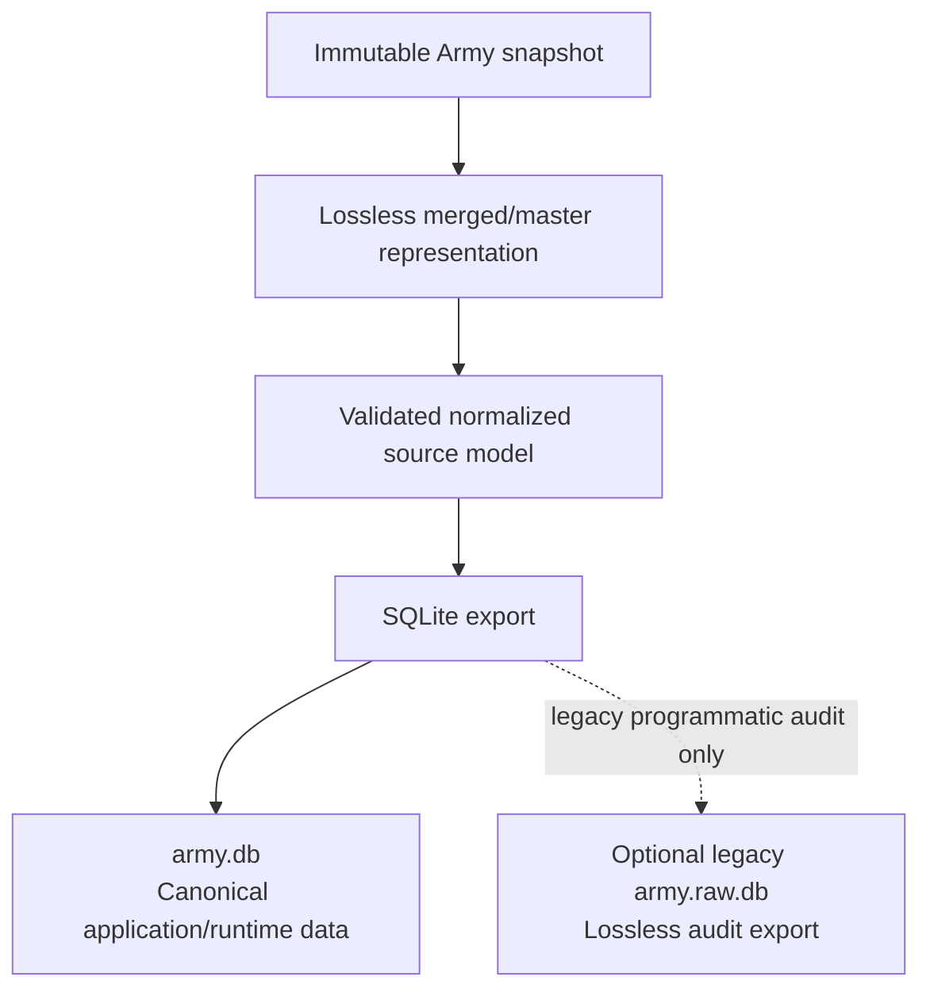
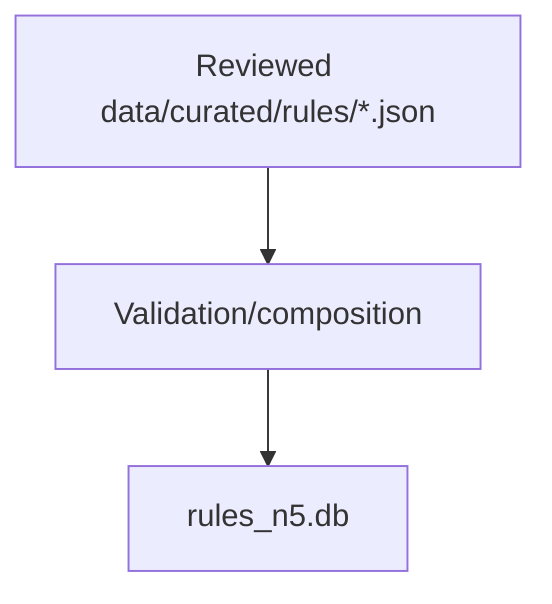

# Data model

**Project domain:** Data processing

This is the canonical entry point for semantic provenance, runtime storage
and cross-domain identity. The focused documents own detailed contracts:

- [Army model](data-model-army.md) — Army/Unit identities, profiles, loadouts,
  availability, filtering, source notes, Peripherals, Fireteams and Army
  materialized projections.
- [Army history model](data-model-history.md) — private historical evidence,
  continuity, effective changes, contextual summaries and public Unit history.
- [Rules model](data-model-rules.md) — typed definitions, exact variant usage,
  restrictions, FAQ applicability and composed reference/search projections.
- [Weapons and deployed objects](data-model-weapons.md) — source profile
  identity, exact citations, Ammunition, Weapon Properties and object delivery.
- [Scenario model](data-model-scenarios.md) — Core/ITS composition, scoring,
  geometry, shared definitions and the proposed player-authored scenario model.

[Architecture](architecture.md) owns subsystem boundaries; the
[data lifecycle](../data/README.md) owns acquisition/build/serve commands
and the [curated format](../data/curated/README.md) owns authoring validation.
The [rules semantics](rules-semantics.md) and
[official source clarifications](official-source-clarifications.md) own
reviewed gameplay interpretation and unresolved source questions.
[Testing](testing-data.md) owns verification procedures.

## Pipeline and persistent artifacts

Army-derived data flows through three conceptual layers:

Curated rules data follows a separate path:

The normal Army export is application-only SQLite. The legacy paired raw
export remains available to explicit programmatic audit/fixture consumers;
the installed CLI no longer creates it. Build and inspection commands are
owned by the [data lifecycle](../data/README.md#current-paths-and-behavior).
Rules and ITS have independent authorities and update cadences. Each
registered ITS source compiles into its own database; see
[season publication ownership](season-publication-ownership.md).

## Current runtime schemas

The tracked runtime uses four matched files:

- `army.db`: Army schema **35**, compatibility **44**, with Unit history.
  The supported history-free development option produces schema 34,
  compatibility 43 (`--no-unit-history`).
- `rules_n5.db`: Rules schema **24**, compatibility **26**.
- `its_17.db` and `its_18.db`: ITS schema **2**, independently selected
  current season publications.

`src/infinity_db/database_set.py` owns complete-set selection.
Normal checkout/Docker serving requires every registered file, current
embedded projections, exact schema/application IDs, integrity and matched
recorded provenance. Unsupported or missing files do not fall back to
sidecars, another directory or a legacy schema. Explicit low-level readers,
source-only inspection and fixtures may support older schema/compatibility
pairs; their support does not imply complete serving compatibility.
Incompatible generated artifacts are rebuilt; rollback uses retained matching
release artifacts, not an in-place migration of the current generated set.

## SQLite storage contract

`army.db` contains canonical materialized application tables and retained
source/context rows necessary for runtime. Source-only normalized tables
are physically absent. `rules_n5.db` stores curated records, relationships,
sources and derived projections; season databases store their own mission
and policy records. Runtime never reads the optional audit archive,
working-tree curation or normalized build JSON.

The optional `army.raw.db` contains lossless normalized source rows,
including exact row JSON preserving absent-vs-null and source-only data.
It is an independent research artifact, not a fifth runtime database.
A source-only value is not automatically a public application fact.

### Shared metadata and integrity

Army metadata binds the source snapshot, identity-policy hashes, published
table boundaries, deterministic content identity and
`export_pair_sha256` fingerprint for the complete normalized generation.
The fingerprint includes source-only rows whether or not a raw archive
is written. If an explicit raw sibling is built, it must match that
generation before paired inspection. Its replacement precedes the Army
application commit point; the normal application-only export needs no raw
file. The exact lifecycle belongs to the [data lifecycle](../data/README.md).

`snapshotArchiveSha256` records the exact Army ZIP. Deployment matches it
to the symbol publication source identity. Schema/application IDs,
compatibility, foreign keys and integrity are verified; planner statistics
and canonical physical finalization make release bytes deterministic.
Semantic fixtures may skip physical finalization, never semantic/input
or integrity validation.

Each new Army staging, raw-archive, application, and rules database creates its schema and inserts
rows within one explicit write transaction, after deterministic connection configuration. This
avoids a separate disk commit per schema statement while retaining integrity checks and canonical
finalization. A SQLite connection context manager does not itself begin a transaction for schema
DDL; the rules schema script starts its transaction internally because `executescript` commits any
previously pending transaction.

The complete Rules build constructs its initial relational schema and
applies embedded projection stages to the current schema. Those stages
are implementation details, not a way to replace complete serving with an
older isolated database. The public API snapshot revision hashes a
canonical sorted inventory of every active database filename and SHA-256,
with domain separation; changes to either ITS file are included.

### Shared runtime build-input provenance

The complete builder writes `database_set_build` into Army and Rules
metadata (and an explicitly produced legacy raw sibling where applicable).
Version 1 contains `formatVersion`, `buildSetId`, `family`, `manifest`;
Rules also records `requiredArmyExportPairSha256`. The manifest families
are `army` and `rules-n5`. ITS 17/18 independently pin their own source
and registered shared-library identities, validated against the matched
build manifest.

`buildSetId` is SHA-256 of the domain prefix `InfinityDB database-set build v1`
followed by a null byte and the canonical UTF-8 JSON input manifest (sorted
object keys, no whitespace, preserved Unicode, no non-finite numbers).
The manifest declares its format/version, selected families, `builderRevision`,
Army archive and API-metadata basenames/exact SHA-256 values, and repository-relative
input file digests. `builderRevision` hashes the sorted source-code path/digest
map; it is a code-content identity, not a Git commit or an output-file hash.
Source-code digests use LF bytes under the repository's text policy, so an
older Windows CRLF checkout does not create a different builder identity.

The input envelope includes maintained JSON under `config/catalogs`,
`config/identity`, `config/validation`, `config/symbols`, and
`data/curated` (excluding `example.json`), `pyproject.toml`, the symbol
publication manifest, static Restrictions reference, and Python sources
outside `src/infinity_db/web/`, except the presentation-only
`theme_palette.py` and `scenario_map_svg.py`. These are shared with standalone
rendering tools but do not publish stored data; geometry validation and shared
catalog/model code remain pinned. Generated palette CSS remains covered by
the static asset revision, and runtime map ETags include rendered SVG bytes.
Adding a publication dependency on either excluded module requires revisiting
the exclusion. Existing recorded sets remain internally valid, but require one
rebuild to pass the exact checkout-input freshness gate under the new envelope;
the manifest format and set-integrity checks are unchanged.
History-enabled builds also pin the accepted historical archive/database hashes
and the history projection's
research Python sources. All maintained text input digests normalize CRLF
to LF; upstream Army ZIP and supplementary metadata pins remain byte-exact.
This is a conservative content envelope, not a claim that every file is
used by every projector. Paths are repository-relative; absolute paths,
Git state, wall-clock dates, scratch names and final output hashes are excluded.

The ID is computed before output creation. Army export fingerprints include
the shared metadata; Rules binds that export generation and its normal embedded
model binds the completed Army bytes in one direction. Neither database embeds
its own final byte digest. The shared set validator rejects altered/unsupported
records, different IDs, missing family provenance, wrong Army generations and
archive/API-metadata identities that disagree with the selected Army metadata.
Older standalone fixtures without a record may still be inspected as
`not-recorded` in explicit non-complete validation; complete serving requires
the current source-bound set. Runtime health does not compare the manifest with
current working-tree files; the builder rechecks declared inputs before
publication. Release/source-freshness validation runs in the
[release process](releasing.md) and [deployment verifier](ci.md#deployment-smoke).

## Semantic provenance

A field or relationship must be understood by provenance class before it is deduplicated or
presented.

### Source-native facts

These are represented directly by Army or another cited source: source IDs, names, profile values,
loadout costs, Army-list membership, source extras, notes, Fireteam rows, and similar material.
InfinityDB may normalize their representation but must preserve their source coordinates and meaning.

### Source-derived facts

These are deterministic interpretations of explicit source relationships, such as Army grouping or
role derived from metadata parents and reinforcement links. The derivation is application logic, but
the evidence remains source-owned.

### Curated/reviewed facts

These are human-reviewed project data derived from official sources where the application needs a
stable relationship the upstream data does not directly supply. Examples include identity aliases,
legacy Army presentation records, Peripheral mappings, historical relationship endpoint evidence,
maintained rules summaries, and typed rules relationships.

### InfinityDB abstractions

These are application concepts introduced to make multiple source views coherent. They must not be
presented as if they were source-native. Important examples are:

- logical Units spanning equivalent source representations;
- the General profile abstraction;
- canonical profile/loadout payload identities;
- application-domain slugs; and
- cross-domain composed reference projections.

### Presentation-only structure

Browser grouping, card/disclosure structure, responsive layout, visual labels, and other display
conveniences are not game-data semantics unless backed by a data-model contract.

## Relationship model

Application relationships should be materialized where their semantics are understood and useful.
Source storage links that exist only to express normalization shape are not automatically player
relationships.

Important current relationship families include:

- logical Unit ↔ source occurrence;
- Army grouping/parentage and Unit availability/membership;
- Profile/Loadout/Unit-option include relationships;
- selection/dependency constraints;
- Peripheral/Controller relationships;
- Fireteam membership/equivalence/Wildcard context; and
- typed rules/reference relations.

Historical source endpoints that no longer resolve in the current Army snapshot are handled by a
separate snapshot-bound review contract. That evidence can classify a source relation as stale; it
must not create a false alias to a current Unit.

## Snapshot provenance

Army, wiki, and externally produced symbol snapshots use generated provenance
records described in `data/README.md`.

The current provenance model distinguishes:

- logical snapshot content SHA-256 (normalized member paths + member bytes);
- exact archive SHA-256;
- acquisition timestamp;
- source URL/language/document count where applicable; and
- for Army snapshots, the latest source-data date encoded by supported Army source version strings.

`data/README.md` owns the current provenance-format version and compatibility rules.

Acquisition time answers when the producer downloaded the snapshot. `source.dataChangedOn` answers when
the contained Army source data most recently reports changing. Those dates must not be substituted
for each other.

Human snapshot notes are separate curated annotations bound to immutable source identity. Acquisition
tools never rewrite them.

## Army source revision interpretation

Corvus Belli Army document `version` values are source revisions, not InfinityDB snapshot versions.
InfinityDB may derive a latest encoded source date only from version shapes it explicitly recognizes;
unsupported values must remain visible rather than guessed. A snapshot can be acquired long after
its newest source revision, so the provenance model stores both concepts.

The browser's normal freshness wording uses the source-data change date when available. Exact
acquisition/archive identity remains Developer/provenance information.

## Required Army metadata

Army database builds require the supplementary Army `metadata.json`. It is preserved through the
merge/normalized pipeline and exported to metadata tables.

Metadata provides, among other things, faction/grouping relationships and weapon/profile reference
information. Army list files remain authoritative for concrete Unit membership/availability; a
metadata identity does not create an Army roster by itself.

Current build validation rejects normalized Army data without valid required metadata.

## Accepted authoring direction: one source family, version-tagged facts

For maintained curation, **prefer one file per logical source family** rather
than a new curated file for every revision of that source. For example, ITS
Season 18 is one source family even though its original and September hotfix
PDFs have different exact byte identities. Source families do not merge
independent authorities such as N5 core rules, the N5 FAQ and ITS.

- Tag each maintained fact with the exact source revision(s) for which it was
  reviewed. Use the smallest meaningful fact/field scope; a whole-record tag
  alone is insufficient when only some mission rules, scoring, geometry or
  citations change. Retain one shared fact when it is explicitly reviewed for
  multiple revisions, and distinct tagged variants when its meaning differs.
- Keep immutable upstream revision files and their source descriptors, dates,
  languages, hashes and page citations separately identifiable within the
  curated family. Each current fact's citation must resolve to the revision
  supporting it; retaining historical evidence does not make it current.
- Declare the **current revision** explicitly for each source family and
  project only facts reviewed as applicable to that revision into the normal
  publication. Reject overlapping incompatible variants, unreviewed carry-
  forward and missing required current facts; never select a fact merely from
  file order or the newest-looking timestamp. Stable logical IDs may span revisions.
- **Player-facing behavior is latest-only.** Within a selected source family or
  season, show its current revision automatically, not a list of revisions.
  Preserve version tags, source provenance and superseded facts in curation
  for possible later historical browsing, but do not require separately
  selectable historical SQLite publications, API selectors or UI controls.
  Historical replay is a separate future capability, not a prerequisite for
  the source-family migration.

This is implemented in the ITS source-family projector. Current season
selection and version-tagged authoring are owned by
[season publication ownership](season-publication-ownership.md)
and the [ITS database contract](its-season-database.md).
Historical source retention does not authorize historical gameplay replay.

## Application query model

Runtime repositories query canonical/materialized application structures and compose contextual
source detail as needed. They must not infer semantics from raw IDs or reach into the optional
legacy `army.raw.db` source archive.

Examples:

- Unit lists operate on logical Unit identity and materialized Army availability.
- Unit detail returns one logical Unit with source/Army/profile/loadout context preserved.
- catalog filters resolve canonical application identity and match all materialized source members.
- rules-backed States and other rules-only concepts are read from `rules_n5.db`; their presence does
  not imply mutable in-game state in `army.db`.
- search and Glossary project canonical domain identities rather than creating another identity
  namespace.

The HTTP/browser layer may change presentation without changing these semantic ownership rules.

## Audit and validation tools

Use [data and source validation](testing-data.md) for the current audit
selection, source-only prerequisites and reproducible procedures. Audit
tools operate on explicit selected evidence; generated reports and
temporary artifacts stay under ignored local workspaces. The model is
not a source-coverage scoreboard.

## Historical model decisions

The [complete pre-split data model](https://github.com/frankysan/InfinityDB/blob/a7fc1900d73e4bc9b44561c20b04e58e73fbb8b6/docs/data-model.md#data-model) is preserved at
`a7fc1900`. It includes the per-source variant review ledger,
previous schema and publication migrations, dated counts and individual
source-interpretation evidence. For the current exact variants use the
maintained curated records, validation manifests, source clarification
register and [Rules model](data-model-rules.md). Historical commands and
inventory counts are not current acceptance requirements.
