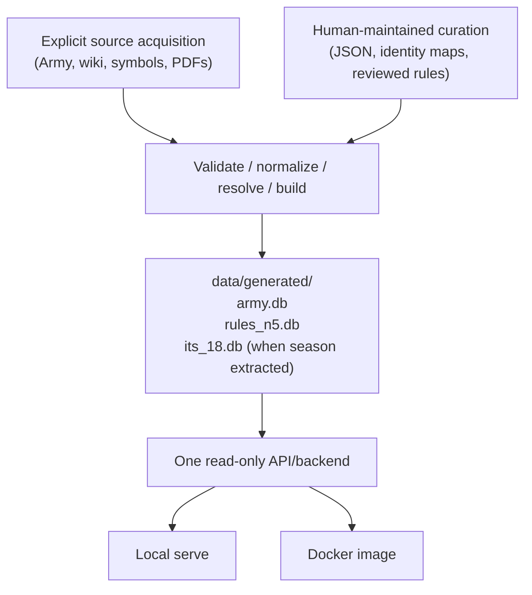
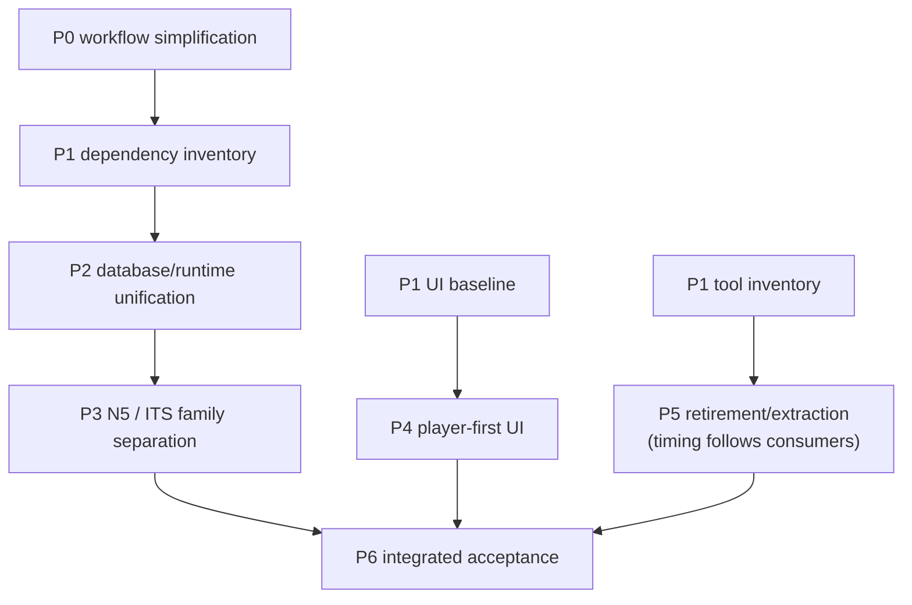

# Major simplification and restructuring plan

**Project domains:** Project infrastructure, Data processing, Acquisition, Web backend, Web frontend, Deployment

**Status:** Active on `dev/v1.1.0`: P0 completed (including the verified checkout-local preference update); P1.1 inventory completed; P1.2–P6 remain planned.  
**Established:** 2026-11-08  
**Planning baseline:** `dev/v1.0.1` at `2f84a282872d2aa701684f66bf4e7302cf802932` (clean checkout at initial inspection). This is evidence of the starting architecture, not a freeze on subsequent work.

## Purpose and scope

Simplify InfinityDB as a single-maintainer, non-commercial, read-only Infinity reference. Reduce development and operational overhead *substantially* while preserving the useful behavior of the web application: accurate game data, source citations, linked references, scenario maps, navigation, accessibility, privacy and supported local/Docker hosting.

This is a **target architecture and execution sequence**, not a statement of current behavior and not a second active task register. `TODO.md` owns live implementation work; `validation-queue.md` owns outstanding verification; `releasing.md` owns releases. Use the phase/step identifiers below as durable references in short, actionable TODO entries or commits when necessary. Do not mirror a checkbox per step here or preserve a parallel completion diary.

### Agreed direction

1. **Single-maintainer proportionality.** Prefer Git history, clear documentation, coherent commits, focused checks and a few meaningful release checks over routine staging/promotion, compatibility scaffolding, rollback exercises or repetitive administrative gates.
2. **Databases are the runtime structured-data boundary.** Upstream and editable curated JSON remain valid *build inputs*. All structured data required to serve the application belongs in SQLite output, not loose required JSON or a second build-time interpretation layer. Normal HTTP JSON responses are unaffected.
3. **Source-oriented database ownership.** Rename `infinity.db` to **`army.db`** and `rules.db` to **`rules_n5.db`**. Plan a separate **`its_18.db`** for ITS Season 18, with later seasons following the same pattern where useful.
4. **One artifact contract, two hosting targets.** Checkout-based serving and immutable Docker deployment consume the *same logical database set and application code*. Deployment packages already built data; it does not invent an alternate data model.
5. **Player-first presentation.** Normal pages explain Infinity; internal schema constraints, ingestion caveats and implementation warnings belong in developer diagnostics or documentation. Material gameplay uncertainties and source citations remain available to players.
6. **Remove, do not merely relocate, accidental complexity.** Retire obsolete scripts, deprecated schemas, duplicated checks and documents after proving no live consumer remains. Extract independent acquisition tooling when that actually makes the main repository simpler.
7. **Bounded agent work.** Planning, implementation, test design/execution, housekeeping and release operations are distinct responsibilities; every change should not run all five.

### Guardrails, not procedural gates

- Preserve the player-facing functional baseline and game meaning; no silent changes to Army profiles, rules, cited provenance, scenario geometry, or historical source scope.
- Keep acquisition explicit and offline builds reproducible from identified inputs; do not silently merge different N5/ITS revisions.
- Retain basic database validation, source attribution/licensing, privacy, security, accessibility, and actionable focused regression checks. Simplicity is not permission to publish incorrect data.
- No indefinite compatibility layer for *internal* filenames, schemas, deprecated build commands or legacy runtime publication formats. A deliberate cutover with documented replacement commands is acceptable. Public URLs and documented user-visible API contracts are evaluated separately because breaking them affects users.
- Preserve immutable upstream snapshots and genuinely unique research evidence where needed. Git history is the default record for superseded *code and process*, not a substitute for source files unavailable from Git.
- Do not automatically refactor unrelated gameplay features while cleaning architecture. Keep changes in coherent slices so regressions can be attributed.

## Target boundary (proposed, not yet implemented)

- **`army.db`:** normalized Army snapshots, application Army/Unit/profile identities and usage/relationships derived from Army data. Cross-source information placed here only when Army ownership makes sense.
- **`rules_n5.db`:** N5 core rules, current applicable N5 FAQ, reviewed reference content, rules citations and core scenarios. Retain exact publication/version identity inside records; `n5` in the filename is a family, not an excuse to conflate revisions.
- **`its_18.db`:** Season 18 scenarios, seasonal rules/extras and season-scoped interpretations/citations. The boundary with N5 shared concepts must be decided from real consumers before extraction.
- **Future seasons:** separate database per independently managed season only when worthwhile. Do not require a new physical database for every minor PDF revision or force shared concepts into seasonal duplicates.
- **Raw archives/`infinity.raw.db`:** research and lossless provenance *build-side only*; explicitly reassess whether the raw SQLite sibling is still useful. It is not a serving dependency.
- **Assets:** SVGs, styles, scripts, fonts and other non-structured static assets remain files. JSON used as a transient interchange or generated diagnostic report is acceptable; **required runtime JSON sidecars are not**.
- **Cross-database relationships:** use stable typed IDs and one centralized resolver/query boundary. Prefer build-time materialization or a small shared runtime resolver over scattered joins, replicated rules, or an extra meta-database. Decide the precise approach with tests before migration.

## Work phases

The ordering below expresses **dependencies**, not a requirement to serialize independent work. P4 (UI content) may proceed in parallel with database migration after its baseline is captured. Each step should be delivered as a bounded change, not as one large agent call.

### P0 — Replace heavyweight development governance

**Outcome:** A minimal, explicit single-maintainer workflow that helps rather than obstructs the restructuring.  
**Owns:** Project infrastructure.  
**Prerequisite:** This plan exists.

1. **P0.1 — Inventory mandatory checks.** Enumerate current task-boundary actions across `AGENTS.md`, `AGENTS.local.md`, `docs/testing.md`, `docs/validation-queue.md`, `docs/ci.md` and `docs/releasing.md`. Classify each as correctness-critical, release-only, useful optional, or removable duplication.
2. **P0.2 — Define the normal task lifecycle.** A small coherent implementation task gets relevant context, a focused change, an immediate focused check where warranted, review of its diff, and a coherent commit. Deferred checks are batched by risk/impact rather than multiplying admin steps per edit.
3. **P0.3 — Streamline validation ownership.** Keep a lightweight queue for *real* deferred test obligations. Decide which VD/VR distinctions, numeric thresholds, age limits and strict drain rules actually help; remove duplicated accounting. Preserve independent Linux execution and concise exact-revision reporting without making Linux sync a prerequisite for every edit.
4. **P0.4 — Separate release from development.** Keep explicit release/deploy authorization, basic artifact validation and a relevant smoke test; remove redundant candidate/promotion/rollback ceremony for immutable Docker deployments where Git and rebuilds suffice.
5. **P0.5 — Reconcile agent instructions.** Update the canonical tracked guidance and its linked procedures together. Coordinate any local-only preferences with their owner rather than silently overriding `AGENTS.local.md`; prevent contradictory mandatory instructions.

**Exit:** An agent can explain and execute a normal small change using a short workflow; focused validation and final release responsibilities are unambiguous; no new compatibility or staging policy is added merely for process continuity.

#### P0.1 — Current procedural inventory (2026-11-09)

**Status:** Read-only inventory completed on `dev/v1.1.0`, initial HEAD `baf1773c2d0d746e4f513827228592f620834003`. **Recommendations below are not yet active policy.** P0.2–P0.5 own the actual changes, including updates to dependent instructions and tests. Reviewed `AGENTS.md`, ignored local `AGENTS.local.md`, `docs/testing.md`, `docs/validation-queue.md`, `docs/ci.md`, `docs/releasing.md`, and the [documentation map](README.md).

**Classification key:** **Keep** = correctness/safety-critical for relevant changes; **release-only** = verify at merge, release or deployment rather than every edit; **optional** = useful tool or workflow, chosen by need; **simplify/remove** = administrative duplication or disproportionate mandatory gate.

1. **Start-of-task inspection — keep, narrowed.**
   [Agent guidance](../AGENTS.md) requires branch/HEAD/status, current task, related sources/tests and canonical documents; local `AGENTS.local.md` guidance adds authorized checkout and scope protections. Keep branch/status, relevant context and preserving unrelated changes. Avoid rereading broad architecture, testing, releasing and historical reports for every minor edit. Use targeted documentation only when affected.

2. **Git safety and change delivery — keep.**
   [Agent guidance](../AGENTS.md) and local guidance require reviewed diffs, coherent commits, preserving unrelated changes, safe non-forced push, no uncontrolled checkout changes, and explicit release/deploy authorization. Keep these. Specialized remote Git API compare-and-swap guidance and optional [multi-agent coordination](multi-agent-workspaces.md) apply only to their respective access modes; they are **not** general task phases.

3. **Ordinary backlog selection and closeout — simplify/remove.**
   [Agent guidance](../AGENTS.md), [backlog rules](README.md#backlog-completion-and-retirement) and [historical V1S selection checks](testing.md#v1s-backlog-checks) require task-boundary reconciliation, staged-index historical closeout checks and stable-ID retirement evidence. The 1.0 V1S register has no active items. Keep a short active-backlog/acceptance check; scope V1S-specific selection and closeout tooling to an explicitly reopened V1S item, not normal 1.1 work. Do not create a second task ledger.

4. **Per-change deferred-validation registration — simplify/remove.**
   [Agent guidance](../AGENTS.md#phased-validation-and-task-boundary-checkpoint), local `AGENTS.local.md` preferences, [testing](testing.md#phased-development-and-validation) and the [queue](validation-queue.md#queue-rules) all prescribe VD design and VR execution entries even for routine changes. Keep a lightweight register for *genuinely deferred* verification, with a concrete selector/acceptance condition and revision. Eliminate the default obligation to generate queue records when a bounded task can simply run its focused checks and finish.

5. **VD/VR strict scheduling — simplify/remove.**
   The [queue](validation-queue.md#queue-rules) specifies **VD >= 3**, **VR >= 5**, complete drain-to-zero, seven-day age gates, repeated recounts, and independent reconciliation of every entry. The exact thresholds/drain and age rules are also copied into local agent guidance. These are process controls, not evidence that a test is necessary. P0.3 should replace them with explicit risk/merge triggers and sensible periodic batching, retaining visible blocked/missing checks rather than silently discarding them.

6. **Test-design/implementation separation — simplify/remove.**
   [Testing](testing.md#phased-development-and-validation) and the queue forbid routine tests during implementation and **all** tests during a VD design pass, except urgent integrity cases. A newly authored focused test can therefore be prevented from being run immediately. Proposed replacement: allow writing and running focused tests together when useful; separate design from execution only for actual queued or independently delegated work. Never present an unrun test as passed.

7. **Focused-first coverage and immediate integrity gates — keep.**
   [Focused-first VR guidance](testing.md#focused-first-vr-execution) already says to select affected cross-layer tests first, fix focused failures before widening, reuse compatible executions and avoid full-suite runs merely because the queue filled. Preserve that principle, along with immediately necessary security, schema, provenance, migration and published-artifact checks. Drop repeated approval/accounting around executing a small relevant test.

8. **Linux worker and parallel-work restrictions — keep isolation, remove artificial serialization.**
   The [queue](validation-queue.md#queue-rules), [validation batching](testing.md#validation-batch-planning) and [Linux protocol](testing.md#parallel-windows-development-and-linux-validation) permit unrelated Windows implementation **only during an independent full-suite Linux job**, not a focused Linux job. The meaningful safety boundary is an independent, pinned checkout and non-overlapping writes, not whether a job happens to be full-suite. Preserve explicit Git sync, tested-revision identity and artifact isolation; allow independent development during any isolated job in P0.3.

9. **Task status reporting — optional.**
   [Read-only development status](testing.md#read-only-development-status) consolidates repository, queues, jobs and exact-SHA CI observations. Retain the command as a useful opt-in view. Ordinary task reports should state changed behavior, actual checks, limitations and commit; queue counts, oldest age, worker/host and job receipts are relevant only when there is due or running validation.

10. **Hosted CI monitoring — keep at integration boundaries; avoid per-edit ceremony.**
    [CI guidance](ci.md#agent-ci-monitoring-and-repair) correctly allows non-blocking development between commits and requires actual exact-revision evidence for a final gate. Keep actionable failure diagnosis and correct claim boundaries. Do not require workflow polling/recordkeeping for every doc or intermediate commit with no relevant CI run. P0.4 should identify the smallest set of mandatory hosted gates for a given change class.

11. **Release and Docker gates — release-only; simplify by impact.**
    [Release checklist](releasing.md#4-run-local-release-validation) and [hosted policy](ci.md#risk-based-source-validation) already allow focused Source reuse for narrowly scoped candidates, but require much broader source, wheel, browser, image, publication and exact-SHA evidence at other gates. Preserve version/changelog consistency, a usable built artifact, relevant smoke tests, deployment authorization and production identity. Reassess mandatory four-browser matrices, exhaustive local/preflight reruns, candidate promotions and rollback-image inspections by actual release risk; do not weaken them silently before P0.4 establishes a replacement contract.

12. **Project-wide documentation and one-use retirement — simplify scheduling.**
    [Former release documentation audit](releasing.md#2-review-release-relevant-documentation) previously required reviewing the *entire* maintained corpus every release; [document retirement](README.md#one-use-tool-and-audit-lifecycle) and [agent guidance](../AGENTS.md#documentation-and-project-tracking) add task-level reconciliation. Keep one authoritative owner per contract, check affected links, and preserve necessary licensing/provenance. Use focused documentation review for routine edits and deliberate broader audits for architectural changes; leave one-use script retirement to its bounded task or P5 inventory instead of revisiting it on every small edit.

13. **Source/gameplay correctness and external constraints — keep.**
    Existing agent, architecture and source-reconciliation guidance protects stable identities, correct citations and revisions, unknown/ambiguous facts, offline builds, privacy, copyright permissions and safe rendering. These are product invariants, not optional paperwork. Maintain them while reducing ceremony.

**Root cause and priority:** Mandatory instructions for the same VD/VR process are spread over four documents, historical V1S closeout is still referenced in normal task guidance, and release checks are described alongside ordinary development. First define a small normal lifecycle (P0.2), then reduce the queue rules and worker restrictions (P0.3), isolate release acceptance (P0.4), and reconcile tracked/local agent guidance and linked procedures (P0.5). Do not partially edit a single policy owner and leave contradictory mandatory instructions elsewhere.

**Baseline observation:** The active queue reported no pending VD or VR entries at inspection. No implementation/test policy, required CI workflow or existing gate was changed in P0.1. This section records proposed dispositions for the next steps, not their approval as operational rules.

#### P0.2 — Proposed normal task lifecycle (2026-11-09)

**Status:** Implemented on `dev/v1.1.0` through P0.3–P0.5 tracked guidance changes. This section records the rationale, not a second operating manual. Active task instructions live in `docs/testing.md`, linked from `AGENTS.md`. The checkout-local preference update was subsequently completed and verified.

**Default task unit:** One coherent, reviewable behavior change or closely coupled set of changes with an observable acceptance condition. Avoid splitting every file edit into its own investigation/test/commit cycle, but do not mix independent defects merely to fill a batch. Small, known tasks need no separate planning agent, formal handoff or pre-implementation approval.

**Proposed five-step default:**

1. **Orient.** Verify the intended branch, HEAD, working-tree status and active task. Read only directly affected source, tests and the relevant canonical guidance; identify existing changes to preserve. For ambiguous/high-risk semantics, perform a bounded read-only investigation first. A task is ready when the desired behavior and a practical check are clear.
2. **Implement.** Make the smallest coherent change, preserving unrelated work. Update focused tests alongside code where useful. Do not create separate VD/VR entries or invoke a test-design agent merely because source changed. A newly written test may be run immediately.
3. **Verify.** Select the smallest sufficient checks for the affected contract: existing/new regression tests, lint/type/docs or data/asset integrity as appropriate. Broaden only for a demonstrated cross-cutting impact or an independently required gate; resolve relevant failures before acceptance. **Documentation-only edits:** documentation checks; no automatic app test. **Executable/data edits:** focused behavioral checks plus any necessary schema/source/provenance gates. **Cumulative/release changes:** follow the separately applicable integration or release acceptance owner.
4. **Deliver.** Review the actual diff and status; update the canonical documentation and active backlog only if behavior or remaining work changed. Stage task-related files, commit a coherent validated result, and safely push only where authorized by the normal development workflow. A completed implementation task does not imply that unrun CI, Docker or release tests passed.
5. **Report and stop.** State what changed, checks actually run and outcomes, blocked/unrun verification (if any), commit/branch and any meaningful next dependency. Do not require routine queue counts, old V1S bookkeeping, GitHub run receipts or repeated checklists when none are relevant.

**Decision rules for exceptional work:**

| Situation | Action; not a default extra phase |
| --- | --- |
| Small known code/UI bug | Implement and execute focused regression(s) in the same pass. |
| Documentation-only change | Update owned documentation, run docs checks, commit. |
| Rule/source interpretation, cross-source revision, database/schema or security-sensitive change | Investigate affected invariants first; validate the relevant semantic/integrity boundaries before acceptance. |
| Test execution is genuinely deferred (for example, a required browser/asset/host unavailable locally) | Register **one concrete open obligation** with selector/expected evidence, owning task, relevant revision and intended execution trigger. Do not mark it passed or silently discard it. P0.3 will define the streamlined register and scheduling. |
| Multiple related implementation changes | Run the union of impacted focused tests once where compatible; do not repeat a full suite for every edit. |
| An isolated Linux/other worker is testing an exact revision | Independent work may continue in a **separate checkout** if no shared mutable inputs are affected. The result validates only the pinned revision/assets. P0.3 updates the concurrency rule. |
| CI/PR merge, release or deployment | Hand off to the separately defined relevant gate. Do not run all release checks for ordinary commits and do not conflate passing focused tests with a shippable release. |

**Minimal per-task acceptance evidence:** a specific intended result, reviewed changed files, passing applicable focused checks (with failures/skips disclosed), and an unambiguous delivered revision. For source/data changes retain the source publication/revision and reproducible build evidence needed to substantiate the changed facts. No additional status document, task diary or audit report is required solely for process compliance.

**Conditions that still block closeout:** a known correctness regression; a required immediate integrity check that fails or was not performed; loss of source scope/provenance or required licensing attribution; uncertain Git state; or a stated acceptance condition that remains unmet. In contrast, an independently owned future CI/release gate is reported as pending without forcing an otherwise validated implementation to stay in an administrative loop.

**Implementation handoff to P0.3–P0.5:**

- **P0.3:** Replace default-per-change VD/VR creation, strict numeric drain loops, all-tests-forbidden design passes and the full-suite-only concurrency exception. Retain actual deferred obligations and focused-first checks. Check users of the queue format (especially `tools.dev_status` and backlog/test helpers) before removing fields or IDs.
- **P0.4:** Separate the minimal normal development acceptance from release/merge, image, cross-platform and deployed-smoke acceptance. Make the release choice risk-based and explicit rather than removing product-level protection by implication.
- **P0.5:** Give the active default one authoritative short owner in `docs/testing.md`; keep `AGENTS.md` an entry point and align `docs/validation-queue.md`, `docs/ci.md`, `docs/releasing.md` and local `AGENTS.local.md` without conflicting MUST rules. Do not edit ignored personal preferences without an explicit reconciliation decision.

**Exit decision for P0.2:** The normal path is **orient → implement → verify → deliver → report**. Specialized investigation, queued testing, multi-agent delegation and release operations are opt-in by actual risk or need, not mandatory steps per edit. No behavior, queue threshold or existing mandatory gate changes merely because this target lifecycle has been documented.

#### P0.3 — Deferred-validation simplification (2026-11-09)

**Implemented on `dev/v1.1.0`:** Ordinary implementation now permits
immediate focused regression design and execution. VD/VR entries are created
only for concrete **unresolved** checks, each with a reason and resumption
trigger. Removed mandatory 3/5 item thresholds, seven-day age deadlines and
drain-to-zero sequencing. A pinned, independent Linux checkout can execute
focused or full tests while unrelated Windows work continues without changing
shared inputs. Linux revision/asset verification, Git safety, actual terminal
test results and all independently required CI/release gates remain.

The read-only `tools.dev_status` report now gives counts, oldest age and
blocked IDs without inferring an automatic "due" state. The historical VD/VR
IDs and active markdown sections remain readable. Removed redundant
completed-entry narrative from the active queue; Git history and existing
testing evidence retain that history.

**Scope boundary:** Tracked `AGENTS.md`, `docs/testing.md`,
`docs/validation-queue.md`, `docs/AI_CONTEXT.md`, documentation map,
Copilot guidance and the optional coordination entrypoint are aligned.
`AGENTS.local.md` remains Git-ignored and contains superseded strict-queue
preferences; tracked policy takes precedence, but explicit local-preference
reconciliation belongs to **P0.5**. Substantive release and hosted-gate
simplification is recorded in the P0.4 implementation section below.

#### P0.4 — Release and CI simplification (2026-11-09)

**Implemented for development toward v1.1.0:** Normal development no longer
needs finalized release metadata, a repeated isolated preflight or a
cross-browser matrix. Release metadata (`Unreleased` to a dated version,
package/module version and README link) is explicitly checked with
`tools.release_metadata` **before the release merge/tag**, not on every PR.
Pending release notes remain valid in ordinary source and web tests.

**Source CI:** the primary Ubuntu/Python 3.11 leg runs the complete source
suite **once**, with lint, types, documentation and builds. Other OS/Python
legs check portable Army/Rules builds and deterministic output without
duplicating the full pytest suite. The optional isolated preflight remains
available for a specific packaging/index risk; installed-wheel and Docker
smoke are separate exact-SHA workflows. Broad or unknown changes still
invoke the full Source *matrix*, while eligible documentation/test-only
deltas can reuse a verified Source/wheel/deployment baseline.

**Release evidence:** the three core workflows are Source checks, Installed
wheel smoke and Deployment smoke. Source job-level verification now runs
whether or not browser evidence was selected. The four-platform browser
matrix is manual/opt-in for **v1.1+**, required only when browser risk
warrants it; the historical v1.0.x tag rule remains fail-closed. The
evidence CLI accepts `--include-cross-browser` and still verifies every
selected browser job. At tag preparation, it also checks exact local HEAD
and finalized metadata/tag identity so an `Unreleased` heading cannot slip
through merely because ordinary development CI permits it. A previously
configured GitHub branch ruleset may
still require the now-manual browser status and must be reconciled by the
repository owner if so.

**Deployment:** Docker CI validates **one current release image** and its
startup/asset contract, not a fabricated v8 rollback image or recovery
exercise. Tagged images and Git history remain normal recovery mechanisms;
real deployment remains separately authorized. Project-wide documentation
audits, manual full-suite repetitions and large post-deployment browser
matrices are risk-based, not blanket release gates.

**Still to do:** P0.5's tracked and checkout-local reconciliation is recorded
below. P2 owns deleting application data-candidate/promotion infrastructure
and unifying local and Docker runtime publication. Those are *not* implicitly
removed by the simplified release policy.

#### P0.5 — Agent and documentation guidance reconciliation (2026-11-09)

**Tracked reconciliation implemented:** `AGENTS.md` now makes the
canonical short lifecycle the normal path and applies historical V1S
selection/retirement only to reopened numbered work. The release-closeout
agent skill now distinguishes normal tracked backlog closeout, genuinely
deferred validation and actual release gates. The documentation map and
read-only status entrypoint no longer mandate a whole-backlog or status
inventory at every boundary. Preserve local Git safety, source semantics,
release authorization and published evidence guarantees.

**Local-only reconciliation verified:** The user manually updated the
Git-ignored `AGENTS.local.md` on the current checkout. A subsequent read-only
inspection confirmed that the old VD/VR 3/5 threshold, drain-to-zero,
implementation-time test ban and full-suite-only Linux concurrency rules were
replaced with the canonical focused-first policy. Other local preferences
remain untracked and were not promoted to project policy. This verification
does not imply that other checkouts have the same private file.

**Exit:** One authoritative tracked workflow under `docs/testing.md`;
`docs/validation-queue.md`, `docs/ci.md` and `docs/releasing.md`
retain domain-specific rules. A small implementation no longer invokes
historical V1S, VD/VR or release ceremony by default. This checkout's
local preference guidance is now aligned; other machines remain independent.

### P1 — Map the dependency graph and define the cutover

**Outcome:** Evidence-based keep/migrate/extract/retire inventory and an executable database target contract.  
**Owns:** Project infrastructure, Data processing, Web backend, Deployment.  
**Prerequisite:** P0 workflow is usable; read-only inventory may start immediately.

1. **P1.1 — Inventory entrypoints and paths.** Record tracked and generated assets by owner: `src/`, `data/`, `config/`, `tools/`, `scripts/`, `.github/workflows/`, `docs/` and Docker packaging. Distinguish source inputs, editable knowledge, intermediates, release artifacts and serving dependencies.
2. **P1.2 — Trace runtime reads.** For every required `.json`, `.db` and manifest, identify producers, CLI consumers, API/backend consumers, tests, Docker requirements and direct static browser fetches. Start with `variant-usage.json`, `weapon-profile-sources.json`, `restrictions-reference.json`, legacy `deployed-objects.json`, `infinity.raw.db` and symbol publication metadata.
3. **P1.3 — Capture baseline behavior.** Select representative Army/Unit/rules/FAQ/Fireteam/scenario/search responses and browser routes, including Battleground geometry, source citations and Developer mode. Record snapshot-specific fixtures or checks that can show semantic parity after migrations without demanding full-suite runs at each intermediate step.
4. **P1.4 — Define database ownership.** For each runtime dataset specify physical database, stable identities, schema, provenance/version requirements and cross-database lookup. Resolve where Weapon citations, variant usage, restrictions, deployed objects and symbol mappings belong.
5. **P1.5 — Define build/serve paths.** Choose one default generated database directory, an explicit way to select an alternate database set, and Docker's mechanism for packaging exactly those built artifacts. Keep local and Docker data expectations aligned; determine whether release DBs remain tracked or are generated as release outputs.
6. **P1.6 — Classify tooling.** Mark each tool as maintained runtime/build utility, reusable check, completed one-use helper, extractable acquisition concern, or obsolete. Cite live imports, CI, commands and documentation consumers before removal.

**Exit:** Each runtime data dependency has a named database destination and migration order; the two serve targets have one artifact contract; tool retirements are evidence-based; baseline comparisons are runnable.

#### P1.1 — Entry points and artifact-path inventory (2026-11-09)

**Status:** Read-only inventory completed on `dev/v1.1.0` at
`be70d859447b5c79541e1f885807918a21704d32`; no data, code,
deployment or database files were changed. This is a **path/ownership
classification**, not proof that every runtime consumer has been traced.
P1.2 must establish those dependencies individually before any cutover.

**Maintained and source inputs:**

- `src/infinity_army_data/` — standalone Army merge, normalize and export
  implementation. `src/infinity_db/` — integrated build/CLI, rules models,
  SQLite repositories, and `web/` WSGI/API/presentation. The entrypoints in
  `pyproject.toml` are `infinity-db` and `infinity-army`; production WSGI
  enters via `infinity_db.web.wsgi:app`.
- `data/raw/` — ignored immutable Army/symbol ZIP snapshots, acquired
  explicitly by `tools/download_army_json.py` and related symbol tools.
  `data/wiki/` and `data/pdf/` — ignored research source archives/documents,
  not implicit normal-build inputs. `data/work/`, `data/logs/`,
  `data/reports/`, `data/backups/` — local acquisition/transformation state.
- `config/catalogs/`, `config/identity/`, `config/validation/` and
  `config/symbols/` — maintained JSON mappings, review decisions,
  validation evidence and symbol policy. Classify each file by actual build
  or runtime reads in P1.2; being JSON does **not** make a file a runtime
  sidecar.
- `data/curated/rules/`, `identities/`, `peripherals/`,
  `relationships/`, `enrichment-coverage/`, `rules-interactions/`,
  `snapshot-notes/`, and reviewed root JSON — maintained knowledge and
  source evidence. Rules curation feeds `build-rules`; Army/identity
  curation also feeds normalization and publication.
- `data/manifests/snapshots/` and `army-symbol-build.json` — ignored
  generated provenance/build state. **`data/manifests/symbol-publication.json`
  is different:** a tracked release publication and an observed **runtime
  lookup input** for `SymbolCatalog`. Its mappings must be accounted for
  before retiring any required runtime JSON.

**Generated and release outputs (current v10):**

- `data/generated/infinity.db` — tracked Army runtime release database;
  `data/generated/rules.db` — tracked N5/Rules runtime release database,
  with reviewed deployed objects embedded in v10.
- `data/generated/variant-usage.json` and
  `data/generated/weapon-profile-sources.json` — **tracked, required,
  database-paired release publications**; runtime reads their JSON content.
  These are first-class P2 migration candidates, not merely build diagnostics.
- `data/generated/master.json`, `normalized.json`,
  `normalized-validation.json`, `infinity.raw.db` and generated
  reports — rebuildable intermediates/development source provenance.
  `infinity.raw.db` is needed to produce exact-variant output **at build
  time** but is not included in the v10 serving bundle.
  `data/generated/deployed-objects.json` is a legacy v8/v9 compatibility
  output, not a required v10 file.
- `src/infinity_db/web/static/` — packaged HTML/CSS/JS, processed SVG
  symbols, fonts and other browser assets. **`static/restrictions-reference.json`
  is directly fetched by the browser**, via `static/api.js`, independently
  of the database bundle. Treat it as runtime structured data in P1.2/P2.4.
  SVGs, fonts and ordinary scripts remain files under the agreed target.
- `build/`, `dist/`, `reports/`, `local/` and analogous cache/output
  directories contain packaging, test, diagnostics or checkout-local work;
  their existence does not make them tracked release inputs.

**Two current serving and packaging paths:**

1. **Checkout:** `infinity-db build --compact` writes the Army
   application/raw pair, historically replacing tracked
   `data/generated/infinity.db`. Plain `infinity-db build-rules` writes
   ignored `local/rules-standalone.db` and calls
   `tools.build_v10_runtime_candidate.publish_checkout_runtime`, which
   validates and assembles four matched files under ignored
   `local/checkout-runtime/`. Plain `infinity-db serve` selects that
   bundle if present/current, otherwise the tracked release database pair;
   an explicit `--database` bypasses selection. Entry points:
   `src/infinity_db/cli.py`, `checkout_runtime.py`,
   `web/server.py`, `web/app.py`.
2. **Docker:** `scripts/deploy.sh` and
   `.github/workflows/deployment-smoke.yml` run release asset checks and
   `tools.prepare_runtime_bundle`: they validate the **tracked** release
   pair/sidecars and copy exactly `infinity.db`, `rules.db`,
   `variant-usage.json`, `weapon-profile-sources.json` into ignored
   `data/runtime/` for **v10**. `Dockerfile` packages that directory at
   `/app/data/`; WSGI receives `INFINITY_DB_DATABASE` and
   `INFINITY_DB_RULES_DATABASE`. `compose.yaml` runs the app, the
   separately packaged metrics-history collector and Caddy. No raw Army
   snapshot, checkout bundle or local candidate is required by the image.
   `Dockerfile.metrics-history` is an independent service image, not an
   additional gameplay-data database owner.

**Owners to preserve across P1.2–P1.6:** `tools/` contains explicit
acquisition, symbol building, data-candidate publication, validators,
CI/release preparation, metrics and migration/audit scripts; they must be
classified by concrete consumers in P1.6 rather than deleted by naming
convention. `scripts/` owns deploy/install, local-container and
image-verification entrypoints; `.github/workflows/` owns Source, wheel,
Docker, optional browser and full-asset gates. `tests/` and
`config/testing/` own fixtures/test selection, not release data;
`docs/` owns current contracts, plans and historical provenance.

**P1.2 priority:** Trace the two JSON database companions, the directly
served Restrictions JSON, and the symbol-publication manifest through their
producers, read paths and externally visible results; then inspect other
runtime file reads and determine which structured facts belong in Army,
N5 Rules or season databases. Do not equate a static JSON asset with a
non-runtime document or assume every JSON in `config/` needs migration.

### P2 — Make runtime data SQLite-only and unify build/serve

**Outcome:** No required loose JSON data publications and no competing checkout-vs-Docker data assembly model.  
**Owns:** Data processing, Web backend, Deployment.  
**Prerequisite:** P1 database and build decisions.

1. **P2.1 — Establish the final DB build interface.** Design `infinity-db build` as the complete normal offline build. Retain narrower developer commands only when genuinely useful; `infinity-db serve` should consume the selected built database directory directly.
2. **P2.2 — Embed variant usage.** Normalize `variant-usage.json` into its agreed owning DB; migrate reference loading/API output; remove file/hash pairing and runtime fallback code.
3. **P2.3 — Embed reviewed Weapon-profile citations.** Migrate `weapon-profile-sources.json` into its agreed DB, preserving source locators and relationship semantics; delete the sidecar consumer.
4. **P2.4 — Embed remaining static structured reference data.** Move `restrictions-reference.json` behind the API/DB; scan for other static JSON that supplies domain facts at runtime, including any needed symbol mapping. Avoid moving ordinary static web assets into SQLite.
5. **P2.5 — Finalize the deployed-object transition.** Retain v10's DB-backed model while removing only proven unused v8/v9 loose-file fallbacks, legacy builder modes and publication verifiers.
6. **P2.6 — Rename `infinity.db` to `army.db` and `rules.db` to `rules_n5.db`.** Update CLI defaults, env vars, package/build scripts, path discovery, database validators, docs, tests, Dockerfile and workflows in one coordinated cutover. Do not preserve permanent filename aliases.
7. **P2.7 — Remove redundant publication stages.** Collapse `local/checkout-runtime/`, standalone rules staging, candidate promotion, duplicated matched-release checks and `data/runtime/` copying where possible into the simple contract from P1. Temporary files used for atomic DB creation are still acceptable; do not equate implementation safety with a public promotion workflow.
8. **P2.8 — Prove both hosting targets.** Verify the local `build && serve` path and an actual Docker image built from the same DB set. Compare representative API payload semantics, citations, scenario SVG results, startup health and absence of missing sidecars.

**Exit:** Built DBs alone provide every runtime structured fact; normal local serving and Docker image serving agree; no silent fallback to older artifacts or required loose JSON; reviewed results meet P1 baseline.

### P3 — Separate seasonal ITS data from N5 core rules

**Outcome:** Source-family boundaries support current and historical seasons without duplicating core rules.  
**Owns:** Data processing, Web backend, Web frontend.  
**Prerequisite:** P2 storage and identity contracts; can begin design during P1/P2.

1. **P3.1 — Model publication ownership.** Identify N5 core/FAQ objects versus ITS 18 missions, extras, tournament constraints and season-scoped FAQ; preserve effective versions and selected source identity.
2. **P3.2 — Define `its_18.db` schema and builder.** Reuse existing scenario component and geometry models instead of making a separate ITS renderer or rules engine.
3. **P3.3 — Migrate existing Battleground pilot.** Ensure it still resolves core rules, source citations and map geometry with exactly the same player-visible meaning.
4. **P3.4 — Centralize multi-DB resolution.** Provide a clear backend registry and typed cross-domain references. Avoid leaking file paths, `ATTACH` assumptions or season selection rules into UI components.
5. **P3.5 — Verify season isolation and extension.** Ensure Season 18 data cannot silently shadow N5 core rules or hypothetical future seasons; prove a second season can be added without restructuring N5/Army storage.

**Exit:** N5 and ITS ownership is explicit, the current Battleground pilot works against `its_18.db`, and the model is ready for more seasons. Curating all ITS missions remains separate feature work in `TODO.md`, not a restructuring prerequisite.

### P4 — Make the interface player-first

**Outcome:** Less user-visible implementation language without loss of relevant gameplay accuracy.  
**Owns:** Web frontend, Web backend where API copy/metadata is involved.  
**Prerequisite:** P1 representative UI baseline; may run alongside P2/P3.

1. **P4.1 — Audit visible strings and chrome.** Review reference cards, source lines, normal/developer variants, accuracy notice, About, FAQ, scenario pages, empty states and errors. Identify repeated disclaimers, architecture caveats and source-processing vocabulary.
2. **P4.2 — Classify content by audience.** Gameplay facts/citations and meaningful ambiguities stay in normal mode. Internal IDs, ingestion limitations, evidence inventories, schema/version diagnostics and maintenance constraints move to developer-only views or documentation.
3. **P4.3 — Simplify shared renderers first.** Remove repeated labels such as `InfinityDB-maintained reference · consult citations for source wording` when a concise `Sources` line is sufficient. Avoid page-specific copy forks and spacing patches.
4. **P4.4 — Tighten editorial language.** Explain limits in terms players need: supported season, source version, unavailable data or genuinely disputed ruling; do not explain Git, build tooling or internal schema constraints in ordinary rules cards.
5. **P4.5 — Validate representative flows.** Compare key pages and keyboard/screen-reader behavior in both themes/viewport classes where relevant. Preserve route usability, citations, responsive layout and map saving.

**Exit:** Normal reference pages prioritize gameplay; technical material is not repeated across cards; genuine uncertainty stays visible and accessible.

### P5 — Retire, consolidate and selectively extract tools

**Outcome:** A smaller InfinityDB repository with clearly maintained entrypoints.  
**Owns:** Acquisition, Data processing, Project infrastructure.  
**Prerequisite:** P1 tool inventory; final retirement after replacement consumers are stable.

1. **P5.1 — Retire completed one-use tooling.** Inspect `stage_*`, `promote_*`, `audit_*`, one-off migrations and historic candidate/release helpers. Check dynamic command/CI/tests/docs consumers, not only Python imports.
2. **P5.2 — Consolidate ongoing utilities.** Favor a few clear CLI subcommands and shared validators over wrappers that repeat the same generation or verification.
3. **P5.3 — Evaluate acquisition repository boundaries.** Army JSON downloader, Wiki/Human Sphere mirroring, and symbol acquisition/processing are candidates for separate Git repositories. Split only if each has a stable input/output contract and remains independently useful. Keep necessary Army normalization and domain-specific publishing in InfinityDB.
4. **P5.4 — Extract incrementally.** Move one downloader at a time, specify versioned archive/output format and provenance, update importer/operator documentation, and verify an offline build from its produced artifact. Avoid cross-repository runtime dependencies or a mandatory multi-repository development setup.
5. **P5.5 — Remove obsolete documents and scaffolding.** Retain active source evidence and essential operating instructions; delete superseded procedural narratives where Git history suffices. Reduce documentation duplication rather than moving every old file to `local/`.

**Exit:** The main repository clearly separates app/build responsibilities from optional acquisition; unused tools and obsolete guidance are gone; a normal build does not require fetching or cloning new tool repositories.

### P6 — Consolidate, measure and establish the new baseline

**Outcome:** The new architecture is the documented default and no old workflow is mandatory.  
**Owns:** Project infrastructure, Data processing, Web backend, Web frontend, Deployment.  
**Prerequisite:** P2–P5 changes intended for the restructuring milestone.

1. **P6.1 — Delete residual compatibility scaffolding.** Search for old database names, legacy runtime JSON consumers, deprecated schema switches, temporary parallel bundling and unused environment options.
2. **P6.2 — Align docs and help.** Update `README.md`, `docs/architecture.md`, `docs/data-model.md`, `data/README.md`, setup/deployment instructions, CLI help, agent instructions, test commands and relevant CI configuration. Retire historical instructions that are no longer active.
3. **P6.3 — Run a measured acceptance batch.** Execute focused cross-layer tests first, then the appropriate full/project check and real local/Docker smoke tests once the integrated state is ready. Compare the P1 sample dataset, core routes, references, maps and accessibility regressions.
4. **P6.4 — Quantify simplification.** Compare the initial and final counts of maintained CLI/tool entrypoints, required runtime files, compatibility branches, duplicate docs and development actions per ordinary change. Record actual build/test/deploy time where measurable; do not invent performance savings.
5. **P6.5 — Retire the roadmap.** Transfer final architectural contracts to their canonical owners; keep only genuinely open scope in `TODO.md`. Git history preserves this plan once complete; do not keep it as a permanent competing guide.

**Exit:** A newcomer or future agent can identify the main data path, rebuild databases, run the web app locally, and package a Docker image from a few concise, authoritative entrypoints.

## Dependency and delivery map

**Suggested first execution batch:** P0.1–P0.3 as a focused documentation/process change, followed by P0.4–P0.5. Next do the P1 dependency inventory *before* modifying the data path. Work that is genuinely independent (P4 copy) need not block on the database migration.

## Questions to settle during discovery (not reasons to stop planning)

- Which database owns cross-source variant usage, Weapon-profile citations, and symbol-to-identity mappings?
- Does the build need a `data/generated/` tracked artifact directory, an ignored output plus explicit release packaging, or some smaller combination? There should be **one contract**, not competing implicit defaults.
- Which parts of `infinity.raw.db` provide unique research value versus raw ZIP snapshots?
- How are core/ITS revisions selected when archived seasons or rules editions become supported? Source-family separation must not collapse revisions.
- Which consumers legitimately require a public API/backward-compatibility guarantee, versus internal helpers that can be replaced outright?
- Which symbol pipeline functions truly belong in an external repository rather than the application packaging layer?

Decide each with observed consumers, one brief rationale and a concrete migration task; do not create a standing architecture review ceremony.

## Evidence and success criteria

At the final integrated milestone, verify:

- **Zero runtime-required loose structured JSON files** (while authored source JSON and static binary/text assets remain valid).
- **`army.db`, `rules_n5.db`, and season-scoped DBs** expose clear ownership and stable cross-reference semantics.
- **One normal offline build, one local serve, and one Docker packaging contract**; no routine candidate promotion or implicit stale-release fallback.
- The released normal web app retains accurate source-backed rules, Army content, citations, scenario maps, navigation, accessibility and privacy characteristics.
- Unused compatibility paths, legacy staging helpers and redundant checklists are removed, not merely wrapped.
- Routine agent tasks require fewer mandatory process operations; focused tests run when relevant and full checks run at meaningful integration/release points.
- Reduction in tool entrypoints and duplicated documentation is demonstrated from P1 baselines, with regressions and deliberate product changes called out separately.

**Current status:** Only this plan and its documentation/backlog pointers are authorized by the planning request. All changes described in P0–P6 remain proposals until implemented and validated.
