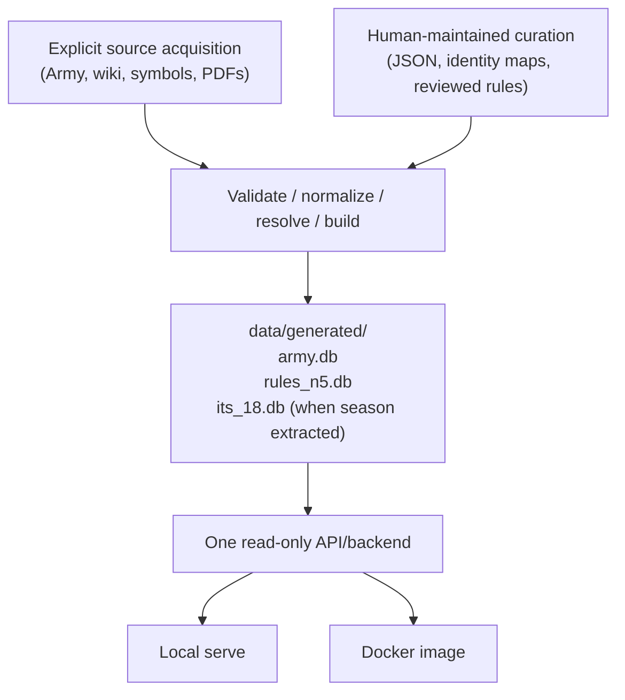
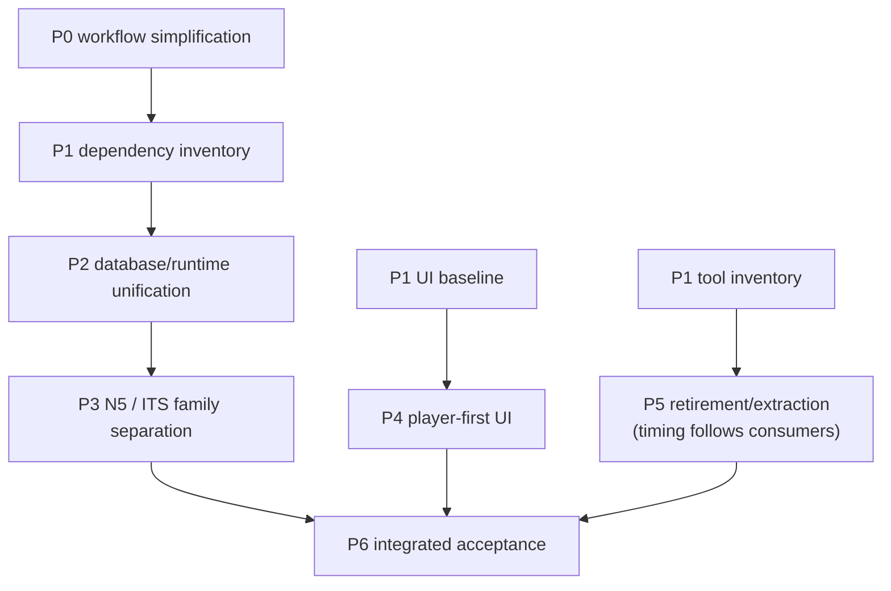

# Major simplification and restructuring plan

**Project domains:** Project infrastructure, Data processing, Acquisition, Web backend, Web frontend, Deployment

**Status:** Active on `dev/v1.1.0`: P0/P1 complete (P1.4–P1.5 are target designs, not final serving paths). P2.1 provides shared validation, opt-in complete builds and provenance. P2.2–P2.4 projections are embedded in opt-in Rules v17/Army v31 sets. P2.5 removed legacy deployed-object serving and image assembly; historical builder/migration modes and the standalone verifier remain. Final naming/defaults and unified serving remain under P2.6–P2.8.

**Established:** 2026-11-08  
**Planning baseline:** `dev/v1.0.1` at `2f84a282872d2aa701684f66bf4e7302cf802932` (clean checkout at initial inspection). This is evidence of the starting architecture, not a freeze on subsequent work.

## Purpose and scope

Simplify InfinityDB as a single-maintainer, non-commercial, read-only Infinity reference. Reduce development and operational overhead *substantially* while preserving the useful behavior of the web application: accurate game data, source citations, linked references, scenario maps, navigation, accessibility, privacy and supported local/Docker hosting.

This is a **target architecture and execution sequence**, not a statement of current behavior and not a second active task register. `TODO.md` owns live implementation work; `validation-queue.md` owns outstanding verification; `releasing.md` owns releases. Use the phase/step identifiers below as durable references in short, actionable TODO entries or commits when necessary. Do not mirror a checkbox per step here or preserve a parallel completion diary.

### Agreed direction

1. **Single-maintainer proportionality.** Prefer Git history, clear documentation, coherent commits, focused checks and a few meaningful release checks over routine staging/promotion, compatibility scaffolding, rollback exercises or repetitive administrative gates.
2. **Databases are the runtime structured-data boundary.** Upstream and editable curated JSON remain valid *build inputs*. All structured data required to serve the application belongs in SQLite output, not loose required JSON or a second build-time interpretation layer. Normal HTTP JSON responses are unaffected.
3. **Source-oriented database ownership.** Rename `infinity.db` to **`army.db`** and `rules.db` to **`rules_n5.db`**. Plan a separate **`its_18.db`** for ITS Season 18, with later seasons following the same pattern where useful.
4. **One artifact contract, two hosting targets.** Checkout-based serving and immutable Docker deployment consume the *same logical database set and application code*. Deployment packages already built data; it does not invent an alternate data model.
5. **Player-first presentation.** Normal pages explain Infinity; internal schema constraints, ingestion caveats and implementation warnings belong in developer diagnostics or documentation. Material gameplay uncertainties and source citations remain available to players.
6. **Remove, do not merely relocate, accidental complexity.** Retire obsolete scripts, deprecated schemas, duplicated checks and documents after proving no live consumer remains. Extract independent acquisition tooling when that actually makes the main repository simpler.
7. **Bounded agent work.** Planning, implementation, test design/execution, housekeeping and release operations are distinct responsibilities; every change should not run all five.

### Guardrails, not procedural gates

- Preserve the player-facing functional baseline and game meaning; no silent changes to Army profiles, rules, cited provenance, scenario geometry, or historical source scope.
- Keep acquisition explicit and offline builds reproducible from identified inputs; do not silently merge different N5/ITS revisions.
- Retain basic database validation, source attribution/licensing, privacy, security, accessibility, and actionable focused regression checks. Simplicity is not permission to publish incorrect data.
- No indefinite compatibility layer for *internal* filenames, schemas, deprecated build commands or legacy runtime publication formats. A deliberate cutover with documented replacement commands is acceptable. Public URLs and documented user-visible API contracts are evaluated separately because breaking them affects users.
- Preserve immutable upstream snapshots and genuinely unique research evidence where needed. Git history is the default record for superseded *code and process*, not a substitute for source files unavailable from Git.
- Do not automatically refactor unrelated gameplay features while cleaning architecture. Keep changes in coherent slices so regressions can be attributed.

## Target boundary (proposed, not yet implemented)



- **`army.db`:** normalized Army snapshots, application Army/Unit/profile identities and usage/relationships derived from Army data. Cross-source information placed here only when Army ownership makes sense.
- **`rules_n5.db`:** N5 core rules, current applicable N5 FAQ, reviewed reference content, rules citations and core scenarios. Retain exact publication/version identity inside records; `n5` in the filename is a family, not an excuse to conflate revisions.
- **`its_18.db`:** Season 18 scenarios, seasonal rules/extras and season-scoped interpretations/citations. The boundary with N5 shared concepts must be decided from real consumers before extraction.
- **Future seasons:** separate database per independently managed season only when worthwhile. Do not require a new physical database for every minor PDF revision or force shared concepts into seasonal duplicates.
- **Raw archives/`infinity.raw.db`:** research and lossless provenance *build-side only*; explicitly reassess whether the raw SQLite sibling is still useful. It is not a serving dependency.
- **Assets:** SVGs, styles, scripts, fonts and other non-structured static assets remain files. JSON used as a transient interchange or generated diagnostic report is acceptable; **required runtime JSON sidecars are not**.
- **Cross-database relationships:** use stable typed IDs and one centralized resolver/query boundary. Prefer build-time materialization or a small shared runtime resolver over scattered joins, replicated rules, or an extra meta-database. Decide the precise approach with tests before migration.

## Work phases

The ordering below expresses **dependencies**, not a requirement to serialize independent work. P4 (UI content) may proceed in parallel with database migration after its baseline is captured. Each step should be delivered as a bounded change, not as one large agent call.

### P0 — Replace heavyweight development governance

**Outcome:** A minimal, explicit single-maintainer workflow that helps rather than obstructs the restructuring.  
**Owns:** Project infrastructure.  
**Prerequisite:** This plan exists.

1. **P0.1 — Inventory mandatory checks.** Enumerate current task-boundary actions across `AGENTS.md`, `AGENTS.local.md`, `docs/testing.md`, `docs/validation-queue.md`, `docs/ci.md` and `docs/releasing.md`. Classify each as correctness-critical, release-only, useful optional, or removable duplication.
2. **P0.2 — Define the normal task lifecycle.** A small coherent implementation task gets relevant context, a focused change, an immediate focused check where warranted, review of its diff, and a coherent commit. Deferred checks are batched by risk/impact rather than multiplying admin steps per edit.
3. **P0.3 — Streamline validation ownership.** Keep a lightweight queue for *real* deferred test obligations. Decide which VD/VR distinctions, numeric thresholds, age limits and strict drain rules actually help; remove duplicated accounting. Preserve independent Linux execution and concise exact-revision reporting without making Linux sync a prerequisite for every edit.
4. **P0.4 — Separate release from development.** Keep explicit release/deploy authorization, basic artifact validation and a relevant smoke test; remove redundant candidate/promotion/rollback ceremony for immutable Docker deployments where Git and rebuilds suffice.
5. **P0.5 — Reconcile agent instructions.** Update the canonical tracked guidance and its linked procedures together. Coordinate any local-only preferences with their owner rather than silently overriding `AGENTS.local.md`; prevent contradictory mandatory instructions.

**Exit:** An agent can explain and execute a normal small change using a short workflow; focused validation and final release responsibilities are unambiguous; no new compatibility or staging policy is added merely for process continuity.

#### P0.1 — Current procedural inventory (2026-11-09)

**Status:** Read-only inventory completed on `dev/v1.1.0`, initial HEAD `baf1773c2d0d746e4f513827228592f620834003`. **Recommendations below are not yet active policy.** P0.2–P0.5 own the actual changes, including updates to dependent instructions and tests. Reviewed `AGENTS.md`, ignored local `AGENTS.local.md`, `docs/testing.md`, `docs/validation-queue.md`, `docs/ci.md`, `docs/releasing.md`, and the [documentation map](README.md).

**Classification key:** **Keep** = correctness/safety-critical for relevant changes; **release-only** = verify at merge, release or deployment rather than every edit; **optional** = useful tool or workflow, chosen by need; **simplify/remove** = administrative duplication or disproportionate mandatory gate.

1. **Start-of-task inspection — keep, narrowed.**
   [Agent guidance](../AGENTS.md) requires branch/HEAD/status, current task, related sources/tests and canonical documents; local `AGENTS.local.md` guidance adds authorized checkout and scope protections. Keep branch/status, relevant context and preserving unrelated changes. Avoid rereading broad architecture, testing, releasing and historical reports for every minor edit. Use targeted documentation only when affected.

2. **Git safety and change delivery — keep.**
   [Agent guidance](../AGENTS.md) and local guidance require reviewed diffs, coherent commits, preserving unrelated changes, safe non-forced push, no uncontrolled checkout changes, and explicit release/deploy authorization. Keep these. Specialized remote Git API compare-and-swap guidance and optional [multi-agent coordination](multi-agent-workspaces.md) apply only to their respective access modes; they are **not** general task phases.

3. **Ordinary backlog selection and closeout — simplify/remove.**
   [Agent guidance](../AGENTS.md), [backlog rules](README.md#backlog-completion-and-retirement) and [historical V1S selection checks](testing.md#v1s-backlog-checks) require task-boundary reconciliation, staged-index historical closeout checks and stable-ID retirement evidence. The 1.0 V1S register has no active items. Keep a short active-backlog/acceptance check; scope V1S-specific selection and closeout tooling to an explicitly reopened V1S item, not normal 1.1 work. Do not create a second task ledger.

4. **Per-change deferred-validation registration — simplify/remove.**
   [Agent guidance](../AGENTS.md#phased-validation-and-task-boundary-checkpoint), local `AGENTS.local.md` preferences, [testing](testing.md#phased-development-and-validation) and the [queue](validation-queue.md#queue-rules) all prescribe VD design and VR execution entries even for routine changes. Keep a lightweight register for *genuinely deferred* verification, with a concrete selector/acceptance condition and revision. Eliminate the default obligation to generate queue records when a bounded task can simply run its focused checks and finish.

5. **VD/VR strict scheduling — simplify/remove.**
   The [queue](validation-queue.md#queue-rules) specifies **VD >= 3**, **VR >= 5**, complete drain-to-zero, seven-day age gates, repeated recounts, and independent reconciliation of every entry. The exact thresholds/drain and age rules are also copied into local agent guidance. These are process controls, not evidence that a test is necessary. P0.3 should replace them with explicit risk/merge triggers and sensible periodic batching, retaining visible blocked/missing checks rather than silently discarding them.

6. **Test-design/implementation separation — simplify/remove.**
   [Testing](testing.md#phased-development-and-validation) and the queue forbid routine tests during implementation and **all** tests during a VD design pass, except urgent integrity cases. A newly authored focused test can therefore be prevented from being run immediately. Proposed replacement: allow writing and running focused tests together when useful; separate design from execution only for actual queued or independently delegated work. Never present an unrun test as passed.

7. **Focused-first coverage and immediate integrity gates — keep.**
   [Focused-first VR guidance](testing.md#focused-first-vr-execution) already says to select affected cross-layer tests first, fix focused failures before widening, reuse compatible executions and avoid full-suite runs merely because the queue filled. Preserve that principle, along with immediately necessary security, schema, provenance, migration and published-artifact checks. Drop repeated approval/accounting around executing a small relevant test.

8. **Linux worker and parallel-work restrictions — keep isolation, remove artificial serialization.**
   The [queue](validation-queue.md#queue-rules), [validation batching](testing.md#validation-batch-planning) and [Linux protocol](testing.md#parallel-windows-development-and-linux-validation) permit unrelated Windows implementation **only during an independent full-suite Linux job**, not a focused Linux job. The meaningful safety boundary is an independent, pinned checkout and non-overlapping writes, not whether a job happens to be full-suite. Preserve explicit Git sync, tested-revision identity and artifact isolation; allow independent development during any isolated job in P0.3.

9. **Task status reporting — optional.**
   [Read-only development status](testing.md#read-only-development-status) consolidates repository, queues, jobs and exact-SHA CI observations. Retain the command as a useful opt-in view. Ordinary task reports should state changed behavior, actual checks, limitations and commit; queue counts, oldest age, worker/host and job receipts are relevant only when there is due or running validation.

10. **Hosted CI monitoring — keep at integration boundaries; avoid per-edit ceremony.**
    [CI guidance](ci.md#agent-ci-monitoring-and-repair) correctly allows non-blocking development between commits and requires actual exact-revision evidence for a final gate. Keep actionable failure diagnosis and correct claim boundaries. Do not require workflow polling/recordkeeping for every doc or intermediate commit with no relevant CI run. P0.4 should identify the smallest set of mandatory hosted gates for a given change class.

11. **Release and Docker gates — release-only; simplify by impact.**
    [Release checklist](releasing.md#4-run-local-release-validation) and [hosted policy](ci.md#risk-based-source-validation) already allow focused Source reuse for narrowly scoped candidates, but require much broader source, wheel, browser, image, publication and exact-SHA evidence at other gates. Preserve version/changelog consistency, a usable built artifact, relevant smoke tests, deployment authorization and production identity. Reassess mandatory four-browser matrices, exhaustive local/preflight reruns, candidate promotions and rollback-image inspections by actual release risk; do not weaken them silently before P0.4 establishes a replacement contract.

12. **Project-wide documentation and one-use retirement — simplify scheduling.**
    [Former release documentation audit](releasing.md#2-review-release-relevant-documentation) previously required reviewing the *entire* maintained corpus every release; [document retirement](README.md#one-use-tool-and-audit-lifecycle) and [agent guidance](../AGENTS.md#documentation-and-project-tracking) add task-level reconciliation. Keep one authoritative owner per contract, check affected links, and preserve necessary licensing/provenance. Use focused documentation review for routine edits and deliberate broader audits for architectural changes; leave one-use script retirement to its bounded task or P5 inventory instead of revisiting it on every small edit.

13. **Source/gameplay correctness and external constraints — keep.**
    Existing agent, architecture and source-reconciliation guidance protects stable identities, correct citations and revisions, unknown/ambiguous facts, offline builds, privacy, copyright permissions and safe rendering. These are product invariants, not optional paperwork. Maintain them while reducing ceremony.

**Root cause and priority:** Mandatory instructions for the same VD/VR process are spread over four documents, historical V1S closeout is still referenced in normal task guidance, and release checks are described alongside ordinary development. First define a small normal lifecycle (P0.2), then reduce the queue rules and worker restrictions (P0.3), isolate release acceptance (P0.4), and reconcile tracked/local agent guidance and linked procedures (P0.5). Do not partially edit a single policy owner and leave contradictory mandatory instructions elsewhere.

**Baseline observation:** The active queue reported no pending VD or VR entries at inspection. No implementation/test policy, required CI workflow or existing gate was changed in P0.1. This section records proposed dispositions for the next steps, not their approval as operational rules.

#### P0.2 — Proposed normal task lifecycle (2026-11-09)

**Status:** Implemented on `dev/v1.1.0` through P0.3–P0.5 tracked guidance changes. This section records the rationale, not a second operating manual. Active task instructions live in `docs/testing.md`, linked from `AGENTS.md`. The checkout-local preference update was subsequently completed and verified.

**Default task unit:** One coherent, reviewable behavior change or closely coupled set of changes with an observable acceptance condition. Avoid splitting every file edit into its own investigation/test/commit cycle, but do not mix independent defects merely to fill a batch. Small, known tasks need no separate planning agent, formal handoff or pre-implementation approval.

**Proposed five-step default:**

1. **Orient.** Verify the intended branch, HEAD, working-tree status and active task. Read only directly affected source, tests and the relevant canonical guidance; identify existing changes to preserve. For ambiguous/high-risk semantics, perform a bounded read-only investigation first. A task is ready when the desired behavior and a practical check are clear.
2. **Implement.** Make the smallest coherent change, preserving unrelated work. Update focused tests alongside code where useful. Do not create separate VD/VR entries or invoke a test-design agent merely because source changed. A newly written test may be run immediately.
3. **Verify.** Select the smallest sufficient checks for the affected contract: existing/new regression tests, lint/type/docs or data/asset integrity as appropriate. Broaden only for a demonstrated cross-cutting impact or an independently required gate; resolve relevant failures before acceptance. **Documentation-only edits:** documentation checks; no automatic app test. **Executable/data edits:** focused behavioral checks plus any necessary schema/source/provenance gates. **Cumulative/release changes:** follow the separately applicable integration or release acceptance owner.
4. **Deliver.** Review the actual diff and status; update the canonical documentation and active backlog only if behavior or remaining work changed. Stage task-related files, commit a coherent validated result, and safely push only where authorized by the normal development workflow. A completed implementation task does not imply that unrun CI, Docker or release tests passed.
5. **Report and stop.** State what changed, checks actually run and outcomes, blocked/unrun verification (if any), commit/branch and any meaningful next dependency. Do not require routine queue counts, old V1S bookkeeping, GitHub run receipts or repeated checklists when none are relevant.

**Decision rules for exceptional work:**

| Situation | Action; not a default extra phase |
| --- | --- |
| Small known code/UI bug | Implement and execute focused regression(s) in the same pass. |
| Documentation-only change | Update owned documentation, run docs checks, commit. |
| Rule/source interpretation, cross-source revision, database/schema or security-sensitive change | Investigate affected invariants first; validate the relevant semantic/integrity boundaries before acceptance. |
| Test execution is genuinely deferred (for example, a required browser/asset/host unavailable locally) | Register **one concrete open obligation** with selector/expected evidence, owning task, relevant revision and intended execution trigger. Do not mark it passed or silently discard it. P0.3 will define the streamlined register and scheduling. |
| Multiple related implementation changes | Run the union of impacted focused tests once where compatible; do not repeat a full suite for every edit. |
| An isolated Linux/other worker is testing an exact revision | Independent work may continue in a **separate checkout** if no shared mutable inputs are affected. The result validates only the pinned revision/assets. P0.3 updates the concurrency rule. |
| CI/PR merge, release or deployment | Hand off to the separately defined relevant gate. Do not run all release checks for ordinary commits and do not conflate passing focused tests with a shippable release. |

**Minimal per-task acceptance evidence:** a specific intended result, reviewed changed files, passing applicable focused checks (with failures/skips disclosed), and an unambiguous delivered revision. For source/data changes retain the source publication/revision and reproducible build evidence needed to substantiate the changed facts. No additional status document, task diary or audit report is required solely for process compliance.

**Conditions that still block closeout:** a known correctness regression; a required immediate integrity check that fails or was not performed; loss of source scope/provenance or required licensing attribution; uncertain Git state; or a stated acceptance condition that remains unmet. In contrast, an independently owned future CI/release gate is reported as pending without forcing an otherwise validated implementation to stay in an administrative loop.

**Implementation handoff to P0.3–P0.5:**

- **P0.3:** Replace default-per-change VD/VR creation, strict numeric drain loops, all-tests-forbidden design passes and the full-suite-only concurrency exception. Retain actual deferred obligations and focused-first checks. Check users of the queue format (especially `tools.dev_status` and backlog/test helpers) before removing fields or IDs.
- **P0.4:** Separate the minimal normal development acceptance from release/merge, image, cross-platform and deployed-smoke acceptance. Make the release choice risk-based and explicit rather than removing product-level protection by implication.
- **P0.5:** Give the active default one authoritative short owner in `docs/testing.md`; keep `AGENTS.md` an entry point and align `docs/validation-queue.md`, `docs/ci.md`, `docs/releasing.md` and local `AGENTS.local.md` without conflicting MUST rules. Do not edit ignored personal preferences without an explicit reconciliation decision.

**Exit decision for P0.2:** The normal path is **orient → implement → verify → deliver → report**. Specialized investigation, queued testing, multi-agent delegation and release operations are opt-in by actual risk or need, not mandatory steps per edit. No behavior, queue threshold or existing mandatory gate changes merely because this target lifecycle has been documented.

#### P0.3 — Deferred-validation simplification (2026-11-09)

**Implemented on `dev/v1.1.0`:** Ordinary implementation now permits
immediate focused regression design and execution. VD/VR entries are created
only for concrete **unresolved** checks, each with a reason and resumption
trigger. Removed mandatory 3/5 item thresholds, seven-day age deadlines and
drain-to-zero sequencing. A pinned, independent Linux checkout can execute
focused or full tests while unrelated Windows work continues without changing
shared inputs. Linux revision/asset verification, Git safety, actual terminal
test results and all independently required CI/release gates remain.

The read-only `tools.dev_status` report now gives counts, oldest age and
blocked IDs without inferring an automatic "due" state. The historical VD/VR
IDs and active markdown sections remain readable. Removed redundant
completed-entry narrative from the active queue; Git history and existing
testing evidence retain that history.

**Scope boundary:** Tracked `AGENTS.md`, `docs/testing.md`,
`docs/validation-queue.md`, `docs/AI_CONTEXT.md`, documentation map,
Copilot guidance and the optional coordination entrypoint are aligned.
`AGENTS.local.md` remains Git-ignored and contains superseded strict-queue
preferences; tracked policy takes precedence, but explicit local-preference
reconciliation belongs to **P0.5**. Substantive release and hosted-gate
simplification is recorded in the P0.4 implementation section below.

#### P0.4 — Release and CI simplification (2026-11-09)

**Implemented for development toward v1.1.0:** Normal development no longer
needs finalized release metadata, a repeated isolated preflight or a
cross-browser matrix. Release metadata (`Unreleased` to a dated version,
package/module version and README link) is explicitly checked with
`tools.release_metadata` **before the release merge/tag**, not on every PR.
Pending release notes remain valid in ordinary source and web tests.

**Source CI:** the primary Ubuntu/Python 3.11 leg runs the complete source
suite **once**, with lint, types, documentation and builds. Other OS/Python
legs check portable Army/Rules builds and deterministic output without
duplicating the full pytest suite. The optional isolated preflight remains
available for a specific packaging/index risk; installed-wheel and Docker
smoke are separate exact-SHA workflows. Broad or unknown changes still
invoke the full Source *matrix*, while eligible documentation/test-only
deltas can reuse a verified Source/wheel/deployment baseline.

**Release evidence:** the three core workflows are Source checks, Installed
wheel smoke and Deployment smoke. Source job-level verification now runs
whether or not browser evidence was selected. The four-platform browser
matrix is manual/opt-in for **v1.1+**, required only when browser risk
warrants it; the historical v1.0.x tag rule remains fail-closed. The
evidence CLI accepts `--include-cross-browser` and still verifies every
selected browser job. At tag preparation, it also checks exact local HEAD
and finalized metadata/tag identity so an `Unreleased` heading cannot slip
through merely because ordinary development CI permits it. A previously
configured GitHub branch ruleset may
still require the now-manual browser status and must be reconciled by the
repository owner if so.

**Deployment:** Docker CI validates **one current release image** and its
startup/asset contract, not a fabricated v8 rollback image or recovery
exercise. Tagged images and Git history remain normal recovery mechanisms;
real deployment remains separately authorized. Project-wide documentation
audits, manual full-suite repetitions and large post-deployment browser
matrices are risk-based, not blanket release gates.

**Still to do:** P0.5's tracked and checkout-local reconciliation is recorded
below. P2 owns deleting application data-candidate/promotion infrastructure
and unifying local and Docker runtime publication. Those are *not* implicitly
removed by the simplified release policy.

#### P0.5 — Agent and documentation guidance reconciliation (2026-11-09)

**Tracked reconciliation implemented:** `AGENTS.md` now makes the
canonical short lifecycle the normal path and applies historical V1S
selection/retirement only to reopened numbered work. The release-closeout
agent skill now distinguishes normal tracked backlog closeout, genuinely
deferred validation and actual release gates. The documentation map and
read-only status entrypoint no longer mandate a whole-backlog or status
inventory at every boundary. Preserve local Git safety, source semantics,
release authorization and published evidence guarantees.

**Local-only reconciliation verified:** The user manually updated the
Git-ignored `AGENTS.local.md` on the current checkout. A subsequent read-only
inspection confirmed that the old VD/VR 3/5 threshold, drain-to-zero,
implementation-time test ban and full-suite-only Linux concurrency rules were
replaced with the canonical focused-first policy. Other local preferences
remain untracked and were not promoted to project policy. This verification
does not imply that other checkouts have the same private file.

**Exit:** One authoritative tracked workflow under `docs/testing.md`;
`docs/validation-queue.md`, `docs/ci.md` and `docs/releasing.md`
retain domain-specific rules. A small implementation no longer invokes
historical V1S, VD/VR or release ceremony by default. This checkout's
local preference guidance is now aligned; other machines remain independent.

### P1 — Map the dependency graph and define the cutover

**Outcome:** Evidence-based keep/migrate/extract/retire inventory and an executable database target contract.  
**Owns:** Project infrastructure, Data processing, Web backend, Deployment.  
**Prerequisite:** P0 workflow is usable; read-only inventory may start immediately.

1. **P1.1 — Inventory entrypoints and paths.** Record tracked and generated assets by owner: `src/`, `data/`, `config/`, `tools/`, `scripts/`, `.github/workflows/`, `docs/` and Docker packaging. Distinguish source inputs, editable knowledge, intermediates, release artifacts and serving dependencies.
2. **P1.2 — Trace runtime reads.** For every required `.json`, `.db` and manifest, identify producers, CLI consumers, API/backend consumers, tests, Docker requirements and direct static browser fetches. Start with `variant-usage.json`, `weapon-profile-sources.json`, `restrictions-reference.json`, legacy `deployed-objects.json`, `infinity.raw.db` and symbol publication metadata.
3. **P1.3 — Capture baseline behavior.** Select representative Army/Unit/rules/FAQ/Fireteam/scenario/search responses and browser routes, including Battleground geometry, source citations and Developer mode. Record snapshot-specific fixtures or checks that can show semantic parity after migrations without demanding full-suite runs at each intermediate step.
4. **P1.4 — Define database ownership.** For each runtime dataset specify physical database, stable identities, schema, provenance/version requirements and cross-database lookup. Resolve where Weapon citations, variant usage, restrictions, deployed objects and symbol mappings belong.
5. **P1.5 — Define build/serve paths.** Choose one default generated database directory, an explicit way to select an alternate database set, and Docker's mechanism for packaging exactly those built artifacts. Keep local and Docker data expectations aligned; determine whether release DBs remain tracked or are generated as release outputs.
6. **P1.6 — Classify tooling by continuing purpose.** Distinguish maintained runtime/build utilities, genuinely reusable checks, completed one-use helpers, extractable acquisition concerns and obsolete paths. Establish the independent research, development or presentation purpose first; inspect imports, tests, CI, commands and documentation to plan replacement/removal, not to veto retirement automatically. Classify historical-path tests by the current invariant (if any) they protect.

**Exit:** Each runtime data dependency has a named database destination and migration order; the two serve targets have one artifact contract; tool retirements are evidence-based; baseline comparisons are runnable.

#### P1.1 — Entry points and artifact-path inventory (2026-11-09)

**Status:** Read-only inventory completed on `dev/v1.1.0` at
`be70d859447b5c79541e1f885807918a21704d32`; no data, code,
deployment or database files were changed. This is a **path/ownership
classification**, not proof that every runtime consumer has been traced.
P1.2 must establish those dependencies individually before any cutover.

**Maintained and source inputs:**

- `src/infinity_army_data/` — standalone Army merge, normalize and export
  implementation. `src/infinity_db/` — integrated build/CLI, rules models,
  SQLite repositories, and `web/` WSGI/API/presentation. The entrypoints in
  `pyproject.toml` are `infinity-db` and `infinity-army`; production WSGI
  enters via `infinity_db.web.wsgi:app`.
- `data/raw/` — ignored immutable Army/symbol ZIP snapshots, acquired
  explicitly by `tools/download_army_json.py` and related symbol tools.
  `data/wiki/` and `data/pdf/` — ignored research source archives/documents,
  not implicit normal-build inputs. `data/work/`, `data/logs/`,
  `data/reports/`, `data/backups/` — local acquisition/transformation state.
- `config/catalogs/`, `config/identity/`, `config/validation/` and
  `config/symbols/` — maintained JSON mappings, review decisions,
  validation evidence and symbol policy. Classify each file by actual build
  or runtime reads in P1.2; being JSON does **not** make a file a runtime
  sidecar.
- `data/curated/rules/`, `identities/`, `peripherals/`,
  `relationships/`, `enrichment-coverage/`, `rules-interactions/`,
  `snapshot-notes/`, and reviewed root JSON — maintained knowledge and
  source evidence. Rules curation feeds `build-rules`; Army/identity
  curation also feeds normalization and publication.
- `data/manifests/snapshots/` and `army-symbol-build.json` — ignored
  generated provenance/build state. **`data/manifests/symbol-publication.json`
  is different:** a tracked release publication and an observed **runtime
  lookup input** for `SymbolCatalog`. Its mappings must be accounted for
  before retiring any required runtime JSON.

**Generated and release outputs (current v10):**

- `data/generated/infinity.db` — tracked Army runtime release database;
  `data/generated/rules.db` — tracked N5/Rules runtime release database,
  with reviewed deployed objects embedded in v10.
- `data/generated/variant-usage.json` and
  `data/generated/weapon-profile-sources.json` — **tracked, required,
  database-paired release publications**; runtime reads their JSON content.
  These are first-class P2 migration candidates, not merely build diagnostics.
- `data/generated/master.json`, `normalized.json`,
  `normalized-validation.json`, `infinity.raw.db` and generated
  reports — rebuildable intermediates/development source provenance.
  `infinity.raw.db` is needed to produce exact-variant output **at build
  time** but is not included in the v10 serving bundle.
  `data/generated/deployed-objects.json` is a legacy v8/v9 compatibility
  output, not a required v10 file.
- `src/infinity_db/web/static/` — packaged HTML/CSS/JS, processed SVG
  symbols, fonts and other browser assets. **`static/restrictions-reference.json`
  is directly fetched by the browser**, via `static/api.js`, independently
  of the database bundle. Treat it as runtime structured data in P1.2/P2.4.
  SVGs, fonts and ordinary scripts remain files under the agreed target.
- `build/`, `dist/`, `reports/`, `local/` and analogous cache/output
  directories contain packaging, test, diagnostics or checkout-local work;
  their existence does not make them tracked release inputs.

**Two current serving and packaging paths:**

1. **Checkout:** `infinity-db build --compact` writes the Army
   application/raw pair, historically replacing tracked
   `data/generated/infinity.db`. Plain `infinity-db build-rules` writes
   ignored `local/rules-standalone.db` and calls
   `tools.build_v10_runtime_candidate.publish_checkout_runtime`, which
   validates and assembles four matched files under ignored
   `local/checkout-runtime/`. Plain `infinity-db serve` selects that
   bundle if present/current, otherwise the tracked release database pair;
   an explicit `--database` bypasses selection. Entry points:
   `src/infinity_db/cli.py`, `checkout_runtime.py`,
   `web/server.py`, `web/app.py`.
2. **Docker:** `scripts/deploy.sh` and
   `.github/workflows/deployment-smoke.yml` run release asset checks and
   `tools.prepare_runtime_bundle`: they validate the **tracked** release
   pair/sidecars and copy exactly `infinity.db`, `rules.db`,
   `variant-usage.json`, `weapon-profile-sources.json` into ignored
   `data/runtime/` for **v10**. `Dockerfile` packages that directory at
   `/app/data/`; WSGI receives `INFINITY_DB_DATABASE` and
   `INFINITY_DB_RULES_DATABASE`. `compose.yaml` runs the app, the
   separately packaged metrics-history collector and Caddy. No raw Army
   snapshot, checkout bundle or local candidate is required by the image.
   `Dockerfile.metrics-history` is an independent service image, not an
   additional gameplay-data database owner.

**Owners to preserve across P1.2–P1.6:** `tools/` contains explicit
acquisition, symbol building, data-candidate publication, validators,
CI/release preparation, metrics and migration/audit scripts; they must be
classified by concrete consumers in P1.6 rather than deleted by naming
convention. `scripts/` owns deploy/install, local-container and
image-verification entrypoints; `.github/workflows/` owns Source, wheel,
Docker, optional browser and full-asset gates. `tests/` and
`config/testing/` own fixtures/test selection, not release data;
`docs/` owns current contracts, plans and historical provenance.

**P1.2 priority:** Trace the two JSON database companions, the directly
served Restrictions JSON, and the symbol-publication manifest through their
producers, read paths and externally visible results; then inspect other
runtime file reads and determine which structured facts belong in Army,
N5 Rules or season databases. Do not equate a static JSON asset with a
non-runtime document or assume every JSON in `config/` needs migration.

#### P1.2 — Verified runtime read/producer dependency graph (2026-11-09)

**Status:** Read-only code/packaging trace at
`52c1407d58816272dbbc31adf45956b04a3880b1`; P1.1 is the
path inventory above. This traces the **observed file-opening paths and
their transitive API/build callers**; it is not a proposed schema or
acceptance of a changed runtime. The intervening checkout revision
changed documentation flow diagrams, not the serving model. P1.3–P1.5
own baseline fixtures, final database placement and output layout.

**SQLite databases:**

- **`data/generated/infinity.db`:** `infinity-db build --compact`
  invokes `infinity_db.cli.cmd_build` and `database.importer.export_database`
  after Army ZIP merge, normalization and curation. `Database` in
  `database/repository.py` is the read-only serving owner, used by
  `web/app.py` and `web/api_handler.py` for Army/Unit/profile/catalog,
  Fireteam, filters and cross-domain source relationships. The selected
  file is validated on application startup; its provenance is included
  in `/api/version` and release snapshot identity. Docker takes the
  tracked database through `tools.prepare_runtime_bundle`; local serving
  selects the checkout bundle when current. Tests include
  `tests/test_database.py`, `test_api.py`, `test_app_cli.py` and
  `test_web.py`.
- **`data/generated/rules.db`:** `infinity-db build-rules`,
  `tools.release_rules_export` and
  `tools.build_v10_runtime_candidate` normalize reviewed
  `data/curated/rules/`, the Restrictions manifest and deployed-object
  review evidence through `export_rules_database`. Serving reads it
  via `RulesDatabase` and the Skill/Equipment/Rules/FAQ/Scenario
  catalogs, including `/api/restrictions`, `/api/scenarios` and
  the scenario-map SVG API. v10 embeds deployed objects; source
  collection/version, Army links and provenance must survive extraction
  into `rules_n5.db` and later ITS databases. Tests include
  `tests/test_rules_database.py`, `test_deployed_object_storage.py`,
  `test_scenario_catalog.py` and API/browser acceptance.
- **`data/generated/infinity.raw.db`:** produced alongside the Army
  application database by the exporter, with matching export-pair
  metadata. `variant_usage.build_variant_usage_projection`,
  source audits and `tools.inspect_raw_archive` read raw occurrence
  tables (including original owner/position/extras) for build-time
  reconciliation; `Application`, `ApiHandler` and Docker's v10
  serving bundle do **not** open it. Raw database output is not a
  P2 serving file, although the exact-variant builder currently needs
  it. Keep that distinction when selecting the final build directory.

**Release-paired JSON beside the databases:**

- **`variant-usage.json`:** producer
  `variant_usage.build_variant_usage_projection(army, raw, rules, ...)`,
  followed by `variant_usage_reference.publication_from_candidate`;
  invoked by `tools.build_variant_usage` or checkout/release candidate
  assembly. It records stable `variantKey`, Skill/Equipment record IDs,
  exact source occurrence/owner coordinates, derived Unit/context counts
  and Army/Rules/export-pair fingerprints. In v10 its format-v2
  publication requires **embedded** deployed objects but no legacy
  deployed-object JSON. `web/app.py` loads and fingerprints the
  co-located file through `load_variant_usage_publication`, and
  `/api/variant-usage?record_id=...` filters its groups; detail
  pages report publication availability. Missing publication produces
  unavailable results, not computed best-effort counts. Relevant tests:
  `test_variant_usage.py`,
  `test_verify_variant_usage_publication_browser.py` and
  `test_deployed_object_storage.py`. **Migration invariant:** preserve
  exact source-row identity, order, context and counts, and the
  sourceSnapshot/public API projection without a runtime raw-file read.
- **`weapon-profile-sources.json`:** producer
  `tools.build_weapon_profile_publication`, using
  `data/curated/weapon-shared-effect-reviews.json`, exact Army
  Weapon/profile/mode signatures and current Rules PDF source/page
  provenance. `weapon_profile_publication.load_runtime_weapon_profile_publication`
  validates the co-located Army/Rules SHA pair and reconstructs a map
  keyed by `(weapon_id, profile_source_id, mode)`.
  `/api/weapons/<slug>` attaches `profile_citations` and
  `profile_citations_available`; its file digest contributes to
  `runtime_snapshot_revision`. Required for published release checks
  by `tools.verify_deployment_assets`. Tests:
  `test_weapon_profile_publication.py`,
  `test_weaponry_catalog_api.py` and
  `test_verify_deployment_assets.py`. **Migration invariant:** retain
  mode-level identities and page/source version/URL/SHA provenance;
  replacing this JSON must update snapshot revision semantics.
- **`deployed-objects.json`:** produced for **legacy v8/v9** schemas by
  `tools.build_deployed_object_publication` and checked via
  `load_deployed_object_publication`. `Application` falls back to
  that file only if no embedded payload exists. Current v10 reads
  normalized deployed-object records from `RulesDatabase`, paired to
  the Army source, and exposes list/detail through
  `/api/deployed-objects`. `tools.prepare_runtime_bundle` packages
  no deployed-object JSON for v10; its legacy branches still require
  it. Tests: `test_deployed_object_storage.py`,
  `test_deployed_object_publication.py` and
  `test_deployment_scripts.py`. P2.5 should remove **proven dead
  compatibility paths**, not rebuild the already normalized content.

**Other required structured reads outside the four-file bundle:**

- **`web/static/restrictions-reference.json`:** a separate *compiled
  static browser publication*, produced/verified by
  `tools.audit_restrictions_source_chart.project_public_restrictions`
  from `config/validation/restrictions-source-chart.json`, selected
  curated source records and N5.3 page 194. It is served by
  `web/presentation.py`; `static/api.js` fetches it for
  `restrictions-page.js`, `catalog-detail.js` and `skill.js`.
  The source-specific six-row page representation is **not identical**
  to the existing database-backed `/api/restrictions` payload, which
  uses normalized prohibition records. Tests include
  `test_game_mode_source_table.py` and Restrictions API checks.
  P2.4 must preserve the developer-only display, anchor links,
  labels, notes, source link and no-legality-evaluator boundary when
  replacing this fetch; migrating the static file into a second
  database table uncritically would perpetuate duplicated semantics.
- **`data/manifests/symbol-publication.json`:** produced by symbol
  acquisition/build publication (`tools.build_symbols` /
  `tools.reorganize_symbols`) with validated processed SVGs and
  browser path mappings. `SymbolCatalog` reads this **tracked
  manifest at API initialization** to enrich Army/Unit/profile SVG
  references; `web/presentation._static_asset_revision` also hashes
  its exact bytes for static cache identity. The source checkout uses
  the tracked manifest; installed wheels use
  `share/infinity-db/data/manifests/`. Docker does not copy it into
  `/app/data/` because the wheel already contains it. Tests:
  `test_symbol_catalog.py`, `test_asset_validation.py`,
  `test_build_symbols.py` and `test_deployment_scripts.py`.
  **Migration invariant:** preserve path/identity mapping and correct
  browser cache invalidation, independently of keeping SVG files
  outside SQLite.

**Further runtime reads via wheel-packaged maintained JSON:**

The production image installs the package with `pip install ".[server]"`
before deleting the temporary `/app/config`, `/app/data/curated`
and manifest *source* directories. `project_resources.py` still
resolves maintained resources from installed
`share/infinity-db/`; `pyproject.toml` explicitly packages them.
Consequently a four-file `data/runtime/` inventory is **not** a
complete runtime dependency graph. These files are directly read by
normal API services rather than merely by build commands:

- `data/curated/identities/army-overview.json` →
  `army_overview_copy.load_army_overview_copy` →
  `ApiHandler` → `/api/armies` editorial summaries.
- `data/curated/identities/legacy-armies.json` →
  `legacy_armies.load_legacy_armies` → `ApiHandler` →
  `/api/armies`, and legacy-aware Search.
- `config/catalogs/equipment-presentation-encodings.json` →
  `EquipmentCatalog` → `/api/equipment` and detail.
- `config/catalogs/skill-source-classifications.json` →
  `SkillCatalog` and `unit_presentation` →
  Skill classification and Unit details.
- `config/catalogs/unit-filter-semantics.json` →
  `unit_presentation.enrich_unit_filter_presentation` and
  `Database._classification_filter_source_ids` →
  `/api/unit-filters` and Unit list/filter queries.
- `config/catalogs/trait-wiki-references.json` →
  `TraitCatalog` → Trait link/public source projection.
- `config/catalogs/weapon-ammunition-references.json` →
  `WeaponAmmunitionReferences` in `CatalogRules` →
  exact Weapon/profile Ammunition references.
- `config/catalogs/weapon-combined-saving-rolls.json` →
  `WeaponCombinedSavingRolls` in `CatalogRules` →
  reviewed Weapon-profile saving-roll information.
- `config/catalogs/weapon-properties.json` →
  `WeaponProperties` in `CatalogRules`, `GlossaryCatalog`
  and maintained-text reference enrichment → Weapon/Glossary links,
  summaries and exact profile associations.

These nine maintained JSON inputs require **runtime projection or
materialization** if the target is genuinely SQLite-only at serving
time. Keep the editable source files as build inputs; P1.4 chooses
their normalized owners. Representative existing regression coverage
includes `test_weapon_properties.py`, `test_weaponry_catalog_api.py`,
`test_api.py`, `test_web.py`, `test_app_cli.py` and
`test_installed_wheel_smoke.py`. Add precise parity fixtures in
P1.3 rather than assuming those tests cover every mapping.

**Build-only / non-domain resources (do not migrate merely for being JSON):**
`config/catalogs/weapon-categories.json`, `weapon-overrides.json`,
`metadata-only-weapons.json`, source identity configuration,
review/pinning evidence in `config/validation/`, and curated
source snapshots feed exporter/audit/tooling paths; no normal
`ApiHandler` file read was found for those inputs. They may still be
needed by installed build commands even after serving becomes SQLite-only.
`docs/CHANGELOG.md` is a rendered human-facing release document and
`scenario_map_svg.py` reads CSS theme tokens; neither is a required
structured JSON fact file. Search of browser static code found only
one direct named `.json` fetch, the Restrictions publication; normal
browser data calls otherwise use `/api/` routes.

**Packaging and test boundaries:** `Dockerfile` stages `data/runtime/`
at `/app/data/`, sets `INFINITY_DB_DATABASE` and
`INFINITY_DB_RULES_DATABASE`; `web/wsgi.py` requires the Army
database path and validates explicit Rules. Checkout `serve` chooses
a source-matched local bundle via `checkout_runtime.py`.
`tools.verify_deployment_assets` checks source binding, variant/Weapon
publications and symbol manifest; `tools.prepare_runtime_bundle`
enforces the four-file v10 contract. `tools.installed_wheel_smoke`
verifies resources in a wheel-installed environment and exercises
`/api/armies`. These entrypoints and `tests/test_deployment_scripts.py`
must change together with any runtime cutover; the presence of valid
SQLite files alone does **not** currently guarantee a standalone
installed application can serve every route.

**Handoffs:**

- **P1.3:** Pin representative payloads for `/api/armies`,
  `/api/unit-filters`, Skill/Equipment/Weapon/Traits, exact
  `/api/variant-usage`, deployed objects, both Restrictions
  representations, Glossary/legacy Search, symbols, and scenario
  list/detail/map; include source/citation/revision metadata,
  missing-publication behavior and relevant browser links.
- **P1.4:** Decide ownership for each of the nine runtime-maintained
  datasets, the two sidecars, Restrictions presentation and symbol
  mappings; specify typed keys, source/version identity and API
  projection. Existing `rules.db` Restrictions and deployed-object
  tables should be reused rather than duplicated. Do not choose
  `army.db` versus `rules_n5.db` solely from a file's current folder.
- **P1.5:** Define one generated database directory and exact active
  selection for checkout and Docker; validate packaging without
  required wheel/share runtime JSON. Retain independently authored
  config as **build inputs**, and continue packaging static SVG/JS/CSS
  as files. Explicitly decide the policy for absent or mismatched
  database sets; existing sidecars have different failure modes
  (startup failure, 503/unavailable, optional feature absence).
- **P1.6:** Classify publication, compat and audit tools by their
  actual entrypoint/test/deployment consumers before retiring them.
  The source trace does not authorize immediate deletion.

#### P1.3 — Snapshot-pinned runtime and browser-route baseline (2026-11-09)

**Implemented:** `tools/runtime_semantic_baseline.py` captures and checks
`tests/fixtures/runtime-semantic-baseline-v1.json` offline through
the actual WSGI `create_app` using the tracked Army/Rules database pair.
The initial fixture pins SHA-256 identities of both DBs, reviewed Weapon
citations and the symbol-publication manifest. It records **41 requests**,
including Army/Unit/Skill/Equipment/Weapon/Traits, Fireteams,
Orders/AROs, restrictions and deployed objects; a dated FAQ; exact
Skill and Equipment variant usage; search and glossary; current N5
and ITS-18 Battleground scenario data, its complete map SVG bytes and
five geometry markers; and public HTML routes and developer-only
CSS/JS markers. A reviewed Weapon with published profile citations
is chosen by verified source identity, not by the compact list payload.

**Comparison:** JSON responses are canonicalized with sorted keys and
stable exact list order before hashing. Only database-byte binding fields
(`armyDatabaseSha256`, `rulesDatabaseSha256`, `exportPairSha256`,
legacy deployed-object publication hash) are omitted **inside**
`sourceSnapshot`; source archive identities and citations remain
in the semantic digest. The `/api/version` field names are checked
without binding the candidate to the old app/static version. Battleground
SVG bytes have an exact SHA-256 and geometry markers; browser HTML/JS/CSS
are checked for route availability and selected contract markers rather
than freezing versioned asset URLs. These checks do **not** substitute
for actual Playwright user-interaction, accessibility or responsive tests.

**Repeatable focused commands (repository root):**

```powershell
.\.venv\Scripts\python.exe -m tools.runtime_semantic_baseline --check --identical-artifacts
.\.venv\Scripts\python.exe -m tools.runtime_semantic_baseline --check --army-db data/generated/army.db --rules-db data/generated/rules_n5.db
.\.venv\Scripts\python.exe tools/run_checks.py --stage test tests/test_runtime_semantic_baseline.py
```

The first verifies the *unchanged pinned source pair*. The second is the
planned post-P2 parity check against a rebuilt/renamed pair: differences
in artifact bytes are permitted, but the selected API semantics and
geometry must still agree. The tool can compare a documented intentional
URL replacement using e.g.
`--route-alias '/static/restrictions-reference.json=>/api/restrictions/chart'`
provided that new route returns the same response contract. It does not
silently remove probes, alter expected digests, regenerate the baseline
or accept changed semantics. The fixture is an immutable reviewed
reference; `--capture` refuses to overwrite it. A deliberate source
update requires a **separate reviewed baseline** with corresponding
new source/release identity, not a blind re-capture.

**Remaining acceptance:** A new DB schema/packaging path, actual Docker
startup, visual Developer-mode toggling, responsive layouts and
full-feature parity are **not** yet tested. Use the relevant existing
Playwright/HTTP selectors at P2 milestones; do not demand the full
project suite for each intermediate step. P1.4 now specifies the
database owners/schema and P1.5 the unified build directory/serving
contract before any production data migration.

#### P1.4 — Target database ownership and relational contract (2026-11-09)

**Status:** Design accepted for implementation planning on `dev/v1.1.0`,
based on current Army schema v26, the v10 Rules release model, the P1.2 read graph
and the P1.3 parity fixture. **Nothing in this section describes a
deployed or migrated schema.** P1.5 owns paths/packaging; P2 builds the
first two files; P3 separates ITS physically. Exact SQL DDL and
compatibility-version increments belong to the implementing change.

**Final database families and authority:**

- **`army.db` — Army source and Army-facing application facts.** Own
  normalized source-native Armies, Units, profiles, options, Weapons and
  exact source identifiers; canonical Army slugs, source-to-logical-Unit
  identities, Army overviews/legacy identities, filter semantics,
  classifications, and published Army/Unit/profile **symbol path
  mappings**. Generated from the pinned Army archive and maintained
  Army-specific authoring/validation inputs. Do not put rule
  interpretations, source PDF authority or season-specific missions here.
- **`rules_n5.db` — N5 rule authority and N5-scoped enrichments.**
  Own reviewed rule collections/records/relations/citations, N5 FAQ and
  applicability, Restrictions conditions/chart, Weapon Properties and
  profile-to-rule references, mode-specific Weapon Chart citations,
  **exact reviewed Skill/Equipment variant usage**, and existing
  embedded deployed-object read models. Some of these are **joint
  projections** over the selected Army source; they must explicitly
  pin `army.db` rather than be mistaken for Army-independent
  official-rule facts. Preserve the N4-origin Reinforcements annex as
  distinctly labeled optional historical authority when referenced by
  N5; do not silently reclassify it as native N5.
- **`its_18.db` — ITS Season 18 publications.** Eventually owns
  Battleground and subsequent ITS 18 missions, season revision/source
  authority, setup/scoring, geometry, seasonal constraints and
  season-scoped FAQ/rules contributions. It references N5 canonical
  definitions by typed identity without copying their definitions.
  **Interim P2 exception:** existing ITS 18 rows remain in
  `rules_n5.db` until P3 migrates them; never publish duplicates
  from both databases or drop Battleground during the cutover.
  A later `its_17.db` follows the same independent source-family
  contract without modifying N5 or Season 18 schema.

**Concrete destination for every P1.2 serving JSON:**

- `data/curated/identities/army-overview.json` →
  `army.db`: `army_overview_text` keyed by stable Army application
  slug and text role, with authored ordering/source attribution;
  `/api/armies` remains unchanged.
- `data/curated/identities/legacy-armies.json` →
  `army.db`: `legacy_army_identities` keyed by explicit
  historical source identity plus named source/archive context;
  aliases and current-identity links use ordered child rows.
  Do not infer a missing parent from an Army ID or name.
- `config/catalogs/equipment-presentation-encodings.json` →
  `army.db`: `equipment_presentation_encodings` keyed by the
  reviewed characteristic and canonical Equipment ID; retain
  reason/selection and reject ambiguous characteristic matches.
- `config/catalogs/skill-source-classifications.json` →
  `army.db`: `skill_source_classifications` keyed by the
  source Skill identity, with classification and review reason.
  This classifies Army's source bucket; it does not create N5
  canonical Skill definitions.
- `config/catalogs/unit-filter-semantics.json` →
  `army.db`: `hidden_unit_characteristics` keyed by normalized
  characteristic slug, `source_classification_memberships` keyed by
  source classification and matched filter slug, with explicit
  reason/position. Query filters, hidden choices and public IDs
  must retain existing behavior.
- `config/catalogs/trait-wiki-references.json` →
  `rules_n5.db`: `trait_source_links` keyed by canonical
  `trait:<slug>` and source/version; preserve the verified URL
  as a locator, not a derived rule definition.
- `config/catalogs/weapon-ammunition-references.json` →
  `rules_n5.db`: `weapon_ammunition_links` keyed by exact
  Army Ammunition source ID and N5 source/version;
  `weapon_ammunition_segments` ordered by position with optional
  canonical `ammunition:<slug>` link; reviewed composition
  components remain distinct ordered relationships. Never parse
  label punctuation into game semantics.
- `config/catalogs/weapon-combined-saving-rolls.json` →
  `rules_n5.db`: `weapon_combined_saving_roll_profiles`
  keyed by exact Army Weapon source ID **plus mode**, original
  ammunition/source-profile signature, N5 citation, extra-roll
  count and ARM/BTS attribute. Preserve source strings and nulls;
  this is a reviewed annotation, not a generic roll calculator.
- `config/catalogs/weapon-properties.json` →
  `rules_n5.db`: `weapon_properties` keyed by canonical
  `weapon-property:<slug>`; ordered `weapon_property_origins`
  and `weapon_property_profiles` hold each reviewed rule/source
  section and exact Army Weapon/source-mode signature. Do not
  merge this vocabulary with official Ammo or Trait records.
- `data/generated/variant-usage.json` →
  `rules_n5.db`: `variant_usage_groups` keyed by N5 record
  identity and **canonical reviewed variant signature**;
  `variant_usage_source_rows` with unique
  `(catalog, owner_kind, occurrence_id)`, explicit
  Army/Unit/group/profile/option ID and source position;
  ordered `variant_usage_extras`, include/peripheral provenance
  and any count fields or derivable count views. Store
  `army_export_pair_sha256` and selected N5 source identity
  in projection metadata; raw `infinity.raw.db` remains
  build-only. Preserve unresolved/ambiguous source rows as
  diagnostics, **not** invented exact usages. Maintain the public
  `variantKey`, source-row order, sourceSnapshot and
  `/api/variant-usage` semantics.
- `data/generated/weapon-profile-sources.json` →
  `rules_n5.db`: `weapon_chart_profile_citations`
  unique by exact `(weapon_id, source_profile_id, mode_key)`;
  `mode_key` is non-null and explicitly distinguishes an
  unqualified mode from named modes (SQLite composite UNIQUE
  does not treat NULLs as equal). FK within Rules to the
  current primary `sources(collection_id,id)`, with page,
  curated review SHA and profile fingerprint bound to selected
  Army source. Return the original nullable mode on the API.
  Preserve completeness checks for every source profile/mode.
- `web/static/restrictions-reference.json` →
  `rules_n5.db`: source-chart `restriction_chart_rows`
  and ordered `restriction_chart_conditions` keyed by
  N5 PDF identity/page, row position, condition position and
  subject; optional mapping edges to existing
  `restriction_constraints` preserve the distinct 6-row
  educational chart and 14 normalized prohibition conditions.
  API projection returns the exact former chart structure,
  labels/links/notes and no-legality-evaluator caveat; frontend
  changes from a direct static JSON fetch to that API.
  **Do not** conflate chart rows with restrictions constraints
  or add an independent rules-evaluation layer.
- `data/manifests/symbol-publication.json` →
  `army.db` for runtime `factionIdToPublishedPath`,
  `unitSlugToPublishedPath`, `unitProfileLogoToPublishedPath`
  and `profileIdentityToPublishedPath` lookups. Implement
  `published_symbol_paths` with validated mapping kind,
  exact identity and relative SVG path, unique by kind/identity.
  Other publication-manifest metadata remains build/asset
  validation evidence. Keep processed SVGs as packaged files,
  and derive static cache identity from validated **asset bytes**
  plus the embedded mapping revision, not a runtime JSON file.
- `data/generated/deployed-objects.json` → **already
  `rules_n5.db` in v10**: retain
  `deployed_objects`, attributes, delivery sources, direct
  Unit uses and unresolved entries. Retire superseded v8/v9
  JSON paths, builders and readers when their independent
  research, development or player-facing purpose is fulfilled.
  Tests of those historical paths do **not** establish a
  continuing requirement: delete them or rework any
  still-relevant provenance, pairing or fail-closed checks
  against the current DB-backed model. No second migration
  of the same rows.

**P1.6 purpose audit examples (not blanket deletions):**
`test_legacy_v8_opt_in_can_rebuild_existing_v8_database`
and `tools.installed_wheel_smoke` explicitly exercise the
old v8 builder; `test_legacy_v9_image_bundle_keeps_matched_json`
skips when the tracked Rules database is v10. Their existence
does not justify maintaining v8/v9 build or Docker publication
support. Determine whether an independently useful, currently
planned historical source comparison actually needs replay;
otherwise retire those paths and their dedicated tests. By
contrast, tests rejecting an Army/Rules pairing mismatch
protect a live correctness invariant and should be rewritten
against the new database-set validator rather than deleted.
This is a **classification finding**, not authorization to
delete code or tests before the scoped P2/P5 changes.

**Typed identity and cross-database resolution:**

1. Canonical rule/record references are typed strings such as
   `skill:camouflage`, `weapon-property:<slug>` and
   `scenario:battleground`; original numeric Army source IDs,
   canonical Army slugs and source occurrence coordinates are
   **different identities** and must not be conflated. Preserve
   existing public slug/numeric lookup compatibility through the
   central domain resolver. A record identity is additionally
   qualified by its source collection/revision wherever authority
   and historical variants require that distinction.
2. `rules_n5.db` owns links into `army.db` as **typed external
   references**, not SQL FKs into another file. Store the precise
   owner kind, source identity, optional mode/profile key, and
   paired Army generation identity. Validate the target,
   cardinality, variant signature and nonambiguity **at build
   time**, then validate the selected database set at startup.
   Do not use `ATTACH`, global SQLite connections, implicit
   sibling-file guesses or browser-side cross-database joins as
   the domain resolution mechanism. An application-layer
   registry/resolver produces the existing API read model.
3. `its_18.db` uses `(season_id, season_revision,
   scenario_id)` for mission membership/publication selection.
   A canonical scenario ID alone is **not** globally unique
   across seasons or revisions. Typed references to core Rule,
   Skill, State and game-object definitions resolve centrally
   against `rules_n5.db`; season-specific rule supplements
   retain their owner/revision/effective dates and never
   silently shadow a core definition. Missing/ambiguous
   season/version selectors fail closed, consistent with
   current `resolve_scenario_publication` behavior.
4. Within each SQLite file, use ordinary `PRIMARY KEY`,
   `FOREIGN KEY`, `UNIQUE`, explicit position and `CHECK`
   constraints. Encode repeatable query-bearing facts, source
   links, variant extras, rules citations and geometry in typed
   columns or child tables. Do **not** replace loose JSON with
   opaque JSON blobs that must be reparsed for normal queries.
   Existing validated nested scenario payloads and older
   `*_json` columns are migration debt; P3 may preserve the
   current typed scenario component serialization temporarily,
   but it must retain explicit relational identity, source
   membership and all semantics. Audit any retained JSON
   columns when their owners are migrated.

**Provenance and atomic set selection:**

- Each database has its distinct SQLite application ID,
  schema/compatibility version, build revision, source family,
  exact archive/source collection+revision, applicable official
  source SHA(s), curation/config digests, and deterministic
  content fingerprint. Stable `build_set_id` is computed
  **before writing output bytes** from the canonical manifest
  of pinned build inputs and selected families; all databases
  in one built set carry it. A rules or season database
  additionally carries the exact required Army/source and
  core-rules generation references as applicable. Never
  embed a database's *own final file hash* or a circular
  two-way file-hash reference inside that database.
- The candidate validator checks independent schema IDs,
  `PRAGMA integrity_check`, logical content and the
  required cross-database identity edges. Runtime requires
  one coherent selected set and rejects mixed sources,
  incompatible rule/season versions, incomplete projections
  or stale embedded mappings. Do not silently attach a
  mismatched rules database or fall back to older sidecars.
  An expressly optional season may be absent without
  disabling N5 core; its own routes must report an
  unambiguous unavailable/404 status rather than inventing
  content. Release builds requiring ITS 18 must require
  its presence once P3 is complete.
- The public `/api/version` still exposes application,
  static and snapshot revisions. Its future snapshot
  revision deterministically covers the **selected completed
  database set** and source-bound enrichments; the static
  revision covers static assets and published symbol paths
  separately. Define the new exact-revision algorithm at
  P1.5/P2 implementation and test cache invalidation. The
  P1.3 semantic parity gate deliberately ignores old DB
  *byte* digests but protects source archive, citation and
  public payload identities. An update to official data is
  a separately reviewed baseline revision, not a reason to
  bypass parity during a storage-only migration.

**Migration sequencing constraints:** Implement `army.db` source
overlays/symbols and `rules_n5.db` rule-owned mappings while
both are built against the same pinned Army inputs; then embed
variant usage and mode-specific Weapon citations with their
cross-database validators; move Restrictions chart behind
a DB-backed API; remove the now-unneeded legacy JSON
runtime readers; perform the explicit file-name/build-path
cutover once consumers agree. Keep ITS 18 temporarily
accessible through `rules_n5.db` until P3 exports and
switches it to `its_18.db` in a single parity-checked
change. P2.8 and P3.5 must compare all P1.3 selected routes
and the Battleground SVG, plus appropriate actual browser
and Docker smoke checks. The goal is a **single build
contract**, not separate, recurring publish/promote
ceremony for every artifact.

**P1.5 boundary (resolved below):** P1.4 assigns
*owners and relations*, while P1.5 decides the output
directory, CLI/environment override, release tracking,
package inputs, and required/optional set policies.
Neither planning step changes current CLI filenames
or release publication expectations.

#### P1.5 — One database-set build, serve and release contract (2026-11-09)

**Status:** Target design selected from the actual `infinity-db` CLI, current
`data/generated/` tracking rules, `checkout_runtime.py`, `web/wsgi.py`,
`tools.prepare_runtime_bundle`, Dockerfile, deployment smoke and
`scripts/deploy.sh`. **Not yet implemented:** all existing CLI flags,
environment variables, release files and Docker commands still use the
v10 layout until the coordinated P2 cutover. P1.4 owns schema/data
boundaries; P1.5 owns where a **complete validated set** lives and how
both hosting targets select the exact same files.

**Decision — retain tracked release databases and one canonical directory:**

- The canonical database directory, relative to a repository checkout,
  is **`data/generated/`**. It will contain the final, source-pinned
  `army.db` and `rules_n5.db`, plus **`its_18.db` after P3**.
  These are the only structured data files needed to serve the
  corresponding supported game domains. A future ITS season adds an
  explicitly named database to the same set; it never rewrites
  `rules_n5.db` merely to select another season.
- **Track the finished databases in Git** and include them in tagged
  releases, as with today's `infinity.db`/`rules.db` pair.
  The deployment checkout intentionally has **no raw Army ZIP** and
  must not regenerate runtime data. Git preserves the exact
  source-selected database bytes and allows a clean tagged checkout
  to host directly. Trade-off: a deliberate local data rebuild can
  dirty binary files and produces larger Git commits. This is
  acceptable for the single-maintainer project and avoids an
  external artifact registry, release asset download, separate
  promotion checkout, or a second hosting data contract.
- The final `.gitignore` whitelists only the three intended
  database filenames under `data/generated/` (the third when
  supported); remove the tracked old names and required
  `variant-usage.json`/`weapon-profile-sources.json` together
  at cutover. The normal build may create diagnostics and
  `infinity.raw.db` under **ignored `data/work/build/`**;
  audit tools receive an explicit path to this build-only raw
  archive. Intermediate `master.json`, `normalized.json`,
  validation reports and source-provenance JSON are never part
  of the selected serving directory. Retain editable curated
  JSON/config as **source inputs**, not runtime publications.
- `data/generated/` is a **location, not another promotion stage**.
  The source-controlled databases in that directory are the ones
  the checkout runs and Docker packages. An alternate explicitly
  selected directory is also one complete self-contained set,
  not a staging tier silently preferred over the tracked one.

**Normal and alternate CLI contract (proposed P2 interface):**

```powershell
infinity-db build --compact
infinity-db serve
infinity-db build --compact --db-dir local/alternate-dbs
infinity-db serve --db-dir local/alternate-dbs
```

- Normal `infinity-db build` is one offline end-to-end command:
  acquire **nothing** over the network; use the pinned selected
  local Army archive, curated N5/season sources and maintained
  mappings; produce and validate the full required DB set.
  `--compact` retains its existing build-input formatting
  meaning. Default output is `data/generated/`.
  `--db-dir PATH` selects a different complete destination
  for this invocation; it never copies the result back to the
  default. The builder does **not** inherit the serving-only
  `INFINITY_DB_DB_DIR` environment variable, so a service
  setting cannot accidentally redirect an offline build.
  P2 may retain explicit narrow developer commands
  for independent audits, but `build-rules` no longer
  assembles `local/checkout-runtime/` or implicitly changes
  which set `serve` selects. Reconcile existing
  `--output-dir` and standalone `infinity-army` build options
  at implementation; **do not leave two implicit
  `infinity-db build` output directories**.
- `infinity-db serve` opens **only** the named complete
  directory. Precedence: explicit `--db-dir PATH`, then
  optional `INFINITY_DB_DB_DIR`, then `data/generated/`
  from the checkout root. Relative operator paths resolve
  against the current working directory; the documented
  local workflow runs from the repository root. Print the
  selected directory and build/source revisions on startup.
  No automatic checking `local/checkout-runtime/`,
  sibling `rules.db` discovery, or fallback to tracked/older
  artifacts if the selected directory is invalid.
- Production WSGI requires the single
  **`INFINITY_DB_DB_DIR=/app/data`** environment variable
  and resolves the same fixed filenames. A self-hosted
  checkout service sets its own absolute directory.
  Retire `INFINITY_DB_DATABASE` and
  `INFINITY_DB_RULES_DATABASE` together with the legacy
  naming/selection paths in P2.6; do not provide a permanent
  mixed old/new configuration or silently load a partial
  alternate directory.
- No new `--rules-db` or `--its-db` override is needed
  in the normal serving CLI; explicit selection is
  **directory-wide**. Tests needing independently constructed
  DBs may keep low-level Python `create_app`/repository
  injection for fixtures, without establishing a third
  operator-facing publication contract.

**Complete-set requirements and error handling:**

- During P2, `army.db` + `rules_n5.db` are **both
  mandatory**, with ITS 18 still embedded in Rules until P3.
  At the P3 cutover, `its_18.db` is **also mandatory for
  a release advertising Season 18**. For installations
  that explicitly do not publish an optional season, its
  routes are clearly unavailable; they never fall through
  to a different season's data or an old `rules_n5.db`
  embedded copy.
- Build uses ordinary temporary SQLite files to complete
  each database, validates every required file, source
  pairing/typed external reference, provenance and logical
  content **before replacing selected outputs**, and
  only then publishes the coherent set. This is not a
  permanent candidate/promotion workflow. The independent
  DB files cannot be replaced as one filesystem
  transaction; **stop a local server before rebuilding
  its selected directory and restart after success**.
  If interrupted between replacements, a mixed set is
  invalid at next startup; rerun `build` to recover.
  Docker image inputs remain immutable throughout serving.
- Startup cheaply validates each selected file's SQLite
  application/schema/compatibility identity and embedded
  `build_set_id`/source-generation references (P1.4);
  build/release checks additionally run the thorough
  relational, content and asset validations. Missing
  directories or files, stale source bindings,
  mismatched Army/Rules/season generations, unsupported
  schemas, or incomplete embedded publications are
  **errors**, not warnings with partial fallback.
  If a user edited maintained source JSON but did not
  rebuild, `serve` deliberately reads the **last built**
  databases; there is no runtime JSON read or implicit
  source rebuild. A release gate separately checks the
  **tracked curation/config digests** against database
  build metadata; stale domain-source edits block a release,
  even though an unchanged checkout can still serve its
  last committed set. Present-but-invalid optional
  season files also fail validation; optional means
  *absent by selection*, never silently ignored errors.
- `/api/version` keeps `version`, `static_revision`
  and `snapshot_revision`. Proposed runtime revision
  algorithm: SHA-256 of a domain-separated,
  deterministic encoding of the **sorted active
  database filenames and their final byte SHA-256 hashes**.
  It is computed outside the databases; it cannot create
  self-referential file digests. Any DB/season change
  invalidates API snapshot cache validators. Static
  revision separately includes published SVG/other
  static bytes and the embedded symbol-map revision.
  Retain the public field names; test both revision
  changes and identical-rebuild stability in P2/P3.

**Docker and release path — no runtime directory assembly:**

1. On the development checkout, `build`, validate the
   entire selected set, and commit **all changed required
   DBs together** with relevant source/config/code
   changes. A tagged checkout includes the exact
   released databases. A relevant source-only edit without a
   rebuild is rejected by release verification rather than
   silently becoming a new published fact.
2. On the deployment checkout, the release script
   verifies the committed set and processed graphical
   assets, then `docker compose build app`. The
   Dockerfile uses **explicit** `COPY` entries for
   `data/generated/army.db`, `rules_n5.db` and later
   `its_18.db` directly into `/app/data/`. The
   `.dockerignore` excludes raw inputs/intermediates
   and any unselected output while exposing those exact
   tracked files. No `data/runtime/` copy, Docker-time
   Army/Rules build, loose JSON sidecar or host bind mount
   is required. The immutable runtime remains read-only.
3. Use **one shared database-set verifier**, exposed
   as `infinity-db database-health --db-dir PATH` and
   callable by local build completion, source/release CI,
   deployment preflight and image smoke. Extend the
   existing Army-only command instead of adding a
   competing verification CLI; preserve a separate
   explicit raw-archive inspection option for research.
   Perform optional graphical-asset checks when present.
   Remove `tools.prepare_runtime_bundle` and its second
   source/copy validation after consumers are updated.
   Installed-wheel smoke must prove that server requests
   no longer need curated/config JSON package resources
   at runtime; build-only wheel resources are a
   separate decision.
4. `scripts/deploy.sh` still performs explicit
   release/tag/image verification and starts the
   existing Compose app/Caddy/metrics services; it
   no longer generates legacy deployed-object JSON
   or prepares `data/runtime/`. Both local checkout
   `serve` and the deployed image must pass the
   **same P1.3 41-probe semantic baseline** at the
   appropriate P2 gate. A normal local test does not
   require Docker; the actual image is tested once
   the integrated data contract is ready.

**Focused acceptance to implement during P2:**
the same source inputs deterministically rebuild the selected
databases without extra runtime JSON; `build --db-dir`
changes only that output; `serve --db-dir` and WSGI select
the exact set (including negative/missing/mismatched cases);
a clean tagged checkout serves without raw archives;
the Dockerfile copies only the selected committed DBs and
processed static assets; `database-health --db-dir`
and the 41-path baseline agree across direct and Docker
serving; cache revision changes whenever any active
database or symbol mapping changes. Test these as
focused build/WSGI/CLI/Docker slices before the full
integrated acceptance gate.

**Delivery order:** P2.1 introduces the end-to-end
builder and shared set validator while keeping old
runtime paths operational until migration. P2.2–P2.5
materialize all required structured facts and remove
runtime JSON consumers. P2.6 makes one deliberate
filename/directory/env/CLI/CI/Docker cutover; P2.7
removes checkout-runtime and runtime-bundle staging
after the new set is validated; P2.8 verifies both
hosting targets. P3 then adds the separate ITS 18 DB
and updates the mandatory release set atomically
with its routing and acceptance. No deployment or
release change is made by this P1.5 planning entry.

#### P1.6 — Tool purpose and retirement map (2026-11-09)

**Status:** Classification completed against `e6d009f2` on `dev/v1.1.0`.
No tools, tests, source inputs or publications were removed. This is the
disposition map for P2/P5, not a claim that replacement code exists.
The inspected tree contains **146 tracked Python modules under `tools/`**
(including `__init__.py`), **seven shell scripts**, **five workflows** and
the two installed CLI entrypoints in `pyproject.toml`. These are file and
entrypoint counts, not a count of independent capabilities or measured savings.

**Method and scope:** Reviewed module responsibilities, cross-tool imports,
application CLI calls, test consumers, workflow/shell commands, packaging and
the current documentation owners. Imports and textual command references
identify work needed at removal; they do not prove a continuing purpose.
No migration/promotion/download command was executed. Historical acceptance
and source findings remain evidence for their original inputs. Each group
below names modules by basename, omitting `.py`; `__init__` is package
scaffolding, retained with whatever maintained modules remain.

**Maintain the capability; adapt paths/contracts during P2 where needed:**

| Modules | Independent continuing purpose and disposition |
| --- | --- |
| `run_checks`, `test_sections`, `check_doc_links`, `ci_preflight`, `installed_wheel_smoke` | Local checks, offline documentation integrity, clean-index/package isolation and actual installed-wheel behavior. Keep; update data-set inputs without multiplying check runners. |
| `build_determinism_manifest`, `compare_determinism_manifests`, `release_metadata`, `prepare_release_ci_evidence`, `release_validation_scope` | Reproducible output comparison and exact-revision release/CI identity. Keep the contracts used by Source/wheel/release checks; update generated-file expectations at cutover. |
| `asset_validation`, `verify_deployment_assets` | Validate published graphical assets and source-bound runtime content. Extract the structured-data checks into P1.5's shared database-set verifier; retain graphical verification. Retire duplicated sidecar/pair checks after their replacements pass. |
| `audit_unit_semantics`, `audit_profile_semantics`, `audit_loadout_semantics`, `audit_army_faction_semantics`, `audit_peripheral_semantics`, `audit_relationship_semantics`, `audit_fireteam_semantics`, `audit_semantic_deduplication` | Verify current Army identities, payload ownership, memberships, source relationships and canonical reuse. Keep applicable checks against `army.db`; do not carry obsolete schema branches merely to keep old fixtures. |
| `audit_database_separation`, `audit_runtime_database_surface`, `audit_normalization_links`, `audit_source_presentation`, `payload_audit_common`, `paired_audit_connection` | Enforce runtime/raw separation and explain represented versus unrepresented source constructs. Keep reusable queries/helpers; supply the build-only raw archive explicitly after its move. No runtime dependency on that archive is authorized. |
| `audit_enrichment_coverage`, `audit_rules_interactions`, `audit_maintained_text_links`, `audit_source_variant_inputs`, `audit_deployed_object_inventory`, `audit_core_scenario_objects` | Current curation, exact source-variant identity, link-review and core/season/object ownership checks. Keep relevant validators and maintained configuration. Consolidate thin wrappers only if their independent check remains reachable. |
| `runtime_semantic_baseline` | P1.3's pinned API/route/geometry comparison for the migration. Keep through P2/P3 acceptance; P6 then transfers useful regressions and retires the migration-only capture contract. This is not a permanent release gate for one frozen snapshot. |

**Replace current build/publication machinery, then remove its wrappers:**

| Modules | Continuing logic, observed consumers and replacement/removal point |
| --- | --- |
| `build_variant_usage`, `build_weapon_profile_publication` | Exact Army/source occurrence derivation and reviewed Weapon locators are current facts, even though standalone JSON publication is being retired. Move derivation/validation into the DB builder in P2.2/P2.3. The Weapon tool is also called by determinism and deployment checks; migrate those callers. |
| `build_deployed_object_publication` | Its builder calls the maintained `infinity_db.deployed_object_builder`, while its CLI contains legacy v8/v9 refresh/promotion modes and a v10 embedded validation path. Source, Deployment and Cross-browser workflows, preflight and `scripts/deploy.sh` still call it. P2.5 keeps the embedded/source-pair assertions in database health/build tests and removes loose JSON and historical refresh commands with their callers. |
| `build_v10_runtime_candidate` | Despite the name, `src/infinity_db/cli.py` calls `publish_checkout_runtime` for normal `build-rules`. It also has candidate build/verify/promotion operations. P2.1 establishes the replacement builder; P2.6/P2.7 move the CLI onto the selected DB set, then delete candidate/promotion and checkout-bundle assembly. Preserve required content, source binding and complete-set validation. |
| `release_rules_export`, `audit_rules_rebuild_equivalence` | Mixed responsibility: legacy schema-preserving export and JSON adapters alongside logical SQLite comparison and v10 rebuild diagnostics. `build_v10_runtime_candidate` uses `audit_v10_candidate`; source audits and current API fixtures also import export/adaptation helpers. Extract useful comparison/build logic into maintained modules and migrate those consumers before P2.5/P2.7 retirement. No permanent v8/v9 exporter is required. |
| `prepare_runtime_bundle`, `preview_runtime_image` | The former copies verified files into `data/runtime/` for deployment and is called by the latter's isolated image preview. P2.6/P2.7 remove the copy stage from Docker, `deploy.sh`, Deployment smoke and preview. Preserve disposable image startup/API checks on the direct DB-set input; retire the v10-specific preview wrapper if the normal image smoke supplies that capability. |

**Completed bounded publication/migration paths — retire in P2.5/P5.1:**

- `restrictions_v9_release`, `refresh_reference_summary_layout`;
  `promote_aro_deployment_reference`, `promote_cover_reference`,
  `promote_geometry_reference`, `promote_hackable_profile_help`,
  `promote_movement_reference`, `promote_terrain_condition_reference`,
  `promote_turn_sequence_reference`.
- `review_camouflage_variant`, `review_combat_jump_variant`,
  `review_infiltration_ph_variant`, `review_lieutenant_variant`,
  `review_terrain_variant`.
- `stage_commlink_v9_candidate`, `stage_deployed_object_citation_migration`,
  `stage_hacking_device_chart_citations`, `stage_immunity_plasma_saving_roll`,
  `stage_promoted_terrain_artifacts`, `stage_terrain_scenery_references`,
  `verify_staged_release_pair`.
- `migrate_symbol_publication_provenance`: its one-time addition of compact
  Army snapshot identity is superseded by the current symbol publisher,
  which writes `sourceSnapshot` itself; the tracked publication already
  contains that identity. Remove the migration CLI and migration-only
  fixture/test in P5, keeping source/hash validation on normal publication.

The publication tools above implement delivered Restrictions, variant,
Commlink, citation, reference-content and paragraph-layout changes. Their
old stage/promote interface has no independent future hosting requirement.
Some share helpers through `restrictions_v9_release`,
`promote_aro_deployment_reference`, `promote_hackable_profile_help` and
`review_lieutenant_variant`; replace useful source-delta/identity assertions
in current builder tests, then remove that dependency cluster together.
The accepted curation, source locators and review decisions stay in their
maintained owners; Git history preserves the procedural implementation.
An unresolved publisher question does not require retaining a tool that
promoted an earlier local interpretation.

**Bounded source investigations — extract lasting checks/evidence, retire
the completed investigation wrapper in P5 rather than preserving a second
research application:**

- `audit_deployed_object_citation_migrations`,
  `audit_deployed_object_delivery_coverage`, `audit_deployed_object_detail_queue`,
  `audit_deployed_object_expanded_queue`, `audit_deployed_object_non_catalog_queue`,
  `audit_deployed_object_quick_profiles`, `audit_orders_aro_object_adjacent_chart`.
- `audit_game_mode_source_table`, `audit_standard_game_reference_tables`,
  `audit_hacking_device_program_source_chart`,
  `audit_hacking_program_statistics_chart`, `audit_restrictions_source_chart`,
  `audit_silhouette_template_source_table`, `audit_terrain_scenery_source_gaps`.
- `audit_weapon_chart_profiles`, `audit_weapon_definition_gaps`,
  `audit_weapon_trait_cross_sources`, `audit_weapon_traits_prose`,
  `audit_weaponry_family_clauses`, `audit_wiki_weapon_chart_names`.

These fixed-source probes reconcile named reviewed charts/clauses or discover
candidates; the completed inventory itself is not a new product capability.
Move current source-pin, domain-ownership, reviewed chart/locator and unknown
mapping assertions into build validators or focused source fixtures. Preserve
unique findings and outstanding SRC wording in `rules-semantics.md`,
`rules-research.md`, `official-source-clarifications.md` or the existing
frozen source evidence, as appropriate. The Weapon publication builder
currently imports `audit_weapon_definition_gaps` and
`audit_enrichment_coverage`; source chart helpers also import one another.
P2.3/P5 must replace those dependencies rather than retaining every audit
entrypoint. Reusable parsing can be extracted if a still-supported source
review needs it; historical parser tests alone do not establish that need.

**Research/evidence capabilities with a present independent use:**

- `audit_pdf_revision_deltas`: explicit pinned PDF comparison supports the
  open N5/ITS revision intake; retain as research triage, never semantic
  approval or an implicit build input.
- `audit_auxiliary_silhouette_provenance`, `audit_reinforcements_applicability`:
  retain the exact cross-source discrepancy and N4/N5 applicability checks
  while their unresolved source questions/current disclosures need them.
  At P5, keep the useful assertions/evidence without requiring these dated
  CLI wrappers indefinitely.
- `audit_1_0_reference_inputs`, `report_reference_baseline`,
  `source_coverage_dispositions`: split reusable exact-source/fingerprint
  verification from the frozen 1.0 inventory/report. The first supplies
  Reinforcements source checks; the second supplies disposition validation
  and served-candidate identity checks. Preserve those capabilities where
  still needed; retire completed inventory/reporting branches in P5.
  Do not expand the historical whole-source review into a v1.1 gate.
- `audit_trait_wiki_anchors`: retained saved-page heading/link validation
  used by the Trait browser verifier; migrate extracted source parsers if
  consolidating research tools.

**Presentation and test infrastructure — retain current assertions, not
one checker per historical migration:**

- Browser acceptance: `verify_ammunition_browser`, `verify_general_rules_browser`,
  `verify_hacking_programs_browser`, `verify_labels_browser`,
  `verify_non_skill_army_browser`, `verify_rule_fragment_browser`,
  `verify_states_browser`, `verify_structured_skill_charts_browser`,
  `verify_trait_wiki_browser`, `verify_traits_catalog_browser`,
  `verify_unit_skill_presentation_browser`, `verify_release_candidate_browser`.
  These check current catalog/detail rendering, fragment/source destinations,
  Unit relationships or served revision identity. Keep those checks; P5 may
  consolidate repeated harness code without discarding DOM/API/error checks.
- `browser_wsgi_transport`, `browser_test_capacity`, `browser_test_host_profile`,
  `browser_test_metrics`, `pytest_startup_profile`, `resource_waits`,
  `run_cross_browser_compatibility`: current test transport, isolation,
  capacity, diagnostics and explicitly selected browser cohort. Retain;
  machine-specific captures/settings remain ignored and optional.
- `benchmark_runtime`, `compare_runtime_benchmarks`, `capacity_test`,
  `benchmark_test_workers`, `sample_test_host_resources`,
  `analyze_test_host_resources`, `analyze_chromium_timeline`,
  `probe_docker_test_host`: optional reproducible performance/test-host
  investigation, supporting the active performance and Chromium backlog.
  Keep separate from routine checks; no inferred production capacity from
  a diagnostic run. Revisit overlapping wrappers during P5 consolidation.

**Acquisition and optional operations — keep independent of serving:**

- `download_army_json`, `download_wiki_snapshot`, `download_army_symbols`,
  `snapshot_archive`, `path_sanitization`: extraction candidates for P5.3
  because they explicitly acquire immutable source archives or support safe
  archive paths. First specify archive members, logical/byte identities,
  provenance and versioning. `build_symbols` still imports both Army
  downloaders; extraction must preserve offline use of an already pinned ZIP.
- `build_symbols`, `symbol_work`, `svg_processor`, `svg_compress`,
  `reorganize_symbols`, `pipeline_console`, `prepare_web_fonts`: maintain
  source-asset processing/publication. Generic acquisition/conversion may
  move after its contract is independent; Army-to-browser naming and source
  binding remain app-owned. Do not turn extraction into a runtime dependency
  or require cloning several repositories for a normal database build.
- `build_full_asset_bundle`, `stage_full_asset_bundle`, `activate_synced_assets`:
  retain optional private asset transfer/integrity. `stage_full_asset_bundle`
  is used by Full-asset CI; its name does not make it a completed migration.
- `report_metrics`, `metrics_history`, `deployment_alerts`,
  `deployment_resources`, `deployment_diagnostics`: recurring aggregate
  operational visibility and bounded diagnostics. Keep privacy safeguards
  and the independently packaged metrics-history service; it is not another
  gameplay database or a normal reference build input.
- `inspect_raw_archive`: recurring explicit lossless-source inspection;
  keep build-side only, with an explicit archive path after P2 relocation.
- `create_work_archive`: optional transfer artifact, also supplies archive
  byte normalization to determinism tooling. Keep useful deterministic
  archive logic; ordinary local work does not require an archive handoff.
- `dev_status`, `check_v1_backlog`, `check_v1_backlog_ci`: optional status and
  narrowly scoped historical V1S integrity/retirement checks. Keep current
  P0 scope; they neither select normal restructuring work nor add a V1S gate.
- `agent_coordination`, `agent_global_coordination`, `agent_workspaces`:
  supported opt-in collaboration tools, not active for this task. Do not
  acquire claims or alter existing assignments to inventory/retire tools.

The seven `scripts/` entrypoints retain independent hosting purposes:
`deploy.sh`, `install-or-update.sh`, `deploy-local-test.sh`,
`stop-local-test.sh`, `prune-app-images.sh`, `verify-container-image.sh`,
`verify-metrics-history-image.sh`. Update DB selection/build inputs and
remove legacy generation/bundle preparation in P2; preserve explicit
deployment authorization, image health, safe cleanup and metrics verification.
The five workflows retain Source, installed-wheel, Deployment, optional
Full-asset and release-selected Cross-browser responsibilities under P0 policy;
update the commands above rather than retaining obsolete commands for CI.
Both installed CLIs stay until P2 reconciles overlapping build options;
`infinity-army` still has an independent offline transformation/export use.

**Test disposition and concrete removal sequence:**

1. **Keep current product invariants.** Tests for deployed-object identity,
   unknown delivery, exact source variants/Weapon citations, Restrictions,
   scenario boundaries and public API/browser behavior move to the embedded
   DB model. In particular, `tests/test_audit_source_variant_inputs.py` and
   `tests/test_restriction_storage_candidate.py` contain useful source-delta
   checks as well as historical promotion coverage; do not delete either
   file wholesale or retain every branch wholesale.
2. **Remove historical-operation-only assertions with their tools.** Examples:
   `tests/test_verify_staged_release_pair.py`, legacy stage/promote cases in
   `tests/test_legacy_staging_schema_guards.py`, bounded `*_publication.py`
   promotion tests, and provenance-migration fixtures. Stage directory
   layout, rollback copying and v8/v9 export are not independent requirements
   once those interfaces are retired. Test unchanged-output-on-build-failure
   and rejected mixed DB sets on the replacement builder instead.
3. **Extract useful helpers first.**
   `tests/test_rules_rebuild_logical_equality.py` protects meaningful row,
   schema/index and database-identity comparison despite SQLite writer-header
   differences. Keep it against the extracted comparator. Update source/API
   fixtures importing `release_rules_export`; migrate v10 content assertions
   from `tests/test_deployed_object_storage.py` to shared builder/health checks.
4. **Cut over complete consumers together.** P2.2–P2.5 embed facts and move
   assertions; P2.6 updates CLI, WSGI, Docker, workflows and scripts; P2.7
   deletes obsolete assembly/promotion. P5 then retires completed source
   probes/doc commands and evaluates extraction. Clear dynamic command,
   import, fixture, skill and documentation references in each removal diff;
   verify focused current behavior and documentation links before committing.

P1 discovery is complete. **Handoff: P2.1**, implemented in coherent builder
and verifier slices using the P1.4/P1.5 contract, with existing serving kept
functional until the deliberate cutover. This classification does not
authorize deployment, tagging or source reinterpretation. It is internal
planning work and needs no changelog entry.

### P2 — Make runtime data SQLite-only and unify build/serve

**Outcome:** No required loose JSON data publications and no competing checkout-vs-Docker data assembly model.  
**Owns:** Data processing, Web backend, Deployment.  
**Prerequisite:** P1 database and build decisions.

1. **P2.1 — Establish the final DB build interface.** Implement the P1.5 complete offline `infinity-db build` and shared database-set verifier; preserve the normal `infinity-db build --compact` workflow and use the same explicit `--db-dir` contract for `serve`. Retain narrower developer commands only when useful.
2. **P2.2 — Embed variant usage.** Normalize `variant-usage.json` into its agreed owning DB; migrate reference loading/API output; remove file/hash pairing and runtime fallback code.
3. **P2.3 — Embed reviewed Weapon-profile citations.** Migrate `weapon-profile-sources.json` into its agreed DB, preserving source locators and relationship semantics; delete the sidecar consumer.
4. **P2.4 — Embed remaining runtime-maintained and static structured facts.** Materialize the nine identified maintained JSON datasets and runtime symbol mappings in their P1.4 owner DBs; remove wheel-packaged JSON *serving* dependencies while retaining editable build inputs. Move `restrictions-reference.json` behind the Rules API/DB. Scan for missed direct static JSON facts; keep ordinary SVG/CSS/JS assets as files.
5. **P2.5 — Finalize the deployed-object transition.** Retain v10's DB-backed model. Retire superseded v8/v9 loose-file fallbacks, legacy builder modes and publication verifiers once any genuinely outstanding research/development/presentation use is closed. Remove tests that exist only to exercise retired behavior; migrate still-relevant source, identity and fail-closed assertions to the embedded model. Do not make historical tests themselves a reason to keep legacy paths.
6. **P2.6 — Cut over to `army.db` and `rules_n5.db` in one canonical `data/generated/` set.** Update CLI/WSGI `--db-dir` and `INFINITY_DB_DB_DIR`, output paths, Git tracking, source/build scripts, validators, docs, tests, Dockerfile and workflows together. Do not preserve permanent filename or environment-variable aliases.
7. **P2.7 — Remove redundant publication stages.** Delete `local/checkout-runtime/`, standalone rules publication staging, candidate promotion, duplicated matched-release checks and `data/runtime/` copying after the P1.5 direct database-set contract is validated. Temporary files for complete, validated DB creation are acceptable; no public promotion workflow remains.
8. **P2.8 — Prove both hosting targets.** Verify the local `build && serve` path and an actual Docker image built from the same DB set. Compare representative API payload semantics, citations, scenario SVG results, startup health and absence of missing sidecars.

**Exit:** Built DBs alone provide every runtime structured fact; normal local serving and Docker image serving agree; no silent fallback to older artifacts or required loose JSON; reviewed results meet P1 baseline.

#### P2.1 — Current-format builder, verifier and input provenance (2026-11-09)

**Status:** Implemented the shared current-format verifier and the opt-in
offline `build SOURCE.zip --db-dir PATH` orchestration. Both databases carry
the same input-derived build identity, and Rules requires the selected Army
export generation. Temporary outputs validate before the selected files are
replaced; a changed input or pre-publication failure preserves the destination.
`database-health --db-dir PATH` and current v10 candidate/Docker-bundle checks
share the built-artifact verifier; source regeneration and fixed-snapshot
acceptance remain additional checks. The [data lifecycle](../data/README.md)
owns the command/format boundary, the [data model](data-model.md#shared-runtime-build-input-provenance)
owns metadata, and [testing](testing.md#selected-runtime-database-set-validation)
owns focused regressions and local acceptance.

The opt-in complete build now produces a two-file v12 database set, with exact
variant usage and reviewed Weapon Chart citations embedded. Intermediate JSON
and raw archives are temporary; ordinary Army builds remain available for
research outputs. The maintained Weapon builder now verifies reviewed source
identities without importing historical enrichment or Weapon-gap audit tools.
There are no final-family filename aliases or new implicit serving paths.
Continue P2.4 to materialize the remaining database facts; P2.6 then
finishes P2.1's final defaults/directory interface with the
filename/CLI/WSGI/Docker cutover.
The final P2.1 target remains open until that integration is verified.

#### P2.2 — Relational exact variant usage (2026-11-09)

**Status:** Functional embedding delivered for complete builds and v11 runtime
reads. Rules v11/compatibility 13 stores typed source occurrences and extras,
counts and reviewed rule coordinates, with Army generation/content validation.
The public read model and Developer Mode browser journeys retain their semantics.
Complete builds first published a three-file v11 set. The current v12 path
publishes two SQLite files and removes obsolete variant/Weapon sidecars;
schema-aware selected-set health reads the embedded model. Older release
bundle/image checks continue to verify tracked v10 artifacts pending P2.6. The [data model](data-model.md#rule-variant-usage-api) owns persistence/API
details; [testing](testing.md#selected-runtime-database-set-validation) owns checks.

The tracked v10 release and old narrow/candidate build paths remain operational
until the coordinated P2.6 cutover. Their source-paired JSON adapter is isolated
to older schemas; it is never a v11 fallback. Retire it with the tracked sidecar
and superseded publication tools during P2.5–P2.7 rather than breaking the current
release path early. The P2.3 Weapon citation embedding retains the v11 invariant.

#### P2.3 — Relational reviewed Weapon-profile citations (2026-11-09)

**Status:** Complete at the opt-in database-set boundary. Schema v12
(compatibility 14) and the two-file selected-set builder/validator are
implemented. Exact `(weapon_id, source_profile_id, mode_key)` coordinates
and the original nullable mode are preserved, with
current-primary-PDF source FKs, chart pages, reviewed-input and selected-Army
fingerprints, complete per-Weapon profile coverage, and a content digest
independent of final Rules database bytes. The runtime loader prefers the
embedded model for v12, without reading a JSON sidecar; the v10 release and
v11 interim schemas retain their existing paired-publication adapters until
P2.5–P2.7. Focused storage/builder tests own validation evidence in
[testing](testing.md#selected-runtime-database-set-validation).

**P2.3 closeout:** The maintained `infinity_db.weapon_profile_builder`
implements the source-reviewed eligibility, policy, profile and source-PDF
checks without importing the historical enrichment/Weapon-gap audit modules.
The older publication CLI delegates to this same builder, retaining its
byte-exact v10 release contract. The complete-builder's input manifest no
longer hashes obsolete audit tools as build dependencies.

Two independent real source-ZIP builds using the pinned
`JSON 20260929-114335.zip` (SHA-256
`f103a7afd02e68d845cc9ce38b1948f46914676bbc6a5e6b790d0a04148b6c75`)
produced byte-identical v12 database sets; full health, build provenance,
all 62 reviewed Weapons/69 profile citations, 151 variant groups and
representative HTTP citation/variant endpoints passed. The maintained
`tools.verify_complete_database_build` check runs this acceptance in
ignored temporary directories without touching tracked release files.
[Testing](testing.md#selected-runtime-database-set-validation) owns the
hashes and execution result.

The tracked v10/v11 JSON compatibility adapters and historical publication
fixtures remain until their consumer purposes are fulfilled under P2.5–P2.7.
This closes P2.3, **not** the P2.6 default/serving cutover or independent
Linux, Docker and hosted acceptance. The verifier's comparison to tracked v10
JSON is migration-specific: retire or replace it once that historical artifact
has no independent purpose. Do not retain the sidecar solely to keep a test
or diagnostic running. P2.4 is next.

#### P2.4 — First slice: relational Restrictions chart (2026-11-09)

**Status:** Partial. Opt-in complete builds now emit Rules v13
(compatibility 15) with relational `restriction_chart_metadata`,
`restriction_chart_rows`, `restriction_chart_conditions` and ordered
`restriction_chart_qualifiers`. The six source-ordered educational chart
rows retain category, subject kind, linked owner, player-facing labels,
links, scope and notes. All 14 chart conditions are checked against the
existing **separate** `restriction_constraints` and the pinned current
primary N5.3 PDF identity, page and SHA; the chart is not a new action
legality evaluator. Its deterministic fingerprint and row count fail
closed on corruption or incomplete publication.

The browser's `getRestrictionsReference` now requests
`/api/restrictions/chart`. Rules v13 reads chart facts solely from
SQLite, with the original JSON response semantics; pre-v13 releases
retain their packaged-JSON compatibility path until P2.6. The old
`/static/restrictions-reference.json` remains available during this
transition for historical route checks and existing v10 consumers.
A narrowly scoped browser-fetch marker change is allowed against the
P1.3 semantic baseline; the pinned source, API, asset availability and
geometry checks remain otherwise strict. The tracked release files
and normal `build`/`build-rules`/`serve`/Docker defaults remain unchanged.

The real immutable Army source ZIP was built **twice** on Windows into
temporary independent v13 two-file sets with byte-identical hashes;
both passed database-set health, source/Rules/Army provenance, 151
variant groups, 62 reviewed Weapons/69 chart citations, six Restrictions
chart rows and matching HTTP chart content. Focused relational,
compatibility, browser and failure-path tests are recorded in
[testing](testing.md#selected-runtime-database-set-validation).
This is local P2.4 evidence, not Linux/Docker/hosted acceptance.

#### P2.4 — Second slice: reviewed Trait Wiki links (2026-11-09)

**Status:** Partial, opt-in complete build now emits Rules v14
(compatibility 16). All 33 reviewed `trait:<slug>` Wiki destinations
previously loaded by `TraitCatalog` from packaged
`config/catalogs/trait-wiki-references.json` are stored in
`trait_source_links` plus `trait_wiki_metadata`. Each source link
has a current Rules record foreign key and retains its source
collection, reviewed name, URL, and stable position. The model
requires exact coverage of current canonical Traits, validates
the source-observed HTTPS fragment destinations, and fingerprints
the full link inventory. Malformed or incomplete rows fail closed.

The v14 Trait API reads the embedded links and never calls the
maintained JSON loader. Older schemas use the original adapter.
Normal canonical Trait routes and all 33 public `wiki` links are
unchanged; there is no automatic Wiki URL inference. The maintained
mapping remains a source input whose SHA is recorded in the
complete-build input manifest, not a runtime publication.
The tracked v10 release files, ordinary build and serving defaults
remain unchanged. Focused storage/builder/HTTP and pinned real-source
acceptance is recorded in
[testing](testing.md#selected-runtime-database-set-validation).

#### P2.4 — Third slice: exact Combined Saving Roll annotations (2026-11-09)

**Status:** Opt-in complete builds emit Rules v15/compatibility 17.
Three reviewed Plasma Weapons (six exact named source modes) now
materialize from `config/catalogs/weapon-combined-saving-rolls.json`
into relational `weapon_combined_saving_roll_profiles`, with
source-ordered modes, exact Army ammunition and saving-roll signatures.
`combined_saving_roll_metadata` binds the current N5.3 source
PDF/page and selected Army database SHA and fingerprints all six
annotations. A malformed/missing/mismatched mode, source or
Army signature fails closed; there is no general saving-roll solver.

`CatalogRules` and `WeaponCombinedSavingRolls` use the v15
database read model; the legacy JSON adapter remains for older
schema/releases and standalone source review. The exact
`combined_saving_roll` API payload, Plasma weapon detail/variant
behavior and non-Plasma absence are unchanged. The editable
configuration remains a pinned build input. The tracked v10 release
files and default build/serve/Docker contract remain untouched.
Local focused tests, two-source-build reproducibility and complete
semantic baseline evidence are recorded in
[testing](testing.md#selected-runtime-database-set-validation).

#### P2.4 — Fourth slice: reviewed Ammunition link mapping (2026-11-09)

**Status:** The opt-in complete build now emits Rules v16
(compatibility 18) with `weapon_ammunition_links`,
`weapon_ammunition_segments` and `weapon_ammunition_components`.
The 16 reviewed source Ammunition IDs/names, 11 canonical N5
base Ammunition identities, and five explicitly authored combined
compositions retain their reviewed order and exact display text.
Source PDF identity/SHA and selected Army database SHA are pinned
in `weapon_ammunition_reference_metadata` with a deterministic
full-map fingerprint. Each linked record has a composite foreign
key to an existing current N5 rule record. Build/read checks
reject missing, mismatched or otherwise unreviewed links and never
infer effects from separator punctuation.

`WeaponAmmunitionReferences` now consumes the v16 relational map
without reading the packaged JSON, while pre-v16 release schemas
and source-review tools use the existing validated JSON adapter.
The public `ammunition_parts`, `ammunition_effects` and
`ammunition_composition` projections remain unchanged.
The tracked v10 release artifacts and ordinary build/serve/Docker
defaults are untouched. Focused and pinned source-build evidence
is owned by [testing](testing.md#selected-runtime-database-set-validation).

#### P2.4 — Fifth slice: reviewed Weapon Property vocabulary (2026-11-09)

**Status:** The opt-in complete build emits Rules v17
(compatibility 19). The 12 authored Weapon Properties in
`config/catalogs/weapon-properties.json` now materialize as
`weapon_properties`, ordered `weapon_property_origins`,
`weapon_property_profiles` with exact Army Weapon ID and
nullable source mode, and ordered
`weapon_property_profile_traits`. Current canonical rule
origins are source-linked via composite foreign keys. Authored
source-section strings, all original signature fields and Trait
lists remain intact. `weapon_property_metadata` binds the
current N5.3 primary PDF, selected Army database SHA, counts
and deterministic full-publication fingerprint. Unreviewed,
missing or conflicting signatures fail closed.

`WeaponProperties` reads its v17 vocabulary exclusively from
Rules SQLite, while older releases and explicit source-review
calls retain the maintained JSON loader. Glossary/search and
Weapon-detail API responses, cross-links, previews, and exact
mode/profile match guards remain unchanged. The v10 release,
default build/serve/Docker behavior and packaged SVG assets are
unchanged. Focused and independent real-source-build evidence
is recorded in [testing](testing.md#selected-runtime-database-set-validation).

#### P2.4 — Sixth slice: Army presentation-encoded Equipment (2026-11-09)

**Status:** Opt-in complete builds extend their disposable v26 Army/raw
export pair to Army v27/compatibility 36 and embed the two reviewed
Cube/Cube 2.0 presentation encodings from
`config/catalogs/equipment-presentation-encodings.json`.
`equipment_presentation_encodings` stores Equipment slug,
source-characteristic ID/name, selection order and authored reason,
with a source-catalog foreign key. The metadata binds the raw Army
generation identity and the exact maintained config fingerprint.
A v27-specific published-content checksum includes these relational
rows; the raw sibling receives matching checksum/compatibility
metadata, keeping paired-export validation strict.

`EquipmentCatalog` reads the v27 source mappings directly from
Army SQLite, while the tracked v26 release and narrow Army build
retain the validated JSON adapter. Existing equipment routes,
Unit characteristic links and filter results are preserved.
The tracked v10 release artifacts, default serving contract and
Docker packaging are unchanged. Focused and repeated pinned-source
acceptance is owned by [testing](testing.md#selected-runtime-database-set-validation).

#### P2.4 — Seventh slice: Army source Skill classifications (2026-11-09)

**Status:** The opt-in complete build extends the matched
Army v27/raw pair to Army v28 (compatibility 37).
The six exceptions in
`config/catalogs/skill-source-classifications.json` are now
published in `skill_source_classifications` with explicit
numeric-or-slug Army source reference, resolved application
Skill ID, reviewed classification, original source order
and author reason. The composite key references the current
Army `application_catalog_items` Skill identity rather than
fabricating a N5 Skill definition. Source-only, duplicate,
ambiguous or drifted identities fail closed. The metadata
pins the maintained source digest, complete content fingerprint,
row count and Army export generation; the v28 content checksum
covers the new rows and both exported Army siblings retain
paired-generation compatibility metadata.

`SkillCatalog` and Unit-detail presentation consume the
same Army SQLite projection at v28, avoiding runtime
`skill-source-classifications.json` reads. Earlier v26/v27
Army snapshots and explicit source review tools retain the
validated JSON adapter. The tracked v10 release and ordinary
build/serve/Docker defaults remain unchanged. Focused
parity, corruption and real-source evidence is owned by
[testing](testing.md#selected-runtime-database-set-validation).

#### P2.4 — Eighth slice: Unit Explorer filter semantics (2026-11-09)

**Status:** Opt-in complete builds extend the matched Army v28/raw
pair to **v29/compatibility 38**, embedding the two hidden
characteristic choices and the ordered combined-classification
membership from `config/catalogs/unit-filter-semantics.json`.
Source slugs, resolved characteristic/category identities, authored
reasons and ordering remain explicit; the projection is bound to
the input digest, Army export generation and published checksum.
Unit filtering and the filter-values API consume this SQLite
projection without opening maintained JSON. Original source facts
and numeric/slug filter behavior are preserved. The data model
owns storage details; [testing](testing.md#selected-runtime-database-set-validation)
owns focused and pinned-source acceptance. Earlier schemas retain
their validated JSON adapter until the deliberate serving cutover.

#### P2.4 — Ninth slice: Army overview and historical identities (2026-11-09)

**Status:** Opt-in complete builds extend the matched Army v29/raw
pair to **v30/compatibility 39**, embedding all 58 authored overview
summaries together with the two explicit legacy Army identities.
The summaries reference current application identities or historical
identities through foreign keys; legacy parents are validated against
the central current Army registry without inventing relationships.
Authored ordering, exact text, historical IDs, grouping, logo locators
and review reasons retain their source context and digest. The
Army overview API and legacy-aware search read this projection
without opening either maintained JSON input. The [data model](data-model.md#army-overview-and-historical-identities-in-army-v30-p24-opt-in)
owns the relational/provenance contract; [testing](testing.md#selected-runtime-database-set-validation)
owns focused parity and pinned-source acceptance.

#### P2.4 — Final slice: published symbol mappings (2026-11-09)

**Status:** Complete at the opt-in SQLite boundary. Army v31/compatibility
40 embeds all 2,019 exact lookup keys and all 808 published SVG hashes.
The build verifies the publication's Army archive identity and actual SVG
bytes before extending the matched Army/raw pair. Runtime lookup reads
SQLite only; cache identity combines the selected mapping fingerprint with
verified packaged asset bytes, independently for each application. HTML,
module imports, cache headers and candidate verification share that identity.
No import/startup manifest read remains for v31. The [data model](data-model.md#published-symbol-mappings-in-army-v31-p24-opt-in)
owns storage details and [testing](testing.md#selected-runtime-database-set-validation)
owns exact parity, cache isolation and pinned-source evidence.

All P2.4-maintained JSON projections are now available in the two-file
opt-in set. Older adapters remain while the tracked release and source
tools independently need them; obsolete-path tests alone do not justify
retention. Continue P2.5's deployed-object cleanup, then P2.6's final
names/defaults and unified serving, followed by P2.7–P2.8 closeout.

#### P2.5 — First slice: serving and image assembly (2026-11-09)

HTTP startup now reads only the embedded, Army-bound deployed-object model;
adjacent legacy JSON cannot enable a catalog or recover damaged data.
Image assembly and container verification use the shared supported-set
validator, including two-file opt-in layouts. Deployment no longer generates
legacy JSON, and the image verifier requires the complete reviewed object,
Restrictions, variant and Weapon-citation contracts. The former v9 image
test was replaced with rejected-input/output-preservation checks; source
and current embedded-content invariants remain covered. Historical-only
image branches and assertions were retired rather than copied elsewhere.

#### P2.5 — Second slice: read-only CI and clean-export verification (2026-11-09)

Source CI, manual cross-browser CI and clean-export preflight no longer invoke
the legacy deployed-object JSON publication builder or create/check its
sidecar. They run `infinity_db database-health --db-dir data/generated`,
which validates the selected set's full SQLite integrity, provenance
binding, embedded deployed objects, variant usage and reviewed Weapon
citations for both the tracked v10 layout and opt-in v17 two-file layout.
The existing SVG/asset checks and source acceptance remain independent.
Workflow and preflight regressions now assert the shared validator and
failure propagation rather than preserving obsolete publication commands.

#### P2.5 — Third slice: retire legacy deployed-object CLI (2026-11-09)

The standalone `tools.build_deployed_object_publication` JSON publisher/checker
and its v8/v9 stage, promote and refresh flag dispatch are retired. Direct
invocation now fails with an explicit migration message instead of creating
sidecars or modifying old release pairs. The current source projection and
embedded build remain in `infinity_db.deployed_object_builder`. The retired
module's programmatic JSON projection/serialization helpers are temporarily
retained because historical source tests and one-use stage/promotion modules
still import them; imports alone are not a reason to keep those modules.
Provenance, exact Army-source identities and fail-closed embedded-data
behavior remain tested independently of the removed CLI.

#### P2.5 — Fourth slice: detach variant source builds from legacy JSON (2026-11-09)

The maintained `build_variant_usage_projection` now requires deployed
objects embedded in Rules SQLite and never calls the standalone JSON loader,
even if a sidecar exists. Complete-set assembly and both current candidate
and developer variant builders omit the obsolete sidecar input. The optional
fourth positional argument remains ignored temporarily for one-use tool
callers until their independent purpose/retirement review is complete;
it cannot enable v8/v9 schemas. Source archive/export-generation parity,
exact variants and reviewed delivery provenance retain their existing checks.
A negative regression verifies that a legacy sidecar cannot recover an
unembedded Rules model, without writing to the sidecar.

#### P2.5 — Fifth slice: bound the retired terrain staging cluster (2026-11-09)

Two superseded *command interfaces* are disabled: standalone
`tools.stage_promoted_terrain_artifacts` and
`tools.verify_staged_release_pair`. Calling either module now fails
explicitly with guidance to the supported complete database-set builder
and `database-health --db-dir`. Their imported historical functions remain
available temporarily; this slice does **not** delete their implementation
or source-review tests. Neither command has a current CI/deployment caller.

The independently useful assertions are already owned by maintained
`tests/test_rules_database.py` (the two terrain General Rule identities),
`tests/test_restriction_chart_storage.py` (source/condition fingerprint
and chart integrity), `tests/test_deployed_object_storage.py` (embedded
source identities and uses), `tests/test_database_set.py` (read-only,
fail-closed selected-set integrity), and
`tests/test_database_set_builder.py` (source-pinned repeatability and
output preservation on failure). Legacy staging layout, report-baseline
checks, manual rollback choreography and the loose JSON pairing no longer
establish independent product obligations.

#### P2.5 — Sixth slice: delete the retired terrain staging cluster (2026-11-09)

The five historical files were **physically removed** in commit
`15a2ed23`: `tools/stage_promoted_terrain_artifacts.py`,
`tools/verify_staged_release_pair.py`,
`tests/test_promoted_terrain_artifacts.py`,
`tests/test_verify_staged_release_pair.py` and
`tests/test_legacy_staging_schema_guards.py`. The same atomic commit
removed their three entries from `config/testing/test-sections.json`.
No current application, CLI, CI or deployment consumer imported those tools.
The removed tests asserted only historical staging/report behavior.
The accepted source identities, curation and provenance checks remain
maintained in the active Rules, Restrictions, deployed-object and
selected database-set builders/tests identified above. The exact
historical command and its outputs remain recoverable from Git history;
no second executable archive was created.

The historical testing notes now distinguish completed acceptance from
runnable development instructions. The still-present
`tools/stage_terrain_scenery_references.py` and its staging tests require
a separate purpose/evidence review; they were not part of this deletion.

#### P2.5 — Seventh slice: retire pre-promotion terrain proposal (2026-11-09)

The original Special Terrain / Access Width reference insertion was
accepted and published before v1.0. Its one-use stager and evidence
were no longer independent build inputs. Commit `4dbbb0d3` tightened
the maintained `audit_terrain_scenery_boundary` contract: both accepted
rule identities, reviewed N5.3 citation pages and the distinct deployed
object domain must be present; neither the fully absent pre-promotion
state nor a partial migration passes. Existing tests continue checking
the 18 source examples, gate-token ownership, pinned PDF cells, and
Rules database / API equality.

Commit `7330c310` physically removed
`tools/stage_terrain_scenery_references.py`,
`tests/test_terrain_scenery_reference_staging.py`, and the one-time
`config/validation/terrain-scenery-reference-additions.json`, along
with the test suite's registry entry. The proposal was superseded by
the accepted curated `rule:special-terrain` and `rule:access-width`
records. The original proposal, review date and staging implementation
remain recoverable from Git history; no private duplicate archive or
runtime fallback was added. Historical testing notes no longer advertise
the removed command as runnable.

#### P2.5 — Eighth slice: retire standalone v9 summary promotions (2026-11-10)

The completed Hackable profile-help and paragraph-layout promotion paths
are retired at commit `dab737d1`, removing
`tools/promote_hackable_profile_help.py` and
`tools/refresh_reference_summary_layout.py`. The second module only
imported the first; neither had independent runtime, current-build,
CI, script, agent-skill or test consumers. Both relied on v9 Rules and
two loose, mutually fingerprinted JSON publications and rollback copy
procedures that current complete-set builds supersede.

The accepted bilingual Hackable source locators (EN p.8; ES p.9),
reviewed wording, fresh Rules export and published profile-help/glossary
API remain protected by `tests/test_application_rule_references.py`;
readable long summaries remain protected by the maintained curated
paragraph test. The historical V1S-082 loss-of-lieutenant migration,
including its 498-record equality check and published fingerprints,
remains documented in the source audit and Git history. The testing
guide no longer presents its command as a current maintenance path.
No preserved source interpretation depends on these deleted wrappers.

#### P2.5 — Ninth slice: isolate reusable logical SQLite comparison (2026-11-10)

The cross-host Rules rebuild comparator has been moved out of the mixed
`tools.release_rules_export` legacy exporter into
`infinity_db.sqlite_comparison.same_logical_rules_contents`. The old
export module temporarily re-exports it for completed v9 promotion callers.
The maintained `test_rules_rebuild_logical_equality` suite now calls
the canonical function directly and checks writer-header differences,
table insertion order, database identity, full schema/index changes and
logical row changes. Missing or invalid databases fail closed without
creating files. A v9 Lieutenant-only duplicate insertion-order test was
retired; its useful invariant is now checked without importing a
migration promoter.

**Source-delta decision:** `restrictions_v9_release` contains numerous
exact *one-time transitions* (NULL-to-PDF-sha256 cells and pre-publication
variant JSON mutations). Those transitions should **not** be copied to a
maintained validator solely because old staging scripts/tests import them.
Current source pins and accepted variant parameters are checked through
curated-data validation, fresh Rules export and database-set tests.
Only generally reusable assertions should be extracted; the remaining
transition fixtures and their dependent wrappers are retirement
candidates, not permanent product compatibility contracts.

#### P2.5 — Tenth slice: retire isolated v9 turn and Immunity staging (2026-11-10)

The completed `tools/promote_turn_sequence_reference.py` and
`tools/stage_immunity_plasma_saving_roll.py` have no active build, CI,
script or external tool imports. The former published the already-accepted
Game Sequence and Order Pool v9 Rules/loose-deployed-object pair; the
latter staged reviewed Plasma Rifle Immunity examples through the old
three-file batch rollback contract. Neither operation is supported by
the current selected database-set builder.

The Game Sequence test module now owns its exact bilingual source pins,
rule identity/composition/scope, ordered Tactical Phase and Order Pool
semantics, SRC-031 disclosure, and current Rules/API/search equality
without importing the promoter. Its historical released-v9-pair rebuild
test was retired: current deterministic rebuild/selected-set checks
and the maintained `sqlite_comparison` cover ongoing concerns.
Plasma/Immunity has independent current source, curated, Weapon profile,
Rules export, API and browser regressions, so the historical stager's
source checker and matched-JSON promotion assertions are not copied to
a second active owner. Git history preserves both old procedures.

The remaining v9 review/staging dependencies still require a separate
current-purpose audit and retirement; removal of one-use leaf tools is
not an excuse to delete the accepted source evidence.

#### P2.5 — Eleventh slice: retire Cover and terrain-condition promoters (2026-11-10)

The accepted Cover/vertical-movement and Difficult Terrain/Saturation
references no longer require the one-use v9 paired-publication promoters
`tools/promote_cover_reference.py` and
`tools/promote_terrain_condition_reference.py`. Neither had a supported
build, runtime, CI or other tool consumer. Both performed historical
`rules.db` plus loose `deployed-objects.json` rebuilding, repeated
promotion refusal and rollback checks, superseded by the complete selected
database-set builder and its maintained integrity tests.

`tests/test_cover_publication.py` and
`tests/test_terrain_condition_publication.py` now own their source
citations and exact curated rule identity, definition role and N5 scope.
They continue checking pinned source PDF text, accepted gameplay
semantics, reviewed Army variants where applicable, Rules database
equality, current web routes/search and dated FAQ selection. The
historical-only v9 paired-publication tests were removed rather than
retaining a migration path to satisfy their own tests. The original
publication implementation and acceptance evidence remain in Git history.

#### P2.5 — Twelfth slice: retire ARO, movement and geometry promoters (2026-11-10)

The completed v9 promotion chain for ARO/Deployment Phase,
Moving/Measuring and General Movement, and geometry/LoF is retired:
`tools/promote_aro_deployment_reference.py`,
`tools/promote_movement_reference.py`, and
`tools/promote_geometry_reference.py`. The movement and geometry wrappers
depended on the ARO promoter for staging constants and SQLite helpers;
none has a current build, runtime, CI or production consumer.

The three maintained source tests now own their original N5.3 citations
and exact canonical record identity, definition role and scope without
importing any old promoter. They preserve pinned PDF/wiki evidence,
reviewed ARO and deployment conditions, movement restrictions,
geometric exceptions, Rules database parity, public routes and search.
The superseded v9 staged-pair rebuild, rollback and repeated-promotion
checks were removed, rather than retaining an obsolete release format to
satisfy its own tests. Source and migration history remain available in Git.

The movement Chromium acceptance test no longer imports a historical
promoter or calls `load_release_deployed_objects` on loose
`deployed-objects.json`. It validates the complete selected database set
with embedded deployed objects before checking browser navigation. The
maintained `infinity_db.database_set` and `sqlite_comparison` contracts
cover current artifact matching and logical rebuild equivalence.

#### P2.5 — Thirteenth slice: retire one-use source-variant promotion reviewers (2026-11-10)

Five completed v9 reviewers are retired as one dependency cluster:
`tools/review_lieutenant_variant.py`, `tools/review_terrain_variant.py`,
`tools/review_camouflage_variant.py`, `tools/review_combat_jump_variant.py`
and `tools/review_infiltration_ph_variant.py`. The other four imported
Lieutenant's logical SQLite comparison helper; all five imported the
legacy v9 Restrictions refresh and loose deployed-object JSON publisher.
None is a supported build or current runtime, CI, or operator interface.

Their five `test_*_review_gate_*` cases existed to exercise completed
matched-v9 rebuild/promotion procedures. Current-purpose source checks
remain in `tests/test_audit_source_variant_inputs.py`: exact Army source
IDs, occurrence/extra counts and owner scope; independently reviewed
Lieutenant, Terrain, Combat Jump, Camouflage and Infiltration semantics;
negative variant mutations; the five bare Infiltration ReRolls and
Religious Troop's unreviewed Total anomaly. The current source inventory
and curated grammar, Rules export, and selected database-set validation
are the maintained owners. The OS-independent SQLite rebuild comparator
already has a separate owner in `infinity_db.sqlite_comparison`.

The original v9 command execution details remain recoverable in Git and
the dated historical test/source audit logs. Historical testing prose
is not a supported modern release or promotion procedure.

#### P2.5 — Fourteenth slice: retire Commlink paired-release staging (2026-11-10)

`tools/stage_commlink_v9_candidate.py` staged and promoted a one-time
N4-origin Commlink (+1/+2) Rules v9 and loose deployed-object JSON
publication pair. That review/promotion was completed in November 2026.
No supported runtime, current builder, CI, or other tool imports its
entrypoints. Its only remaining code consumer was the optional
Reinforcements test module, where a disposable pre-promotion v9 database
was reconstructed to exercise the old stage, rollback and tamper gates.

The test module now discards those five historical promotion checks and
the synthetic paired-release fixture. Its current annex acceptance instead
builds fresh Rules directly from curated sources and checks Commlink
typed-effect and three annex-record facts/summary parity with active
Rules. It retains N4-origin disclosure, core matrix separation, exact
source Army profiles/loadouts and Commlink +1/+2 owner scope.
`tests/test_audit_source_variant_inputs.py` continues pinning the
51 source occurrences, qualified extra counts/owners and independent
fresh Rules semantics; curated grammar rejects invented modifiers.
Current selected-set integrity is covered by `infinity_db.database_set`,
not the superseded loose JSON publication/rollback helper. Historical
source hashes, staging records and instructions remain in Git and dated
acceptance notes; no separate code archive is required.

#### P2.5 — Fifteenth slice: retire completed N5.3 citation stagers (2026-11-10)

The 14-citation deployed-object source migration (six non-catalog,
five expanded and three source-domain reviews) and the four N5.3 p.58
Hacking Device chart citations are already accepted in curated Rules.
Their completed staging tools, `tools/stage_deployed_object_citation_migration.py`
and `tools/stage_hacking_device_chart_citations.py`, built obsolete
`rules.db` plus loose `deployed-objects.json` publication pairs.
The Hacking Device stager depended on the earlier stager for a one-time
text insertion helper. Both have no current build, runtime or CI consumers.

Current-purpose source and presentation evidence remains independently
tested: `tools/audit_deployed_object_citation_migrations.py` checks all
14 verified source/manifest citations and rejects incomplete/stale
review data; `tools/audit_hacking_device_program_source_chart.py`
checks exact Equipment-to-Program sets and N5.3 p.58 provenance.
The source-chart test now **requires** all four accepted citations
and verifies they are present in the built Rules database. The citation
audit test now **requires** all 14 migrated citations. Historical
stage-only tests, rollback simulations and their registry entry are
retired. The dated staging hashes and previous procedure remain
recoverable in Git history, not the current maintenance instructions.

The old `test_shared_promotion_refuses_v9_to_v8_downgrade` in the
Restrictions storage candidate suite also exercised only the Hacking
Device batch rollback helper, so it is retired. A direct Rules export
does not materialize relational Restrictions; their current integration
owner is the complete database-set build and
`tests/test_restriction_chart_storage.py`, not the superseded
`tools.release_rules_export` staging path.

**Remaining P2.5:** Review the v9-only Restrictions transition tests,
separate reusable source checks from `restrictions_v9_release`, and
retire the legacy release exporter/loose JSON serialization adapters
once their independent consumers are resolved. Preserve current
database-set integrity and serving. P2.6–P2.8 still own final
naming/defaults, assembly-stage removal and full local/container
acceptance.

### P3 — Separate seasonal ITS data from N5 core rules

**Outcome:** Source-family boundaries support current and historical seasons without duplicating core rules.  
**Owns:** Data processing, Web backend, Web frontend.  
**Prerequisite:** P2 storage and identity contracts; can begin design during P1/P2.

1. **P3.1 — Model publication ownership.** Identify N5 core/FAQ objects versus ITS 18 missions, extras, tournament constraints and season-scoped FAQ; preserve effective versions and selected source identity.
2. **P3.2 — Define `its_18.db` schema and builder.** Reuse existing scenario component and geometry models instead of making a separate ITS renderer or rules engine.
3. **P3.3 — Migrate existing Battleground pilot.** Ensure it still resolves core rules, source citations and map geometry with exactly the same player-visible meaning.
4. **P3.4 — Centralize multi-DB resolution.** Provide a clear backend registry and typed cross-domain references. Avoid leaking file paths, `ATTACH` assumptions or season selection rules into UI components.
5. **P3.5 — Verify season isolation and extension.** Ensure Season 18 data cannot silently shadow N5 core rules or hypothetical future seasons; prove a second season can be added without restructuring N5/Army storage.

**Exit:** N5 and ITS ownership is explicit, the current Battleground pilot works against `its_18.db`, and the model is ready for more seasons. Curating all ITS missions remains separate feature work in `TODO.md`, not a restructuring prerequisite.

### P4 — Make the interface player-first

**Outcome:** Less user-visible implementation language without loss of relevant gameplay accuracy.  
**Owns:** Web frontend, Web backend where API copy/metadata is involved.  
**Prerequisite:** P1 representative UI baseline; may run alongside P2/P3.

1. **P4.1 — Audit visible strings and chrome.** Review reference cards, source lines, normal/developer variants, accuracy notice, About, FAQ, scenario pages, empty states and errors. Identify repeated disclaimers, architecture caveats and source-processing vocabulary.
2. **P4.2 — Classify content by audience.** Gameplay facts/citations and meaningful ambiguities stay in normal mode. Internal IDs, ingestion limitations, evidence inventories, schema/version diagnostics and maintenance constraints move to developer-only views or documentation.
3. **P4.3 — Simplify shared renderers first.** Remove repeated labels such as `InfinityDB-maintained reference · consult citations for source wording` when a concise `Sources` line is sufficient. Avoid page-specific copy forks and spacing patches.
4. **P4.4 — Tighten editorial language.** Explain limits in terms players need: supported season, source version, unavailable data or genuinely disputed ruling; do not explain Git, build tooling or internal schema constraints in ordinary rules cards.
5. **P4.5 — Validate representative flows.** Compare key pages and keyboard/screen-reader behavior in both themes/viewport classes where relevant. Preserve route usability, citations, responsive layout and map saving.

**Exit:** Normal reference pages prioritize gameplay; technical material is not repeated across cards; genuine uncertainty stays visible and accessible.

### P5 — Retire, consolidate and selectively extract tools

**Outcome:** A smaller InfinityDB repository with clearly maintained entrypoints.  
**Owns:** Acquisition, Data processing, Project infrastructure.  
**Prerequisite:** P1 tool inventory; final retirement after replacement consumers are stable.

1. **P5.1 — Retire completed one-use tooling.** Inspect `stage_*`, `promote_*`, `audit_*`, one-off migrations and historic candidate/release helpers. Determine whether each still has an independent research, development or presentation purpose. Inspect dynamic command/CI/tests/docs consumers to identify changes required for retirement; remove obsolete-path tests and retain useful invariants in current-path tests. Consumer existence alone does not block removal.
2. **P5.2 — Consolidate ongoing utilities.** Favor a few clear CLI subcommands and shared validators over wrappers that repeat the same generation or verification.
3. **P5.3 — Evaluate acquisition repository boundaries.** Army JSON downloader, Wiki/Human Sphere mirroring, and symbol acquisition/processing are candidates for separate Git repositories. Split only if each has a stable input/output contract and remains independently useful. Keep necessary Army normalization and domain-specific publishing in InfinityDB.
4. **P5.4 — Extract incrementally.** Move one downloader at a time, specify versioned archive/output format and provenance, update importer/operator documentation, and verify an offline build from its produced artifact. Avoid cross-repository runtime dependencies or a mandatory multi-repository development setup.
5. **P5.5 — Remove obsolete documents and scaffolding.** Retain active source evidence and essential operating instructions; delete superseded procedural narratives where Git history suffices. Reduce documentation duplication rather than moving every old file to `local/`.

**Exit:** The main repository clearly separates app/build responsibilities from optional acquisition; unused tools and obsolete guidance are gone; a normal build does not require fetching or cloning new tool repositories.

### P6 — Consolidate, measure and establish the new baseline

**Outcome:** The new architecture is the documented default and no old workflow is mandatory.  
**Owns:** Project infrastructure, Data processing, Web backend, Web frontend, Deployment.  
**Prerequisite:** P2–P5 changes intended for the restructuring milestone.

1. **P6.1 — Delete residual compatibility scaffolding.** Search for old database names, legacy runtime JSON consumers, deprecated schema switches, temporary parallel bundling and unused environment options.
2. **P6.2 — Align docs and help.** Update `README.md`, `docs/architecture.md`, `docs/data-model.md`, `data/README.md`, setup/deployment instructions, CLI help, agent instructions, test commands and relevant CI configuration. Retire historical instructions that are no longer active.
3. **P6.3 — Run a measured acceptance batch.** Execute focused cross-layer tests first, then the appropriate full/project check and real local/Docker smoke tests once the integrated state is ready. Compare the P1 sample dataset, core routes, references, maps and accessibility regressions.
4. **P6.4 — Quantify simplification.** Compare the initial and final counts of maintained CLI/tool entrypoints, required runtime files, compatibility branches, duplicate docs and development actions per ordinary change. Record actual build/test/deploy time where measurable; do not invent performance savings.
5. **P6.5 — Retire the roadmap.** Transfer final architectural contracts to their canonical owners; keep only genuinely open scope in `TODO.md`. Git history preserves this plan once complete; do not keep it as a permanent competing guide.

**Exit:** A newcomer or future agent can identify the main data path, rebuild databases, run the web app locally, and package a Docker image from a few concise, authoritative entrypoints.

## Dependency and delivery map



**Execution status:** P0 and P1 are complete as process changes, dependency/tool inventory, baseline fixtures and target decisions. P2.1 has complete-build foundations; P2.2–P2.4 projections are available in opt-in Army v31/Rules v17 sets. Continue P2.5's deployed-object transition before final names/defaults and unified serving. Independent P4 copy work need not block on the database migration.

## Questions to settle during discovery (not reasons to stop planning)

- **Resolved in P1.4:** `rules_n5.db` owns rule-derived variant usage and reviewed Weapon Chart citations; `army.db` owns runtime symbol-to-Army identity mappings.
- **Resolved in P1.5:** keep the final source-pinned runtime DBs tracked directly in `data/generated/`, with ignored intermediate artifacts in `data/work/build/`. Both checkout and Docker consume the selected database set directly, without additional assembly.
- Which parts of `infinity.raw.db` provide unique research value versus raw ZIP snapshots?
- How are core/ITS revisions selected when archived seasons or rules editions become supported? Source-family separation must not collapse revisions.
- Which consumers legitimately require a public API/backward-compatibility guarantee, versus internal helpers that can be replaced outright?
- Which symbol pipeline functions truly belong in an external repository rather than the application packaging layer?

Decide each with observed consumers, one brief rationale and a concrete migration task; do not create a standing architecture review ceremony.

## Evidence and success criteria

At the final integrated milestone, verify:

- **Zero runtime-required loose structured JSON files** (while authored source JSON and static binary/text assets remain valid).
- **`army.db`, `rules_n5.db`, and season-scoped DBs** expose clear ownership and stable cross-reference semantics.
- **One normal offline build, one local serve, and one Docker packaging contract**; no routine candidate promotion or implicit stale-release fallback.
- The released normal web app retains accurate source-backed rules, Army content, citations, scenario maps, navigation, accessibility and privacy characteristics.
- Unused compatibility paths, legacy staging helpers and redundant checklists are removed, not merely wrapped.
- Routine agent tasks require fewer mandatory process operations; focused tests run when relevant and full checks run at meaningful integration/release points.
- Reduction in tool entrypoints and duplicated documentation is demonstrated from P1 baselines, with regressions and deliberate product changes called out separately.

**Current status:** P0 policy and P1 discovery/design have been delivered as described above. P2.1 has current-format build/verification foundations; the remaining P2–P6 scope still requires implementation and appropriate validation. The target architecture is not current runtime behavior.
